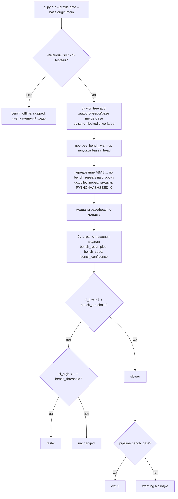
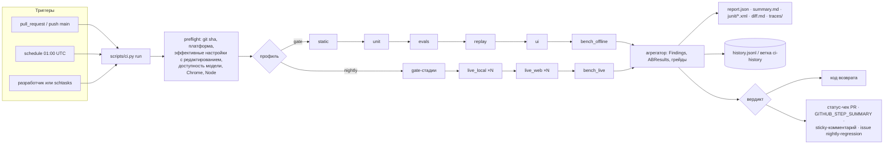

# Автономный пайплайн тестирования AutoBrowser: регрессии, бенчмарки, решение по Langfuse

Статус: Proposed (проект). Шаг 2 плана (usage) и часть шага 1 сделаны веткой провайдеров;
состояние на 2026-10-23 и порядок старта — §1.3. Шаг 0 и минимальный гейт сделаны 2026-10-27.
Дата: 2026-10-19
Ветка: `ref/new-gui-design`
ADR (Proposed):
- [2026-10-19 Автономный пайплайн тестирования](../decisions/2026-10-19-autonomous-test-pipeline.md)
- [2026-10-19 Langfuse не вводим; нейтральный OTLP-экспорт как отложенная опция](../decisions/2026-10-19-langfuse-observability.md)

Пользователь просит пайплайн, который запускается без человека и сам отвечает на два вопроса:
- «регрессия есть или нет»;
- «стало быстрее, медленнее или дороже».

Отдельно нужно решить, нужен ли Langfuse.

Документ определяет:
- уровни тестов, их роли и что гейтит merge, а что идёт по ночам;
- правила регрессии: golden-наборы, baseline v2, допуски, детерминизм, кассеты модельных
  ответов, обновление baseline как явное действие;
- методику бенчмарков: метрики, статистика, шумоподавление, история;
- единую точку входа `scripts/ci.py`, стадии, артефакты, коды возврата, CI-workflow;
- решение по Langfuse с обоснованием;
- настройки, модули, тесты, риски и план внедрения.

Терминальный UI из [дизайна TUI](2026-10-19-gui-redesign-design.md) (§6.4) встраивается в тот
же пайплайн отдельной стадией `ui`.

---

## 1. Контекст и проблема

### 1.1 Что есть сейчас

**Unit- и контрактные тесты.**
- 53 файла в `tests/`, полный `uv run pytest` идёт около 5 минут.
- Границы слоёв фиксируют `tests/test_engine_boundaries.py` и
  `tests/test_memory_boundaries.py`.
- Дрейф настроек ловит `tests/test_config.py:660-713`: `.env.example` и
  `config.example.yaml` обязаны воспроизводить дефолты кода.
- Маркеров pytest нет; `[tool.pytest.ini_options]` задаёт только `pythonpath`
  (`pyproject.toml:132-135`).

**Сценарные evals.**
- `src/agent_loop/evals.py`: `_FakeBrowserTools` (`:48`) проигрывает последовательность
  снимков, `FakeChatModel` (`:244`) — сценарные ответы модели.
- `run_scenario` (`:371`) собирает настоящий `BrowserHarness`, `EngineResources`,
  `PermissionEngine` с `BrowserResourceResolver` и гоняет `Agent.run(TaskRequest)`.
- 7 сценариев в `tests/evals/scenarios/*.yaml`.
- Baseline `tests/evals/baselines/agent_loop_v1.json` хранит 6 метрик на сценарий:
  `terminal_status`, `model_turn_count`, `tool_call_count`, `policy_block_count`,
  `repeated_action_count`, `trace_complete`.
- Сравнение — строгое равенство словарей: `tests/test_agent_loop_evals.py:22-35` и
  `scripts/run_evals.py:60`.
- `final_answer` в baseline не входит. `prompt_chars` (`evals.py:312`) считается, но не
  сравнивается.
- `--memory-seed` прогоняет сценарии второй раз с блоком `Memory`.

**Golden-набор.**
- `tests/golden/tasks.jsonl`: 5 многошаговых сценариев на живых сайтах (Ozon, GitHub,
  Википедия) с полем `expected`.
- `scripts/run_batch.py` и `src/agent_loop/batch.py` создают свежий `SessionRuntime` на
  сценарий и пишут `batch.json` и `run_index.jsonl` в `.autobrowser/batches/<id>/`.

**Телеметрия.**
- `src/agent_loop/events.py`: типизированные `EventRecord`.
- Синки: `JsonlEventSink` (`events.jsonl`) и `AgentTraceSink` (`agent_trace.jsonl`).
  Обе собирает `_build_session_event_sink` (`src/harness/session.py:300-308`).
- `redact_json_safe` редактирует ключи `token/secret/password/credential/api_key/authorization`
  и усекает строки до `events.max_string_chars`.
- `src/agent_loop/replay.py` даёт `summarize_trace` и `print_action_sequence`.
- `src/agent_loop/metrics.py` даёт `extract_event_metrics`, включая `duration_ms` по
  временным меткам.
- `src/agent_loop/export.py` и `scripts/export_sessions.py` выгружают строки задач.
- `TelemetryObserver` (`src/harness/telemetry.py`) только пишет в `logging`.

**Модель.**
- `ChatModel` и `ModelResponse(content, tool_calls, finish_reason)` — `src/llm.py:29-39`.
- Адаптер `src/providers/ollama.py`; по умолчанию `gemma4:31b-cloud`, `temperature=0.0`.
- Движок вызывает модель в трёх местах, каждое с парой `model.requested` → `model.responded`
  и полем `phase`:
  - `plan` — `src/agent_loop/execution/loop.py:1081-1083`;
  - `agent` — `:390-398`, через `ModelDriver.invoke`;
  - `approval` — `:750-765`.

**CI.** Каталога `.github/` нет, `.gitattributes` нет.

**История решений.** LangSmith удалён ADR
[2026-09-03](../decisions/2026-09-03-drop-langchain-stack-provider-neutral-model.md) с
формулировкой «no cloud tracing … diagnostics stay local».

### 1.2 Что не так

| # | Проблема | Где |
|---|---|---|
| P1 | Нет автономного прогона: никто не запускает тесты без человека, нет вердикта «есть/нет регрессии» в одном месте | нет `.github/`, нет единой точки входа |
| P2 | `run_batch.py` всегда возвращает 0; `expected` из golden-набора никто не проверяет | `scripts/run_batch.py:107`, `batch.py` хранит `expected` только в `run_index` |
| P3 | `run_evals.py` при провале утверждения падает трейсбеком (`assert_scenario_result` бросает `AssertionError`) вместо отчёта; при расхождении с baseline печатает результаты без диффа | `scripts/run_evals.py:33,60` |
| P4 | Baseline беден: нет `final_answer`, `error_count`, `approval_request_count`, `observation_count`, размера промпта, сигнатуры последовательности действий. Сценарий может изменить *какие* инструменты вызывает при тех же счётчиках — и пройдёт | `agent_loop_v1.json`, `EvalResult.metrics()` `evals.py:314` |
| P5 | `FakeChatModel` **циклически** повторяет ответы (`evals.py:270`): лишний вызов модели после изменения движка получит снова JSON плана, а не ошибку. Это маскирует дрейф | `src/agent_loop/evals.py:270` |
| P6 | `run_scenario` сводит любой статус, кроме `blocked`, к `goal.completed`. `cancelled` тоже становится `completed`. Это расходится с `goal_status_from_completion()` (`src/contracts.py:348`) и с недавним коммитом d035daf | `src/agent_loop/evals.py:436` |
| P7 | Нет данных о стоимости: `ModelResponse` не несёт usage, адаптер Ollama отбрасывает `prompt_eval_count`, `eval_count`, `total_duration`, `load_duration` | `src/llm.py:29-39`, `src/providers/ollama.py:158-180` |
| P8 | `seed` пробрасывается адаптером только из `params` (`ollama.py:110-115`), но никто его не передаёт и в `LLMSettings` его нет | `src/config.py:131-206` |
| P9 | Нет промежуточного уровня между «сценарий написан руками» и «живой сайт»: поведение реальной модели нельзя воспроизвести офлайн | — |
| P10 | `pywin32==311` — прямая зависимость без маркера платформы, а колёса у неё только Windows: `uv sync` на `ubuntu-latest` упадёт | `pyproject.toml:102`, `uv.lock:261` |
| P11 | Нет разделения тестов: живые, медленные, Windows-only и UI-тесты не помечены | `pyproject.toml:132` |
| P12 | Локальный `config.yaml` и `.env` (оба есть в корне) подмешиваются в любой процесс, читающий `get_settings()`. Тесты hooks/permissions/memory от этого защищены явными `*Settings(...)`, но эффективная конфигурация прогона нигде не фиксируется | `src/config.py:113-119`, корень репозитория |
| P13 | Нет истории результатов: нельзя сказать «стало медленнее», потому что не с чем сравнивать | — |

### 1.3 Состояние на 2026-10-23: готовность к CI, регрессиям, E2E и бенчмаркам

§1.1–1.2 описывают код на 2026-10-19. С тех пор ветка `feat/openai-compat-provider`
([дизайн](2026-10-22-openai-compat-provider-design.md),
[ADR](../decisions/2026-10-22-openai-compatible-chat-provider.md)) закрыла часть предпосылок.
Ниже — что изменилось и с чего начинать. Сам дизайн (§4) это не меняет.

**Вывод.** Начинать можно со всех четырёх направлений, но готовы они по-разному:

| Направление | Готовность | Что уже есть | Чего не хватает |
|---|---|---|---|
| CI (T0–T3) | можно сейчас | ~1590 тестов без сети за 1,5–3,5 мин (а не 5); evals против `agent_loop_v1.json` детерминированы и годятся как гейт | на 2026-10-27 шаг 0 и минимальный гейт на `windows-latest` сделаны (ниже); нет ветки `ubuntu-latest`, nightly и оркестратора `scripts/ci.py` (шаги 10, 13) |
| Регрессии (T2) | можно | baseline evals, golden-набор + `run_batch.py`, replay трейсов | шаги 3–5 (P3–P6), грейдеры (шаг 7), кассеты (шаги 8–9) |
| E2E | два уровня | детерминированный: настоящий движок и сессия поверх `tests/mcp_fixtures/fake_server.py` и фейковой модели; для живого — провайдер `openai_compat` | фикстурный сайт и живые стадии (шаг 11); ключ провайдера в секретах CI |
| Бенчмарки (T4, T7) | можно начинать, наименее готово | `usage` в `model.responded`, длительности Ollama, тайминги из пар событий (§4.5.1), `/model` и `--provider` для сравнения моделей | агрегация по задаче и прогону (шаг 6), цены (шаг 1), история (шаг 10), методика N повторов |

**Что из плана §7 уже сделано.**
- **Шаг 2 (usage) — в основном.** `ModelUsage`, `ModelResponse.usage`, usage и длительности
  Ollama, `usage` в `model.responded` фаз `plan` и `agent`. Отличия от эскиза §4.7:
  - `usage` лежит на верхнем уровне payload, а не в `metadata`;
  - проекции в `agent_trace` нет (`src/agent_loop/events.py` проецирует у `model.responded`
    только `node`);
  - `llm.seed` не добавлен (P8 открыт);
  - фаза `approval` (классификатор) и консолидация памяти `usage` в события не пишут.
- **Шаг 1 (настройки) — частично.** В `llm.*` появились `provider`, `timeout_seconds`,
  `max_retries`, `max_tokens_param`, `parallel_tool_calls`, `extra_headers`, `extra_body`,
  `error_preview_chars`, `temperature: null`. Нет `PipelineSettings`, `storage.ci_dir`,
  `llm.seed` и цен `llm.input_price_per_mtok`/`output_price_per_mtok`, без которых `cost`
  остаётся «неизвестно».
- **Шаги 3–15 не начаты.**
- **Шаг 0 — сделан 2026-10-27** (P10, P11 закрыты):
  - `pywin32==311 ; sys_platform == 'win32'`. В `uv.lock` у Linux-ветки нет пакетов без
    колеса или sdist. Живой `uv sync --locked` на Linux не проверялся.
  - Маркеры `live`, `bench`, `conpty`, `ui`, `--strict-markers` и
    `addopts = -m "not live and not bench"` заданы в `pyproject.toml`. `ui` вешает
    `tests/ui/conftest.py`, `conpty` — `tests/ui/test_windows_conpty.py`.
  - `.gitattributes` — строки из §5.1.
  - `syrupy` в группу `dev` не добавлен: снимки TUI сделаны без него, а группа `dev` с
    `pyte` и `pywinpty` уже есть.
- **Минимальный гейт (рекомендация 1) — сделан 2026-10-27.** `.github/workflows/gate.yml`
  запускается на `windows-latest`: `uv sync --locked`, `uv run pytest`, затем
  `scripts/run_evals.py` против `agent_loop_v1.json` без `tests/evals/memory_seed` и с ним.
  Ветку `ubuntu-latest` добавит шаг 13.

**Что устарело в §1.**
- P7 решена: адаптер Ollama отдаёт `prompt_eval_count`, `eval_count`, `total_duration` и
  `load_duration` как `ModelUsage`.
- «Модель»: провайдеров два (`ollama`, `openai_compat`), их выбирает
  `src/providers/registry.py`; ошибки провайдера приходят как нейтральная
  `ModelProviderError` с кодом и коротким текстом, что упрощает разбор падений в отчёте.
- Два нестабильных теста replay в `tests/test_ui_controller.py` (случайный id сессии
  совпадал с номером задачи) исправлены 2026-10-23.

**Рекомендации поверх плана §7.**
1. **Минимальный гейт раньше шага 13.** Сразу после шага 0 завести workflow: `uv sync --locked`,
   `uv run pytest`, `scripts/run_evals.py --baseline tests/evals/baselines/agent_loop_v1.json`
   на `windows-latest`. Оркестратор (шаг 10) потом заменит его, не меняя смысла гейта.
   Первые недели следить за повторными падениями: нестабильные тесты могут найтись ещё.
2. **E2E — два уровня, как T2c и T5/T6.** Детерминированный уровень (фейковые MCP и модель)
   идёт в каждый PR. Живой (Chrome, Node, Playwright MCP, реальная модель) — по ночам или
   вручную, в обязательный гейт PR не ставится. Для T5 провайдер `openai_compat` позволяет
   взять дешёвую облачную модель или локальный LM Studio/vLLM вместо платной.
3. **Бенчмарки — по методике §4.5,** а не разовыми замерами: фиксированный набор задач,
   N повторов, медианы и история. Одиночный прогон на недетерминированной модели ничего не
   показывает.
4. **Совместить первый живой прогон с проверкой провайдера.** Шаг 6 плана провайдера (живая
   проверка на OhMyLama с тремя семействами моделей, ADR → Accepted) ещё не сделан. Первый
   прогон T5/T7 на нескольких моделях закрывает и его.

Порядок: шаг 0 и минимальный гейт → регрессии (шаги 3–5, 7) → детерминированные E2E в
гейте, живые по ночам (шаги 8–11) → бенчмарки (шаги 1, 6, 10, затем T7).

---

## 2. Требования

### 2.1 Функциональные

- F1. Одна команда запускает выбранный профиль (`gate`, `nightly`) или набор стадий и
  завершается кодом возврата, однозначно кодирующим вердикт.
- F2. Отчёт отвечает на три вопроса одной строкой: регрессия да/нет; производительность
  быстрее/медленнее/без изменений/неизвестно; стоимость дешевле/дороже/без
  изменений/неизвестно.
- F3. Регрессии считаются против **закоммиченного** baseline по объявленным правилам
  (точно, верхняя граница, относительный допуск).
- F4. Обновление baseline, кассет и UI-снимков — только явная команда
  (`ci.py baseline update …`). Её результат попадает в PR как дифф. CI baseline не пишет.
- F5. Детерминированный уровень воспроизводит поведение **реальной** модели офлайн через
  записанные кассеты.
- F6. Бенчмарки сравниваются статистически: A/B на одной машине для PR, скользящая история
  для ночных прогонов. Есть подавление шума.
- F7. Живые прогоны (реальная модель, реальный браузер) запускаются по расписанию, повторяются
  N раз, оцениваются генерическими грейдерами и не блокируют merge.
- F8. UI-тесты TUI (снимки, pyte, ConPTY smoke) — отдельная стадия того же пайплайна.
- F9. Артефакты: JSON-отчёт со схемой версии, markdown-сводка, JUnit XML, дифф метрик,
  трассы упавших сценариев.
- F10. Уведомления без ручного участия: статус-чеки PR, сводка шага, issue для ночных
  деградаций.

### 2.2 Нефункциональные

- N1. Merge-gate герметичен: без сети, модели, Chrome и внешних сервисов. Целевое время
  ≤ 12 минут на ОС.
- N2. Работает одинаково на Windows (основная платформа) и Linux; запуск через `uv run`.
- N3. Ни одного правила по именам инструментов, сайтам или страницам в `src/`. Грейдеры
  читают только текст ответа.
- N4. Все пороги, повторы, таймауты и окна — поля `src/config.py` с дефолтами, границами и
  описанием, плюс `.env.example` и `config.example.yaml`.
- N5. Движок не меняет поведение. Единственная правка в `execution/` — аддитивная
  телеметрия usage в payload `model.responded`.
- N6. Секреты редактируются до записи событий, кассет и отчётов. Закоммиченные кассеты не
  содержат данных реальных страниц.
- N7. Пайплайн не требует ни облачного, ни self-hosted сервиса наблюдаемости.

### 2.3 Вне скоупа

- Нагрузочное тестирование MCP-серверов и Playwright.
- Мутационное тестирование и покрытие кода как гейт (покрытие можно добавить отчётом
  позже).
- Автоматический merge PR с обновлёнными baseline.
- Реализация OTLP-экспортёра: она отложена до триггера (см. §4.9 и ADR о Langfuse).
- Правки промптов: они остаются за пользователем.

---

## 3. Варианты

### 3.1 Оркестрация пайплайна

| Вариант | Плюсы | Минусы и риски |
|---|---|---|
| **A. Только pytest + маркеры + GitHub Actions YAML** | Нет нового кода; всё знакомо | Логика вердикта (A/B, история, «дороже») размазана по YAML и плагинам; локально не воспроизводится одной командой; на Windows и Linux разный shell |
| **B. `scripts/ci.py` — тонкий Python-оркестратор над pytest и in-process стадиями** | Одна команда локально и в CI; вердикт и коды возврата в тестируемом Python; YAML тривиален; stdlib, без новых зависимостей | Новый код и тесты к нему |
| **C. Внешний раннер (nox/tox/make/just)** | Готовые сессии | Новая зависимость; вердикт всё равно писать самим; `make` на Windows неудобен |

**Рекомендация: B.**
- Вердикт — это код, а не конфигурация CI, поэтому его надо тестировать как код.
- Pytest остаётся исполнителем тестов, `ci.py` только агрегирует результаты.

### 3.2 Детерминированные регрессии с поведением реальной модели

| Вариант | Плюсы | Минусы и риски |
|---|---|---|
| **A. Только рукописные сценарии (как сейчас)** | Просто, читаемо | Не ловят изменения, проявляющиеся только на реальных ответах модели и реальных снимках |
| **B. Кассеты: запись ответов модели и результатов инструментов в живом прогоне, строгое воспроизведение офлайн** | Реальное поведение модели детерминированно; ловит регрессии harness, наблюдения, контекста и нормализации; быстро | Кассеты устаревают при изменении промптов; приватность записанных страниц |
| **C. Вызов реальной модели в gate с `temperature=0` и `seed`** | Максимально реально | Сеть и секреты в PR; облачные модели не бит-детерминированы; медленно и платно |

**Рекомендация: A + B.**
- Рукописные сценарии остаются для краевых случаев: отказ, устаревший ref, deny.
- Кассеты закрывают «реальное» поведение.
- Устаревание кассеты определяется структурным дайджестом запроса и превращается в
  понятную находку `cassette_drift`, а не в загадочный провал (§4.4).
- C идёт в ночной уровень.

### 3.3 Бенчмарк в PR

| Вариант | Плюсы | Минусы и риски |
|---|---|---|
| **A. Абсолютные пороги (`turn ≤ X мс`)** | Просто | Общие раннеры GitHub шумят на ±20–30 %, ложные срабатывания |
| **B. Сравнение с историей main** | Видно тренды | Разные машины и экземпляры раннеров — шум того же порядка |
| **C. Парный A/B: base и head на одной машине, чередуя запуски, медиана + бутстрап-интервал отношения** | Шум машины вычитается; вердикт с доверительным интервалом | Нужна копия base (git worktree + `uv sync`), время ×2 |

**Рекомендация.**
- В PR — C для офлайн-метрик.
- Ночью — B для живых метрик, с MAD-порогом и гистерезисом.
- Детерминированные «прокси стоимости» (`request_chars`, байты на кадр TUI) сравниваются
  точно, без статистики: они не шумят.

### 3.4 Langfuse

Подробно — §4.9 и [ADR](../decisions/2026-10-19-langfuse-observability.md).

| Вариант | Итог |
|---|---|
| (а) Не нужен: пайплайн самодостаточен на `events.jsonl` + usage + локальной истории | **Принят для пайплайна** |
| (б) Langfuse-специфичный `EventSink` на SDK за флагом | Отвергнут: вендорный SDK с частой сменой мажорных версий, а OTLP покрывает Langfuse так же |
| (в) Нейтральный OTLP-экспорт (`EventSink` → spans GenAI semconv), Langfuse — один из бэкендов | **Принят как отложенная опция** с триггерами; выключен по умолчанию, вне движка |

---

## 4. Дизайн

### 4.1 Уровни тестов и их роли

| Уровень | Что проверяет | Средства | Детерминизм | Где |
|---|---|---|---|---|
| **T0 static** | Стиль, синтаксис, дрейф конфигурации | `uvx ruff check` (по `ruff.toml`), `tests/test_config.py` | полный | gate |
| **T1 unit/contract** | Контракты, границы слоёв, состояние, политика, хуки, разрешения, память | `uv run pytest -m "not live and not bench and not ui"` | полный | gate |
| **T2a scripted evals** | Краевые сценарии движка на рукописных ответах | `tests/evals/scenarios/*.yaml`, baseline v2 | полный | gate |
| **T2b cassette replay** | Поведение harness, наблюдения и контекста на реальных записанных ответах модели и инструментов | `tests/pipeline/cassettes/*.json`, `ReplayChatModel`, `CassetteToolSource` | полный | gate |
| **T2c MCP integration** | Реальный stdio MCP: аннотации, падения, таймауты | `tests/mcp_fixtures/fake_server.py` (уже в T1) | полный | gate |
| **T3 UI** | Снимки рендера, экран pyte, клавиши, resize, единственный писатель; ConPTY smoke на Windows | `tests/ui/` (дизайн TUI §6.4) | полный | gate |
| **T4 bench offline** | Накладные расходы движка на ход, время импорта CLI, время рендера блока, байты на кадр | A/B base↔head | статистический (кроме байтов) | gate, по умолчанию только отчёт |
| **T5 live local** | Реальная модель + реальный Playwright MCP + **локальный фикстурный сайт** | `tests/pipeline/sites/`, `tests/pipeline/live/*.yaml`, N повторов | статистический | nightly |
| **T6 live web** | Golden-набор на реальных сайтах | `tests/golden/tasks.jsonl` + грейдеры | статистический | nightly/weekly, только отчёт |
| **T7 bench live** | Латентность задачи, хода и инструмента, время до плана и первого действия, токены, стоимость | события T5/T6 + история | статистический | nightly |

**Merge гейтят** T0–T3 и детерминированная часть T4 (байты на кадр, `request_chars`).
Статистическая часть T4 гейтит только при `pipeline.bench_gate=true`; по умолчанию она пишет
предупреждение (открытый вопрос Q4).

**Ночью идут** все уровни, включая T5–T7, плюс evals с `--memory-seed`.

**Зачем T5.** Golden-набор (T6) зависит от Ozon и GitHub: антибот, гео, вёрстка меняется.
Падение там чаще говорит о сайте, чем об агенте. Фикстурный сайт — статический HTML в
`tests/pipeline/sites/`, раздаётся `http.server` на свободном порту. Он даёт реальную модель
и реальный браузер без шума веба. С него же записываются коммитимые кассеты: данные наши,
приватность не страдает.

### 4.2 Компоненты и слои

```text
src/llm.py                          + ModelUsage, ModelResponse.usage            (нейтральный лист)
src/providers/ollama.py             + usage из ответа Ollama, seed из настроек    (адаптер)
src/agent_loop/model.py             + usage в ModelTurn.metadata                   (драйвер модели)
src/agent_loop/execution/loop.py    + usage в payload model.responded (plan)       (только телеметрия)
src/agent_loop/evals.py             ~ статус через goal_status_from_completion, strict FakeChatModel,
                                      request_chars, collect_eval_metrics без исключений
src/agent_loop/comparison.py        новое: правила метрик, Baseline, Finding, compare()
src/agent_loop/benchmarks.py        новое: тайминги из событий, статистика, A/B, история
src/agent_loop/cassettes.py         новое: формат кассеты, ReplayChatModel, CassetteToolSource, run_cassette
src/agent_loop/graders.py           новое: генерические грейдеры текста ответа
src/harness/cassette_recorder.py    новое: RecordingChatModel, RecordingToolSource, CassetteRecorder
src/harness/session.py              ~ SessionConfig.cassette_path → обёртки при initialize()
src/config.py                       + PipelineSettings; storage.ci_subdir; llm.seed/цены
scripts/ci.py                       новое: точка входа
scripts/pipeline/                   новое: stages.py, report.py, history.py, ab.py, notify.py
scripts/run_batch.py                ~ --grade, --record-cassettes, код возврата
scripts/run_evals.py                ~ отчёт и дифф вместо трейсбека
tests/pipeline/                     новое: sites/, live/, cassettes/, hermetic.yaml
.github/workflows/gate.yml, nightly.yml
```

**Почему так разложено.**
- Чистая аналитика (`comparison`, `benchmarks`, `graders`, `cassettes`) живёт в
  `src/agent_loop/`. По `AGENTS.md` там лежат «replay/eval helpers, metrics, batch/export»;
  эти модули тестируются как обычный код и используются и `ci.py`, и pytest, и
  `run_evals.py`.
- Запись кассет — инфраструктура (обёртки над моделью и источником инструментов в
  сессии), поэтому она в `src/harness/`.
- Оркестрация (subprocess, git worktree, отчёты, уведомления) — dev-инструмент. Он в
  `scripts/`, а не в `src/`: при упаковке по ADR о команде `autobrowser` он не должен
  попасть в wheel.
- `autobrowser test` **не** вводится:
  - `tests/` и фикстуры не входят в пакет;
  - зарезервированные подкоманды CLI (`doctor`, `sessions`, `replay`, `completion`) — для
    пользователя, а не для разработчика.

### 4.3 Регрессия

#### 4.3.1 Baseline v2

Файл `tests/evals/baselines/agent_loop_v2.json`. Он добавляется рядом с v1; v1 удаляется
отдельным коммитом после принятия.

```json
{
  "schema_version": 2,
  "suite": "agent_loop",
  "scenarios": {
    "search_basic": {
      "terminal_status": "completed",
      "trace_complete": true,
      "final_answer": "Jacket A is the first visible result.",
      "model_turn_count": 5,
      "tool_call_count": 3,
      "policy_block_count": 0,
      "repeated_action_count": 0,
      "approval_request_count": 0,
      "error_count": 0,
      "observation_count": 3,
      "action_signature": "sha256:…",
      "request_chars": 18342
    }
  }
}
```

- `action_signature` — sha256 от последовательности `(tool, sorted(arg keys))` из
  `iter_action_sequence`. Значения аргументов не входят: они уже в сценарии, а ключи ловят
  смену схемы и нормализации.
- `request_chars` — символы всех сообщений **плюс** сериализованных `ToolDef`. Сейчас
  `prompt_chars` не учитывает схемы инструментов, а это заметная часть стоимости запроса.
- Для запусков с `--memory-seed` хранится отдельный блок `scenarios_with_memory`. Сейчас
  обе ветки сравниваются с одним и тем же baseline (`run_evals.py:63-66`). Исход должен
  совпадать, а `request_chars` по построению различается.

#### 4.3.2 Правила сравнения

Правило — словарь «метрика → вид сравнения». Это фиксированный словарь в коде
`comparison.py`: он описывает семантику метрики, а не тюнинг. Допуски берутся из
`PipelineSettings`.

| Метрика | Детерминированные стадии (T2/T3) | Живые стадии (T5/T6) |
|---|---|---|
| `terminal_status` | точно | доля прогонов с ожидаемым статусом ≥ `live_min_pass_rate` |
| `trace_complete` | точно `true` | точно `true` в каждом прогоне |
| `final_answer` | точно (после нормализации пробелов) | грейдеры (§4.3.4) |
| `model_turn_count`, `tool_call_count` | точно | медиана ≤ baseline + `live_count_slack` |
| `policy_block_count`, `error_count`, `approval_request_count` | точно | медиана ≤ baseline + `live_count_slack` |
| `repeated_action_count` | точно | медиана ≤ baseline |
| `observation_count` | точно | только отчёт |
| `action_signature` | точно | только отчёт (`changed`) |
| `request_chars` | рост > `request_chars_tolerance` → регрессия «дороже»; падение > допуска → `improvement` | — |
| `input_tokens`, `output_tokens`, `cost` | — | история (§4.5.4) |

**Направление изменения.** В детерминированных стадиях любое отличие счётчиков — находка
`changed`, и стадия падает:
- baseline обязан отражать текущее поведение;
- в отчёте помечено направление («меньше вызовов — вероятно лучше»), чтобы ревьюер решил,
  обновлять ли baseline.

`request_chars` — исключение: это непрерывная величина с допуском.

**Целостность набора.**
- Сценарий без строки в baseline — `missing_baseline`, падение.
- Строка без сценария — `orphan_baseline`, падение.
- Так нельзя молча удалить сценарий.

#### 4.3.3 Детерминизм

| Источник недетерминизма | Мера |
|---|---|
| Ответы модели | `FakeChatModel(strict=True)` для новых сценариев и кассет: исчерпание ответов — ошибка `IndexError` → находка `script_exhausted`. Старые 7 сценариев переводятся на `strict` отдельным коммитом после проверки, что baseline не меняется (P5) |
| `uuid4` в `event_id`, `session_id`, `task_id` | В сравнение не входят; сравниваются только производные метрики |
| Временные метки | `duration_ms` исключён из детерминированных метрик |
| Порядок словарей и множеств | `PYTHONHASHSEED=0` в окружении стадий; сигнатуры строятся по отсортированным ключам |
| Локальный `config.yaml` и `.env` | Стадии T1–T4 запускаются с `AUTOBROWSER_CONFIG_FILE=tests/pipeline/hermetic.yaml` (закоммиченный пустой профиль) и очищенным окружением: все `AUTOBROWSER_*`, кроме явно переданных, удаляются. Отчёт записывает `non_default_settings` с редактированием секретов (P12). Корневой `.env` по-прежнему читается pydantic из cwd до внедрения `AUTOBROWSER_HOME`. Поэтому preflight-проверка помечает его присутствие как предупреждение; в CI его нет |
| Живая модель | `llm.temperature=0.0` (уже дефолт), новый `llm.seed`. Облачные модели при этом не бит-детерминированы, поэтому живые стадии статистические (N повторов) |

#### 4.3.4 Грейдеры golden-набора

`src/agent_loop/graders.py`, только текст финального ответа последней задачи сценария, без
знания сайтов.

| Ключ `expected` | Проверка |
|---|---|
| `contains: str \| list[str]` | все подстроки есть (casefold) |
| `not_contains: list[str]` | ни одной |
| `regex: str \| list[str]` | все совпадают |
| `min_items` / `max_items` / `items` | число элементов списка или строк тела markdown-таблицы (текстовый формат: маркеры `-`, `*`, `1.`, строки `\|…\|` без разделителя) |
| `numbers_at_most` / `numbers_at_least` | все числа ответа (с учётом пробелов-разделителей тысяч) в границах |
| неизвестный ключ | `ungraded` с предупреждением; провалом не считается |

Нынешние `expected` используют ключи `count`, `fields`, `max_price`. Их нужно переписать в
этот словарь:
- `count` → `items`;
- `max_price` → `numbers_at_most`;
- `fields` из ответа на русском детерминированно не проверить.

Опционально `pipeline.judge="model"` включает LLM-оценщика с рубрикой для ключей без
детерминированного грейдера. По умолчанию `off`, открытый вопрос Q7.

#### 4.3.5 Обновление baseline — явное действие

```text
uv run scripts/ci.py baseline show   --suite evals|replay|ui
uv run scripts/ci.py baseline update --suite evals|replay|ui [--scenario NAME]
```

- `update` перезаписывает только детерминированные baseline. Для UI это syrupy
  `--snapshot-update`.
- Команда печатает дифф и отказывается работать на грязном дереве в затронутых файлах.
- CI никогда не вызывает `update`.
- Если PR меняет файлы baseline, сводка gate показывает блок «Baseline changed» с
  диффом метрик. Ревьюер видит, что эталон сдвинут намеренно.

### 4.4 Кассеты: запись и воспроизведение

**Запись.**
- `SessionConfig.cassette_path: Path | None = None` — аддитивное поле.
- Если оно задано, `SessionContext.initialize` (`src/harness/session.py:461`, `:501`)
  оборачивает:
  - `self.llm` в `RecordingChatModel`;
  - `mcp.tool_source` в `RecordingToolSource`.
- Движок про запись не знает.
- Источники записи:
  - `run_batch.py --record-cassettes DIR`;
  - стадия `live_local` с `--record`.

**Воспроизведение.**
- `run_cassette()` собирает агент так же, как `run_scenario`, но с `ReplayChatModel` и
  `CassetteToolSource`.
- Ответы модели отдаются строго по порядку.
- Вызов инструмента сопоставляется со следующей неиспользованной записью с тем же
  `(name, canonical_args)`.

```mermaid
sequenceDiagram
    autonumber
    participant Live as live_local / run_batch
    participant Sess as SessionContext.initialize
    participant RecM as RecordingChatModel
    participant RecT as RecordingToolSource
    participant Eng as AgentLoopEngine
    participant Cas as cassette.json
    Live->>Sess: SessionConfig(cassette_path)
    Sess->>RecM: wrap(llm)
    Sess->>RecT: wrap(mcp.tool_source)
    Eng->>RecM: complete(messages, tools)
    RecM->>RecM: inner.complete → response
    RecM->>Cas: model_call{structure_digest, content_digest, response, usage}
    Eng->>RecT: tool.invoke(args)
    RecT->>Cas: tool_call{name, server, args, status, content}
    Note over Cas: при закрытии: редактирование секретов, каталог инструментов<br/>(name, server, schema, annotations), исход и метрики
    participant Rep as run_cassette (gate)
    participant RM as ReplayChatModel
    participant RT as CassetteToolSource
    Rep->>Cas: load
    Rep->>Eng: Agent(resources с RM/RT).run(TaskRequest)
    Eng->>RM: complete(messages, tools)
    RM->>RM: structure_digest совпал? иначе Finding(cassette_drift)
    RM-->>Eng: записанный ответ (исчерпание → script_exhausted)
    Eng->>RT: invoke(name, args)
    RT-->>Eng: записанный результат или error «unrecorded call» → Finding(cassette_miss)
    Rep->>Rep: метрики → compare(baseline cassettes_v1.json)
```

**Дайджесты.**
- `structure_digest` = sha256 от:
  - последовательности ролей сообщений;
  - отсортированного списка имён предложенных инструментов;
  - флага «есть ли tools».

  Он меняется, когда меняется *форма* разговора: лишний вызов модели, другой набор
  инструментов. Это и есть сигнал регрессии или устаревания кассеты: стадия падает с
  подсказкой `ci.py cassette record <name>`.
- `content_digest` — sha256 полного текста. Его расхождение (например, правка промпта
  пользователем) — информационная находка `prompt_changed`, не провал. Иначе каждая правка
  промпта ломала бы все кассеты.

**Сохранение семантики инструментов.**
- Наблюдение хранит снимки по `server` и `readOnlyHint`
  (`src/agent_loop/execution/observation.py:198-200`). Нейтральный `Tool`
  (`src/contracts.py:87-118`) поля `server` не имеет, у `MCPTool` оно есть.
- Поэтому `CassetteToolSource` отдаёт `ReplayTool` с полями `name`, `server`,
  `description`, `input_schema`, `annotations` и `invoke`.
- Контрактный тест сверяет, что наблюдение обрабатывает `ReplayTool` так же, как `MCPTool`.

**Секреты.**
- Рекордер применяет `redact_json_safe` к аргументам **и** к аргументам `tool_calls` в
  записанных ответах модели одинаково. Тогда воспроизведение остаётся согласованным:
  модель «выдаёт» `[REDACTED]`, инструмент сопоставляется по `[REDACTED]`.
- Тексты результатов усекаются до `events.max_string_chars`, как в событиях.

**Приватность.**
- Коммитятся только кассеты T5 (фикстурный сайт), в `tests/pipeline/cassettes/`.
- Кассеты T6 (реальный веб) пишутся в `.autobrowser/ci/cassettes/` (git-ignored) и
  годятся только для локальной отладки.

### 4.5 Benchmark

#### 4.5.1 Что меряем

| Метрика | Уровень | Источник | Шум |
|---|---|---|---|
| `engine_turn_overhead_ms` — время `Agent.run` / число ходов на фейковой модели с нулевой задержкой | T4 | `run_scenario` | средний → A/B |
| `cli_import_ms` — холодный импорт точки входа (`python -X importtime`) | T4 | subprocess | средний → A/B |
| `render_block_us` по видам блоков, 80 колонок | T4 (UI) | `tests/ui` bench | средний → A/B |
| `bytes_per_frame`, `frames_per_task` живой зоны на записанной ленте событий | T4 (UI) | pyte-стенд | **нет** → точно ± допуск |
| `request_chars` | T2 | evals/кассеты | **нет** → правило §4.3.2 |
| `task_latency_ms` (`goal.started` → терминал) | T5/T6 | события | высокий → история |
| `time_to_plan_ms` (`goal.started` → `model.responded{phase:plan}`) — «время до первого события», которое видит пользователь | T5/T6 | события | высокий → история |
| `time_to_first_tool_ms` (`goal.started` → первый `tool.started`) | T5/T6 | события | высокий → история |
| `model_latency_ms` по фазам `plan/agent/approval` (пары `requested→responded`) | T5/T6 | события | высокий; много выборок → p50/p95 |
| `tool_latency_ms` (`tool.started→tool.finished`) | T5/T6 | события | средний |
| `model_calls`, `input_tokens`, `output_tokens`, `cached_input_tokens` | T5/T6 | `usage` в `model.responded` (новое) | низкий для вызовов, средний для токенов |
| `load_ms` — холодная загрузка модели (`load_duration`) | T5/T6 | `usage` | отделяется от тёплых вызовов |
| `cost` = токены × `llm.input_price_per_mtok` / `output_price_per_mtok` | T5/T6 | вычисляется | при нулевых ценах «неизвестно», отчёт только в токенах |
| `pytest_durations` — длительность файлов тестов | T1 | `--junitxml` | только тренд |

Все живые тайминги выводятся из существующих событий: пары `model.requested/responded` и
`tool.started/finished` с временными метками уже есть. Новое в движке только одно —
`usage`.

#### 4.5.2 Статистика A/B (PR, T4)



- Отношение медиан устойчивее среднего к выбросам планировщика ОС.
- Бутстрап с фиксированным `bench_seed` даёт воспроизводимый интервал.
- Вердикт «быстрее/медленнее» выносится только тогда, когда **весь** интервал вышел за
  порог. Так шум не превращается в вердикт.

#### 4.5.3 Шумоподавление

- Прогрев (`bench_warmup`), чередование base/head, `gc.collect()` перед замером.
- Бенч-стадия идёт последней и одна: без параллельных pytest.
- `PYTHONHASHSEED=0`, `PYTHONUTF8=1`. Окружение одинаково для base и head.
- Холодная загрузка модели (`load_ms > 0`) выделяется отдельно и не входит в `model_latency_ms`.
- p95 считается только при числе выборок ≥ `bench_p95_min_samples`, иначе в отчёте
  «n/a». На N=3 повторах задачи p95 бессмыслен; на десятках вызовов модели за ночь — нет.

#### 4.5.4 История и вердикт по живым метрикам (nightly, T7)

- Каждая ночь добавляет строки в `history.jsonl`:
  `{run_id, ts, sha, branch, profile, os, runner, suite, scenario, metric, stat, value, unit, n}`.
- Деградация метрики сценария фиксируется, если выполнены все три условия:
  1. медиана текущей ночи выше медианы последних `history_window` прогонов больше чем на
     `bench_threshold`;
  2. робастный z-score `(x − median) / (1.4826·MAD)` > `history_mad_z`;
  3. условия 1–2 держатся `history_consecutive` ночей подряд (гистерезис).
- Улучшение — симметрично.
- При истории короче `history_window` вердикт «unknown».

**Хранение истории.**
- Локально: `.autobrowser/ci/history.jsonl` (`storage.ci_dir`).
- В CI: ночной workflow дописывает `history/<os>.jsonl` в orphan-ветку `ci-history` через
  `GITHUB_TOKEN`; PR-сборка читает её только для контекста трендов.
- Ротация по `history_max_rows`.
- Альтернатива — `benchmark-action/github-action-benchmark` с gh-pages. Она даёт графики,
  но тянет внешнюю action и формат; это открытый вопрос Q5.

### 4.6 Пайплайн: точка входа, стадии, артефакты, коды возврата

#### 4.6.1 Команды

```text
uv run scripts/ci.py run --profile gate|nightly           # профиль из pipeline.*_stages
uv run scripts/ci.py run --stages unit,evals,replay       # явный набор
    [--base REF] [--report-dir DIR] [--require live_local] [--record] [--notify none|issue]
uv run scripts/ci.py baseline show|update --suite evals|replay|ui [--scenario NAME]
uv run scripts/ci.py cassette record <live-scenario> | list | prune
uv run scripts/ci.py report <run_dir>                     # перерисовать summary.md из report.json
uv run scripts/ci.py history [--metric M] [--scenario S]  # тренд в консоль
```

#### 4.6.2 Поток



#### 4.6.3 Стадии

| Стадия | Действие | Доступность (иначе `skipped`) |
|---|---|---|
| `static` | `uvx ruff check`; гейтит при `pipeline.lint_gate` | `uvx` в PATH |
| `unit` | `uv run pytest -m "not live and not bench" --ignore=tests/ui --junitxml=… --durations=30` | всегда |
| `evals` | `collect_eval_metrics` без и с `tests/evals/memory_seed` → `compare(v2)` | всегда |
| `replay` | `run_cassette` для `tests/pipeline/cassettes/*.json` → `compare(cassettes_v1.json)` | есть кассеты |
| `ui` | `pytest tests/ui -m "not conpty"`; на Windows дополнительно `-m conpty` | есть `tests/ui` с тестами |
| `bench_offline` | A/B (§4.5.2) или, без `--base`, только снимок в историю | изменён код или явно запрошено |
| `live_local` | фикстурный сайт + `build_session` (реальные модель и MCP) × `live_repeats`; события → метрики, грейды, тайминги | модель отвечает, Chrome и Node найдены |
| `live_web` | `run_batch` по golden + грейды × `live_repeats` | то же + сеть |
| `bench_live` | тайминги и токены из событий `live_*` → история → вердикт | были `live_*` |

- Стадия `skipped` по недоступности не провал. Исключение — стадия в `--require`: тогда код 4.
- Таймаут каждой стадии — `pipeline.stage_timeout_seconds`; таймаут задачи в живых
  стадиях — `pipeline.live_task_timeout_seconds`.

#### 4.6.4 Артефакты

Каталог `<report-dir>` (по умолчанию `storage.ci_dir/<run_id>/`):

```text
report.json          # PipelineReport, schema_version=1
summary.md           # первая строка — вердикт; таблица стадий; находки; A/B; baseline changed
diff.md              # дифф метрик против baseline и предыдущего прогона
junit/unit.xml, junit/ui.xml
traces/<suite>/<scenario>.events.jsonl   # только упавшие или изменившиеся сценарии
bench.json           # сырые выборки A/B и живых метрик
```

Первая строка `summary.md`:

```text
Регрессий нет · Скорость: без изменений (×1.02, 95% ДИ 0.97–1.06) · Стоимость: +3.1% request_chars (в допуске 10%)
```

#### 4.6.5 Коды возврата

| Код | Значение | Приоритет |
|---|---|---|
| 0 | регрессий и гейтящих деградаций нет | — |
| 1 | функциональная регрессия: тесты упали, расхождение с baseline, `cassette_drift`, грейды ниже порога в гейтящей стадии | 2 |
| 2 | ошибка пайплайна: аргументы, исключение оркестратора, повреждённый baseline | 1 (высший) |
| 3 | гейтящая деградация производительности или стоимости | 3 |
| 4 | стадия из `--require` не смогла запуститься (нет модели, браузера, сети) | 4 |

Итоговый код — самый приоритетный из встретившихся. Живые стадии в nightly по умолчанию не
гейтящие: их провал даёт issue, но код 0. Исключение — их явное перечисление в `--require`.

#### 4.6.6 CI-workflow

`.github/workflows/gate.yml` (эскиз):

```yaml
name: gate
on:
  pull_request:
  push: { branches: [main] }
concurrency: { group: gate-${{ github.ref }}, cancel-in-progress: true }
jobs:
  gate:
    strategy: { fail-fast: false, matrix: { os: [windows-latest, ubuntu-latest] } }
    runs-on: ${{ matrix.os }}
    timeout-minutes: 30
    env: { PYTHONUTF8: "1", PYTHONHASHSEED: "0" }
    steps:
      - uses: actions/checkout@v4
        with: { fetch-depth: 0 }            # merge-base для A/B
      - uses: astral-sh/setup-uv@v6
        with: { enable-cache: true }
      - run: uv sync --locked
      - run: uv run scripts/ci.py run --profile gate --base origin/${{ github.base_ref || 'main' }} --report-dir ci-out
      - if: always()
        shell: bash
        run: cat ci-out/summary.md >> "$GITHUB_STEP_SUMMARY"
      - if: always()
        uses: actions/upload-artifact@v4
        with: { name: ci-${{ matrix.os }}, path: ci-out }
```

`.github/workflows/nightly.yml`:
- `schedule: cron "0 1 * * *"` + `workflow_dispatch`.
- `runs-on: [self-hosted, windows, autobrowser]` (рекомендация; альтернатива —
  `windows-latest`).
- Секреты GitHub отображаются в переменные окружения:
  - `AUTOBROWSER_LLM__API_KEY`, `AUTOBROWSER_LLM__HOST`;
  - `AUTOBROWSER_BROWSER__CHROME_PATH`;
  - `AUTOBROWSER_BROWSER__USER_DATA_DIR` — отдельный CI-профиль, не профиль пользователя.
- Команда: `ci.py run --profile nightly --notify issue`.
- После прогона — push истории в `ci-history`.

Почему self-hosted для nightly:
- нужен Chrome, Node и Playwright MCP;
- нужен ключ облачной модели;
- реальные сайты часто блокируют IP общих раннеров;
- машина пользователя уже настроена.

Без GitHub локальный эквивалент — планировщик Windows:

```text
schtasks /Create /SC DAILY /ST 03:00 /TN AutoBrowserNightly ^
  /TR "cmd /c cd /d C:\WebApps\AutoBrowser && uv run scripts/ci.py run --profile nightly --notify issue"
```

**Уведомления.**
- PR: статус-чеки `gate (windows-latest)` и `gate (ubuntu-latest)` как required в защите
  ветки, сводка шага, опциональный sticky-комментарий через `gh pr comment --edit-last`.
- Nightly: `scripts/pipeline/notify.py` через `gh` открывает или обновляет одну issue с
  меткой `nightly-regression` и закрывает её первым зелёным прогоном.
- Сбой расписания GitHub сам шлёт письмо автору cron.
- Внешних сервисов нет.

### 4.7 Контракты (эскизы)

```python
# src/llm.py  (нейтральный лист)
@dataclass(frozen=True)
class ModelUsage:
    input_tokens: int | None = None
    output_tokens: int | None = None
    cached_input_tokens: int | None = None
    provider_duration_ms: int | None = None   # total_duration провайдера
    load_duration_ms: int | None = None       # холодная загрузка модели

    def to_json_dict(self) -> dict[str, int]: ...   # только заданные поля

@dataclass(frozen=True)
class ModelResponse:
    content: str = ""
    tool_calls: tuple[ToolCall, ...] = ()
    finish_reason: str | None = None
    usage: ModelUsage | None = None             # аддитивно; None — провайдер не сообщил
```

```python
# src/agent_loop/comparison.py
MetricKind = Literal["exact", "upper_bound", "ratio", "report"]
FindingKind = Literal[
    "regression", "improvement", "changed", "cassette_drift", "cassette_miss",
    "script_exhausted", "prompt_changed", "missing_baseline", "orphan_baseline", "ungraded",
]

@dataclass(frozen=True)
class MetricRule:
    metric: str
    kind: MetricKind
    tolerance: float = 0.0      # из PipelineSettings
    slack: int = 0

@dataclass(frozen=True)
class Finding:
    kind: FindingKind
    suite: str
    scenario: str
    metric: str = ""
    baseline: object | None = None
    actual: object | None = None
    message: str = ""

@dataclass(frozen=True)
class Baseline:
    schema_version: int
    suite: str
    scenarios: Mapping[str, Mapping[str, object]]

@dataclass(frozen=True)
class ComparisonReport:
    suite: str
    findings: tuple[Finding, ...]
    @property
    def failed(self) -> bool: ...   # regression | changed | drift | miss | missing | orphan

def load_baseline(path: Path) -> Baseline: ...
def deterministic_rules(settings: PipelineSettings) -> tuple[MetricRule, ...]: ...
def live_rules(settings: PipelineSettings) -> tuple[MetricRule, ...]: ...
def compare(results: Mapping[str, Mapping[str, object]], baseline: Baseline,
            rules: Sequence[MetricRule]) -> ComparisonReport: ...
```

```python
# src/agent_loop/benchmarks.py
@dataclass(frozen=True)
class TaskTimings:
    task_latency_ms: int | None
    time_to_plan_ms: int | None
    time_to_first_tool_ms: int | None
    model_latency_ms: Mapping[str, tuple[int, ...]]   # phase -> выборки (тёплые)
    model_load_ms: tuple[int, ...]
    tool_latency_ms: tuple[int, ...]
    model_calls: int
    input_tokens: int | None
    output_tokens: int | None

def extract_task_timings(events: Iterable[EventRecord | Mapping[str, Any]]) -> TaskTimings: ...

@dataclass(frozen=True)
class SampleStats:
    n: int
    median: float
    p25: float
    p75: float
    p95: float | None       # None при n < bench_p95_min_samples
    mad: float

PerfVerdict = Literal["faster", "slower", "unchanged", "unknown"]

@dataclass(frozen=True)
class ABResult:
    metric: str
    base: SampleStats
    head: SampleStats
    ratio: float
    ci_low: float
    ci_high: float
    verdict: PerfVerdict

def describe(samples: Sequence[float], *, p95_min_samples: int) -> SampleStats: ...
def compare_ab(metric: str, base: Sequence[float], head: Sequence[float], *,
               settings: PipelineSettings) -> ABResult: ...
def compare_history(current: SampleStats, history: Sequence[float], *,
                    settings: PipelineSettings) -> PerfVerdict: ...
```

```python
# src/agent_loop/cassettes.py  (без имён инструментов; импортирует src.browser так же, как evals.py)
@dataclass(frozen=True)
class CassetteTool:
    name: str
    server: str
    description: str
    input_schema: Mapping[str, Any]
    annotations: Mapping[str, Any] | None

@dataclass(frozen=True)
class CassetteModelCall:
    index: int
    structure_digest: str
    content_digest: str
    response: ModelResponse

@dataclass(frozen=True)
class CassetteToolCall:
    index: int
    name: str
    args: Mapping[str, Any]
    status: str
    content: str
    error: str = ""

@dataclass(frozen=True)
class Cassette:
    schema_version: int
    name: str
    task: str
    recorded: Mapping[str, str]        # model, git_sha, recorded_at, settings_digest
    browser_server: bool               # подключать ли browser_agent_rules_resource
    permissions: PermissionsSettings
    tools: tuple[CassetteTool, ...]
    model_calls: tuple[CassetteModelCall, ...]
    tool_calls: tuple[CassetteToolCall, ...]

class ReplayChatModel:                 # реализует ChatModel
    def __init__(self, cassette: Cassette) -> None: ...
    async def complete(self, messages, *, tools=(), **params) -> ModelResponse: ...
    @property
    def findings(self) -> tuple[Finding, ...]: ...

@dataclass(frozen=True)
class ReplayTool:                      # та же поверхность, что читает наблюдение у MCPTool
    name: str
    server: str
    description: str
    input_schema: dict[str, Any]
    annotations: dict[str, Any] | None
    async def invoke(self, args: Mapping[str, Any] | None = None) -> str: ...

class CassetteToolSource:              # MCPToolClient
    def __init__(self, cassette: Cassette) -> None: ...
    async def get_tools(self) -> list[ReplayTool]: ...
    @property
    def findings(self) -> tuple[Finding, ...]: ...

def load_cassette(path: Path) -> Cassette: ...
async def run_cassette(cassette: Cassette) -> tuple[EvalResult, tuple[Finding, ...]]: ...
```

```python
# src/harness/cassette_recorder.py
class CassetteRecorder:
    def __init__(self, path: Path, *, task_label: str, settings: EventSettings) -> None: ...
    def record_model_call(self, messages: Sequence[Message], tools: Sequence[ToolDef],
                          response: ModelResponse) -> None: ...
    def record_tool_call(self, tool: Any, args: Mapping[str, Any], result: Any,
                         error: BaseException | None) -> None: ...
    def save(self, *, outcome: Mapping[str, object]) -> Path: ...   # редактирование здесь

class RecordingChatModel:              # ChatModel-декоратор
    def __init__(self, inner: ChatModel, recorder: CassetteRecorder) -> None: ...

class RecordingToolSource:             # LiveToolSource-декоратор, сохраняет version/server/annotations
    def __init__(self, inner: ToolSource, recorder: CassetteRecorder) -> None: ...
```

```python
# src/agent_loop/graders.py
GradeStatus = Literal["pass", "fail", "ungraded"]

@dataclass(frozen=True)
class CheckResult:
    key: str
    status: GradeStatus
    detail: str = ""

@dataclass(frozen=True)
class GradeResult:
    status: GradeStatus        # fail, если есть хоть один fail; ungraded, если нет ни одной проверки
    checks: tuple[CheckResult, ...]

def grade_answer(answer: str, expected: Mapping[str, Any] | None) -> GradeResult: ...
```

```python
# scripts/pipeline/report.py
StageStatus = Literal["passed", "failed", "degraded", "skipped", "error"]
CostVerdict = Literal["cheaper", "pricier", "unchanged", "unknown"]

@dataclass(frozen=True)
class StageResult:
    name: PipelineStage
    status: StageStatus
    duration_ms: int
    findings: tuple[Finding, ...] = ()
    perf: tuple[ABResult, ...] = ()
    grades: Mapping[str, GradeResult] = field(default_factory=dict)
    artifacts: tuple[str, ...] = ()
    note: str = ""

@dataclass(frozen=True)
class Verdict:
    regression: bool
    performance: PerfVerdict
    cost: CostVerdict
    exit_code: int

@dataclass(frozen=True)
class PipelineReport:
    schema_version: int
    run_id: str
    profile: str
    git: Mapping[str, str]                 # sha, branch, base
    platform: Mapping[str, str]            # os, python, runner
    non_default_settings: Mapping[str, object]   # редактировано
    stages: tuple[StageResult, ...]
    verdict: Verdict
    started_at: str
    finished_at: str

# scripts/pipeline/stages.py
class Stage(Protocol):
    name: PipelineStage
    def unavailable_reason(self, ctx: PipelineContext) -> str | None: ...
    async def run(self, ctx: PipelineContext) -> StageResult: ...

@dataclass(frozen=True)
class PipelineContext:
    repo_root: Path
    run_dir: Path
    pipeline: PipelineSettings
    storage: StorageSettings
    base_ref: str | None
    record: bool
    child_env: Mapping[str, str]           # очищенное окружение для subprocess
```

Подпроцессы запускаются через инъецируемый `CommandRunner` (Protocol). Тесты оркестратора
подменяют его и не запускают pytest рекурсивно.

### 4.8 Настройки

**Новая секция `pipeline`** (`PipelineSettings`, `src/config.py`). Её читает только
`scripts/ci.py` и чистые модули через инъекцию; рантайм агента её не читает.

```python
PipelineStage = Literal["static", "unit", "evals", "replay", "ui", "bench_offline",
                        "live_local", "live_web", "bench_live"]
```

| Поле | Тип | Дефолт | Границы | Env | Описание |
|---|---|---|---|---|---|
| `gate_stages` | `tuple[PipelineStage, ...]` | `("static","unit","evals","replay","ui","bench_offline")` | непусто | `AUTOBROWSER_PIPELINE__GATE_STAGES` (JSON-список) | стадии профиля `gate` |
| `nightly_stages` | `tuple[PipelineStage, ...]` | gate + `("live_local","live_web","bench_live")` | непусто | `AUTOBROWSER_PIPELINE__NIGHTLY_STAGES` | стадии профиля `nightly` |
| `lint_gate` | `bool` | `False` | — | `AUTOBROWSER_PIPELINE__LINT_GATE` | провал `static` гейтит |
| `stage_timeout_seconds` | `int` | `1800` | 60–14400 | `AUTOBROWSER_PIPELINE__STAGE_TIMEOUT_SECONDS` | таймаут одной стадии |
| `live_task_timeout_seconds` | `int` | `600` | 30–7200 | `AUTOBROWSER_PIPELINE__LIVE_TASK_TIMEOUT_SECONDS` | таймаут живой задачи |
| `live_repeats` | `int` | `3` | 1–20 | `AUTOBROWSER_PIPELINE__LIVE_REPEATS` | повторы живого сценария |
| `live_min_pass_rate` | `float` | `0.67` | 0.0–1.0 | `AUTOBROWSER_PIPELINE__LIVE_MIN_PASS_RATE` | минимальная доля успешных повторов |
| `live_count_slack` | `int` | `2` | 0–50 | `AUTOBROWSER_PIPELINE__LIVE_COUNT_SLACK` | допуск счётчиков в живых стадиях |
| `request_chars_tolerance` | `float` | `0.10` | 0.0–10.0 | `AUTOBROWSER_PIPELINE__REQUEST_CHARS_TOLERANCE` | допустимый относительный рост `request_chars` |
| `ui_bytes_tolerance` | `float` | `0.05` | 0.0–10.0 | `AUTOBROWSER_PIPELINE__UI_BYTES_TOLERANCE` | допустимый рост `bytes_per_frame` |
| `bench_gate` | `bool` | `False` | — | `AUTOBROWSER_PIPELINE__BENCH_GATE` | статистическая деградация T4 даёт код 3 |
| `bench_repeats` | `int` | `15` | 3–500 | `AUTOBROWSER_PIPELINE__BENCH_REPEATS` | замеров на сторону A/B |
| `bench_warmup` | `int` | `2` | 0–50 | `AUTOBROWSER_PIPELINE__BENCH_WARMUP` | прогревочных запусков |
| `bench_threshold` | `float` | `0.15` | 0.01–5.0 | `AUTOBROWSER_PIPELINE__BENCH_THRESHOLD` | значимое относительное изменение |
| `bench_confidence` | `float` | `0.95` | 0.5–0.999 | `AUTOBROWSER_PIPELINE__BENCH_CONFIDENCE` | уровень бутстрап-интервала |
| `bench_resamples` | `int` | `2000` | 100–100000 | `AUTOBROWSER_PIPELINE__BENCH_RESAMPLES` | бутстрап-выборок |
| `bench_seed` | `int` | `0` | ≥ 0 | `AUTOBROWSER_PIPELINE__BENCH_SEED` | seed бутстрапа (воспроизводимость) |
| `bench_p95_min_samples` | `int` | `20` | 5–10000 | `AUTOBROWSER_PIPELINE__BENCH_P95_MIN_SAMPLES` | минимум выборок для p95 |
| `history_window` | `int` | `7` | 2–365 | `AUTOBROWSER_PIPELINE__HISTORY_WINDOW` | прогонов в скользящем окне |
| `history_mad_z` | `float` | `3.0` | 0.5–20.0 | `AUTOBROWSER_PIPELINE__HISTORY_MAD_Z` | порог робастного z-score |
| `history_consecutive` | `int` | `2` | 1–30 | `AUTOBROWSER_PIPELINE__HISTORY_CONSECUTIVE` | ночей подряд для вердикта |
| `history_max_rows` | `int` | `50000` | 100–10000000 | `AUTOBROWSER_PIPELINE__HISTORY_MAX_ROWS` | ротация истории |
| `judge` | `Literal["off","model"]` | `"off"` | — | `AUTOBROWSER_PIPELINE__JUDGE` | LLM-оценщик для негрейдируемых ключей |

**Поля в существующих секциях:**

| Поле | Дефолт | Границы | Env | Описание |
|---|---|---|---|---|
| `storage.ci_subdir` | `"ci"` | min_length=1 | `AUTOBROWSER_STORAGE__CI_SUBDIR` | каталог отчётов, истории и локальных кассет; computed `storage.ci_dir` |
| `llm.seed` | `None` | ≥ 0 | `AUTOBROWSER_LLM__SEED` | seed выборки для провайдеров, которые его принимают |
| `llm.input_price_per_mtok` | `0.0` | ≥ 0 | `AUTOBROWSER_LLM__INPUT_PRICE_PER_MTOK` | цена 1M входных токенов; 0 — «неизвестно» |
| `llm.output_price_per_mtok` | `0.0` | ≥ 0 | `AUTOBROWSER_LLM__OUTPUT_PRICE_PER_MTOK` | цена 1M выходных токенов |

Все поля попадают в `.env.example` и `config.example.yaml`; `tests/test_config.py` ловит
дрейф. Секция `telemetry` для OTLP **не** добавляется сейчас — только при реализации
отложенного шага (§4.9).

Почему `pipeline` в `src/config.py`, а не в отдельном файле пайплайна:
- инвариант «все тюнаблы — в `src/config.py`»;
- проверка дрейфа шаблонов в `test_config.py` достаётся бесплатно;
- переопределение через env в CI идёт тем же механизмом.

Цена — секция, которую рантайм агента не читает. Это допустимо: `ui` тоже читают только
клиенты.

### 4.9 Langfuse: нужен ли

#### 4.9.1 Что Langfuse даёт (проверено 2026-10-19)

- Трассы LLM-вызовов и инструментов, сессии, «generations» с токенами и стоимостью.
- Датасеты и эксперименты: `run_experiment` с item- и run-level оценщиками, сравнение
  прогонов в UI.
- GitHub Action `langfuse/experiment-action` для экспериментов в CI.
- LLM-as-judge, очереди ручной разметки, управление промптами.
- Python SDK v5 (OTel-based начиная с v3) требует Python 3.11+ и Langfuse Cloud или
  self-hosted v4.59.0+.
- OTLP HTTP-эндпоинт `/api/public/otel` доступен с OSS 3.22.0; gRPC не поддерживается.
- Ядро под MIT; в июне 2025 под MIT открыты и бывшие платные функции.

#### 4.9.2 Чего стоит

- **Инфраструктура self-host:** начиная с v3 нужны шесть сервисов — web, worker, PostgreSQL,
  ClickHouse, Redis, S3/MinIO. Это Docker Compose и 4–8 ГБ RAM, на Windows-станции
  пользователя — Docker Desktop.
- **Облако:** содержимое страниц (снимки магазинов, возможно с залогиненным профилем) уходит с
  машины. ADR 2026-09-03 сознательно оставил диагностику локальной.
- **Секреты:** пара ключей проекта (Basic Auth) в env, CI и `.env`.
- **Нестабильность API:**
  - SDK v3 (2025) → v4 (март 2026) → v5 (2026);
  - legacy-API ingestion и чтения в Cloud снимаются 2026-11-16;
  - self-hosted v3 поддерживается до 2027-01-31.
- **Вендор:** ClickHouse купила Langfuse 2026-01-16. Лицензия MIT сохранена, но
  enterprise-self-host теперь продаётся вместе с ClickHouse.
- **Стоимость модели:** для `gemma4:31b-cloud` цены пришлось бы заводить вручную, как и в
  нашем `llm.*_price_per_mtok`.

#### 4.9.3 Пересечение с тем, что уже есть

| Потребность | Уже есть / будет в этом дизайне | Langfuse |
|---|---|---|
| Полная трасса задачи | `events.jsonl` (типизированные события, редактирование), `agent_trace.jsonl`, `replay_trace.py`, будущий `autobrowser replay` и TUI-лента | UI трасс |
| Токены и стоимость | `ModelUsage` → `model.responded` → `benchmarks.py` (новое) | generations |
| Датасеты | `tests/evals/scenarios`, кассеты, `tests/pipeline/live`, golden | datasets |
| Сравнение прогонов | baseline v2 + `compare()`, A/B, `history.jsonl`, `diff.md` | experiments UI |
| Вердикт для CI и код возврата | `ci.py` | всё равно пишется своим скриптом (`RegressionError` по порогу) |
| Работа в герметичном gate | да | нет (нужен сервис) |
| Оценщики | детерминированные грейдеры; опционально `judge=model` | LLM-as-judge, разметка |
| Совместный UI для нескольких людей | нет | да |

#### 4.9.4 Решение

- **Для пайплайна Langfuse не нужен.**
  - Вердикт «регрессия есть/нет» и «быстрее/медленнее/дороже» должен выноситься
    герметично в merge-gate. Сервис наблюдаемости там недоступен по определению.
  - Даже в схеме Langfuse порог и провал CI пишет наш собственный скрипт.
  - Всё, что Langfuse добавил бы к вердикту (токены, латентность, датасеты, сравнение),
    покрывают события, usage и локальная история. Сервиса и секретов для этого не нужно.
- **Отложенная опция (вариант «в»).** Если появится потребность в UI трасс или совместной
  разметке, добавляется нейтральный `OtlpEventSink`:
  - живёт в `src/harness/otel_sink.py` и подключается в `_build_session_event_sink`;
  - выключен по умолчанию (`telemetry.otlp_enabled=false`);
  - по умолчанию без содержимого (`telemetry.capture_content="none"`), только редактированная
    проекция `to_json_dict()`;
  - строит spans по парам событий: `goal.*` — корень, `model.requested/responded` — span
    `gen_ai.operation.name=chat` с `gen_ai.usage.*`, `tool.started/finished` — span
    `execute_tool`; `session.id` — атрибут.

  Langfuse, Arize Phoenix, Jaeger или Grafana Tempo становятся равноправными бэкендами по
  OTLP HTTP. `opentelemetry-api/sdk` 1.39.1 уже закреплены в `pyproject.toml`; экспортёр
  `opentelemetry-exporter-otlp-proto-http` ушёл бы в необязательную группу зависимостей.
- **Триггеры пересмотра:**
  - больше одного человека разбирает живые прогоны;
  - нужна ручная разметка или массовый LLM-judge;
  - живых прогонов больше, чем удобно читать в `summary.md` и `replay`.

Langfuse-специфичный `EventSink` на SDK (вариант «б») отвергнут: OTLP-путь даёт тот же
результат без вендорного SDK, привязанного к циклу мажорных версий.

### 4.10 События и телеметрия

- Новых `EventType` нет.
- `model.responded` получает аддитивное поле `usage` (`ModelUsage.to_json_dict()`) во всех
  трёх фазах:
  - `agent` — через `ModelTurn.metadata["usage"]`;
  - `plan` — прямо из `response.usage`;
  - `approval` — через результат классификатора, если тот его отдаёт; иначе поле
    отсутствует.
- `AgentTraceSink` проецирует `usage` для `model.responded` (числа, без текста).
- `EventMetrics` и `TraceSummary` не меняются: тайминги и токены считает
  `benchmarks.extract_task_timings`.
- Пайплайн не пишет в `events.jsonl` сессии. Его события — `report.json` и `history.jsonl`.

---

## 5. Влияние

### 5.1 Модули

| Файл | Изменение |
|---|---|
| `src/llm.py` | + `ModelUsage`, `ModelResponse.usage` |
| `src/providers/ollama.py` | usage из `prompt_eval_count`, `eval_count`, `prompt_eval_cached_count` (если есть), `total_duration`, `load_duration` (нс → мс); `seed` из `llm.seed` |
| `src/agent_loop/model.py` | `ModelDriver.invoke` кладёт `usage` в `metadata` |
| `src/agent_loop/execution/loop.py` | `usage` в payload `model.responded{phase:plan}` (`:1083`); больше ничего |
| `src/agent_loop/events.py` | проекция `usage` в `agent_trace` |
| `src/agent_loop/evals.py` | `goal_status_from_completion` (P6); `FakeChatModel(strict)` (P5); `request_chars`; `collect_eval_metrics` возвращает находки вместо `AssertionError` |
| `src/agent_loop/comparison.py`, `benchmarks.py`, `cassettes.py`, `graders.py` | новые |
| `src/harness/cassette_recorder.py` | новый |
| `src/harness/session.py` | `SessionConfig.cassette_path`; обёртки в `initialize()` |
| `src/config.py` | `PipelineSettings`, `storage.ci_subdir`/`ci_dir`, `llm.seed`, цены |
| `scripts/ci.py`, `scripts/pipeline/*` | новые |
| `scripts/run_evals.py` | отчёт и дифф, без трейсбека; baseline v2 |
| `scripts/run_batch.py` | `--grade` (код 1 при провале грейдов), `--record-cassettes DIR` |
| `pyproject.toml` | маркер `pywin32 ; sys_platform == 'win32'` (P10); `markers`, `--strict-markers`, `addopts = -m "not live and not bench"`; группа `dev` для `syrupy`, `pyte`, `pywinpty` (из плана TUI) |
| `.github/workflows/gate.yml`, `nightly.yml` | новые |
| `.gitattributes` | новый: `tests/**/__snapshots__/** text eol=lf`, `tests/pipeline/cassettes/*.json text eol=lf` |
| `.gitignore` | ничего: `.autobrowser/` уже игнорируется |

### 5.2 Тесты

Новые:
- `tests/test_eval_comparison.py` — правила, целостность набора, направление изменений.
- `tests/test_benchmarks.py` — тайминги из синтетических событий, `describe`, детерминизм
  бутстрапа, `compare_ab`, `compare_history` с гистерезисом.
- `tests/test_cassettes.py` — запись → воспроизведение, `cassette_drift`, `cassette_miss`,
  `script_exhausted`, `prompt_changed`, согласованное редактирование, сохранение `server` и
  `annotations`.
- `tests/test_cassette_recorder.py` — обёртки не меняют результат и `version`, файл без
  секретов.
- `tests/test_graders.py` — словарь ключей на русском и английском тексте, таблицы, списки,
  числа с разделителями.
- `tests/test_ollama_provider.py` — usage и seed на подменённом клиенте. Сейчас прямого
  теста адаптера нет: он упоминается только в `tests/test_config.py`.
- `tests/test_ci_pipeline.py` — матрица кодов возврата, схема `report.json`, первая строка
  `summary.md`, `skipped` и `--require`, очищенное окружение, фейковый `CommandRunner`.
- `tests/test_replay_cassettes.py` — параметризованный прогон закоммиченных кассет против
  `cassettes_v1.json`, тот же путь, что стадия `replay`.

Обновляемые:
- `tests/test_agent_loop_evals.py` — v2 (v1 до удаления).
- `tests/test_config.py` — секция `pipeline` и новые поля.
- `tests/test_agent_loop_events.py` — `usage` в проекции.
- `tests/test_run_batch_script.py` — `--grade`, код возврата.
- `tests/test_harness_session.py` — `cassette_path`.
- `tests/test_engine_boundaries.py` — `execution/` не импортирует `cassette_recorder`,
  `cassettes`, `comparison`, `benchmarks`, `graders`.

Маркеры:
- `live` — нужны модель, браузер или сеть;
- `bench` — замеры;
- `conpty` — только Windows;
- `ui` — для `tests/ui`.

### 5.3 Документы и диаграммы

- `docs/development/testing-pipeline.md` — руководство при внедрении: как запускать,
  обновлять baseline, записывать кассеты, читать отчёт.
- `AGENTS.md` и `CLAUDE.md` — команды `ci.py`.
- `docs/development/setup.md` — раздел о пайплайне.
- `docs/diagrams/test-pipeline.md` и запись в `docs/diagrams/index.md` — диаграммы §4.5.2 и
  §4.6.2 при принятии.
- ADR этого дизайна → Accepted.

### 5.4 Проверка инвариантов

| Инвариант | Статус |
|---|---|
| Цепочка `SessionRuntime → GoalRunner → Agent → AgentLoopEngine → TurnController` | **Соблюдено.** Пайплайн собирает агента через существующие `build_session` / `run_scenario`. Кассеты подменяют `ChatModel` и источник инструментов на уровне сессии и evals; явные типы (`Cassette`, `ReplayTool`), без `Any`-бандлов |
| `execution/` — только reasoning, routing, execution, observation | **Соблюдено.** Единственная правка — поле `usage` в payload события. Запись кассет — в `src/harness/`, аналитика — в `src/agent_loop/`; новый fence-тест |
| Нет логики по именам инструментов, нет site-specific правил | **Соблюдено.** Сопоставление кассет — по записанным данным `(name, args)`, без словаря имён в коде. Грейдеры читают только текстовые форматы ответа. Сайты и имена живут только в `tests/` |
| Новые MCP-серверы — через `mcp_servers` | **Соблюдено.** Живые стадии используют конфигурацию сессии; фикстурный сайт — обычный URL для Playwright MCP |
| Тюнаблы — в `src/config.py` + шаблоны | **Соблюдено.** Все пороги, повторы, окна и таймауты — поля `pipeline`/`llm`/`storage` (§4.8). В коде только словарь «метрика → вид сравнения», имена стадий и схема отчёта (фиксированная лексика) |
| `src/contracts.py` нейтрален; `LoopState.apply()` строгий | **Соблюдено.** `ModelUsage` живёт в нейтральном `src/llm.py`; `LoopState` не меняется |
| Хуки и разрешения session-scoped, выключены по умолчанию | **Соблюдено.** Кассета хранит `PermissionsSettings` сценария явно, как `EvalScenario`; `get_settings()` для hooks/permissions в тестах не читается |
| Граница сессии и задачи | **Соблюдено.** Многошаговые golden-сценарии по-прежнему идут одной сессией (`run_batch`); кассеты пишутся на задачу |
| Аддитивность, нативные тесты, `goal_id == task_id` | **Соблюдено.** v1 baseline живёт до отдельного удаления; `run_scenario` и `run_cassette` эмитят `goal.*` с `goal_id=task_id` |
| Секреты редактируются | **Соблюдено.** Кассеты и отчёты проходят `redact_json_safe`; `non_default_settings` редактирует `SecretStr`; коммитятся только кассеты фикстурного сайта |

---

## 6. Риски и открытые вопросы

### 6.1 Риски

| Риск | Мера |
|---|---|
| Кассеты массово устаревают при правке промптов | Провал только по `structure_digest`; содержимое — `prompt_changed` (инфо). Команда `ci.py cassette record` перезаписывает кассеты пачкой ночью |
| Кассета фиксирует плохое поведение модели как эталон | Кассета коммитится только из прогона, где грейды прошли; в `recorded` пишутся модель и sha |
| Шум A/B на общих раннерах | `bench_gate=false` по умолчанию; калибровка 2 недели по `history.jsonl`; вердикт только по целому интервалу |
| `git worktree` + `uv sync` удлиняют gate | Только при изменениях в `src/` и `tests/ui/`; кэш `setup-uv`; без `--base` стадия пишет только снимок |
| Windows-минуты GitHub дороже Linux (для приватных репозиториев) | Матрица из двух ОС только для gate; nightly — self-hosted |
| Расписания GitHub отключаются после 60 дней без активности (публичные репозитории) | Нужен `workflow_dispatch`; локальный `schtasks` как запасной путь |
| Живые сайты блокируют автоматизацию | T6 не гейтит; основной живой сигнал — T5 на фикстурном сайте |
| Ночной прогон занимает профиль Chrome или порт CDP | Отдельный `AUTOBROWSER_BROWSER__USER_DATA_DIR` для CI; `run_batch` уже подбирает свободный порт и суффикс профиля |
| Корневой `.env` читается из cwd | Предупреждение в preflight; уходит с внедрением `AUTOBROWSER_HOME` (ADR о команде `autobrowser`) |
| CRLF в снимках и кассетах на Windows | `.gitattributes` с `eol=lf` |
| `pywin32` ломает `uv sync` на Linux | Маркер платформы — шаг 0 плана; без него ubuntu-ветка gate невозможна |
| Ollama не отдаёт usage для некоторых облачных моделей | `ModelUsage` с `None`; вердикт по стоимости «unknown», а не ложный |

### 6.2 Открытые вопросы к пользователю

- **Q1.** Есть ли GitHub-remote с Actions, и какой план: приватный репозиторий и лимит минут?
- **Q2.** Где идут nightly: self-hosted-раннер на вашей Windows-машине (рекомендация),
  `schtasks` без GitHub или `windows-latest` с секретом ключа Ollama?
- **Q3.** Допустимо ли, что ночные живые прогоны шлют содержимое фикстурного сайта и
  golden-сайтов в облачную `gemma4:31b-cloud`? Сейчас так работает и обычный REPL.
- **Q4.** Включать ли `bench_gate` сразу или после двух недель калибровки (рекомендация)?
- **Q5.** История: orphan-ветка `ci-history` (рекомендация), только артефакты Actions (90 дней)
  или `github-action-benchmark` с gh-pages?
- **Q6.** Цены для `gemma4:31b-cloud`: подписка Ollama не тарифицирует токены. Оставить
  стоимость в токенах (`price=0` → «unknown») или задать условную цену?
- **Q7.** Разрешить ли LLM-оценщика (`pipeline.judge="model"`) для ключей вроде `fields`, или
  переписать `expected` golden-набора под детерминированный словарь грейдеров?
- **Q8.** Маркер `pywin32` и dev-группа зависимостей меняют `pyproject.toml`, который сейчас
  правят другие агенты. Кто и когда вносит шаг 0?
- **Q9.** `ruff` (`ruff.toml` уже в репозитории) — гейтить сразу (`lint_gate=true`) или
  сначала только отчёт?
- **Q10.** Устраивают ли триггеры пересмотра решения по Langfuse (§4.9.4)?

---

## 7. План внедрения

Каждый шаг — отдельный коммит. Тесты добавляются в шаге. Полный прогон — в конце пачки
шагов, как принято в проекте.

0. **Подготовка зависимостей и pytest** (`pyproject.toml`, `uv.lock`, `.gitattributes`).
   - Маркер `pywin32 ; sys_platform == 'win32'`.
   - `markers` (`live`, `bench`, `conpty`, `ui`), `--strict-markers`,
     `addopts = -m "not live and not bench"`.
   - Группа `dev` (`syrupy`, `pyte`, `pywinpty ; sys_platform == 'win32'`) — согласовать с
     планом TUI.
   - Проверка: `uv sync --locked` на Linux и Windows; полный `uv run pytest` без изменений.
1. **Настройки.**
   - `PipelineSettings`, `storage.ci_subdir`/`ci_dir`, `llm.seed`,
     `llm.input_price_per_mtok`/`output_price_per_mtok` в `src/config.py`.
   - `.env.example`, `config.example.yaml`.
   - Тесты: `tests/test_config.py` (границы, дрейф, JSON-список стадий из env).
2. **Usage модели.**
   - `ModelUsage` и `ModelResponse.usage` (`src/llm.py`); адаптер Ollama (usage, seed).
   - `ModelDriver` metadata; payload `model.responded{plan}`; проекция в `agent_trace`.
   - Тесты: `tests/test_ollama_provider.py` (новый), `tests/test_agent_loop_events.py`,
     `tests/test_engine_boundaries.py` (без изменений, должен пройти).
3. **Исправления eval-харнесса.**
   - `goal_status_from_completion` в `run_scenario` (P6).
   - `FakeChatModel(strict=False)` по умолчанию — аддитивно (P5); `request_chars`.
   - `collect_eval_metrics` без исключений; `run_evals.py` печатает дифф.
   - Тесты: `tests/test_agent_loop_evals.py` (+ cancelled-сценарий), проверка, что v1 не
     меняется.
4. **Сравнение и baseline v2.**
   - `src/agent_loop/comparison.py`; `tests/evals/baselines/agent_loop_v2.json` с блоком
     `scenarios_with_memory`.
   - Тест evals переходит на v2.
   - Тесты: `tests/test_eval_comparison.py`.
5. **Strict-режим для существующих сценариев.** `strict=True` во всех 7 YAML, если baseline
   не меняется; иначе разбор по одному.
   - Тесты: `tests/test_agent_loop_evals.py`.
6. **Бенчмарк-аналитика.** `src/agent_loop/benchmarks.py`.
   - Тесты: `tests/test_benchmarks.py`.
7. **Грейдеры.** `src/agent_loop/graders.py`; `run_batch.py --grade` и код возврата; перевод
   `expected` в `tests/golden/tasks.jsonl` на словарь грейдеров (после ответа на Q7).
   - Тесты: `tests/test_graders.py`, `tests/test_run_batch_script.py`.
8. **Кассеты — воспроизведение.** `src/agent_loop/cassettes.py` (`ReplayChatModel`,
   `CassetteToolSource`, `ReplayTool`, `run_cassette`); рукописная мини-кассета в
   `tests/pipeline/cassettes/`.
   - Тесты: `tests/test_cassettes.py`, fence в `tests/test_engine_boundaries.py`.
9. **Кассеты — запись.** `src/harness/cassette_recorder.py`; `SessionConfig.cassette_path`;
   обёртки в `SessionContext.initialize`; `run_batch.py --record-cassettes`.
   - Тесты: `tests/test_cassette_recorder.py`, `tests/test_harness_session.py`
     (round-trip на `fake_server.py`).
10. **Оркестратор.** `scripts/ci.py`, `scripts/pipeline/{stages,report,history,ab,notify}.py`;
    `tests/pipeline/hermetic.yaml`; стадии `static`, `unit`, `evals`, `replay`, `ui`,
    `bench_offline`.
    - Тесты: `tests/test_ci_pipeline.py`.
11. **Фикстурный сайт и живые стадии.** `tests/pipeline/sites/`, `tests/pipeline/live/*.yaml`;
    стадии `live_local`, `live_web`, `bench_live`; первые кассеты, записанные с фикстурного
    сайта; `tests/evals/baselines/cassettes_v1.json`.
    - Тесты: `tests/test_replay_cassettes.py`; живые тесты помечены `live`.
12. **UI-стадия.** После фаз TUI, дающих `tests/ui`: маркеры, `conpty`, бенч рендера
    (`render_block_us`, `bytes_per_frame`) по записанной ленте событий.
    - Тесты: `tests/ui/test_render_bench.py` (маркер `bench`).
13. **CI.** `.github/workflows/gate.yml`, `nightly.yml`; required-проверки в защите ветки;
    ветка `ci-history`. Проверка: пробный PR, ручной `workflow_dispatch` nightly.
14. **Документация.** `docs/development/testing-pipeline.md`, `docs/diagrams/test-pipeline.md`
    и индекс, команды в `AGENTS.md`, `CLAUDE.md`, `docs/development/setup.md`; ADR → Accepted;
    удаление `agent_loop_v1.json` и ссылок на него.
15. **(Отложено, по триггеру)** `src/harness/otel_sink.py` (`OtlpEventSink`), секция
    `telemetry` (`otlp_enabled=false`, `otlp_endpoint`, `otlp_headers: SecretStr`,
    `otlp_timeout_seconds`, `capture_content="none"`, `service_name`), необязательная группа
    зависимостей `otel`, подключение в `_build_session_event_sink`; отдельный ADR,
    заменяющий отложенную часть ADR о Langfuse.
    - Тесты: `InMemorySpanExporter`, редактирование, отключённость по умолчанию.

---

## Источники

- Langfuse, Versions & Compatibility: https://langfuse.com/docs/compatibility
- Langfuse, Python SDK v3 GA: https://langfuse.com/changelog/2025-06-05-python-sdk-v3-generally-available
- Langfuse, OTel-based Python SDK: https://langfuse.com/changelog/2025-05-23-otel-based-python-sdk
- Langfuse, OpenTelemetry из других языков (OTLP endpoint): https://langfuse.com/resources/engineering/opentelemetry-languages
- Langfuse, Add Langfuse to an Existing OTel Setup: https://langfuse.com/faq/all/existing-otel-setup
- Langfuse, Experiments via SDK: https://langfuse.com/docs/evaluation/experiments/experiments-via-sdk
- Langfuse, Experiments in CI/CD: https://langfuse.com/docs/evaluation/experiments/experiments-ci-cd
- langfuse/experiment-action: https://github.com/langfuse/experiment-action
- Langfuse, Self-hosting (Docker Compose): https://langfuse.com/self-hosting/deployment/docker-compose
- Self-hosting Langfuse v3, обзор архитектуры: https://jangwook.net/en/blog/en/langfuse-self-hosted-llm-tracing-setup-guide-2026/
- InfoWorld, ClickHouse buys Langfuse: https://www.infoworld.com/article/4118621/clickhouse-buys-langfuse-as-data-platforms-race-to-own-the-ai-feedback-loop.html
- GitHub issue о GenAI semconv v1.37+ в Langfuse: https://github.com/langfuse/langfuse/issues/12657
- Ollama API, chat (поля usage и durations): https://docs.ollama.com/api/chat
