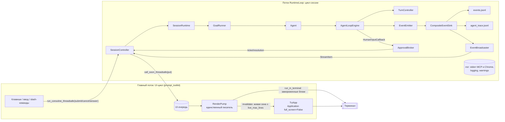

# Новый интерфейс AutoBrowser: терминальный UI в стиле Claude Code и команда `autobrowser`

Статус: Proposed (проект, код не менялся)
Дата: 2026-10-19 (редакция 2: терминальный UI вместо веб-UI как главного клиента)
Ветка: `ref/new-gui-design`
ADR (Proposed):
- [2026-10-19 Терминальный UI и общий SessionController](../decisions/2026-10-19-session-controller-and-local-web-ui.md)
- [2026-10-19 Команда `autobrowser` и домашний каталог](../decisions/2026-10-19-autobrowser-command-and-home-directory.md)

Пользователь просит три вещи: интерфейс как у Claude Code, запуск командой `autobrowser` из
PowerShell, cmd, bash и zsh, и чтобы это было красиво и не давало визуальных багов.

Документ определяет:
- главный клиент — inline-TUI на prompt_toolkit + rich;
- общее UI-нейтральное ядро: `SessionController`, `EventBroadcaster`, `ApprovalBroker`;
- упаковку и CLI команды `autobrowser`;
- визуальный язык;
- правила, снижающие риск визуальных багов.

Веб-UI из первой редакции перенесён в раздел «позже/опционально» (§9).

---

## 1. Контекст и проблема

### 1.1 Что есть сейчас

Единственный интерфейс — REPL на cmd2, запуск `uv run main.py`.

- **Цепочка запуска.** `main.py` → `src/cli/bootstrap.py:97` `run_agent_cli()` →
  `build_session()` (`:52`) → `src/cli/agent_cli.py:461` `run_cli()` → `AgentCli.cmdloop()`.
- **Цикл сессии.** `RuntimeLoop` (`agent_cli.py:63-94`) держит asyncio-цикл сессии в
  отдельном потоке.
- **Обратная связь.** Задача стартует в фоне (`agent_cli.py:320-327`). Пользователь видит
  только `Task started: ...` (`:180`), а в конце — `final_answer` или `Task failed`
  (`_on_task_done`, `:329-345`).
- **Цвета** — ручные ANSI-коды (`agent_cli.py:437-446`).
- **Подтверждения.** `ApprovalPrompt` (`src/cli/approval.py:78-155`) реализует
  `HumanInputCallback` (`src/agent_loop/execution/loop.py:91`). Ответ вводится той же строкой,
  что и команды (`agent_cli.py:139-147`).
- **События.** `EventEmitter` пишет в фиксированный `CompositeEventSink`
  (`src/harness/session.py:299-307`, `:433`): `events.jsonl` и `agent_trace.jsonl`.
  Подписаться на поток в процессе нельзя. Типы событий — `src/agent_loop/events.py:14-38`;
  редактирование секретов — `redact_json_safe()` (`events.py:237-265`).
- **Упаковка.** В `pyproject.toml` нет `[build-system]` и `[project.scripts]`, а
  `[tool.uv] package = false` (`pyproject.toml:135-138`). Код импортируется как пакет
  верхнего уровня `src.*`: 394 строки импорта в 104 файлах `src/`, `tests/`, `scripts/`.
  Команды `autobrowser` нет.
- **Пути привязаны к репозиторию или к текущему каталогу:**
  - `ROOT_PATH = Path(__file__).resolve().parent.parent` и `config.yaml` рядом с ним
    (`src/config.py:113`, `:118`);
  - `.env` ищется в текущем каталоге (`env_file=".env"`, `config.py:1168`);
  - `storage.root_dir = Path(".autobrowser")` — тоже относительно текущего каталога
    (`config.py:636-639`);
  - ресурс правил браузера читается из `docs/development/browser-agent-rules.md` по пути от
    исходников (`src/agent_loop/skills.py:36-41`);
  - командные хуки запускаются с `cwd=ROOT_PATH` (`src/harness/command_hooks.py:61`).
- **Playwright MCP** по умолчанию запускается через `npx -y @playwright/mcp@latest`
  (`src/harness/mcp_setup.py:37`, `:47`). `node_modules/` и `package-lock.json` в репозитории
  (`@playwright/mcp 0.0.55`) кодом не используются.

### 1.2 Что не так

| # | Проблема | Где |
|---|----------|-----|
| P1 | Нет промежуточной обратной связи: не видно плана, ходов и вызовов; поздно отменять. | `agent_cli.py:180`, `:329-345` |
| P2 | Подтверждение делит строку ввода с командами, вопрос печатается из фонового потока поверх промпта. | `agent_cli.py:139-147`, `approval.py:111` |
| P3 | Тюнаблы зашиты в код: `_ARGS_PREVIEW_CHARS = 300` (`approval.py:28`), коэффициент `0.8` (`approval.py:38-41`), таймауты `5` (`agent_cli.py:86`, `:354`, `:369`). | `src/cli/` |
| P4 | Логика представления живёт внутри `AgentCli`: `_browser_state`, перебор магических ключей истории, прямое присваивание `runtime.context`. | `agent_cli.py:316-318`, `:373-417` |
| P5 | Не публикуется содержимое плана: `model.responded {"phase": "plan"}` идёт без шагов. Нет события начала хода. | `loop.py:1081-1083` |
| P6 | Терминальные `goal.*` несут repr всего `AgentLoopResult`, включая `session_state.messages`. Это не парсится и обходит редактирование по ключам. Подтверждено реальной трассой. | `goals.py:91`, `events.py:265` |
| P7 | Отмена не оставляет следов. `CancelledError` не ловится `except Exception`, поэтому нет `goal.cancelled`, а `TaskRecord` остаётся «running». Вывод по чтению кода, подтвердить тестом. | `goals.py:79`, `session.py:784` |
| P8 | **Посторонние писатели в терминал** порвут любой TUI. | см. ниже |
| P9 | Нет команды `autobrowser`. Запуск вне репозитория ломается: `.env`, `.autobrowser/` и ресурс правил ищутся по текущему каталогу или пути исходников. | `pyproject.toml`, `config.py:113/1168`, `skills.py:36` |

Посторонние писатели из P8:
- stdio-MCP запускается без `errlog`, поэтому stderr `npx`/Playwright MCP идёт прямо в
  терминал (`src/mcp/transports.py:36-43`);
- Chrome наследует stdout/stderr и печатает `DevTools listening on ...`
  (`src/harness/chrome.py:40-46`);
- `print("Подключение к серверу...")` (`chrome.py:58`);
- `print_tools` (`src/cli/output.py:20-27`);
- `SessionRuntime(output_fn=print)` (`session.py:714`);
- предупреждения `logging` без обработчика уходят в stderr через `lastResort`.

---

## 2. Требования

### 2.1 Функциональные

- **FR1. Команда `autobrowser`** в PowerShell 7 / Windows PowerShell 5.1, cmd, bash, zsh
  (и fish).
  - Режимы запуска: интерактивный `autobrowser`; стартовая задача `autobrowser "задача"`;
    headless `autobrowser -p "задача"`; продолжение сессии `--continue` и `--resume`;
    `--version`.
  - Подкоманды: `doctor`, `sessions`, `replay`, `completion`.
- **FR2. Главный клиент — inline-TUI в стиле Claude Code** (§3):
  - приветственный баннер;
  - лента задачи, которая вытекает в обычный scrollback терминала;
  - поле ввода внизу, многострочное, с историей;
  - spinner «думает…» с таймером и счётчиками;
  - сворачиваемые блоки вызовов с отступом результата `⎿`;
  - план как чек-лист;
  - подтверждение once / session / deny прямо в потоке (стрелки и цифры);
  - slash-команды с автодополнением;
  - Esc и Ctrl+C;
  - строка статуса;
  - markdown финального ответа.
- **FR3. Живая лента** по событиям engine: план, ход, вызов (сервер/инструмент/аргументы как
  данные), решения guard/хуков/разрешений, результат, наблюдение, итог.
- **FR4. Неблокирующие подтверждения.** Ответ из любого клиента, первый выигрывает; по
  таймауту — `deny`.
- **FR5. Команды:** `/tasks`, `/cancel`, `/status`, `/mcp [reconnect <имя>]`,
  `/memory [путь]`, `/history [N]`, `/clear`, `/reset`, `/permissions`, `/replay`, `/detail`,
  `/theme`, `/help`, `/exit`.
- **FR6. Деградация:**
  - plain-режим для неспособных терминалов и не-TTY;
  - print-режим (`-p`) с форматами `text | json | stream-json` и кодами возврата.
- **FR7.** Существующие пути не ломаются: `uv run main.py`, `--task`, `--no-mcp`,
  `scripts/run_batch.py`, `scripts/run_evals.py`, `scripts/replay_trace.py`.

### 2.2 Нефункциональные

- **NFR1. Слои.** Engine ничего не знает про UI; UI — клиент `SessionRuntime` и потока
  событий; никакой логики по именам инструментов или сайтов.
- **NFR2. Минимум визуальных багов на Windows.** Это отдельный критерий выбора стека (§4) и
  отдельный раздел правил (§6).
- **NFR3. Красота.** Единый визуальный язык под браузерного агента (§5.7): палитра с fallback,
  глифы с ASCII-заменой, ритм и плотность.
- **NFR4. Зависимости.** Предпочитаем закреплённые в `uv.lock`: `prompt-toolkit 3.0.53`,
  `rich 15.0.0`, `wcwidth 0.9.2`, `pygments 2.19.2`, `platformdirs 4.5.1`. Новая runtime-
  зависимость — только `argcomplete` (дополнение команд в оболочке). Новые
  dev-зависимости — `pyte`, `syrupy`, `pywinpty`.
- **NFR5. Конфигурация.** Все тюнаблы — поля секции `ui` в `src/config.py`, плюс
  `.env.example` и `config.example.yaml`.
- **NFR6. Отзывчивость.** Медленный агент или модель не замораживают ввод и spinner; медленный
  рендер не тормозит агента.
- **NFR7. Безопасность вывода.** Секреты редактируются до вывода. Управляющие
  последовательности из содержимого страниц вычищаются (§6.1, B9).

### 2.3 Вне скоупа

- Параллельные задачи в одной сессии. По умолчанию ввод во время задачи отклоняется с
  подсказкой (см. вопрос 4 в §11).
- Rewind/checkpoints, vim-режим, вставка изображений, фоновые субагенты в духе Claude Code.
- Fullscreen (alternate screen) — отдельная фаза (§12, шаг 19).
- Веб-UI и desktop-окно — позже (§9).
- Изменение промптов и редактирование памяти и правил из UI.

---

## 3. UX Claude Code: что переносим

Источник — документация Claude Code (interactive mode) и публичные разборы его рендерера.
Ключевые свойства:
- **Inline-рендеринг без alternate screen.** История остаётся в scrollback терминала.
- **Две зоны.** Неизменяемая «статическая» история и небольшая динамическая зона внизу:
  spinner, активный блок, диалоги, поле ввода.
- **История рендерера.** Ранний рендерер на Ink мерцал. В версии 2.0.72 (декабрь 2025)
  появился дифференциальный рендерер по ячейкам с синхронным выводом (DEC 2026); по словам
  авторов, мерцание снизилось примерно на 85 %. Fullscreen-режим (`CLAUDE_CODE_NO_FLICKER`)
  стал отдельной опцией с ценой потери нативного scrollback.

Вывод для нас: мерцание растёт с размером перерисовываемой области, поэтому живая зона должна
быть маленькой и ограниченной по высоте.

| Элемент Claude Code | Как у нас | Фаза |
|---|---|---|
| Inline без alternate screen, история в scrollback | `Application(full_screen=False)`; завершённые блоки «замораживаются» в scrollback (§6.2) | 3 |
| Баннер приветствия | Баннер-«окно браузера» с моделью, сессией, cwd, MCP и браузером (§5.7.4) | 3 |
| Поле ввода внизу, многострочное | `TextArea` между двумя горизонтальными линиями, без боковых рамок (§6.1, B5). Новая строка: Shift+Enter (где терминал отличает), Ctrl+J, `\`+Enter, вставка | 3 |
| Spinner «Thinking…» с таймером и счётчиками | `⠼ Думаю… · ход 4/50 · 00:37 · 3 вызова · esc — прервать`; фраза по фазе: план / думаю / выполняю / жду подтверждения | 3 |
| Блоки инструментов `⏺ Tool(args)` и `⎿ результат` | `● <сервер> · <инструмент> <аргументы>` и `⎿ ✓ 1.2s · превью`. Имя инструмента — данные, логики по нему нет | 3 |
| Ctrl+O — подробности и транскрипт | Переключает `ui.detail` (`compact` ↔ `verbose`) для живого и последующих блоков. Полный просмотр — `/replay` | 3 |
| Todo-чек-лист, Ctrl+T | План из `plan.updated`: `✓` / `▸` / `○` в живой зоне; Ctrl+T скрывает/показывает; итог замораживается в конце задачи | 3 |
| Диалог разрешения с вариантами 1/2/3, стрелки, Esc | Карточка `ApprovalTicket` в потоке: ↑↓, Enter, 1–3; Esc = «Нет». Варианта «Да, в сессии» нет, если `allow_session = false` | 3 |
| Slash-команды с всплывающим автодополнением | Реестр `SlashCommand` + `Completer` prompt_toolkit; дополнение аргументов (имена MCP-серверов, пути памяти, номера задач) | 3 |
| Esc прерывает, Esc Esc очищает ввод | Esc во время задачи → `cancel()`; Esc Esc при наборе — очистить черновик в историю | 3 |
| Ctrl+C: прервать → очистить → выйти по повторному | То же; окно повтора — `ui.double_press_seconds` | 3 |
| Ctrl+D — выход | На пустом вводе — подсказка, повтор — выход | 3 |
| Ctrl+R — поиск по истории, ↑/↓ — история | Встроено в prompt_toolkit; история в `<home>/history` (`ui.input_history`) | 3 |
| Ctrl+L — перерисовать | `app.renderer.clear()` + перерисовка живой зоны | 3 |
| Строка статуса | Модель · сессия · браузер/MCP · режим разрешений · ход/лимит · время; укорачивается по приоритету при узком окне | 3 |
| Markdown-рендер ответа | `rich.markdown.Markdown` с темой проекта; ссылки OSC 8 только в терминалах уровня full | 3 |
| Shift+Tab — смена режима разрешений | Вне MVP: режим `PermissionEngine` session-scoped, смена на лету — новая функция | — |
| `claude -p`, `--continue`, `--resume`, `--output-format` | `autobrowser -p`, `-c`, `-r [id]`, `--output-format text\|json\|stream-json` (§7.6) | 1 / 4 |
| `/doctor`, `claude doctor` | `autobrowser doctor` и `/doctor`: окружение, пути, Node/npx, Chrome, возможности терминала | 1 / 3 |
| Звук и мигание заголовка при запросе разрешения (так делает Toad) | `ui.approval_bell` (BEL) и заголовок окна `AutoBrowser · нужно подтверждение` (OSC 0, только уровень full) | 3 |

---

## 4. Выбор стека под Claude-Code-подобный TUI

### 4.1 Критерии (в порядке веса)

1. **Риск визуальных багов на Windows** — главный критерий по просьбе пользователя. Важны
   Windows Terminal, conhost/PowerShell 5.1, VS Code terminal и Git Bash/mintty.
2. **Inline-режим с сохранением scrollback** — так работает Claude Code.
3. **Совместимость с `uv.lock`.** Без вынужденных апгрейдов общего стека (fastapi/starlette с
   mcp/fastmcp).
4. **Тестируемость** без настоящего терминала.
5. **Сложность и объём кода.**

### 4.2 Кандидаты (версии проверены 2026-10-19)

| Стек | Inline на Windows | Известные проблемы по визуалу | Совместимость | Тесты | Вердикт |
|---|---|---|---|---|---|
| **prompt_toolkit 3.0.53 `Application(full_screen=False)` + rich 15 как рендерер блоков в ANSI-строки** | Да. prompt_toolkit 10+ лет работает на Windows (IPython, ptpython, xonsh, aider, Kimi CLI, cmd2 4.x). С 3.0.49 использует VT-ввод, где он доступен; с 3.0.42 исправлен перенос в `patch_stdout` на Windows | В mintty без ConPTY не стартует (`NoConsoleScreenBufferError`) — нужно автоопределение и plain. Два перерисовщика (rich `Live` + prompt_toolkit) мерцают — запрещаем `Live`, rich только рендерит строки. Есть исторические баги `patch_stdout` (порядок, потеря вывода на выходе) — не печатаем через него, он только страховка | Всё уже в `uv.lock` (транзитивно через cmd2) | `create_pipe_input()` + VT100-вывод в буфер + эмулятор `pyte` → снимки экрана | **Рекомендуется** |
| **Textual 8.2.8 inline** (`App.run(inline=True)`) | **Нет.** В документации Textual: «Inline mode is not currently supported on Windows» (issue #4409) | Inline-ввод «лагал» (#4403). В mintty не работает мышь (#1462). В conhost Windows 10 искажаются атрибуты. Toad на Textual не поддерживает нативный Windows (только WSL). Mistral Vibe на Textual 8.2.8 называет Windows второсортной платформой | Новая зависимость (textual, textual-speedups без wheel для Windows ARM64 — Vibe #739) | Pilot, snapshot-плагин — сильная сторона | Отклонён для главного клиента: не работает на основной платформе пользователя |
| Textual 8.2.8 fullscreen (alternate screen) | Работает в Windows Terminal | Теряется нативный scrollback и поиск — тот же компромисс, что у `CLAUDE_CODE_NO_FLICKER`. Шире поверхность (CSS-layout, свой композитор) | Новая зависимость | Хорошие | Возможен как опциональный fullscreen-клиент позже |
| cmd2 4.1.2 (текущий) + `add_alert` | Да (сам на prompt_toolkit и rich) | Нет постоянной живой зоны во время выполнения: spinner, карточка и строка статуса — это промпт-цикл команд | Уже есть | Есть | Остаётся как `--classic` на переходный период |
| rich `Live` + `input()` | Частично | `Live` и ввод несовместимы: рваный вывод; rich #2726 — мерцание `Live` при печати | Уже есть | Простые | Отклонён |
| Rust/Go TUI (ratatui, bubbletea) рядом с Python | Да | Отдельный бинарник и протокол. Mistral Vibe (Rust TUI): мигание из-за безусловного truecolor (#1248), сломанный перенос строк в Git Bash (#1208) | Новый тулчейн | — | Отклонён |

### 4.3 Чему учимся у Python-агентских CLI 2026 года

- **Kimi CLI** (prompt_toolkit 3.0.52 + rich 14.2 + typer; `uv_build`; две точки входа
  `kimi`, `kimi-cli`) — ровно наш стек. Проект архивирован в пользу TypeScript-версии;
  берём как подтверждение жизнеспособности стека, а не как зависимость.
- **Mistral Vibe** (Textual 8.2.8 + rich 15; лаунчер `vibe` выбирает клиента по `VIBE_CLI`).
  Уроки:
  - тонкий лаунчер с выбором фронтенда — ровно наш `ui.frontend`;
  - fallback на 256 цветов обязателен: безусловный truecolor ломает отображение (#1248).
- **Toad** (Will McGugan, Textual, ACP):
  - сигнал (звук, мигающий заголовок) при запросе разрешения;
  - контекстная помощь;
  - SQLite-история для resume.
  
  Минус: нет нативного Windows.
- **Aider** — prompt_toolkit + rich; тот же `NoConsoleScreenBufferError` в Git Bash (#1434).
  Урок: автоопределение mintty и plain-fallback с понятным сообщением.
- **Claude Code** — две зоны, маленькая живая область, диффы по ячейкам, DEC 2026,
  `Ctrl+L` как аварийная перерисовка, fullscreen только по выбору.

### 4.4 Решение по инструментам

| Задача | Инструмент | Версия | Статус в проекте |
|---|---|---|---|
| Владелец терминала, живая зона, ввод, клавиши, автодополнение, история | **prompt_toolkit** | 3.0.53 | в `uv.lock` (через cmd2) → сделать прямой зависимостью |
| Рендер блоков (markdown, таблицы, подсветка JSON, перенос) в ANSI-строки | **rich** | 15.0.0 | прямая зависимость |
| Ширина символов (общая для живой зоны и тестов) | **wcwidth** | 0.9.2 | в `uv.lock` → прямая |
| Подсветка JSON и кода | pygments (через rich) | 2.19.2 | уже есть |
| Аргументы CLI | **argparse** (как сейчас) + диспетчер подкоманд | stdlib | без переписывания `build_parser` |
| Дополнение в оболочках | **argcomplete**: bash/zsh официально, fish/PowerShell через contrib `--shell powershell` | 3.6.x | новая runtime-зависимость |
| Сборка пакета и точка входа | **uv_build** + `[project.scripts]` | `>=0.13.1,<0.14` | новая build-зависимость |
| Тесты рендера и экрана | **pyte** (VT-эмулятор), **syrupy** (снимки) | 0.8.2 / 6.1.1 | dev |
| Smoke-тест в настоящей консоли Windows | **pywinpty** (ConPTY) | 3.1.0 | dev, только Windows |

Textual, NiceGUI, Gradio, Streamlit, Flet, Chainlit и Tauri в главный путь не берём (§4.2 и
первая редакция, §9).

---

## 5. Дизайн

### 5.1 Компоненты и слои

| Компонент | Модуль | Слой | Ответственность |
|---|---|---|---|
| `ApprovalTicket`, `ApprovalResolution`, `ApprovalVia` | `src/contracts.py` (+) | нейтральные контракты | Ожидающее подтверждение и его разрешение |
| `ApprovalBroker` | `src/harness/approvals.py` (новый) | harness, session-scoped | Реализует `HumanInputCallback`: тикеты, таймаут → `deny`, ответы из любого потока, подписчики |
| `EventBroadcaster` | `src/harness/event_stream.py` (новый) | harness, session-scoped | `EventSink`: кольцевой буфер редактированных записей + раздача подписчикам |
| `SessionRuntime(event_sinks=…, output_fn=…)`, `reset()` | `src/harness/session.py` (~) | harness | Дополнительные стоки; сброс без доступа клиента к `context` |
| Перенаправление stderr MCP и Chrome в лог | `src/mcp/transports.py`, `src/harness/chrome.py` (~) | harness / mcp | Единственный писатель в терминал (§6.2) |
| Терминальный payload `goal.*` и отмена | `src/agent_loop/goals.py` (~) | lifecycle задачи | P6, P7 |
| `plan.updated`, `turn.started` | `src/agent_loop/execution/loop.py`, `events.py` (~) | engine (телеметрия) | P5 |
| `SessionController` | `src/ui/controller.py` (новый) | UI-ядро | Единый фасад команд и чтения для всех фронтендов |
| `RuntimeLoop` | `src/ui/runtime_loop.py` (перенос из `agent_cli.py`) | UI-ядро | Поток с циклом сессии |
| `FeedItem`, `project_event()` | `src/ui/views.py`, `src/ui/feed.py` (новые) | UI-ядро | Проекция событий в элементы ленты без имён инструментов |
| `TerminalCaps`, `detect_terminal()` | `src/ui/tui/terminal.py` | TUI | Уровень `full / degraded / plain`, цвета, Unicode, sync output |
| `Theme`, `Palette`, `GlyphSet` | `src/ui/tui/theme.py` | TUI | Одна палитра → стиль rich и стиль prompt_toolkit; ASCII-fallback |
| `Transcript`, `Block`, `reduce()` | `src/ui/tui/transcript.py` | TUI | Чистая модель блоков: live / frozen, свёрнут / развёрнут |
| `render_block()` | `src/ui/tui/render.py` | TUI | Чистая функция `Block × ширина × caps × theme → ANSI-строка` |
| `RenderPump` | `src/ui/tui/pump.py` | TUI | **Единственный писатель**: очередь → троттлинг → заморозка в scrollback → перерисовка живой зоны |
| `TuiApp` | `src/ui/tui/app.py` | TUI | `Application(full_screen=False)`: живая зона, карточка, ввод, меню, статус |
| `SlashCommand`, реестр, completer | `src/ui/tui/commands.py` | TUI | Slash-команды и дополнение |
| `PlainFrontend` | `src/ui/plain.py` | UI | Построчный вывод `FeedItem` + `input()`; без prompt_toolkit |
| `PrintMode` | `src/ui/print_mode.py` | UI | `-p`: `text`, `json`, `stream-json`; коды возврата |
| CLI-вход | `src/cli/entry.py` (новый), `parser.py`, `bootstrap.py` (~) | CLI | `autobrowser`: диспетчер подкоманд, выбор фронтенда, `--version`, argcomplete |
| cmd2-REPL | `src/cli/agent_cli.py` (~) | CLI | `--classic`, делегирует `SessionController`; удаляется после стабилизации TUI |

Правила импорта (`tests/test_ui_boundaries.py`):
- `src/agent_loop/**` и `src/harness/**` не импортируют `src.ui` и `src.cli`.
- `src/ui/**` не импортирует `src.agent_loop.execution`.
- `src/cli/**` → `src/ui/**`, но не наоборот.
- Литералы имён инструментов под `src/` уже запрещены `tests/test_engine_boundaries.py`.

### 5.2 Контракты (эскизы)

Ядро — без изменений по смыслу относительно первой редакции:

```python
# src/contracts.py
ApprovalVia = Literal["tui", "plain", "classic", "web", "timeout"]

@dataclass(frozen=True)
class ApprovalTicket:
    ticket_id: str; task_id: str; tool: str; server: str; domain: str
    reason: str; rule_id: str; source: str
    args_preview: str          # redact_json_safe(args) -> json -> усечение
    allow_session: bool        # grant_key is not None and not always_ask
    created_at: datetime; deadline: datetime

@dataclass(frozen=True)
class ApprovalResolution:
    ticket_id: str; answer: ApprovalAnswer; via: ApprovalVia; resolved_at: datetime
```

```python
# src/harness/approvals.py
class ApprovalBroker:                       # сигнатура __call__ == HumanInputCallback
    def __init__(self, settings: PermissionsSettings, *, progress_timeout_seconds: float,
                 events: EventEmitter | None = None) -> None: ...
    async def __call__(self, request: ToolRequest, reason: str,
                       verdict: PermissionVerdict) -> ApprovalAnswer: ...
    def bind_task(self, task_id: str) -> None: ...
    def pending(self) -> tuple[ApprovalTicket, ...]: ...
    def answer(self, ticket_id: str, answer: ApprovalAnswer, *, via: ApprovalVia) -> bool: ...
    def answer_threadsafe(self, ticket_id: str, answer: ApprovalAnswer, *,
                          via: ApprovalVia) -> concurrent.futures.Future[bool]: ...
    def subscribe(self, listener: Callable[[ApprovalTicket | ApprovalResolution], None]
                  ) -> Callable[[], None]: ...

# src/harness/event_stream.py
@dataclass(frozen=True)
class StreamCursor: session_id: str; sequence: int
@dataclass(frozen=True)
class StreamItem:
    kind: Literal["event", "gap", "reset"]; cursor: StreamCursor
    record: Mapping[str, object] | None          # EventRecord.to_json_dict()

class EventBroadcaster:                           # EventSink
    def __init__(self, settings: UiSettings) -> None: ...
    def emit(self, record: EventRecord) -> None: ...
    def subscribe(self, after: StreamCursor | None = None) -> AsyncIterator[StreamItem]: ...
    def mark_reset(self, session_id: str) -> None: ...

# src/ui/controller.py
class SessionController:
    async def start(self) -> SessionView: ...
    async def submit(self, text: str) -> TaskView: ...        # TaskBusyError
    async def cancel(self) -> bool: ...
    async def reconnect(self, server: str) -> ServerView: ...
    async def reset(self) -> SessionView: ...
    def answer(self, ticket_id: str, answer: ApprovalAnswer, *, via: ApprovalVia) -> bool: ...
    def session_view(self) -> SessionView: ...
    def task_views(self) -> list[TaskView]: ...
    def history(self, limit: int) -> list[Mapping[str, object]]: ...
    def memory_entries(self) -> list[MemoryEntry]: ...
    def subscribe(self, after: StreamCursor | None = None) -> AsyncIterator[StreamItem]: ...
    def subscribe_approvals(self, listener) -> Callable[[], None]: ...
```

Новое для TUI:

```python
# src/ui/tui/terminal.py
SupportLevel = Literal["full", "degraded", "plain"]
ColorDepth = Literal["none", "16", "256", "truecolor"]

@dataclass(frozen=True)
class TerminalCaps:
    level: SupportLevel
    color: ColorDepth
    unicode: bool             # UTF-8-совместимый вывод и шрифт с нужными глифами
    sync_output: bool         # DEC 2026
    hyperlinks: bool          # OSC 8
    title: bool               # OSC 0
    width: int; height: int
    reason: str               # почему такой уровень — для /doctor

def detect_terminal(settings: UiSettings, env: Mapping[str, str],
                    streams: TerminalStreams) -> TerminalCaps: ...

# src/ui/tui/theme.py
@dataclass(frozen=True)
class Swatch: truecolor: str; c256: int; c16: str     # "#4FB3FF", 75, "bright_blue"

@dataclass(frozen=True)
class Palette:
    accent: Swatch; text: Swatch; muted: Swatch; tool: Swatch; link: Swatch
    ok: Swatch; warn: Swatch; error: Swatch; plan: Swatch; border: Swatch

@dataclass(frozen=True)
class GlyphSet:
    call: str; elbow: str; ok: str; fail: str; skip: str; pending: str; active: str
    bar: str; caret: str; rule: str; spinner: tuple[str, ...]; ellipsis: str

@dataclass(frozen=True)
class Theme:
    palette: Palette; glyphs: GlyphSet; color: ColorDepth
    def rich_theme(self) -> rich.theme.Theme: ...
    def pt_style(self) -> prompt_toolkit.styles.Style: ...

# src/ui/tui/transcript.py
BlockKind = Literal["banner", "user", "plan", "call", "notice", "approval",
                    "outcome", "command_output"]

@dataclass(frozen=True)
class Block:
    block_id: str; kind: BlockKind; task_id: str
    state: Literal["live", "frozen"]
    expanded: bool
    items: tuple[FeedItem, ...]            # события блока в порядке поступления

UiMessage = StreamItem | ApprovalTicket | ApprovalResolution | StatusChanged | Notice | KeyAction

def reduce(transcript: Transcript, message: UiMessage) -> tuple[Transcript, list[Block]]:
    """Чистый редьюсер: новое состояние и блоки, которые надо заморозить в scrollback."""

# src/ui/tui/render.py
def render_block(block: Block, *, width: int, caps: TerminalCaps, theme: Theme,
                 settings: UiSettings) -> str: ...      # ANSI или plain-текст

# src/ui/tui/commands.py
@dataclass(frozen=True)
class SlashCommand:
    name: str; usage: str; summary: str
    complete_args: Callable[[SessionController, str], Sequence[str]] | None
    run: Callable[[SessionController, str], Awaitable[Block | None]]
```

### 5.3 Модель потоков

UI живёт на собственном asyncio-цикле в главном потоке, сессия — на `RuntimeLoop` в отдельном
потоке. Поэтому блокирующий вызов в стеке агента не замораживает ввод и spinner, а медленный
рендер не тормозит агента (NFR6).



### 5.4 Поток: задача с подтверждением в TUI

```mermaid
sequenceDiagram
  autonumber
  participant U as Пользователь
  participant T as TuiApp / RenderPump
  participant C as SessionController
  participant E as Engine (через SessionRuntime/GoalRunner)
  participant B as ApprovalBroker
  participant S as EventBroadcaster

  U->>T: Enter "найди наушники до 5000 ₽"
  T->>T: freeze блок "user" в scrollback
  T->>C: submit(text)  [run_coroutine_threadsafe]
  C->>E: run_task
  E->>S: goal.started, plan.updated, turn.started
  S-->>T: StreamItem → блоки plan, spinner (live)
  E->>S: action.proposed, tool.started
  S-->>T: блок call (live, spinner внутри)
  E->>S: tool.finished, observation.compiled
  S-->>T: блок call → frozen → scrollback
  E->>B: human_input(request, reason, verdict)
  B-->>T: ApprovalTicket → карточка (live), BEL/заголовок
  U->>T: ↓ Enter («Да, в сессии»)
  T->>C: answer(id, session, via=tui)
  C->>B: answer → True
  B->>S: approval.answered
  B-->>T: ApprovalResolution → карточка сворачивается в строку → frozen
  E->>S: goal.completed {status, final_answer, turns}
  S-->>T: блок outcome (markdown) → frozen; spinner исчезает
```

Esc или Ctrl+C во время задачи вызывают `controller.cancel()`. `GoalRunner` эмитит
`goal.cancelled` (после исправления P7), и появляется блок «⊘ Прервано».

### 5.5 Проекция событий в блоки

Решение принимается по `type` события и обобщённым полям; имя инструмента только выводится.

| Событие | Блок | Живой → замороженный |
|---|---|---|
| ввод пользователя | `user` (`› текст`) | сразу frozen |
| `goal.started` | открывает задачу; spinner | — |
| `plan.updated` | `plan` (чек-лист) | live до конца задачи; итоговый снимок frozen в `outcome` |
| `turn.started` | счётчик хода в spinner и строке статуса | не блок |
| `model.requested` / `model.responded` | фраза spinner по `phase` | не блок |
| `action.proposed` | новый `call`: сервер · инструмент + превью аргументов | live |
| `policy.decided` (block), `hook.decided` (deny/ask), `permission.decided` (deny/ask) | строки `⊘` / `?` внутри текущего `call` | вместе с `call` |
| `approval.requested` + тикет брокера | `approval` (карточка) | live до ответа; затем однострочный итог frozen |
| `tool.started` / `tool.finished` | статус, длительность, превью `content`; Page URL — через `src.browser.pages.page_url()` по текстовому формату | `call` замораживается на `observation.compiled` или следующем `action.proposed` |
| `observation.compiled` | строка «наблюдение: N симв., snapshot» (verbose) | вместе с `call` |
| `goal.completed/blocked/cancelled/failed` | `outcome`: статус, ходы, время, markdown-ответ или причина | frozen |
| `memory.*` | `notice` (тусклая строка) | frozen |
| неизвестный тип | `notice` (только в verbose) | frozen |

### 5.6 Клавиши и slash-команды

| Клавиша | Состояние | Действие |
|---|---|---|
| Enter | ввод | отправить задачу или команду |
| Shift+Enter / Ctrl+J / `\`+Enter | ввод | новая строка (Shift+Enter — где терминал его отличает) |
| Esc | задача идёт | прервать задачу (`cancel`) |
| Esc | открыта карточка | «Нет» |
| Esc | открыто меню | закрыть меню |
| Esc Esc | есть черновик | очистить и сохранить в историю |
| Ctrl+C | задача идёт | прервать |
| Ctrl+C | есть текст | очистить |
| Ctrl+C | пусто | подсказка; повтор за `ui.double_press_seconds` — выход |
| Ctrl+D | пусто | то же, что выход |
| ↑ ↓ / Ctrl+R | ввод | история / поиск |
| ↑ ↓, 1–3, Enter | карточка | выбор once / session / deny |
| Ctrl+O | всегда | `detail`: `compact` ↔ `verbose` |
| Ctrl+T | всегда | показать/скрыть план |
| Ctrl+L | всегда | перерисовать (аварийно) |
| Tab | меню | принять дополнение |

Slash-команды:
- `/help`, `/status`, `/tasks`, `/cancel`, `/clear`, `/reset`, `/history [N]`, `/url`,
  `/permissions`, `/doctor`, `/exit`;
- `/mcp [reconnect <имя>]`;
- `/memory [путь]`;
- `/replay [№ задачи | id сессии]`;
- `/detail compact|verbose`;
- `/theme dark|light|mono`.

Аргументы дополняются из `SessionController`: имена серверов, пути памяти, номера задач,
id сессий.

### 5.7 Визуальный дизайн

#### 5.7.1 Принципы

- **Образ браузерного агента.**
  - Акцентный «браузерный» лазурный.
  - Баннер — пиктограмма окна браузера с тремя «огоньками» и приглашением `›_`.
  - URL всегда выделены цветом ссылки.
  - Вызовы инструментов — фиолетовые, решения разрешений — янтарные.
- **Левый жёлоб вместо рамок.** Блоки отмечаются глифом слева (`●`, `⎿`, `▌`), правых границ
  нет. Это и эстетика Claude Code, и защита от поломок рамок из-за ширины символов (§6.1, B4–B5).
- **Тишина по умолчанию.**
  - `compact` показывает одну строку на вызов и одну строку результата.
  - Подробности — Ctrl+O.
  - Тусклым — время, счётчики, служебные строки.
- **Ритм.** Одна пустая строка между блоками (`comfortable`) или без неё (`compact`).
  Отступ содержимого — 2 колонки.
- **Ничего мигающего, кроме spinner.** Без анимаций в замороженной истории.

#### 5.7.2 Палитра (тема `dark` по умолчанию)

| Роль | Truecolor | 256 | 16 | Применение |
|---|---|---|---|---|
| `accent` | `#4FB3FF` | 75 | `bright_blue` | баннер, линии поля ввода, `›`, активный пункт карточки |
| `text` | терминальный fg | — | `default` | текст ответа и задачи |
| `muted` | `#8A8F98` | 245 | `bright_black` | время, счётчики, `⎿`, строка статуса |
| `tool` | `#C792EA` | 176 | `magenta` | `●` и имя вызова |
| `link` | `#5FD7D7` | 80 | `cyan` | URL (подчёркнуты) |
| `ok` | `#7FD962` | 113 | `green` | `✓`, done |
| `warn` | `#FFB454` | 215 | `yellow` | карточка подтверждения, ask, guard-блок |
| `error` | `#FF6B6B` | 203 | `red` | `✗`, deny, blocked, ошибки |
| `plan` | `#E6E6E6` | 254 | `white` | заголовок «План», активный шаг |
| `border` | `#3A3F4B` | 238 | `bright_black` | горизонтальные линии |

- **Тема `light`.** Те же роли, затемнённые: `accent #0A6ED1/25/blue`,
  `tool #8E44AD/97/magenta`, `ok #2E8B3A/28/green`, `warn #B26B00/130/yellow`,
  `error #C62828/160/red`, `muted #6B7280/243/bright_black`.
- **Тема `mono` и `NO_COLOR`.**
  - Цвета не выводятся (соблюдаем соглашение `NO_COLOR`).
  - Иерархия держится атрибутами: заголовки и активный пункт — **bold**; служебное — без
    dim (dim в conhost Windows 10 нечитаем); выбранный пункт карточки — reverse.
- **Глубина цвета.** Выбирается по `TerminalCaps.color`, truecolor никогда не выводится
  безусловно (урок Vibe #1248). Цвета задаются ролями: код рендера знает роль, а не цвет.

#### 5.7.3 Глифы: unicode → ascii

| Роль | Unicode | ASCII | Примечание |
|---|---|---|---|
| вызов | `●` | `*` | |
| результат | `⎿` | `` ` `` с отступом (`  ` `) | `⎿` (U+23BF) нет в Consolas — в conhost ASCII |
| ok / fail / skip | `✓` `✗` `⊘` | `ok` `x` `-` | |
| план: ждёт / идёт / готово | `○` `▸` `✓` | `[ ]` `[>]` `[x]` | |
| полоса карточки | `▌` | `\|` | |
| указатель | `❯` | `>` | |
| приглашение | `›` | `>` | |
| линия | `─` | `-` | |
| spinner | `⠋⠙⠹⠸⠼⠴⠦⠧⠇⠏` | `\| / - \` | |
| многоточие | `…` | `...` | |

Правило ширины: каждый глиф набора `unicode` обязан иметь ширину 1 и в `rich.cells.cell_len`,
и в `wcwidth.wcswidth`. Это проверяет тест. Эмодзи и символы East Asian Wide в «хроме»
интерфейса запрещены; в содержимом страниц они допустимы (§6.1, B4).

#### 5.7.4 Макеты ключевых состояний (80 колонок, уровень full)

Имена инструментов в макетах — пример данных сервера. Интерфейс выводит их как есть, логики по
ним нет.

**Старт с баннером**

```text
  ╭───────╮  AutoBrowser 0.1.0
  │ ● ● ● │  модель   gemma4:31b-cloud · ollama
  ├───────┤  сессия   9c441f7e · C:\WebApps\AutoBrowser
  │  ›_   │  браузер  ● Chrome :9222   MCP ● playwright 22  ● memory 2
  ╰───────╯  разрешения default · хуки выкл. · память выкл.

  Опишите задачу словами. /help — команды · Esc — прервать · Ctrl+O — подробности

────────────────────────────────────────────────────────────────────────────────
› найди на ozon беспроводные наушники до 5000 ₽█
────────────────────────────────────────────────────────────────────────────────
  gemma4:31b-cloud · 9c44 · ● playwright · default · готов             ? помощь
```

ASCII-вариант пиктограммы: `+-------+ / | o o o | / +-------+ / |  >_   | / +-------+`.

**Задача в процессе (`compact`)**

```text
› найди на ozon беспроводные наушники до 5000 ₽

● playwright · browser_navigate  url: https://www.ozon.ru
  ⎿ ✓ 1.2s  https://www.ozon.ru/

● playwright · browser_type  element: "Поиск"  text: "беспроводные наушники"
  ⎿ ✓ 0.8s  https://www.ozon.ru/search/?text=беспроводные+наушники

  План
  ✓ Открыть ozon.ru
  ▸ Найти товары и отфильтровать по цене до 5000 ₽
  ○ Выбрать 3 лучших по рейтингу и вернуть ссылки

⠼ Думаю… · ход 4/50 · 00:37 · 3 вызова · esc — прервать
────────────────────────────────────────────────────────────────────────────────
› █
────────────────────────────────────────────────────────────────────────────────
  gemma4:31b-cloud · 9c44 · ● playwright · default · ход 4/50 · 00:37
```

Всё выше линии «План» уже заморожено в scrollback. Живая зона — план, spinner, ввод и статус;
по высоте не больше `ui.live_max_lines`.

**Вызов свёрнутый и развёрнутый (Ctrl+O → `verbose`)**

```text
● playwright · browser_click  element: "Фильтры"  ref: e212
  ⎿ ✓ 0.6s  https://www.ozon.ru/search/?text=…   (ctrl+o — подробнее)
```

```text
● playwright · browser_click
  │ args   {"element": "Фильтры", "ref": "e212"}
  │ доступ allow · mode default
  ⎿ ✓ success · 0.6s
    - Page URL: https://www.ozon.ru/search/?text=беспроводные+наушники
    - Page Title: Беспроводные наушники — купить на OZON
    - Page Snapshot:
      - generic [ref=e1]:
        - banner [ref=e2]: …
    … ещё 214 строк · наблюдение 9.1k симв., snapshot сохранён
```

**Карточка подтверждения**

```text
▌ Нужно подтверждение · правило ask-checkout                       ⏱ 01:31
▌ playwright · browser_click  на www.ozon.ru
▌ element: "Оформить заказ"  ref: e412
▌ Причина: действие оформляет заказ
▌
▌ ❯ 1. Да, один раз
▌   2. Да, для browser_click на www.ozon.ru до конца сессии
▌   3. Нет — задача будет остановлена
▌
▌ ↑↓ выбрать · enter — подтвердить · 1–3 — сразу · esc — нет
```

После ответа карточка сворачивается в строку:
`  ⎿ ✓ разрешено один раз (tui) · 4.2s`.

**Финальный ответ**

```text
✓ Готово · 6 ходов · 4 вызова · 1:12

  Нашёл 3 варианта до 5000 ₽:

  1. JBL Tune 520BT — 3 490 ₽, рейтинг 4.8
     https://www.ozon.ru/product/jbl-tune-520bt-…
  2. Xiaomi Redmi Buds 6 — 2 990 ₽, рейтинг 4.7
     https://www.ozon.ru/product/redmi-buds-6-…
  3. Sony WH-CH520 — 4 790 ₽, рейтинг 4.9
     https://www.ozon.ru/product/sony-wh-ch520-…
```

**Блок, guard и ошибки**

```text
● playwright · browser_navigate  url: https://example.org
  ⎿ ⊘ hook url_policy: домен вне списка — причина передана модели

✗ Остановлено · blocked · ход 7/50 · 1:40
  ⎿ Подтверждение отклонено: browser_click на www.ozon.ru
  Дальше: уточните задачу или настройте правило (/permissions)

✗ Ошибка · TimeoutError: Goal runner timed out after 300 seconds.
  ⎿ журнал: ~\.autobrowser\logs\autobrowser.log · трасса: /replay 9c44

⊘ Прервано пользователем · ход 3/50 · 0:21
```

**`/mcp`**

```text
› /mcp
  MCP-серверы
  ● playwright   ready    gen 1   stdio   22 инстр.   stateful
  ● memory       ready    gen 1   local    2 инстр.
  ✗ search       failed   gen 3   http    401 Unauthorized
  /mcp reconnect <имя> — перезапустить сервер
```

**`/tasks`**

```text
› /tasks
  Задачи сессии 9c441f7e
   #  статус      время  ходы  задача
   1  ✓ done      0:42      3  зайди на озон
   2  ✗ blocked   1:40      7  купи наушники JBL Tune 520BT …
   3  ⊘ cancelled 0:21      3  найди отзывы на …
   4  ⠼ running   0:37      4  найди на ozon беспроводные наушники …
  /replay <#> — ход задачи
```

**Узкий терминал (40 колонок)**

```text
● playwright · browser_navigate
  url: https://www.ozon.ru
  ⎿ ✓ 1.2s  https://www.ozon.ru/
⠼ Думаю… · 4/50 · 00:37 · esc
────────────────────────────────────────
› █
────────────────────────────────────────
  gemma4… · ● pw · 4/50
```

Строка статуса укорачивается по приоритету: ход → браузер → модель (с `…`) → сессия →
режим разрешений.

**Plain-режим (mintty без ConPTY, `TERM=dumb`, `ui.frontend=plain`)**

```text
autobrowser> найди на ozon беспроводные наушники до 5000 ₽
[plan] 1) Открыть ozon.ru 2) Найти и отфильтровать 3) Выбрать 3 лучших
[call] playwright/browser_navigate url=https://www.ozon.ru
[ok]   1.2s https://www.ozon.ru/
[ask]  playwright/browser_click on www.ozon.ru (rule ask-checkout)
       1) once  2) session  3) deny > 1
[done] 6 turns, 1:12
Нашёл 3 варианта до 5000 ₽: ...
```

### 5.8 Настройки

Секция `ui` (`UiSettings(_Section)`, поле `Settings.ui`) — одиннадцатая секция. Env-имя —
`AUTOBROWSER_UI__<ПОЛЕ>`.

| Поле | Тип | Дефолт | Границы | Описание |
|---|---|---|---|---|
| `frontend` | `Literal["auto","tui","plain","classic"]` | `"auto"` | — | `auto`: TUI при уровне full/degraded, иначе plain |
| `screen` | `Literal["inline","fullscreen"]` | `"inline"` | — | Значение `fullscreen` добавляется в фазе 5 (шаг 19) |
| `theme` | `Literal["dark","light","mono"]` | `"dark"` | — | Палитра |
| `color` | `Literal["auto","truecolor","256","16","none"]` | `"auto"` | — | Ручной override глубины; `NO_COLOR` в окружении → `none` |
| `glyphs` | `Literal["auto","unicode","ascii"]` | `"auto"` | — | Набор глифов |
| `banner` | `bool` | `True` | — | Баннер при старте |
| `density` | `Literal["comfortable","compact"]` | `"comfortable"` | — | Пустая строка между блоками |
| `detail` | `Literal["compact","verbose"]` | `"compact"` | — | Свёрнутые или развёрнутые вызовы |
| `preview_lines` | `int` | `3` | `0..50` | Строк результата в `verbose` до «… ещё N» |
| `preview_chars` | `int` | `400` | `40..20000` | Символов превью аргументов и результата |
| `live_max_lines` | `int` | `12` | `4..60` | Предел высоты живой зоны без поля ввода и статуса |
| `refresh_hz` | `float` | `10.0` | `1..30` | Частота перерисовки живой зоны и кадров spinner |
| `sync_output` | `Literal["auto","on","off"]` | `"auto"` | — | DEC 2026 |
| `escape_timeout_ms` | `int` | `50` | `0..1000` | Задержка распознавания одиночного Esc (`ttimeoutlen`) |
| `double_press_seconds` | `float` | `0.8` | `0.2..3.0` | Окно повторного Ctrl+C / Ctrl+D |
| `size_poll_seconds` | `float` | `0.5` | `0.1..5.0` | Опрос размера терминала (на Windows нет SIGWINCH) |
| `markdown` | `bool` | `True` | — | Markdown-рендер финального ответа |
| `input_history` | `bool` | `True` | — | Хранить историю ввода в `<home>/history` |
| `input_history_size` | `int` | `1000` | `0..100000` | Записей истории |
| `approval_bell` | `bool` | `False` | — | BEL и заголовок окна при запросе подтверждения |
| `locale` | `Literal["ru","en"]` | `"ru"` | — | Язык строк интерфейса |
| `print_format` | `Literal["text","json","stream-json"]` | `"text"` | — | Формат по умолчанию для `-p` |
| `log_file` | `Path` | `Path("logs/autobrowser.log")` | относительно home | Журнал логов, stderr MCP и Chrome в режимах TUI и print |
| `event_buffer_size` | `int` | `2000` | `100..100000` | Буфер `EventBroadcaster` |
| `subscriber_queue_size` | `int` | `1000` | `10..100000` | Очередь подписчика до `gap` |
| `status_interval_seconds` | `float` | `1.0` | `0.2..60` | Опрос `SessionView` (MCP-состояния событий не порождают) |
| `shutdown_timeout_seconds` | `float` | `5.0` | `0.5..60` | Остановка задачи, цикла, клиента; заменяет литералы `5` |

В секцию `permissions` переносятся существующие тюнаблы (P3):
- `approval_timeout_ratio` (`0.8`, границы `gt 0, lt 1`) — вместо `approval.py:41`;
- `approval_args_preview_chars` (`300`, `20..20000`) — вместо `approval.py:28`.

Не поля конфигурации, а переменные окружения уровня процесса — по образцу
`AUTOBROWSER_CONFIG_FILE`:
- `AUTOBROWSER_HOME` — домашний каталог (§7.4);
- общепринятые `NO_COLOR`, `FORCE_COLOR`, `TERM`, `COLORTERM`, `WT_SESSION`, `TERM_PROGRAM`,
  `MSYSTEM`, `TMUX` — они только читаются при автоопределении.

Флаги CLI `--plain`, `--ascii`, `--no-color`, `--theme`, `--classic` переопределяют
соответствующие поля на один запуск.

### 5.9 События и телеметрия

Аддитивные `EventType`:

| Событие | Payload |
|---|---|
| `plan.updated` | `{steps, replan_count}` |
| `turn.started` | `{turn, current_step}` |
| `approval.answered` | `{ticket_id, answer, via}` |

Изменения терминальных событий:
- `goal.*` несут `{task, status, final_answer, turns}` вместо repr результата (P6);
- отмена эмитит `goal.cancelled` и закрывает `TaskRecord` (P7);
- `plan.updated` попадает в `agent_trace.jsonl`.

Новых событий от самого UI нет. Нажатия клавиш и отрисовка не пишутся в `events.jsonl`.

---

## 6. Как снизить риск визуальных багов

### 6.1 Каталог типичных багов TUI и меры

| # | Баг | Причина | Как исключаем |
|---|---|---|---|
| B1 | Мерцание при перерисовке | Перерисовка большой области; частые кадры; очистка scrollback. Это история мерцания Claude Code до диффового рендерера | Живая зона маленькая и ограничена `live_max_lines`. prompt_toolkit перерисовывает только свою область с диффом по строкам. Кадры не чаще `refresh_hz` (`min_redraw_interval`). Обёртка кадра в DEC 2026 там, где поддерживается (Windows Terminal ≥ 1.23.20211 / 1.24, WezTerm, kitty, iTerm2, Ghostty). Scrollback мы никогда не очищаем |
| B2 | «Рваный» вывод: фоновый поток печатает поверх поля ввода | Запись в stdout/stderr мимо владельца терминала: print, logging, stderr дочерних процессов | Единственный писатель — `RenderPump` (§6.2). stderr MCP идёт в `log_file` через `errlog` у `stdio_client`; Chrome — `stdout/stderr=DEVNULL` или в лог; `print` в `chrome.py:58` и `output.py` заменяются уведомлениями через `output_fn`. `logging` и `warnings` (`captureWarnings`) — в файл. `threading.excepthook` и `sys.excepthook` — в лог. `patch_stdout(raw=True)` вокруг приложения только как страховка; тест проверяет, что в штатной работе через него ничего не проходит |
| B3 | Дубли строк и остатки старой живой зоны после resize | Смена ширины переносит уже нарисованные строки, и расчёт курсора расходится | Живая зона низкая. При смене размера — полная перерисовка только своей области (`erase_down` от начала зоны), опрос размера на Windows каждые `size_poll_seconds`. Ничего не рисуем правее `width-1`, чтобы не включился автоперенос в последней колонке. Замороженные блоки после печати не трогаем — их переносит сам терминал. Ctrl+L — аварийная перерисовка |
| B4 | Перенос длинных строк, ширина CJK, эмодзи, ambiguous-символов | Разные таблицы ширины в приложении (rich / wcwidth) и терминале (xterm.js в VS Code по умолчанию — Unicode 6 или 11) | В «хроме» только глифы ширины 1, это проверено тестом. Без правых границ у блоков с переменным содержимым: несовпадение ширины не ломает рамку. Перенос делает rich в замороженных блоках и prompt_toolkit в живой зоне — по одной таблице на зону. Превью усекается по ячейкам с `…`. В `/doctor` — подсказка про `terminal.integrated.unicodeVersion` для VS Code |
| B5 | Ломающиеся рамки в conhost и Git Bash | conhost Windows 10: искажение атрибутов, нет font fallback (`⎿`, braille — «тофу»). mintty без ConPTY: процесс не видит консоль | Поле ввода — две горизонтальные линии без боковых стенок. Баннер — единственная рамка, с контролируемым ASCII-совместимым содержимым. В conhost — набор `ascii` для редких глифов (`⎿`, `❯`, spinner). mintty без ConPTY → plain с подсказкой («запустите в Windows Terminal или `winpty autobrowser`») |
| B6 | ANSI-коды в не-TTY и в pipe | Вывод цветов, когда stdout не терминал | Не-TTY → print/plain без ANSI (`isatty` для stdin и stdout отдельно). `-p` пишет в stdout только результат, ход — в stderr и только с `--verbose`. Уважаем `NO_COLOR`, `FORCE_COLOR`, `TERM=dumb` |
| B7 | Кодировка cp1251/cp866 в старых консолях | Перенаправленный stdout в Windows кодируется локальной кодовой страницей; `chcp 866/1251` | В консоли Python пишет через `WriteConsoleW` (PEP 528) — кириллица и Unicode корректны при любом `chcp`. Для pipe/файла `-p` пишет UTF-8 (`reconfigure(encoding="utf-8")`, флаг `--encoding` для старых потребителей). В plain при не-UTF-8 кодировке — набор `ascii` и `errors="replace"` |
| B8 | Курсор и режимы терминала после Ctrl+C или краша | Не восстановлены raw mode, режимы консоли Windows, bracketed paste, скрытый курсор, незакрытый DEC 2026 | prompt_toolkit восстанавливает режимы при выходе из `Application`. Дополнительно в `finally` и `atexit`: `ESC[?25h` (курсор), `ESC[?2004l`, `ESC[?2026l`, сброс SGR, восстановление заголовка. Исключение сначала восстанавливает терминал, затем пишет traceback в лог и короткое сообщение на экран. Ctrl+C — клавиша, а не сигнал (raw mode); вне приложения `KeyboardInterrupt` ловится на входе. Жёсткое убийство процесса не обработать — в документации совет `reset` / `cls` / Ctrl+L |
| B9 | Управляющие последовательности из содержимого страниц | Текст страницы или вывод инструмента с `ESC`, OSC 52 (буфер обмена), OSC 0 (заголовок), `\r`, BiDi-управляющими | Санитизация перед рендером: убираем C0/C1, кроме `\n` и `\t`, а также `ESC` и BiDi-override (U+202A–202E, U+2066–2069). Это и безопасность, и защита разметки. rich получает только `Text(str)`, никогда `Text.from_ansi` для чужого содержимого |
| B10 | Задержка Esc и «залипшие» клавиши | Esc — префикс escape-последовательностей; prompt_toolkit по умолчанию ждёт долго | `escape_timeout_ms` (50 мс). Действия по клавишам идемпотентны: повторный `cancel` безвреден |
| B11 | Подвисание spinner при занятом агенте | Блокирующий вызов в цикле сессии | UI на отдельном цикле в главном потоке (§5.3) |
| B12 | Дёрганье строки статуса | Меняется длина сегментов | Фиксированные ширины числовых полей (`ход 4/50`, `00:37`), обрезка по приоритету |

### 6.2 Архитектурные правила рендера

1. **Один владелец терминала.** В интерактивном режиме в терминал пишет только `RenderPump`:
   замороженные блоки — через `run_in_terminal`, живую зону — через `Application.invalidate`.
   Ни один модуль ядра, harness или engine не пишет в stdout/stderr.
2. **Все обновления — через очередь.** События, тикеты, статус и уведомления превращаются в
   `UiMessage`, переходят в UI-цикл через `call_soon_threadsafe` и обрабатываются только
   `RenderPump`.
3. **Никаких `print` из чужих потоков.** Это проверяет тест: при активном `TuiApp` вывод вне
   `RenderPump` перехватывается и считается ошибкой. `output_fn` сессии в TUI — функция,
   кладущая `Notice` в очередь.
4. **Живая зона ограничена.** План, активный вызов, карточка и spinner — не выше
   `live_max_lines`; излишек — «… ещё N строк».
5. **Завершённое замораживается.** Блок, который больше не изменится, печатается в scrollback
   один раз и больше не перерисовывается. Ctrl+O меняет детализацию только живых и будущих
   блоков. Полная история — `/replay`.
6. **Троттлинг.** `RenderPump` склеивает сообщения за кадр, кадров не больше `refresh_hz`.
   Spinner тикает тем же таймером.
7. **Рендер — чистая функция.** `render_block` не знает о терминале и зависит только от
   `(Block, width, caps, theme, settings)` — поэтому снимки детерминированы.
8. **Деградация вместо поломки.** Если возможностей не хватает — уровень `degraded` (ASCII,
   меньше цветов, без DEC 2026 и OSC) или `plain` (без prompt_toolkit). Ошибка инициализации
   prompt_toolkit (`NoConsoleScreenBufferError` и т. п.) → автоматический переход на plain с
   объяснением.
9. **Хром отделён от содержимого.** Глифы и цвета интерфейса — из `Theme`. Содержимое страниц
   и инструментов — санитизированный текст без собственной разметки.

### 6.3 Матрица терминалов и автоопределение

| Терминал / оболочка | Признак | Уровень | Особенности |
|---|---|---|---|
| Windows Terminal (pwsh 7, PowerShell 5.1, cmd, Git Bash внутри WT) | `WT_SESSION` | **full** | truecolor, Unicode, DEC 2026 (≥ 1.23.20211), OSC 8, Shift+Enter |
| VS Code terminal (xterm.js) | `TERM_PROGRAM=vscode` | **full**, DEC 2026 выкл. | Ширины по `unicodeVersion` — эмодзи только в содержимом. Режим screen reader замедляет полные перерисовки — тем важнее маленькая живая зона |
| conhost Windows 11 (PowerShell 5.1 / cmd вне WT) | консоль Win32, сборка ≥ 22000, нет `WT_SESSION` | **degraded** | 256 цветов; набор `ascii` для редких глифов; без DEC 2026 и OSC 8 |
| conhost Windows 10 | сборка < 22000 | **degraded** | 16 цветов; без bold-как-цвет и dim; `ascii` |
| Git Bash в mintty без ConPTY | `MSYSTEM` задан, stdin/stdout не консоль | **plain** | Подсказка: Windows Terminal, `winpty autobrowser` или `MSYS=enable_pcon` |
| Git Bash в mintty с ConPTY | `MSYSTEM` + консоль доступна | **degraded** | Без DEC 2026; известны артефакты ConPTY |
| macOS / Linux: iTerm2, WezTerm, kitty, Ghostty, GNOME Terminal | `TERM_PROGRAM`, `COLORTERM`, `KITTY_WINDOW_ID` | **full** | |
| tmux / screen | `TMUX`, `STY` | **degraded** | DEC 2026 выкл., 256 цветов, если нет `Tc` |
| `TERM=dumb`, не-TTY, CI, pipe | `isatty() == False` | **plain** / print | Без ANSI |

Порядок автоопределения:
1. Явные `ui.frontend` / `--plain` / `--classic`.
2. TTY ли stdin и stdout.
3. `TERM=dumb`.
4. mintty без консоли.
5. Тип хоста (WT / VS Code / conhost и сборка Windows / tmux).
6. Глубина цвета: `NO_COLOR` → `none`; `ui.color`; `COLORTERM=truecolor|24bit`; таблица хоста.
7. Unicode: кодировка вывода UTF-8 или консоль Win32, и хост не conhost Windows 10 → `unicode`,
   иначе `ascii`.
8. `ui.glyphs`, `ui.color`, `ui.sync_output` переопределяют результат.

Итог показывают `/doctor` и `autobrowser doctor`, вместе с `TerminalCaps.reason`.

### 6.4 Тестирование визуала

1. **Снимки рендера** (`tests/ui/test_render_snapshots.py`, syrupy):
   - `render_block` для каждого вида блока × ширины **40, 80, 120** × глифы `unicode`/`ascii`
     × цвета `none`/`16`/`truecolor` (выборочно);
   - текстовые снимки без ANSI и отдельные снимки с ANSI;
   - фикстуры с кириллицей, CJK, эмодзи, длинными URL, вредными escape-последовательностями
     (B9) и пустым содержимым.
2. **Снимки экрана** (`tests/ui/test_tui_screen.py`):
   - `TuiApp` запускается с `create_pipe_input()` и `Vt100_Output` в буфер фиксированного
     размера;
   - поток байтов подаётся в `pyte.HistoryScreen(80, 24)`;
   - проверяются видимый экран и scrollback: нет дублей строк, нет остатков живой зоны, курсор
     в поле ввода.
3. **Resize и узкий терминал.** В том же стенде размер меняется 80 → 40 → 120 посреди задачи.
   Проверяем отсутствие осиротевших строк живой зоны и усечение строки статуса.
4. **Единственный писатель.** Тест с фейковым runtime, который логирует, печатает и пишет в
   stderr из другого потока, убеждается, что всё ушло в лог или очередь, а не в терминал.
5. **Клавиши.** Через pipe input: Esc → `cancel`, Ctrl+C ×2 → выход, ↑↓/1–3/Enter в
   карточке, Tab в меню slash-команд.
6. **Ширина глифов.** Для каждого глифа набора `unicode`:
   `rich.cells.cell_len == wcwidth.wcswidth == 1`.
7. **Автоопределение.** `detect_terminal()` на таблице окружений из §6.3 (подменённые env и
   потоки).
8. **Windows smoke в ConPTY** (`tests/ui/test_windows_conpty.py`, только Windows, `pywinpty`):
   - запуск `autobrowser --no-mcp` в псевдоконсоли;
   - ожидаемые кадры: баннер, `/help`, `/exit`, код возврата 0;
   - модель не вызывается, сессия стартует лениво.
9. **CI на Windows.** Сейчас CI нет (каталога `.github/` нет). Предлагается workflow:
   `windows-latest` + `ubuntu-latest`, `uv sync`, `uv run pytest tests/ui`; на Windows также
   ConPTY smoke.
10. **Ручной чек-лист Windows перед релизом** (в `docs/development/terminal-ui.md`):
    - Windows Terminal: pwsh 7, Windows PowerShell 5.1, cmd, Git Bash;
    - conhost: Windows PowerShell 5.1 при терминале по умолчанию «Узел консоли Windows»;
    - VS Code terminal: GPU-ускорение вкл. и выкл.;
    - Git Bash в mintty (ожидается plain) и с `winpty`;
    - `chcp 866` и `chcp 1251` с кириллической задачей;
    - `NO_COLOR=1`; `autobrowser -p "..." | more`;
    - resize посреди задачи; окно 40×15;
    - Ctrl+C посреди вызова и во время карточки, затем ввод в той же оболочке (курсор, эхо,
      стрелки);
    - длинный ответ с markdown-таблицей;
    - страница с CJK и эмодзи в заголовке.

---

## 7. Запуск командой `autobrowser`

### 7.1 Что мешает сейчас

- Нет `[build-system]` и `[project.scripts]`; `package = false`.
- Пакет верхнего уровня называется `src` — в общем `site-packages` это конфликтующее имя.
- Пути `config.yaml`, `.env`, `.autobrowser/` и ресурс правил привязаны к репозиторию или к
  текущему каталогу (§1.1).
- Playwright MCP запускается через `npx`, то есть нужен Node.js в `PATH`.

### 7.2 Пакет: два варианта

**Вариант A (шаг 1, без переименования).** Упаковать существующий пакет `src`:

```toml
[build-system]
requires = ["uv_build>=0.13.1,<0.14"]
build-backend = "uv_build"

[tool.uv.build-backend]
module-name = "src"
module-root = ""

[project.scripts]
autobrowser = "src.cli.entry:main"

[tool.uv]
package = true
```

- Плюсы: ноль изменений импортов, сразу работает в изолированных окружениях
  `uv tool install` и `pipx`.
- Минусы: пакет верхнего уровня `src` — антипаттерн; конфликт возможен только если
  устанавливать в общее окружение рядом с другим «src»-проектом. Изоляция `uv tool`/`pipx`
  это исключает.
- Нужно проверить: попадут ли в wheel лишние каталоги (`tests`, `scripts` и т. д. вне
  `module-root` не попадают по правилам `uv_build`, но это подтвердит тест сборки).

**Вариант B (отдельный шаг с отдельным ADR).** Переименовать в `autobrowser` с src-layout
(`src/autobrowser/...`).

Масштаб:
- 394 строки импорта в 104 файлах;
- строковые ссылки на модули в тестах (`monkeypatch` по путям вроде `src.config.…`);
- строки обработчиков хуков в пользовательских конфигах (`handler: src.harness.builtin_hooks:…`,
  `config.example.yaml:312-317`) — понадобится переходное отображение префикса `src.` →
  `autobrowser.` в загрузчике хуков с предупреждением;
- документы, `CLAUDE.md`, `AGENTS.md`, AST-ограды в тестах.

Это механическая правка на один большой коммит (codemod + прогон тестов). Делать после
стабилизации TUI, чтобы не смешивать с функциональными изменениями.

**Рекомендация:** A сейчас, B — отдельным ADR позже.

### 7.3 Установка

| Способ | Команда | Для кого |
|---|---|---|
| Из чекаута, editable | `uv tool install --editable C:\WebApps\AutoBrowser` | Разработка: правки в репозитории сразу видны команде |
| Из git | `uv tool install git+https://…/AutoBrowser` | Пользователь без чекаута |
| pipx | `pipx install --editable .` или `pipx install git+https://…` | Альтернатива uv |
| Без установки | `uv run autobrowser …` в репозитории | Как сейчас `uv run main.py` |
| Совместимость | `uv run main.py …` | `main.py` вызывает тот же `src.cli.entry:main` |

- Команда появляется в `~/.local/bin` (на Windows — `%USERPROFILE%\.local\bin`, `.exe`-обёртка
  копируется). `uv tool update-shell` добавляет каталог в `PATH` для PowerShell, cmd, bash и
  zsh.
- Одна точка входа одинаково работает во всех оболочках: обёртка — нативный `.exe` на Windows и
  скрипт на Unix.

### 7.4 Домашний каталог и поиск файлов

Вводится **домашний каталог AutoBrowser**:
- значение — `AUTOBROWSER_HOME`, иначе `~/.autobrowser` (на Windows `%USERPROFILE%\.autobrowser`);
- одно фиксированное место по образцу `~/.claude`;
- сканирования текущего каталога нет — это сохраняет дух ADR-2026-09-26.

| Файл / каталог | Порядок поиска (первый найденный) |
|---|---|
| YAML-конфиг | `AUTOBROWSER_CONFIG_FILE` (обязателен, если задан) → `<home>/config.yaml` → `ROOT_PATH/config.yaml` (наследие чекаута: работает при editable-установке и `uv run`) |
| `.env` | `ROOT_PATH/.env` (наследие), затем `<home>/.env` поверх. **Текущий каталог больше не читается**, иначе запуск из чужого проекта подхватывал бы его `.env` |
| `storage.root_dir` | Дефолт — `<home>`. Относительный путь — относительно `<home>`, а не текущего каталога. Сессии: `<home>/sessions`, память: `<home>/memory`, журнал: `<home>/logs` |
| Правила браузера (`browser-agent-rules.md`) | Ресурс пакета (`importlib.resources`) вместо `docs/…`; документ в `docs/` остаётся, тест следит за совпадением копий |
| Командные хуки | `cwd` — каталог файла конфигурации, где хук объявлен (или `<home>`), вместо `ROOT_PATH`; относительные пути скриптов считаются от него |
| История ввода | `<home>/history` |

**Миграция.** Сессии в `C:\WebApps\AutoBrowser\.autobrowser` остаются доступны: можно задать
`storage.root_dir` абсолютным путём в `config.yaml` репозитория или перенести каталог.
`autobrowser doctor` показывает все разрешённые пути и их источник. Это меняет решение
ADR-2026-09-26 о месте файла, поэтому оформлено отдельным ADR.

### 7.5 Playwright MCP и Node.js

- Оставляем запуск через `npx` из `mcp_servers` (`mcp_setup.py:47`). Он не зависит от текущего
  каталога: пакет берётся из кэша npm.
- Требование — Node.js ≥ 18 и `npx` в `PATH`.
- `node_modules/` и `package-lock.json` в репозитории не нужны глобальной команде и не
  используются кодом.
- Для воспроизводимости `config.example.yaml` предлагает закреплённую версию в
  `mcp_servers.playwright.args` (например, `@playwright/mcp@0.0.55`). Константа
  `PLAYWRIGHT_MCP_PACKAGE = "@playwright/mcp@latest"` — кандидат на перенос в настройки
  отдельным шагом.
- `autobrowser doctor` проверяет:
  - `node --version` и `npx`;
  - доступность `chrome_path`, свободен ли `cdp_port`;
  - источники конфигурации и возможности терминала;
  - опционально прогревает кэш: `npx -y <пакет> --version`.

### 7.6 Поверхность CLI

```text
autobrowser                              интерактивный TUI (или plain/classic)
autobrowser "задача"                     TUI со стартовой задачей
autobrowser -p "задача"                  print mode: без TUI, ответ в stdout, код возврата
echo "задача" | autobrowser -p           задача из stdin
autobrowser -p --output-format json "…"  {"status","final_answer","turns","session_id","task_id"}
autobrowser -p --output-format stream-json "…"   JSONL элементов ленты (редактированы) + итог
autobrowser -c | --continue              продолжить последнюю сессию
autobrowser -r | --resume [id]           выбрать сессию (список без id)
autobrowser --version                    версия пакета (importlib.metadata)
autobrowser doctor                       проверка окружения, путей, терминала
autobrowser sessions                     список сессий: id, время, задачи, статус
autobrowser replay <id|путь>             то же, что scripts/replay_trace.py
autobrowser completion <bash|zsh|fish|powershell>   скрипт дополнения
```

Флаги сохраняют текущие имена:
- `--model`, `--temperature`, `--no-mcp`, `--permission-mode`, `--turn-cap`, `--chrome-path`,
  `--user-data-dir`, `--cdp-port`, `--cdp-timeout`, `--compress-tools`, `--show-tools`;
- `--task/-t` остаётся синонимом стартовой задачи;
- новые: `--plain`, `--classic`, `--ascii`, `--no-color`, `--theme`, `--verbose` (для `-p`).

**Разбор аргументов.**
- Остаётся argparse (`build_parser()`).
- Тонкий диспетчер: если первый аргумент — одно из зарезервированных слов `doctor`,
  `sessions`, `replay`, `completion`, разбирается подкоманда, иначе — основная команда.
- Задачу, совпадающую с этими словами, передают через `--task` или `--`.

**Print mode.**
- Подтверждения: `dont_ask`, если не задан `--permission-mode` (как сейчас без TTY).
- Ход задачи — в stderr только при `--verbose`.
- Коды возврата: `0` done, `1` failed, `2` ошибка аргументов, `3` blocked, `130` прервано.

**`--continue` / `--resume`.** Сейчас переносимое состояние сессии на диск не пишется:
`session.json` содержит метаданные и задачи, но не `SessionState.messages`. Нужен новый
durable-файл `<session_dir>/state.json` с `SESSION_STATE_KEYS` и восстановление
`SessionContext` по id. Это отдельный шаг (фаза 5) и вопрос приватности: история диалога будет
храниться на диске.

### 7.7 Дополнение в оболочках

- `argcomplete` подключается к `build_parser()`.
- `autobrowser completion <shell>` печатает скрипт:
  - bash/zsh — штатный `register-python-argcomplete`;
  - fish/PowerShell — contrib-генератор argcomplete (`--shell powershell`).
- Установка:
  - PowerShell: `autobrowser completion powershell | Out-String | Invoke-Expression` в `$PROFILE`
    (или сохранить в `.psm1` и `Import-Module`);
  - bash: `eval "$(autobrowser completion bash)"` в `~/.bashrc`;
  - zsh: то же в `~/.zshrc`.
- Дополняются флаги, подкоманды, `--permission-mode`, `--theme`, id сессий для
  `--resume`/`replay` (динамически из `<home>/sessions`).
- В cmd дополнения нет — ограничение cmd, документируется.

---

## 8. Влияние на существующие пути

| Путь | Что происходит |
|---|---|
| `uv run main.py` | Тот же вход, что `autobrowser`. По умолчанию TUI вместо cmd2; `--classic` возвращает cmd2 |
| `--task "…"` с TTY | TUI со стартовой задачей |
| `--task "…"` без TTY | plain: ход построчно, подтверждения `dont_ask` (как сейчас) |
| `--no-mcp` | Без изменений: в баннере «браузер выкл.» |
| `scripts/run_batch.py`, `scripts/run_evals.py` | Не затрагиваются: собирают сессию и агента без `src/ui` |
| `scripts/replay_trace.py` | Остаётся; `autobrowser replay` вызывает ту же функцию |

---

## 9. Веб-UI — позже и опционально

Ядро (`SessionController`, `EventBroadcaster`, `ApprovalBroker`) общее. Веб-клиент — ещё
один подписчик, его не нужно проектировать заново.

**Первая редакция решала:**
- **Стек:** FastAPI + SSE (`sse-starlette 3.1.2`) для потока и REST POST для команд; uvicorn
  задачей на `RuntimeLoop`; статический фронт на ES-модулях и Alpine.js 3.17.x в
  CSP-сборке, без CDN и без сборки.
- **Безопасность:** только loopback; токен на процесс с обменом на cookie `HttpOnly` +
  `SameSite=Strict`; CSRF double-submit + проверка `Origin`; проверка `Host`; строгий CSP;
  вывод только как текст; без docs/OpenAPI и access-log.
- **Отклонено:**
  - NiceGUI 3.18 — требует `starlette>=1.3.1` при закреплённом `0.50.0`;
  - Chainlit — архивирован 15.10.2026;
  - htmx 4.0 — несовместимый SSE;
  - Gradio и Streamlit — неподходящая модель исполнения.
- **Опционально:** desktop-окно через pywebview 6.2.1.

**Настройки** `ui.web_*` (`web_host`, `web_port`, `web_allow_remote`, `web_token`,
`web_open_browser`, `sse_ping_seconds`, `replay_page_size`) добавляются только вместе с этой
фазой. Первая редакция не коммитилась, поэтому её ключевые решения перечислены здесь; к фазе
веб-UI их нужно оформить отдельным проектом поверх готового ядра.

---

## 10. Влияние на код, тесты и документы

### 10.1 Модули

| Файл | Изменение |
|---|---|
| `pyproject.toml` | `[build-system]` uv_build, `[tool.uv.build-backend]`, `[project.scripts]`, `package = true`; прямые `prompt-toolkit`, `wcwidth`, `argcomplete`; dev-группа `pyte`, `syrupy`, `pywinpty; sys_platform == 'win32'` |
| `src/config.py` | `UiSettings`, `Settings.ui`, поля `permissions.*`; домашний каталог и порядок поиска YAML и `.env`; `storage.root_dir` относительно home |
| `src/contracts.py` | `ApprovalTicket`, `ApprovalResolution`, `ApprovalVia` |
| `src/agent_loop/events.py`, `goals.py`, `execution/loop.py`, `replay.py` | §5.9 |
| `src/agent_loop/skills.py` | ресурс правил через `importlib.resources` |
| `src/harness/session.py` | `event_sinks`, `reset()`, отмена, `output_fn` без `print` по умолчанию в TUI |
| `src/harness/approvals.py`, `event_stream.py` | новые |
| `src/harness/chrome.py`, `src/mcp/transports.py`, `src/harness/command_hooks.py` | stdout/stderr в лог; `cwd` хуков |
| `src/ui/**` | новый пакет: ядро, `tui/`, `plain.py`, `print_mode.py` |
| `src/cli/entry.py`, `parser.py`, `bootstrap.py`, `agent_cli.py`, `approval.py` | точка входа, диспетчер, флаги, `--classic`, адаптер брокера |
| `.env.example`, `config.example.yaml` | секция `ui`, `permissions.*`, закреплённая версия Playwright MCP (пример) |

### 10.2 Тесты

Новые:
- `tests/test_approval_broker.py`, `tests/test_event_stream.py`;
- `tests/test_ui_controller.py`, `tests/test_ui_feed.py`, `tests/test_ui_boundaries.py`;
- `tests/ui/test_terminal_caps.py`, `test_theme_glyphs.py`, `test_transcript.py`;
- `tests/ui/test_render_snapshots.py`, `test_tui_screen.py`, `test_tui_keys.py`;
- `tests/ui/test_single_writer.py`, `test_plain_frontend.py`, `test_windows_conpty.py`;
- `tests/test_print_mode.py`, `tests/test_cli_entry.py` (диспетчер, `--version`, completion);
- `tests/test_packaging.py` (сборка wheel, точка входа, ресурс правил);
- `tests/test_home_paths.py`.

Обновляемые:
- `tests/test_config.py` (секция `ui`, домашний каталог, без чтения `.env` из текущего
  каталога, дрейф `.env.example`);
- `tests/test_main_cli.py`, `tests/test_cli_approval.py`, `tests/test_goal_runner.py`;
- `tests/test_agent_loop_events.py`, `tests/test_agent_loop_replay.py`;
- `tests/test_harness_session.py`, `tests/test_command_hooks.py`, `tests/test_mcp_manager.py`
  (`errlog`).

Тесты строят настройки явно (`UiSettings(...)`), а не через `get_settings()`.

### 10.3 Документы и диаграммы

- `docs/development/terminal-ui.md` — руководство: запуск, клавиши, темы, матрица терминалов,
  чек-лист.
- `docs/diagrams/ui-integration.md` (§5.3, §5.4) + индекс; обновления
  `harness-boundaries.md` и `session-runtime-sequence.md`.
- `README.md`: установка `uv tool install`, `autobrowser`.
- `CLAUDE.md` и `AGENTS.md`: одиннадцать секций, слой `src/ui/`, команда `autobrowser`,
  домашний каталог.
- `docs/glossary.md`.

### 10.4 Проверка инвариантов

| Инвариант | Статус | Как |
|---|---|---|
| Цепочка `SessionRuntime -> … -> TurnController` | соблюдён | `SessionController` над `SessionRuntime`, только публичный API |
| Типизированные объекты без `Any`-бандлов и `getattr` | соблюдён | dataclass-контракты, `UiSettings`, `TerminalCaps`, `Theme` |
| Engine — только reasoning/routing/execution/observation | соблюдён | два аддитивных `_emit`; брокер — реализация существующего callback |
| Engine не импортирует browser/память/UI | соблюдён | AST-ограда |
| Никакой логики по именам инструментов | соблюдён | проекция по типу события и текстовым форматам; имя только выводится |
| MCP через `mcp_servers` | соблюдён | Playwright MCP остаётся записью `mcp_servers` |
| Тюнаблы в `src/config.py` | соблюдён и улучшен | секция `ui`, перенос констант `src/cli/` |
| Нейтральные контракты | соблюдён | тикет и резолюция в `src/contracts.py` |
| `LoopState.apply()` строгий | не затронут | новых полей нет |
| Хуки и permissions выключены/пусты по умолчанию | соблюдён | правил не добавляется; `cwd` хуков меняется только для путей |
| Граница сессии и задачи | соблюдён | `--resume` восстанавливает только `SESSION_STATE_KEYS` |
| Аддитивность, `goal_id == task_id` | с оговоркой | меняется формат `goal.*` (P6) и места файлов (§7.4) — оба в ADR |
| Редактирование секретов | соблюдён и улучшен | только `to_json_dict()`; аргументы тикета через `redact_json_safe`; санитизация управляющих символов |

---

## 11. Риски и открытые вопросы

Риски:

1. **Терминальный зоопарк Windows.** Смягчение — уровни `full/degraded/plain`, ASCII-глифы,
   маленькая живая зона, снимки, ConPTY-smoke, ручной чек-лист.
2. **Два рендерера (rich для блоков, prompt_toolkit для живой зоны).** Таблицы ширины могут
   разойтись на экзотических символах. Смягчение — правило глифов ширины 1, отсутствие правых
   границ и одна таблица на зону.
3. **Регрессии вывода из-за посторонних писателей** (новые `print`, логгеры библиотек, stderr
   новых MCP-серверов). Смягчение — тест «единственный писатель», `errlog` для всех
   stdio-серверов, логирование в файл.
4. **Смена мест файлов** (`.env`, сессии) удивит при первом запуске. Смягчение — наследственный
   поиск в `ROOT_PATH`, `doctor`, примечание в README.
5. **Пакет `src` верхнего уровня** до переименования. Смягчение — только изолированные
   установки (`uv tool`, `pipx`).
6. **Объём работы** больше, чем у веб-UI: клавиатура, деградация, тесты экрана. Смягчение —
   чистые функции рендера и редьюсера, тестируемые без терминала.

Открытые вопросы, влияющие на реализацию:

1. **Где по умолчанию хранить сессии и память?**
   - (а) `~/.autobrowser` — рекомендуется: команда работает из любого каталога;
   - (б) оставить `<репозиторий>/.autobrowser` для запусков из чекаута.
2. **Язык интерфейса по умолчанию** (`ui.locale`): `ru` — макеты и ваш запрос на русском —
   или `en`, как сейчас в CLI?
3. **cmd2-REPL** оставить как `--classic` на одну фазу и удалить (рекомендуется) или держать
   постоянно?
4. **Ввод новой задачи во время выполнения**: отклонять с подсказкой (MVP, рекомендуется) или
   ставить в очередь из одной задачи, как сообщения в очереди у Claude Code?
5. **`--continue` / `--resume`** требуют хранить историю диалога на диске (`state.json`). Это
   допустимо? Если да — с редактированием по ключам, как события, или как есть (нужно для
   продолжения)?
6. **Формат `goal.*`**: заменить repr `result` структурными полями (рекомендуется) или только
   добавить поля?

---

## 12. План внедрения

По коммиту на шаг. Тесты добавляются в каждом шаге; полный прогон `uv run pytest` и evals — в
конце пакета шагов.

**Фаза 0 — исправления (полезны и без UI)**

1. **Отмена и терминальный payload.** `GoalRunner`: `goal.cancelled`, структурный
   `{status, final_answer, turns}`; `SessionRuntime.run_task` закрывает `TaskRecord`;
   `replay._final_answer`.
   Тесты: `test_goal_runner`, `test_harness_session`, `test_agent_loop_replay`,
   `test_agent_loop_events`.
2. **Посторонние писатели.** `errlog` stdio-MCP в лог сессии; Chrome
   `stdout/stderr=DEVNULL`; `print` в `chrome.py:58` → `output_fn`; `print_tools` через
   `output_fn`.
   Тесты: `test_mcp_manager` (файл stderr), `test_harness_session`.
3. **Настройки.** `UiSettings` (без web-полей) + `permissions.approval_timeout_ratio`,
   `approval_args_preview_chars`; перенос констант `src/cli/`; `.env.example`,
   `config.example.yaml`.
   Тесты: `test_config`, `test_cli_approval`.
4. **Телеметрия ленты.** `plan.updated`, `turn.started`, проекция в agent trace.
   Тесты: `test_agent_loop_events` и тест порядка событий engine.

**Фаза 1 — команда `autobrowser`**

5. **Упаковка (вариант A).** `uv_build`, `[project.scripts]`, `src/cli/entry.py`, `main.py`
   вызывает `entry.main`, `--version`, правила браузера как ресурс пакета.
   Тесты: `test_packaging` (сборка wheel, точка входа, ресурс), `test_main_cli`.
6. **Домашний каталог** (`AUTOBROWSER_HOME`, YAML, `.env`, `storage.root_dir`, `cwd` командных
   хуков) + ADR о команде и home → Accepted.
   Тесты: `test_home_paths`, `test_config`, `test_command_hooks`.
7. **Диспетчер подкоманд и print mode.** `doctor`, `sessions`, `replay`, `completion`
   (argcomplete); `-p`, `--output-format`, stdin, коды возврата.
   Тесты: `test_cli_entry`, `test_print_mode`.

**Фаза 2 — ядро**

8. **`EventBroadcaster`** + `SessionRuntime(event_sinks=…)` + `reset()`.
   Тесты: `test_event_stream`, `test_harness_session`.
9. **`ApprovalBroker`** + контракты + `approval.answered`; `ApprovalPrompt` → адаптер.
   Тесты: `test_approval_broker`, `test_cli_approval`.
10. **`SessionController`**, перенос `RuntimeLoop`, `views`/`feed`; cmd2 делегирует
    контроллеру.
    Тесты: `test_ui_controller`, `test_ui_feed`, `test_ui_boundaries`, `test_main_cli`.

**Фаза 3 — терминальный UI**

11. **`TerminalCaps`, `Theme`, `GlyphSet`** (чистые) + `/doctor` с возможностями терминала.
    Тесты: `test_terminal_caps`, `test_theme_glyphs` (ширина глифов).
12. **`Transcript` + `reduce()` + `render_block()`** (чистые) + санитизация содержимого.
    Тесты: `test_transcript`, `test_render_snapshots` (40/80/120, unicode/ascii, цвета).
13. **Каркас `TuiApp`:** баннер, поле ввода, строка статуса, `RenderPump` (единственный
    писатель), slash-команды с дополнением, клавиши; `PlainFrontend`; логирование в файл в
    режиме TUI.
    Тесты: `test_tui_screen`, `test_tui_keys`, `test_single_writer`, `test_plain_frontend`.
14. **Живая лента:** spinner с таймером и счётчиками, блоки вызовов (свёрнутые/развёрнутые,
    Ctrl+O), план (Ctrl+T), заморозка в scrollback, Esc/Ctrl+C → `cancel`.
    Тесты: `test_tui_screen` (resize, отсутствие дублей), `test_tui_keys`.
15. **Карточка подтверждения в потоке** (↑↓, 1–3, Enter, Esc), BEL и заголовок, итоговая строка.
    Тесты: `test_tui_keys`, `test_tui_screen`, `test_approval_broker`.
16. **Итог и команды:** markdown-ответ, блоки blocked/failed/cancelled, `/mcp`, `/tasks`,
    `/memory`, `/history`, `/status`, `/permissions`, `/replay`, `/theme`, `/detail`, `/reset`,
    `/clear`.
    Тесты: снимки и тесты команд.
17. **TUI по умолчанию** (`ui.frontend=auto`), `--classic` для cmd2. Документы и диаграммы,
    `CLAUDE.md`/`AGENTS.md`, README. CI-workflow Windows + Linux с ConPTY-smoke. Ручной
    чек-лист пройден. ADR TUI → Accepted.
    Тесты: `test_windows_conpty`.

**Фаза 4 — продолжение сессий**

18. **`state.json` + `--continue`/`--resume`** (после ответа на вопрос 5).
    Тесты: `test_harness_session` (сохранение и восстановление), `test_cli_entry`.

**Фаза 5 — опционально**

19. Fullscreen-режим (`ui.screen=fullscreen`) на той же модели блоков — prompt_toolkit
    `full_screen=True` с прокручиваемым транскриптом.
20. Удаление cmd2-REPL и зависимости `cmd2`.
21. Переименование пакета `src` → `autobrowser` (отдельный ADR, codemod).
22. Веб-UI (§9) и desktop-окно.

---

## Источники

- Claude Code:
  - [Interactive mode](https://code.claude.com/docs/en/interactive-mode);
  - [мерцание и scrollback (HN)](https://news.ycombinator.com/item?id=46701013),
    [переписанный рендерер](https://www.threads.com/@boris_cherny/post/DSZbZatiIvJ/weve-rewritten-claude-codes-terminal-rendering-system-to-reduce-flickering-by),
    [регрессия NO_FLICKER #41965](https://github.com/anthropics/claude-code/issues/41965),
    [CLAUDE_CODE_NO_FLICKER](https://slyapustin.com/blog/claude-code-no-flicker.html);
  - [conhost Windows 10 и ambiguous-width #88306](https://github.com/anthropics/claude-code/issues/88306),
    [mojibake на Windows #34247](https://github.com/anthropics/claude-code/issues/34247?timeline_page=1),
    [VS Code fullscreen lag #84712](https://github.com/anthropics/claude-code/issues/84712).
- Textual:
  - [App basics (inline не поддерживается на Windows)](https://textual.textualize.io/guide/app/),
    [issue #4409](https://github.com/Textualize/textual/issues/4409),
    [inline lag #4403](https://github.com/Textualize/textual/issues/4403),
    [mintty mouse #1462](https://github.com/Textualize/textual/issues/1462),
    [inline-приложения](https://textual.textualize.io/how-to/style-inline-apps/),
    [releases](https://github.com/Textualize/textual/releases);
  - rich: [Live flicker #2726](https://github.com/Textualize/rich/issues/2726),
    [Git Bash colors #988](https://github.com/Textualize/rich/issues/988).
- prompt_toolkit:
  - [PyPI 3.0.53](https://pypi.org/project/prompt-toolkit/),
    [CHANGELOG](https://raw.githubusercontent.com/prompt-toolkit/python-prompt-toolkit/master/CHANGELOG),
    [patch_stdout](https://github.com/prompt-toolkit/python-prompt-toolkit/blob/main/src/prompt_toolkit/patch_stdout.py);
  - [#1103](https://github.com/prompt-toolkit/python-prompt-toolkit/issues/1103),
    [#1079](https://github.com/prompt-toolkit/python-prompt-toolkit/issues/1079),
    [NoConsoleScreenBufferError #1946](https://github.com/prompt-toolkit/python-prompt-toolkit/issues/1946),
    [aider #1434](https://github.com/Aider-AI/aider/issues/1434).
- Python-агенты:
  - [Mistral Vibe](https://github.com/mistralai/mistral-vibe) (#739, #1208, #1248),
    [Kimi CLI](https://github.com/MoonshotAI/kimi-cli);
  - [Toad](https://willmcgugan.github.io/toad-released/),
    [batrachian-toad](https://pypi.org/project/batrachian-toad/);
  - [awesome-cli-coding-agents](https://github.com/HaseebKhalid1507/awesome-cli-coding-agents).
- Терминалы:
  - [Windows Terminal DEC 2026 PR #18826](https://github.com/microsoft/terminal/pull/18826),
    [WT 1.23.20211.0](https://github.com/microsoft/terminal/releases/tag/v1.23.20211.0);
  - [conhost fixes и Windows 10](https://github.com/microsoft/terminal/discussions/17608);
  - [Git for Windows FAQ (mintty)](https://gitforwindows.org/faq),
    [VS Code terminal advanced](https://code.visualstudio.com/docs/terminal/advanced).
- Упаковка:
  - [uv build backend](https://docs.astral.sh/uv/concepts/build-backend/),
    [uv tools](https://docs.astral.sh/uv/concepts/tools/);
  - [argcomplete contrib (PowerShell)](https://github.com/kislyuk/argcomplete/tree/develop/contrib).
- Тестовые инструменты:
  [pyte](https://pypi.org/project/pyte/), [syrupy](https://pypi.org/project/syrupy/),
  [pywinpty](https://pypi.org/project/pywinpty/).
- Первая редакция (веб-стек): [NiceGUI](https://pypi.org/project/nicegui/),
  [Chainlit (архивирован)](https://github.com/chainlit/chainlit),
  [htmx 4.0](https://four.htmx.org/announcements/2026-08-28-htmx-4.0.0-is-released),
  [Alpine CSP](https://alpinejs.dev/advanced/csp).
