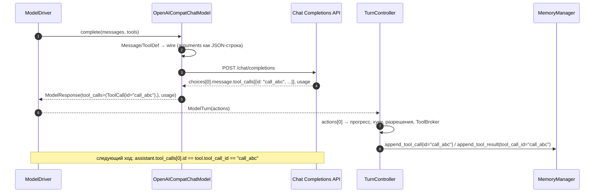
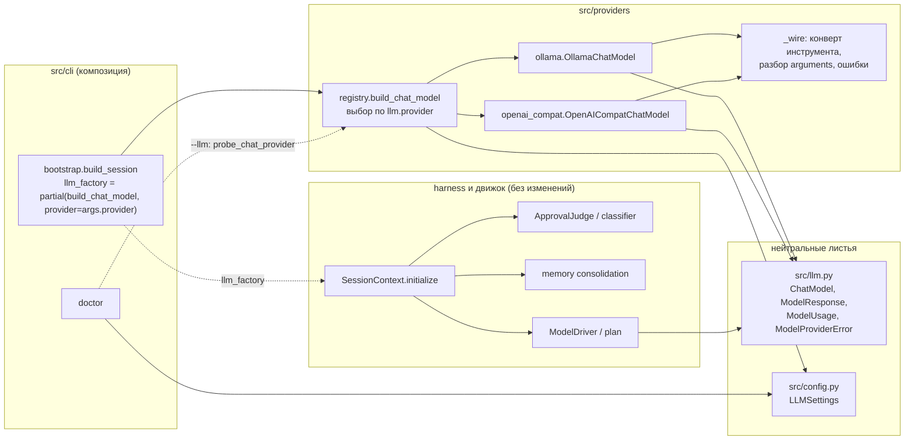

# OpenAI-совместимый провайдер чат-моделей

Статус: Accepted — шаги 1–5 плана (§8) реализованы и влиты в `main`; живую проверку (шаг 6)
пользователь провёл на OpenAI (`gpt-5-mini`), ADR переведён в Accepted 2026-10-26. Открытые вопросы решены 2026-10-22, см. §7.1.
Отличия реализации от проекта — в §7.3.
Дата: 2026-10-22
Ветка: `feat/openai-compat-provider`
ADR (Accepted):
- [2026-10-22 OpenAI-совместимый провайдер чат-моделей](../decisions/2026-10-22-openai-compatible-chat-provider.md)

Сейчас агент разговаривает только с Ollama (`/api/chat`). Нужно подключать OpenAI и
совместимые с ним сервисы: агрегаторы (OhMyLama, OpenRouter, Together, Groq), вендорские
эндпоинты (DeepSeek, Mistral, OpenAI-совместимый эндпоинт Gemini) и локальные серверы
(LM Studio, vLLM, llama.cpp server, Ollama через `/v1`).

Документ определяет:
- один адаптер на протокол Chat Completions, без имён вендоров в коде;
- точное отображение нейтральных `Message`/`ToolDef`/`ModelResponse` на протокол;
- новые поля `llm.*`, выбор провайдера и фабрику моделей;
- нейтральные ошибки провайдера и учёт токенов (`ModelUsage`);
- тесты, риски и план внедрения по коммитам.

Термины — в [глоссарии](../glossary.md). Исходный контракт модели — в
[ADR об отказе от LangChain](../decisions/2026-09-03-drop-langchain-stack-provider-neutral-model.md).

---

## 1. Контекст и проблема

### 1.1 Что есть сейчас

Движок видит только нейтральный контракт `ChatModel` из `src/llm.py`:

```text
async complete(messages: Sequence[Message], *, tools: Sequence[ToolDef] = (), **params) -> ModelResponse
```

`ModelResponse` несёт `content`, `tool_calls` и `finish_reason`. Единственная реализация —
`OllamaChatModel` в `src/providers/ollama.py`: сериализует сообщения в форму `/api/chat`
клиента `ollama` и разбирает ответ обратно.

Кто и как получает модель:

| Потребитель | Где | Как получает модель |
|---|---|---|
| Композиция CLI | `src/cli/bootstrap.py:71` | `llm_factory = ollama_llm_factory` по умолчанию |
| Сессия | `src/harness/session.py:566` | `llm_factory(model=config.model, temperature=config.temperature)` |
| Классификатор подтверждений | `src/agent_loop/execution/approval.py:221` | `llm_factory(model=classifier_model, temperature=0.0)` или модель сессии |
| Консолидация памяти | `src/harness/session.py:1064` | модель сессии |
| План (вызов #0) | `src/agent_loop/execution/loop.py:1086` | `complete(messages)` без инструментов |
| Ход агента | `src/agent_loop/model.py:309` | `complete(messages, tools=[...])` |
| Evals | `src/agent_loop/evals.py` | `FakeChatModel`, провайдер не участвует |

Фабрика внедряется в сессию снаружи. Пакет `src/providers/` импортирует только
`src/cli/bootstrap.py`. Движок, harness и UI о провайдере не знают — их менять не нужно.

Важная особенность движка: `ActionParser.parse` (`src/agent_loop/model.py:36`) превращает
**все** `tool_calls` ответа в действия, но `TurnController` исполняет только первое
(`actions[0]`, `loop.py:404`). `MemoryManager.append_tool_call` (`src/harness/memory.py:255`)
записывает в историю один вызов, а `append_tool_result` — один ответ на его `id`. История
остаётся согласованной (один вызов — один результат), но остальные вызовы того же ответа
молча теряются. Если модель вернула JSON в тексте вместо нативного вызова, `ActionParser`
разбирает его из `content` (`model.py:47-52`), так что модели без нативных инструментов
частично работают.

### 1.2 Что не так

| # | Проблема | Где |
|---|---|---|
| P1 | Поддержан один протокол — Ollama `/api/chat`. OpenAI и совместимые сервисы недоступны. | `src/providers/ollama.py` |
| P2 | Фабрика Ollama зашита в композицию; справка `--model` говорит «Ollama model name». | `bootstrap.py:71`, `parser.py:49` |
| P3 | Таймаута на вызов модели нет: `AsyncClient(timeout=None)`. Зависший вызов ждёт сторожа цели (`loop.progress_timeout_seconds`, 120 с). | `ollama.py:54-58` |
| P4 | `reasoning_effort`, `max_output_tokens`, `max_reasoning_tokens` только записаны в конфиг и ни на что не влияют. | `config.py:176`, `config.example.yaml` |
| P5 | Расход токенов выбрасывается: измерить, что «дороже», нечем. | `ollama.py:176-180` |
| P6 | `temperature` отправляется всегда. Reasoning-модели (gpt-5.x, o-серия) её не принимают. | `ollama.py:110-115`, `LLMSettings.temperature` |
| P7 | Ошибка провайдера уходит в `goal.failed` как сырое исключение SDK с вендорским текстом. | `src/agent_loop/goals.py:91` |

### 1.3 Целевые сервисы

Протокол Chat Completions (`POST {base_url}/chat/completions`) де-факто стал общим. Первый
целевой сервис — **OhMyLama** (`https://ohmylama.ru/v1`). Его документация (`/api-docs`,
проверено 2026-10-22) заявляет:

- `Authorization: Bearer <ключ>`, `POST /v1/chat/completions` (текст, стриминг, reasoning),
  `GET /v1/models`;
- `tools`, `tool_choice`, `parallel_tool_calls` у 48 из 51 модели (без них только эмбеддинги
  и генерация изображений); среди моделей — `gemma-4`, `gpt-oss`, GPT-5.x, Claude, Gemini,
  DeepSeek, Qwen, Grok;
- у gpt-5.x, o3/o4-mini и claude-haiku-5.5 в списке параметров **нет** `temperature`;
- у большинства моделей лимит — `max_completion_tokens`, у Grok — `max_tokens`;
- `reasoning_effort` — у моделей GPT-5;
- по флагу ключа в ответ добавляется блок `lama: {cost, currency, duration_ms, billing_status}`.

Эти пункты определяют требования ниже: необязательная `temperature`, выбор имени параметра
лимита, проброс `reasoning_effort`, терпимость к лишним полям ответа.

---

## 2. Требования

### 2.1 Функциональные

- **F1.** Провайдер выбирается настройкой `llm.provider`; по умолчанию `ollama`, текущие
  конфиги работают без изменений.
- **F2.** Любой сервис с Chat Completions подключается заданием `llm.host`, `llm.api_key`,
  `llm.model` — без кода.
- **F3.** Вызов инструмента проходит полный круг: `id` вызова из ответа → `ToolCall.id` →
  `tool_call_id` ответа инструмента в следующем запросе.
- **F4.** `reasoning_effort` и `max_output_tokens` реально попадают в запрос;
  `temperature: null` означает «не отправлять».
- **F5.** Поля конкретного вендора (заголовки, параметры тела) задаются конфигом
  (`extra_headers`, `extra_body`), а не кодом.
- **F6.** Ответ несёт расход токенов (`ModelResponse.usage`), он попадает в `model.responded`.
- **F7.** Ошибки провайдера приходят в движок как нейтральное `ModelProviderError` с кодом
  статуса и коротким текстом.
- **F8.** `autobrowser doctor` показывает провайдер, базовый URL, модель и «ключ задан: да/нет»;
  `doctor --llm` дополнительно проверяет по сети, что провайдер отвечает и знает модель;
  флаг `--provider` переопределяет провайдер на один запуск.

### 2.2 Нефункциональные

- **N1.** В коде нет имён вендоров и вендорских URL. Профили сервисов — только в примерах
  конфигурации и документации.
- **N2.** Движок (`src/agent_loop/execution/`), harness и UI не меняются, кроме телеметрии
  `usage`. `src/providers/` по-прежнему импортирует только `src/cli/`.
- **N3.** Все лимиты и таймауты — поля `src/config.py` с описанием, отражённые в
  `.env.example` и `config.example.yaml` (`tests/test_config.py`).
- **N4.** Ключи и заголовки не попадают в события, логи, `doctor` и тексты ошибок. Ключ
  читается только из конфигурации AutoBrowser, не из `OPENAI_*` переменных окружения.
- **N5.** SDK импортируется лениво, как `ollama`: импорт модуля ничего не требует.
- **N6.** Адаптер тестируется без сети: фейковый клиент и `httpx.MockTransport`.

### 2.3 Вне скоупа

- Стриминг ответов (движку нужен целый ответ).
- Responses API (`/v1/responses`): агрегаторы его в основном не поддерживают.
- Нативные адаптеры Anthropic Messages и Gemini. Они планируются, но отдельной веткой. Реестр
  (§4.2) и плоский раздел `llm.*` (§4.3) — точки расширения: третий протокол добавляет значение
  `llm.provider`, модуль в `src/providers/` и строку реестра, не трогая harness и движок.
- Мультимодальный ввод (изображения в сообщениях), эмбеддинги, генерация изображений, аудио.
- Автоматический переход на резервную модель или провайдер.
- Стоимость в деньгах (блок `lama` и аналоги), цены моделей.
- Определение возможностей модели через `GET /v1/models`.
- Несколько именованных провайдеров одновременно (например, классификатор у другого вендора).

---

## 3. Протокол Chat Completions: что важно для агента

### 3.1 Запрос

Сообщения:

| Нейтральное `Message` | Chat Completions |
|---|---|
| `system` | `{"role": "system", "content": ...}`. Роль `developer` не используется: OpenAI сам отображает `system` для reasoning-моделей, агрегаторы знают только `system`. |
| `user` | `{"role": "user", "content": ...}` |
| `assistant` без вызовов | `{"role": "assistant", "content": ...}` |
| `assistant` с `tool_calls` | `{"role": "assistant", "content": <текст или null>, "tool_calls": [{"id", "type": "function", "function": {"name", "arguments": <JSON-строка>}}]}` |
| `tool` | `{"role": "tool", "tool_call_id": ..., "content": ...}`; `name` не отправляется |

Отличия от Ollama, на которых легко ошибиться:
- `arguments` — **строка** JSON (`json.dumps(..., ensure_ascii=False)`), а не объект;
- у каждого вызова обязательны `id` и `type: "function"`;
- `tool_call_id` должен совпадать с `id` вызова из предыдущего сообщения, иначе провайдер
  отвечает 400;
- пустой текст при вызове инструментов отправляется как `null`: часть провайдеров отклоняет
  `""` рядом с `tool_calls`.

Инструменты — тот же конверт, что уже строит Ollama (`_tool_to_wire`):
`{"type": "function", "function": {"name", "description", "parameters"}}`. Конверт выносится в
общий помощник `src/providers/_wire.py` и используется обоими адаптерами. `strict` не
задаётся: схемы MCP-серверов не обязаны удовлетворять строгому режиму.

Параметры:

| Параметр | Источник | Когда отправляется |
|---|---|---|
| `model` | `llm.model` или аргумент фабрики | всегда |
| `temperature` | `llm.temperature` или аргумент фабрики | только если не `None` |
| `max_completion_tokens` или `max_tokens` | `llm.max_output_tokens`, имя из `llm.max_tokens_param` | только если лимит задан |
| `reasoning_effort` | `llm.reasoning_effort` | только если задан |
| `parallel_tool_calls` | `llm.parallel_tool_calls` | только если задан **и** в запросе есть инструменты (OpenAI отклоняет параметр без `tools`) |
| `top_p`, `seed` | `**params` вызова | если переданы |
| поля `extra_body` | `llm.extra_body` | всегда, слиянием поверх; зарезервированные ключи запрещены валидатором |
| `stream` | — | не отправляется (`false` по умолчанию) |

`max_reasoning_tokens` остаётся декларативным: стандартного поля в Chat Completions нет.
Вендор, который его поддерживает, получает его через `extra_body` (например, объект
`reasoning` у OpenRouter).

Нестандартные параметры вызова (`num_ctx` и т. п.) игнорируются, как сейчас в адаптере Ollama.
Сейчас ни один потребитель `**params` не передаёт.

### 3.2 Ответ

| Поле ответа | `ModelResponse` |
|---|---|
| `choices` пуст или отсутствует | `ModelProviderError` («пустой ответ»), не пустой `ModelResponse` |
| `choices[0].message.content` | `content`; `null` → `""` |
| `choices[0].message.tool_calls[]` | `tool_calls`; учитываются только `type == "function"` с непустым `name` |
| `tool_calls[].id` | `ToolCall.id`; если `id` пуст или повторяется в этом ответе — генерируется `call_<uuid4>`, как в Ollama |
| `tool_calls[].function.arguments` | JSON-строка → `dict`; невалидный JSON или не-объект → `{}` |
| `choices[0].finish_reason` | `finish_reason` как есть (`stop`, `tool_calls`, `length`, `content_filter`) |
| `usage` | `ModelUsage` (§4.5) |
| `reasoning_content`, `reasoning`, `lama` и другие вендорские поля | игнорируются; рассуждения **не** добавляются в `content` |
| устаревший `function_call` | игнорируется |

Невалидные `arguments` превращаются в `{}` намеренно, как в Ollama. Инструмент получает пустые
аргументы, MCP-сервер возвращает ошибку валидации, модель читает её и исправляет вызов на
следующем ходу. Исключение здесь убило бы всю цель из-за одной опечатки модели.

### 3.3 Один вызов за ход

Движок исполняет только первый вызов ответа (§1.1). Если OpenAI-модель вернула два
параллельных вызова, второй потерян, а токены за него оплачены. Модель его не «помнит»: в
истории есть только исполненный вызов, и на следующем ходу она повторит нужное действие.
История корректна, но это лишняя работа.

Решение: настройка `llm.parallel_tool_calls: bool | None`. По умолчанию `None` — параметр не
отправляется, потому что не все серверы его принимают. В примерах профилей OpenAI и OhMyLama
стоит `false`. Исполнение нескольких вызовов за ход — изменение движка, оно вне этого дизайна.

### 3.4 Последовательность хода с вызовом инструмента



---

## 4. Дизайн

### 4.1 Компоненты и слои



Файлы:

| Модуль | Изменение |
|---|---|
| `src/llm.py` | + `ModelUsage`, + `ModelResponse.usage`, + `ModelProviderError` |
| `src/providers/_wire.py` | новое: общий конверт `ToolDef`, разбор `arguments`, усечение текста ошибки |
| `src/providers/openai_compat.py` | новое: `OpenAICompatChatModel`, `openai_compat_llm_factory` |
| `src/providers/registry.py` | новое: `build_chat_model(model=None, temperature=None, *, provider=None, **kwargs) -> ChatModel`; `probe_chat_provider(settings, *, timeout) -> ProviderProbe` для `doctor --llm` |
| `src/providers/ollama.py` | таймаут из настроек, `usage`, `ModelProviderError`, `max_output_tokens → num_predict`, `temperature=None` не отправляется |
| `src/config.py` | новые поля `LLMSettings` (§4.3) |
| `src/cli/bootstrap.py` | фабрика по умолчанию — `build_chat_model`, провайдер из `--provider` |
| `src/cli/parser.py` | `--provider`; нейтральная справка `--model`; `--temperature` принимает «не отправлять» |
| `src/cli/subcommands.py` | строка `llm` в `doctor`; флаг `doctor --llm` с сетевой проверкой |
| `src/agent_loop/model.py` | `usage` в `ModelTurn.metadata` (уходит в `model.responded`) |
| `src/agent_loop/execution/loop.py` | `usage` в `model.responded` фазы `plan` |
| `src/harness/session.py` | `LLMFactory = Callable[..., ChatModel]` (только тип) |

Границы:
- `src/providers/**` импортирует только `src.config`, `src.contracts`, `src.llm`,
  `src.messages` и сторонние SDK;
- `src.providers` импортирует только `src/cli/`. Новый тест в
  `tests/test_engine_boundaries.py` фиксирует, что `src/agent_loop/**`, `src/harness/**` и
  `src/ui/**` его не импортируют;
- имена провайдеров (`ollama`, `openai_compat`) — фиксированный словарь протоколов, а не
  имена вендоров; в `src/` нет строк `openrouter`, `ohmylama` и вендорских URL.

### 4.2 Контракты (эскизы)

```python
# src/llm.py
@dataclass(frozen=True)
class ModelUsage:
    """Token accounting reported by the provider; every field is optional."""
    input_tokens: int | None = None
    output_tokens: int | None = None
    cached_input_tokens: int | None = None
    reasoning_tokens: int | None = None
    provider_duration_ms: int | None = None   # Ollama total_duration
    load_duration_ms: int | None = None       # Ollama load_duration

    def to_json_dict(self) -> dict[str, int]: ...   # only the fields that are set

@dataclass(frozen=True)
class ModelResponse:
    content: str = ""
    tool_calls: tuple[ToolCall, ...] = ()
    finish_reason: str | None = None
    usage: ModelUsage | None = None             # additive; None = not reported

class ModelProviderError(RuntimeError):
    """A provider call failed; the message is short and carries no secrets."""
    def __init__(
        self,
        message: str,
        *,
        provider: str,                 # "ollama" | "openai_compat"
        status_code: int | None = None,
        retryable: bool = False,
    ) -> None: ...
```

Поля `ModelUsage` совпадают с эскизом из
[дизайна тестового пайплайна](2026-10-19-autonomous-test-pipeline-design.md) и дополняют его
`reasoning_tokens`. Ветка пайплайна берёт этот тип готовым.

```python
# src/providers/openai_compat.py
class OpenAICompatChatModel(ChatModel):
    def __init__(
        self,
        model: str | None = None,
        temperature: float | None = None,   # None here = take llm.temperature
        *,
        settings: LLMSettings | None = None,  # None = get_settings().llm
        client: Any | None = None,            # tests inject a fake AsyncOpenAI
    ) -> None: ...

    async def complete(self, messages, *, tools=(), **params) -> ModelResponse: ...

# src/providers/registry.py
ProviderName = Literal["ollama", "openai_compat"]

def build_chat_model(
    model: str | None = None,
    temperature: float | None = None,
    *,
    provider: ProviderName | None = None,   # None = llm.provider
    **kwargs: Any,
) -> ChatModel: ...
```

Сигнатура `build_chat_model(model=..., temperature=...)` совместима с текущими вызовами
`llm_factory` в `session.py:566` и `approval.py:221`, поэтому harness не меняется.
`--provider` привязывается в `bootstrap` через `functools.partial`, и классификатор с
отдельной `classifier_model` получает тот же провайдер, что и сессия.

`temperature` в фабрике по-прежнему означает «взять из настроек», если не передана. Явное
«не отправлять» задаётся только настройкой `llm.temperature: null`: CLI-флаг передаёт
значение в фабрику, а `None` там уже занят под «по умолчанию». Сохраняется и
`ollama_llm_factory`: тесты и внешние вызовы его используют.

### 4.3 Настройки (`llm.*`)

Раздел остаётся плоским: почти все поля общие для обоих протоколов, а вложенные подразделы
удлинили бы имена переменных окружения. В описании каждого поля сказано, какой провайдер его
читает.

| Поле | Тип и умолчание | Провайдеры | Смысл |
|---|---|---|---|
| `provider` | `Literal["ollama", "openai_compat"] = "ollama"` | — | протокол адаптера |
| `model` | `str = "gemma4:31b-cloud"` | оба | без изменений |
| `temperature` | `float \| None = 0.0` | оба | `None` — не отправлять (reasoning-модели) |
| `host` | `str \| None = None` | оба | базовый URL. Для `openai_compat` **обязателен** (`…/v1`): валидатор падает при старте с понятным сообщением. Вендорского URL по умолчанию в коде нет, переменные `OPENAI_BASE_URL` не читаются. |
| `api_key` | `SecretStr \| None = None` | оба | `Bearer`-ключ. Без ключа заголовок `Authorization` не отправляется (локальные серверы). `OPENAI_API_KEY` не читается. |
| `timeout_seconds` | `float \| None = 60.0`, `gt=0` | оба | таймаут одного HTTP-вызова; `None` — без таймаута (прежнее поведение Ollama) |
| `max_retries` | `int = 0`, `0..10` | `openai_compat` | повторы SDK на соединение, 408/409/429/5xx с его backoff. По умолчанию повторов нет (§7.1, решение 5) |
| `max_output_tokens` | без изменений | оба | теперь отправляется: `num_predict` у Ollama, параметр из `max_tokens_param` у `openai_compat` |
| `max_tokens_param` | `Literal["max_completion_tokens", "max_tokens"] = "max_completion_tokens"` | `openai_compat` | имя поля лимита: OpenAI и большинство моделей OhMyLama — `max_completion_tokens`, Grok и старые серверы — `max_tokens` |
| `reasoning_effort` | без изменений | `openai_compat` | теперь отправляется; для Ollama остаётся декларативным |
| `max_reasoning_tokens` | без изменений | — | декларативное; вендорский эквивалент — через `extra_body` |
| `parallel_tool_calls` | `bool \| None = None` | `openai_compat` | `None` — не отправлять; см. §3.3 |
| `extra_headers` | `dict[str, str] = {}` | `openai_compat` | дополнительные заголовки (`HTTP-Referer`/`X-Title`, `api-key`). Значения могут быть секретами: не логируются, `doctor` печатает только имена. |
| `extra_body` | `dict[str, Any] = {}` | `openai_compat` | вендорские поля тела. Ключи `model`, `messages`, `tools`, `stream`, `temperature`, `max_tokens`, `max_completion_tokens`, `reasoning_effort`, `parallel_tool_calls` запрещены валидатором: для них есть типизированные поля. |
| `error_preview_chars` | `int = 300`, `ge=40` | оба | сколько символов текста ответа провайдера попадает в `ModelProviderError` |

Связь таймаутов: вызов модели не порождает событий, а сторож цели срабатывает через
`loop.progress_timeout_seconds` (120 с) без прогресса. Худший случай одного вызова —
`timeout_seconds × (max_retries + 1)` плюс backoff. При умолчаниях (60 с, без повторов) это
60 с — вдвое меньше бюджета сторожа. Пользователь может включить повторы, поэтому `doctor`
предупреждает, когда произведение не меньше `loop.progress_timeout_seconds`. Межсекционного
валидатора нет: разделы `frozen` и независимы, а жёсткий отказ при старте здесь избыточен.

Переменные окружения (`AUTOBROWSER_LLM__PROVIDER`, `…__TIMEOUT_SECONDS`, `…__EXTRA_HEADERS='{"X-Title":"AutoBrowser"}'`
и т. д.) появляются в `.env.example`; поля с примерами профилей — в `config.example.yaml`
(§5). `tests/test_config.py` проверяет синхронность.

### 4.4 Клиент и транспорт

Транспорт — официальный SDK `openai` (`AsyncOpenAI`), импортируемый лениво внутри
`OpenAICompatChatModel.__init__` (решение 1, §7.1). Он даёт повторы с backoff и
`Retry-After`, таймауты, типизированные ошибки и проверенную сериализацию. `httpx` уже в
зависимостях, но повторы, разбор ошибок и форматы пришлось бы поддерживать самим (см. ADR,
альтернативы). Версия SDK фиксируется в `pyproject.toml` и `uv.lock`, как остальные
зависимости.

Конструирование клиента — одна функция модуля (`_build_client(settings)`), её используют и
`OpenAICompatChatModel`, и сетевая проверка `doctor --llm` (§4.7), чтобы проверка шла с теми
же заголовками и ограничениями:
- `base_url = llm.host`, `timeout = llm.timeout_seconds`, `max_retries = llm.max_retries`,
  `default_headers = llm.extra_headers`;
- ключ передаётся явно. Без ключа заголовок `Authorization` **не отправляется** (решение 2,
  §7.1): SDK получает пустую строку-заглушку, а заголовок убирается. `OPENAI_API_KEY` не
  читается. Тест на закреплённой версии SDK проверяет, что запрос уходит без заголовка;
- **переменные окружения SDK нейтрализуются.** Без явного значения `AsyncOpenAI` читает
  `OPENAI_ORG_ID` и `OPENAI_PROJECT_ID` и отправил бы заголовки `OpenAI-Organization` и
  `OpenAI-Project` стороннему агрегатору. Адаптер передаёт их явно пустыми и не допускает
  этих заголовков. Тест выставляет переменные и проверяет исходящий запрос;
- логгеры `openai` и `httpx` пишут только в файл лога сессии, а не в терминал: в режиме TUI
  действует правило «единственного писателя» (`docs/development/terminal-ui.md`).

`OllamaChatModel` получает `timeout = llm.timeout_seconds` (сейчас `None`).

### 4.5 Учёт токенов

| `ModelUsage` | Chat Completions | Ollama |
|---|---|---|
| `input_tokens` | `usage.prompt_tokens` | `prompt_eval_count` |
| `output_tokens` | `usage.completion_tokens` | `eval_count` |
| `cached_input_tokens` | `usage.prompt_tokens_details.cached_tokens` | — |
| `reasoning_tokens` | `usage.completion_tokens_details.reasoning_tokens` | — |
| `provider_duration_ms` | — | `total_duration` (нс → мс) |
| `load_duration_ms` | — | `load_duration` (нс → мс) |

Если провайдер не прислал `usage`, поле `None`. Отсутствующие подполя тоже `None`, а не 0:
ноль и «не сообщил» различаются.

Телеметрия: `ModelDriver.invoke` кладёт `usage.to_json_dict()` в `ModelTurn.metadata["usage"]`,
и оно уходит в `model.responded` фазы `agent`. Фаза `plan` (`loop.py:1087`) добавляет то же
поле в свой payload. Суммирование, бенчмарки и сравнение по стоимости — задача ветки
тестового пайплайна. Классификатор и консолидация `usage` в событиях пока не публикуют.

### 4.6 Ошибки

Оба адаптера переводят ошибки клиента в `ModelProviderError`:

| Исходная ошибка | `status_code` | `retryable` | Текст |
|---|---|---|---|
| соединение, DNS, TLS | `None` | да | `openai_compat: connection failed (<класс>)` |
| таймаут | `None` | да | `openai_compat: timed out after <n> s` |
| HTTP 400 | 400 | нет | `openai_compat 400: <message из тела, усечённый>` |
| 401 / 403 | код | нет | `… : authentication failed`, тело не цитируется |
| 402 | 402 | нет | `… : payment required / insufficient balance` + усечённое тело |
| 404 | 404 | нет | `… : model or endpoint not found` + усечённое тело |
| 429, 5xx | код | да | сразу при `max_retries: 0`, иначе после исчерпания повторов SDK; + усечённое тело |
| пустые `choices`, нечитаемый ответ | `None` | нет | `… : empty response` |
| ошибки Ollama (`ResponseError`, `httpx`) | код, если есть | по аналогии | `ollama …` |

Текст усекается до `llm.error_preview_chars` и никогда не содержит ключа или заголовков:
SDK их в сообщения не вставляет, а адаптер цитирует только поле `error.message` тела.

Кто это видит:
- ход агента или план: исключение доходит до `GoalRunner` → `goal.failed` с коротким текстом.
  TUI показывает блок failed. Поведение не меняется, улучшается только текст;
- классификатор подтверждений уже трактует любую ошибку как «спросить человека», консолидация
  памяти — как пропуск. Без изменений.

Повторов на уровне движка нет: повторяет только SDK в пределах `max_retries`, а по умолчанию
их нет вовсе. 429 или 503 от провайдера по умолчанию завершают цель как `failed`. Это
сознательная цена за то, что вызов модели всегда укладывается в бюджет сторожа. Ошибку
«неподдерживаемый параметр» (например, `temperature` у gpt-5) адаптер не обходит молча:
текст 400 называет параметр, а пользователь ставит `temperature: null`. Автоматический
повтор без параметра спрятал бы конфигурацию от пользователя.

### 4.7 CLI и `doctor`

- `--provider {ollama,openai_compat}` — переопределение на один запуск; по умолчанию
  `llm.provider`.
- `--model`: справка «Chat model id, as the provider expects it».
- `doctor`, строка `llm` (без сети):
  `openai_compat · https://ohmylama.ru/v1 · gemma-4 · key set · timeout 60 s × 1`.
  - `FAIL`, если `openai_compat` без `host` (настройки и так не загрузятся — сработает
    существующая ветка `settings`);
  - `WARN`, если `timeout_seconds × (max_retries + 1) ≥ loop.progress_timeout_seconds`;
  - `extra_headers` — только имена.
- `doctor --llm` — **сетевая проверка** (решение 4, §7.1). Без флага `doctor` в сеть не ходит:
  проверка тратит запрос и отправляет ключ провайдеру.

Сетевая проверка:

| Провайдер | Запрос | Через |
|---|---|---|
| `openai_compat` | `GET {host}/models` | `client.models.list()` клиента из `_build_client` |
| `ollama` | `GET {host}/api/tags` | `AsyncClient.list()` с тем же `host`, ключом и таймаутом |

- Таймаут — `ui.doctor_probe_timeout_seconds` (уже есть). Повторов нет, `max_retries`
  игнорируется. Новых настроек не нужно.
- Контракт — функция реестра, не метод `ChatModel` (протокол остаётся минимальным, фейки в
  тестах и evals не меняются):

  ```python
  # src/providers/registry.py
  @dataclass(frozen=True)
  class ProviderProbe:
      reachable: bool
      model_listed: bool | None      # None — провайдер не вернул список
      models_count: int | None
      error: str | None              # короткий текст ModelProviderError, без секретов

  def probe_chat_provider(settings: LLMSettings, *, timeout: float) -> ProviderProbe: ...
  ```

  `doctor` синхронный, поэтому проверка выполняется через `asyncio.run`.
- Строки вывода:
  - `OK  llm probe  reachable · 51 models · gemma-4 listed`;
  - `WARN`, если провайдер отвечает, но модели нет в списке. Это не ошибка: часть
    агрегаторов перечисляет не все модели или использует псевдонимы;
  - `FAIL` при 401/403 (ключ), 404 (неверный `host` — частая ошибка с пропущенным `/v1`),
    ошибке соединения или таймауте. Код возврата `doctor` — 1, как для остальных `FAIL`.
- Вывод не содержит ключа, значений заголовков и тела ответа сверх
  `llm.error_preview_chars`.

### 4.8 Безопасность и данные

- Ключ — только `llm.api_key` (`SecretStr`). Он не попадает в события (`redact_json_safe`
  уже прячет `authorization`/`api_key`), логи, `doctor` и `ModelProviderError`.
- Переменные `OPENAI_*` не читаются (§4.4), чтобы ключи и организация от другого проекта не
  ушли стороннему сервису.
- Всё, что видит агент (содержимое страниц, вывод инструментов, память), уходит выбранному
  провайдеру. Для облачных агрегаторов это внешняя передача данных — отмечается в
  `docs/development/setup.md`.

---

## 5. Профили сервисов (только в `config.example.yaml` и документации)

Комментарии в `config.example.yaml` получают закомментированные профили. Имена вендоров
живут только там.

```yaml
# Ollama, локальный демон (умолчание)
llm:
  provider: ollama
  model: gemma4:31b-cloud

# OhMyLama — российский агрегатор, OpenAI-совместимый API
llm:
  provider: openai_compat
  host: https://ohmylama.ru/v1
  api_key: "YOUR_API_KEY"
  model: gemma-4
  parallel_tool_calls: false

# OpenAI, reasoning-модель: temperature не принимается
llm:
  provider: openai_compat
  host: https://api.openai.com/v1
  api_key: "YOUR_API_KEY"
  model: gpt-5-mini
  temperature: null
  reasoning_effort: low
  parallel_tool_calls: false

# OpenRouter
llm:
  provider: openai_compat
  host: https://openrouter.ai/api/v1
  api_key: "YOUR_API_KEY"
  model: <vendor>/<model>
  extra_headers: {"X-Title": "AutoBrowser"}

# Локальный сервер: LM Studio (:1234), vLLM (:8000), Ollama через /v1 (:11434)
llm:
  provider: openai_compat
  host: http://localhost:1234/v1
  model: <model-id>
```

---

## 6. Влияние на тесты и документы

### 6.1 Тесты

| Файл | Что проверяет |
|---|---|
| `tests/test_openai_compat_provider.py` (новое) | сериализация всех ролей; `arguments` — строка JSON; `content: null` рядом с `tool_calls`; круг `id` → `tool_call_id`; разбор ответа: пустые `choices`, `content: null`, нет `id`, повтор `id`, невалидный JSON, не-`function`, вендорские поля игнорируются, `reasoning_content` не попадает в `content`; параметры: `temperature=None` не отправляется, имя лимита по `max_tokens_param`, `reasoning_effort`, `parallel_tool_calls` только с `tools`, `extra_body` сливается; `usage` и отсутствующие подполя; отображение ошибок и усечение |
| там же, через `httpx.MockTransport` и настоящий `AsyncOpenAI` | путь `…/v1/chat/completions`; `Authorization` с ключом и **без** него; при выставленных `OPENAI_ORG_ID`, `OPENAI_PROJECT_ID`, `OPENAI_API_KEY`, `OPENAI_BASE_URL` в запросе нет их следов; `extra_headers` уходят; при `max_retries: 0` 429 не повторяется, при `max_retries: 1` — один повтор |
| `tests/test_ollama_provider.py` (новое; сейчас адаптер покрыт только косвенно в `test_config.py`) | таймаут передаётся клиенту; `max_output_tokens → num_predict`; `temperature=None` не отправляется; `usage` из `prompt_eval_count`/`eval_count`/длительностей; ошибки → `ModelProviderError` |
| `tests/test_provider_registry.py` (новое) | выбор адаптера по настройке и по `provider=`; ленивый импорт: модуль `openai` не грузится при `provider: ollama`; неизвестный провайдер — ошибка; `probe_chat_provider` на `MockTransport` и фейковом клиенте Ollama: модель в списке / нет в списке / 401 / 404 / таймаут / соединение, без повторов и без ключа в `error` |
| `tests/test_config.py` | новые поля, валидаторы (`host` для `openai_compat`, зарезервированные ключи `extra_body`), `temperature: null`, синхронность `.env.example`/`config.example.yaml` |
| `tests/test_engine_boundaries.py` | `src/agent_loop/**`, `src/harness/**`, `src/ui/**` не импортируют `src.providers`; в `src/` нет вендорских URL |
| `tests/test_agent_loop_events.py` | `usage` в `model.responded` фаз `agent` и `plan`; без `usage` поле отсутствует |
| `tests/test_cli_entry.py` / `tests/test_main_cli.py` | `--provider`, справка `--model`; `doctor` печатает строку `llm` без ключа и значений заголовков, `WARN` по таймаутам; `doctor` без `--llm` не вызывает проверку; `doctor --llm` печатает `OK`/`WARN`/`FAIL` по подменённому `probe_chat_provider` и возвращает 1 при `FAIL` |
| `tests/test_messages.py` | `ModelResponse` с `usage` остаётся совместимым |

Сценарные evals (`FakeChatModel`) и `tests/evals/baselines/agent_loop_v1.json` не меняются.

### 6.2 Документы

- `CLAUDE.md`, `AGENTS.md`: «Ollama-compatible chat model» → «Ollama или любой
  OpenAI-совместимый провайдер»; ссылка на ADR.
- `docs/development/setup.md`: раздел «Провайдер модели» с профилями, предупреждение о
  передаче данных, `doctor --llm`.
- `README.md`: короткая строка о провайдерах.
- `docs/glossary.md`: `ModelUsage`, `ModelProviderError`, `OpenAI-compatible provider`,
  `Provider registry`; уточнить `Ollama provider` и `ModelResponse`.
- `docs/architecture/overview.md`: строка `src/providers/` в таблице модулей — добавить `openai_compat.py` и `registry.py`.
- Диаграммы в `docs/diagrams/` не меняются: фазы движка, границы цикла и инъекции harness те
  же.
- ADR → Accepted после живой проверки (шаг 6 плана).

---

## 7. Решения и риски

### 7.1 Принятые решения (2026-10-22)

Открытые вопросы первой редакции решены пользователем:

1. **Транспорт — SDK `openai`.** Так проще: повторы, таймауты и ошибки уже есть в SDK (§4.4).
2. **Без ключа заголовок `Authorization` не отправляется.** `OPENAI_API_KEY` не читается,
   ключи только в конфигурации AutoBrowser (§4.4).
3. **Нативные Anthropic и Gemini — в будущем, отдельной веткой.** В этой ветке только
   `openai_compat`; реестр и плоский раздел `llm.*` оставлены точками расширения (§2.3).
4. **Сетевая проверка в `doctor` — да, по флагу `doctor --llm`** (§4.7). Без флага `doctor`
   в сеть не ходит.
5. **Повторы по умолчанию убраны:** `llm.max_retries = 0`. Вызов модели при умолчаниях
   длится не дольше 60 с, вдвое меньше бюджета сторожа цели (§4.3). Поле остаётся
   настраиваемым, `doctor` предупреждает, если повторы выводят вызов за бюджет.

### 7.2 Риски

1. **Агрегатор неточно переводит формат.** OhMyLama проксирует Claude, Gemini и других в
   формат OpenAI. Возможные расхождения: формат и уникальность `id` вызовов, `content: ""`
   вместо `null`, несколько вызовов при `parallel_tool_calls: false`, отказ от `null`
   `content` в истории. Смягчение — устойчивый разбор (§3.2) и живой прогон на 3 семействах
   (шаг 6).
2. **Дрейф SDK.** Новые версии `openai` меняют поведение по умолчанию: окружение, заголовки,
   повторы. Смягчение — фиксированная версия и тесты через `MockTransport` на исходящий запрос.
3. **Появление таймаута у Ollama.** Сейчас таймаута нет. Медленная локальная модель на CPU
   может не уложиться в 60 с. Смягчение — `timeout_seconds: null` возвращает прежнее
   поведение; пометка в `setup.md`.
4. **Reasoning-модели и `temperature`.** Умолчание `0.0` вызовет 400 у gpt-5.x. Смягчение —
   понятный текст ошибки и профиль-пример с `temperature: null`; молчаливого обхода нет.
5. **Модели без нативных инструментов** работают только через JSON в тексте (`ActionParser`)
   и чаще ошибаются. Смягчение — в профилях выбирать модели с поддержкой tools.
6. **Стоимость и утечка данных** при облачном провайдере. Смягчение — `usage` в событиях,
   предупреждение в документации.
7. **Без повторов кратковременные 429/503 завершают цель.** У агрегаторов это случается при
   пиковой нагрузке. Смягчение — понятный текст `ModelProviderError` с кодом; пользователь
   может поставить `max_retries: 1` и при необходимости поднять
   `loop.progress_timeout_seconds` (`doctor` подскажет, если бюджет мал).

---

### 7.3 Уточнения при реализации (2026-10-22)

- **Парность вызовов в истории.** При отказе в подтверждении движок пишет финальный ответ
  сразу после `assistant.tool_calls`, без `tool`-сообщения (`blocked_response`), а сессия
  переносит эту историю в следующую задачу. Chat Completions отклоняет такой запрос (400).
  `openai_compat` при сериализации выбрасывает вызовы без ответа и ответы без вызова
  (`messages_to_wire`); движок не меняется, Ollama такое и так принимает.
- **Окружение SDK шире, чем описано в §4.4.** Кроме `OPENAI_API_KEY`, `OPENAI_ORG_ID` и
  `OPENAI_PROJECT_ID` SDK читает `OPENAI_BASE_URL`, `OPENAI_ADMIN_KEY`,
  `OPENAI_WEBHOOK_SECRET` и `OPENAI_CUSTOM_HEADERS` (произвольные заголовки). `build_client`
  нейтрализует все; без `llm.host` клиент не строится, чтобы не уйти на `OPENAI_BASE_URL`.
- **Без ключа.** SDK отказывается создавать клиент без ключа и проверяет каждый запрос на
  `Authorization`, поэтому клиент получает ключ-заглушку, а заголовок снимается на каждом
  запросе (`request_headers`). Тест на `MockTransport` проверяет, что заголовка нет.
- **`temperature: null` и CLI.** Отдельного значения «не отправлять» у `--temperature` нет:
  при `llm.temperature: null` умолчание флага само становится `None`, и фабрика берёт `None`
  из настроек.
- **Логи.** Отдельной настройки логгеров не понадобилось: под TUI `terminal_quiet` уже
  направляет корневой логгер в файл, а `openai`/`httpx` пропагируют в него.
- **`Authorization` из `extra_headers`** (в любом регистре) имеет приоритет над ключом. С ключом
  заголовок `Bearer` кладётся в заголовки клиента явно, чтобы `Authorization` из
  `OPENAI_CUSTOM_HEADERS` не мог его вытеснить или сломать проверку заголовков SDK.
- **Форма `usage` в событиях.** `usage` лежит на верхнем уровне payload `model.responded` в фазах
  `plan` и `agent` (а не в `metadata`, как в §4.5), чтобы потребителям хватало одной формы.
- **Классификатор подтверждений.** Литерал `temperature=0.0` для отдельной `classifier_model`
  вынесен в настройку `permissions.classifier_temperature` (0.0; `null` — взять
  `llm.temperature`). Если сессия температуру не отправляет (`llm.temperature: null`),
  классификатор тоже её не получает (`ApprovalJudge.from_settings(send_temperature=...)`).
- **`doctor`** печатает `llm.host` без userinfo, query и fragment.
- **Тесты событий** — в `tests/test_engine_events.py` (там уже проверяется `model.responded`
  фазы `plan`), а не в `tests/test_agent_loop_events.py`.

## 8. План внедрения

По коммиту на шаг. Тесты добавляются в каждом шаге. Полный `uv run pytest` и evals — в конце
пакета.

1. **Документы.** Этот дизайн и ADR (Proposed), реестры `docs/decisions/index.md` и
   `docs/README.md`, термины глоссария.
2. **Настройки.** Новые поля `LLMSettings`, `temperature: float | None`, валидаторы,
   `.env.example`, `config.example.yaml` с профилями (§5).
   Тесты: `test_config`.
3. **Нейтральный контракт и Ollama.** `ModelUsage`, `ModelResponse.usage`,
   `ModelProviderError` в `src/llm.py`; `src/providers/_wire.py`; в Ollama — таймаут,
   `usage`, ошибки, `num_predict`, необязательная `temperature`.
   Тесты: `test_ollama_provider`, `test_messages`.
4. **Адаптер `openai_compat`.** Зависимость `openai` в `pyproject.toml`/`uv.lock`;
   `OpenAICompatChatModel`, нейтрализация `OPENAI_*`, логгеры в файл.
   Тесты: `test_openai_compat_provider` (фейк и `MockTransport`).
5. **Композиция и CLI.** `src/providers/registry.py` с `build_chat_model` и
   `probe_chat_provider`, фабрика в `bootstrap`, `--provider`, справка `--model`, тип
   `LLMFactory`, строка `llm` и флаг `--llm` в `doctor`, проверка границ; `usage` в
   `model.responded`.
   Тесты: `test_provider_registry`, `test_engine_boundaries`, `test_agent_loop_events`,
   `test_cli_entry`.
6. **Живая проверка и документы.** `autobrowser doctor --llm` на OhMyLama, затем прогон с
   тремя моделями разных семейств (`gemma-4`, одна gpt-5.x с `temperature: null`, одна
   Claude) с `--show-state`: вызов инструмента, круг `id`, `usage`, ошибки 401 и 402
   (неверный ключ, пустой баланс).
   `CLAUDE.md`, `AGENTS.md`, `setup.md`, README, глоссарий; ADR → Accepted.
   Затем полный `uv run pytest`, `scripts/run_evals.py` против baseline и ревью
   `code-reviewer`.

## Источники

- [OhMyLama — API docs](https://ohmylama.ru/api-docs) (проверено 2026-10-22: базовый URL,
  эндпоинты, параметры моделей, блок `lama`).
- [ADR-2026-09-03: Drop the LangChain/LangGraph/LangSmith Dependency Stack](../decisions/2026-09-03-drop-langchain-stack-provider-neutral-model.md).
- [Дизайн автономного тестового пайплайна](2026-10-19-autonomous-test-pipeline-design.md) — `ModelUsage`.
- [Дизайн терминального UI](2026-10-19-gui-redesign-design.md) — правило единственного писателя.
