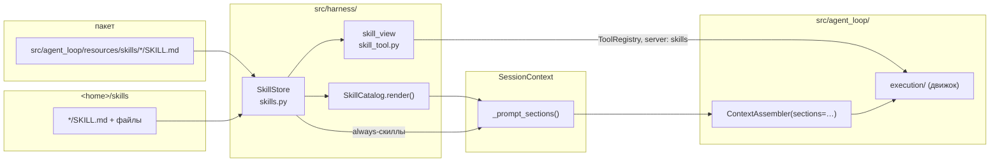
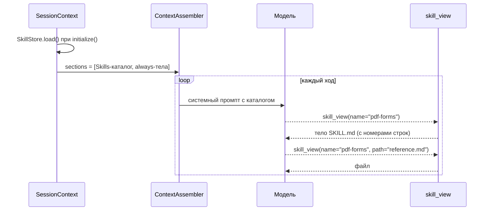

# Скиллы агента (Agent Skills)

Статус: Accepted — решения 1–5 (§2.4) подтверждены 2026-10-26; шаги 1–7 плана (§8) реализованы,
отличия от проекта — в §9. Пользователь проверил вживую (скилл `price-compare`, `/skills`), ADR
переведён в Accepted 2026-10-26.
Дата: 2026-10-26
Ветка: `feat/agent-skills`
ADR (Accepted):
- [2026-10-26 Скиллы агента по модели Agent Skills](../decisions/2026-10-26-agent-skills.md)

Сейчас «скилл» в AutoBrowser — один зашитый файл правил браузера, который целиком вставляется в
системный промпт любой сессии с браузерным MCP-сервером. Нужны настоящие скиллы по модели
Agent Skills (как у Anthropic): папки с `SKILL.md`, каталог в промпте, тело скилла модель
загружает сама инструментом, справочные файлы — по ссылке из тела. Скиллы бывают встроенные
(в пакете) и пользовательские (в домашней папке AutoBrowser).

Документ определяет:
- формат скилла, совместимый с `SKILL.md` Anthropic, и расширения AutoBrowser;
- источники, порядок обнаружения и проверку скиллов;
- постепенную подгрузку: каталог → тело → файлы;
- компоненты, слои и контракты (движок не знает о скиллах);
- настройки `skills.*`, события, `doctor`;
- перенос правил браузера в первый встроенный скилл без изменения промпта;
- тесты, риски и план внедрения по коммитам.

Термины — в [глоссарии](../glossary.md). Ближайший образец по слоям — память L4
([ADR о слоях памяти](../decisions/2026-10-02-layered-agent-memory.md),
[руководство](memory.md)).

---

## 1. Контекст и проблема

### 1.1 Что есть сейчас

`src/agent_loop/skills.py` определяет `PromptResource(name, title, path, description)` и
`browser_agent_rules_resource()`, который указывает на пакетный файл
`src/agent_loop/resources/browser-agent-rules.md`. Использование:

| Место | Что делает |
| --- | --- |
| `src/harness/session.py: _prompt_resources()` | Возвращает `[browser_agent_rules_resource()]`, если у сессии есть браузерный сервер (`mcp.browser_server`), иначе `[]`. |
| `src/agent_loop/context.py: ContextAssembler(resources=...)` | Каждый ресурс — системный блок `title` с приоритетом 45 на каждом ходе; содержимое читается с диска на каждом ходе. |
| `src/agent_loop/evals.py: run_scenario` | Собирает `ContextAssembler(resources=[browser_agent_rules_resource()])`. |
| `tests/test_packaging.py` | Пакетный файл байт-в-байт равен `docs/development/browser-agent-rules.md` и попадает в wheel. |
| `tests/test_context_assembler.py` | Блок `Browser Rules` в системном промпте. |

Память L4 (`src/harness/memory_store.py`, `memory_tool.py`) уже даёт рабочий образец:
harness-инструменты своего сервера (`server: memory`), `readOnlyHint` у чтения, блок контекста,
который рендерит сессия, и тест границ `tests/test_memory_boundaries.py`, запрещающий движку
знать о хранилище и именах инструментов.

### 1.2 Что не так

- Нет каталога: модель получает все правила целиком, даже когда они не нужны.
- Нет выбора моделью: что попадает в промпт, решает только код сессии.
- Нет подгрузки по запросу и справочных файлов: всё — один блок.
- Нет пользовательских скиллов: чтобы добавить инструкцию, нужно править пакет.
- Формат свой: готовые скиллы из экосистемы Agent Skills взять нельзя.

### 1.3 Образец: Agent Skills

Скилл в модели Anthropic — папка, в которой лежит `SKILL.md`: YAML-frontmatter с обязательными
`name` и `description` и markdown-тело с инструкцией. Рядом могут лежать справочные файлы и
скрипты. Подгрузка постепенная:

1. в контексте всегда только метаданные — `name` и `description` каждого скилла;
2. тело `SKILL.md` модель загружает, когда решает, что скилл подходит к задаче;
3. дополнительные файлы читаются по ссылке из тела, когда нужны.

Ограничения формата (открытая спецификация Agent Skills): `name` — до 64 символов, строчные
латинские буквы, цифры и дефис, совпадает с именем папки; `description` — непустая, до 1024
символов, говорит, что делает скилл и когда его применять. Необязательные поля: `license`,
`compatibility`, `allowed-tools`, `metadata` (словарь строк). Тело рекомендуется держать
коротким, подробности — в справочных файлах.

---

## 2. Требования

### 2.1 Функциональные

1. Скилл — папка с `SKILL.md` (frontmatter + тело) и необязательными справочными файлами.
2. Источники: встроенные (пакет) и пользовательские (`<home>/skills/`).
3. В системном промпте — каталог: имя и одна строка описания на скилл.
4. Тело загружается моделью через harness-инструмент `skill_view` (по образцу `memory_view`).
5. Справочные файлы читаются тем же инструментом по относительному пути внутри папки скилла.
6. Скилл выбирает модель. Никакого сопоставления по словам задачи или именам инструментов.
7. Скилл с флагом `always` вставляется в системный промпт целиком (как правила браузера сейчас).
8. Скилл может требовать возможность сессии (`requires: browser`): без неё он не виден.
9. Правила браузера становятся первым встроенным скиллом (`always`, `requires: browser`).

### 2.2 Нефункциональные

- **По умолчанию выключено** (`skills.enabled: false`), пока нет CI: промпт, поведение и
  baseline evals не меняются. С выключенными скиллами `always`-скиллы по-прежнему попадают в
  промпт — ровно так, как правила браузера сейчас.
- Движок (`src/agent_loop/execution/`) не импортирует хранилище скиллов и не знает имени
  `skill_view`; `ContextAssembler` получает готовые текстовые секции, а не скиллы.
- Нет логики по именам инструментов, сайтов или скиллов. Решение «браузерная ли сессия»
  остаётся там, где оно сейчас, — в `SessionContext` (`mcp.browser_server`).
- Все лимиты — поля секции `skills` в `src/config.py`, с `.env.example`,
  `config.example.yaml` и `tests/test_config.py`. Никаких модульных констант.
- Тесты строят хранилище из явных `SkillsSettings(...)` и `tmp_path`, никогда из
  `get_settings()`.
- Системный промпт стабилен в пределах сессии (скиллы читаются один раз при старте) — это
  сохраняет кэш промпта у провайдера.
- Скиллы не содержат правил под конкретные сайты или инструменты (кроме уже существующих
  правил браузера, которые пользователь правит сам).

### 2.3 Вне скоупа

- Запуск скриптов из скиллов (решение 2). Файлы скилла можно читать как текст, но не исполнять.
- Скиллы, которые пишет агент. Агентские процедуры остаются в памяти L4 (решение 3).
- Скиллы из рабочей папки или репозитория (решение 5).
- `allowed-tools` как ограничение: поле читается и сохраняется, но ничего не разрешает и не
  запрещает — авторизация остаётся за `PermissionEngine`.
- Slash-команда `/skills` в TUI и вызов скилла пользователем напрямую — после v1.
- Горячая перезагрузка скиллов во время сессии — после v1 (скиллы читаются при старте).
- Загрузка скиллов из сети, маркетплейсы, подписи.

### 2.4 Подтверждённые решения (2026-10-26)

| # | Вопрос | Решение |
| --- | --- | --- |
| 1 | Формат | Совместимый с Anthropic `SKILL.md`: готовые скиллы берутся без правки. Расширения AutoBrowser — в `metadata` (§3.2). |
| 2 | Скрипты | В v1 нет — только инструкции и файлы. Запуск кода — позже и только через правила разрешений. |
| 3 | Память L4 | Развести. Скиллы пишет человек: им доверяют, они версионируются, агент их не меняет. Процедуры (`memory/procedures/*.md`) пишет агент, они проходят staged trust. |
| 4 | Правила браузера | Флаг `always` во frontmatter; правилам браузера — `always`, промпт пользователь правит сам. |
| 5 | Где пользовательские скиллы | Только домашняя папка (`<home>/skills/`), без сканирования рабочей папки — как с `config.yaml`. |

---

## 3. Формат скилла

### 3.1 Структура папки

```text
<root>/
  browser-agent-rules/
    SKILL.md            # обязателен
  pdf-forms/
    SKILL.md
    reference.md        # справочный файл, на который ссылается тело
    examples/
      invoice.md
```

`<root>` — каталог встроенных скиллов в пакете или `<home>/skills/`. Скилл — непосредственный
подкаталог `<root>`, в котором есть `SKILL.md`. Вложенные скиллы не ищутся: подпапки внутри
скилла — его файлы.

### 3.2 Frontmatter

```markdown
---
name: browser-agent-rules
description: Snapshot-driven browser interaction and extraction rules.
metadata:
  always: "true"
  requires: browser
  title: Browser Rules
---
# Browser Agent Rules
...
```

| Поле | Обязательно | Смысл в AutoBrowser |
| --- | --- | --- |
| `name` | да | Идентификатор: `^[a-z0-9]+(-[a-z0-9]+)*$`, до 64 символов, совпадает с именем папки. |
| `description` | да | Строка каталога. Непустая; длиннее `skills.description_max_chars` — обрезается в каталоге (файл не меняется). |
| `license`, `compatibility`, `allowed-tools` | нет | Читаются и показываются в `doctor`, на поведение не влияют. |
| `metadata` | нет | Словарь строк. AutoBrowser читает из него три ключа ниже, остальные игнорирует. |
| `metadata.always` | нет | `"true"` — тело всегда в системном промпте (§4.4). По умолчанию `"false"`. |
| `metadata.requires` | нет | Возможности сессии через запятую. v1 знает одну: `browser` — у сессии есть браузерный сервер. Скилл с невыполненным требованием не попадает ни в каталог, ни в инструмент. Неизвестная возможность — скилл недействителен. |
| `metadata.title` | нет | Заголовок блока для `always`-скилла. По умолчанию — `name`. Нужен, чтобы блок правил браузера остался `Browser Rules:`. |

Почему расширения в `metadata`, а не на верхнем уровне: открытая спецификация разрешает
произвольные ключи только там, а валидаторы экосистемы отклоняют неизвестные поля верхнего
уровня. Строковые значения — тоже требование спецификации. Неизвестные поля верхнего уровня
AutoBrowser не отклоняет (скилл другого клиента может их нести), но `doctor` о них предупреждает.

### 3.3 Тело и справочные файлы

Тело — markdown после frontmatter, без изменений. Ссылки на файлы — обычные относительные пути
(`reference.md`, `examples/invoice.md`); модель читает их через
`skill_view(name, path)`. Никакой подстановки и разбора ссылок нет: путь проверяет инструмент.

Файл скилла — любой файл внутри папки скилла, который читается как UTF-8. Двоичные файлы и
файлы вне папки (`..`, абсолютные пути, символические ссылки наружу) отклоняются ошибкой
инструмента, которую модель читает. Скрипты читаются как текст, но не исполняются.

### 3.4 Проверка

Скилл недействителен, если: нет или не разбирается frontmatter; нет `name` или `description`;
`name` не соответствует шаблону или имени папки; неизвестная возможность в `requires`; тело
`always`-скилла больше `skills.always_max_chars`; `SKILL.md` больше `skills.file_max_chars`.
Недействительный скилл пропускается с предупреждением (событие `skills.invalid`, строка в
`doctor`) и не валит старт сессии — сессия без скилла лучше, чем отсутствие сессии. Встроенные
скиллы проверяет тест: недействительный встроенный скилл — ошибка CI, а не предупреждение.

---

## 4. Дизайн

### 4.1 Компоненты и слои



| Компонент | Место | Ответственность |
| --- | --- | --- |
| `Skill` | `src/harness/skills.py` | Неизменяемая запись: `name`, `description`, `source` (`builtin`/`user`), `path` (папка), `always`, `requires`, `title`, `body`. |
| `SkillStore` | `src/harness/skills.py` | Обнаружение и разбор скиллов из корней, проверка, фильтр по возможностям сессии, приоритет источников, чтение файлов скилла с проверкой пути. Строится из явных `SkillsSettings` и корней. |
| `SkillCatalog` | `src/harness/skills.py` | Рендерит текст блока `Skills` (заголовок, строка об инструменте, `- name: description`), обрезанный по `skills.catalog_max_chars`. |
| `skill_view` | `src/harness/skill_tool.py` | Harness-инструмент сервера `skills` в форме `MemoryTool`: `readOnlyHint`, тело или файл скилла. |
| `PromptSection` | `src/agent_loop/context.py` | Нейтральная текстовая системная секция: `name`, `title`, `text`, `priority`. Заменяет `PromptResource`. Ничего не знает о скиллах и файлах. |
| `SessionContext` | `src/harness/session.py` | Строит `SkillStore` в `initialize()`, решает возможности сессии (`browser`), регистрирует `skill_view` и собирает `PromptSection` для `ContextAssembler`. |

`src/agent_loop/skills.py` удаляется вместе с `PromptResource` и
`browser_agent_rules_resource()`: имя модуля освобождается, а ресурсный контракт заменяет
`PromptSection`.

### 4.2 Источники и приоритет

| Источник | Корень | Включён |
| --- | --- | --- |
| Встроенные | `src/agent_loop/resources/skills/` (пакетные данные, через `importlib.resources`) | всегда |
| Пользовательские | `skills.dir`; относительный путь — относительно `storage.root_dir` (как `memory.dir`); по умолчанию `<home>/skills` | только при `skills.enabled` |

Рабочая папка и корень репозитория не сканируются (решение 5). Встроенные скиллы остаются в
`src/agent_loop/resources/`, рядом с нынешним файлом правил, чтобы не менять упаковку.

Пользовательский скилл с тем же `name`, что и встроенный, **заменяет** встроенный (событие
`skills.shadowed`, строка в `doctor`). Так пользователь правит правила браузера у себя, не трогая
пакет. Два пользовательских скилла с одним `name` невозможны — имя совпадает с папкой.

Порядок в каталоге — по `name`, стабильно; источник в каталоге модели не показывается.

### 4.3 Постепенная подгрузка



**Уровень 1 — каталог.** Системный блок `Skills` (приоритет 44 — после `Tool Inventory` (40), до
`always`-тел (45)):

```text
Skills:
Skills are instructions for kinds of work. When one fits the task, read it with skill_view
before acting; it may point to further files in the skill.
- browser-agent-rules: Snapshot-driven browser interaction and extraction rules.
- pdf-forms: Fill and check PDF forms. Use when a task involves a PDF form.
```

Текст рендерит `SkillCatalog` в harness — только он называет инструмент (как `TOOLS_HINT` у
памяти). `always`-скиллы тоже есть в каталоге: модель знает о них, а `skill_view` вернёт то же
тело (для файлов скилла это и нужно). Каталог есть, только если `skills.enabled` и есть хотя бы
один видимый скилл. Сверх `skills.catalog_max_chars` строки отбрасываются с конца с пометкой
`... N more skills not shown`.

**Уровень 2 — тело.** `skill_view(name)` возвращает заголовок `name — description` и тело с
номерами строк, обрезанное по `skills.body_max_chars`. Неизвестное имя — ошибка инструмента со
списком доступных имён.

**Уровень 3 — файлы.** `skill_view(name, path)` возвращает файл внутри папки скилла с номерами
строк, обрезанный по `skills.file_max_chars`; `view_range` — как у `memory_view`. Без `path` и
с `path: SKILL.md` — одно и то же.

Модель сама решает, когда загружать скилл. Код не сопоставляет скиллы с задачей, инструментами
или страницей.

### 4.4 `always`-скиллы и правила браузера

`always`-скилл — системный блок `title` (приоритет 45), содержимое — тело `SKILL.md`, как у
нынешнего `PromptResource`. Эти секции собирает сессия **независимо от `skills.enabled`**: так
выключенные скиллы дают тот же промпт, что сейчас. Включение скиллов добавляет каталог,
инструмент и пользовательские источники.

Перенос правил браузера:

```text
src/agent_loop/resources/browser-agent-rules.md
  → src/agent_loop/resources/skills/browser-agent-rules/SKILL.md
```

Frontmatter — как в §3.2; тело — нынешний файл байт-в-байт. Блок в промпте остаётся
`Browser Rules:` с тем же текстом: тест закрепляет, что собранный системный промпт до и после
переноса совпадает символ в символ для сессий с браузером и без. Копия в
`docs/development/browser-agent-rules.md` получает тот же frontmatter и остаётся байт-в-байт
равной пакетной (`tests/test_packaging.py`, путь обновляется; проверка wheel — на новый путь).

`requires: browser` заменяет проверку в `_prompt_resources()`: сессия передаёт `SkillStore`
множество возможностей (`{"browser"}`, если `mcp.browser_server`, иначе пусто). Сопоставление
возможностей — по строкам из фиксированного словаря, а не по именам инструментов.

Правила браузера перестают читаться с диска на каждом ходе: тело читается один раз при старте
сессии. Пользователь, который правит правила, перезапускает сессию — как с `config.yaml`.

### 4.5 Контракты (эскизы)

```python
# src/agent_loop/context.py
@dataclass(frozen=True)
class PromptSection:
    """A fixed system context block the composition root chose for this session."""

    name: str          # stable id, e.g. the skill name; goes to ContextBlock.source/metadata
    title: str         # block heading
    text: str
    priority: int = 45


class ContextAssembler:
    def __init__(self, system_prompt: str | None = None, *,
                 sections: Sequence[PromptSection] = ()) -> None: ...
```

```python
# src/harness/skills.py
SkillSource = Literal["builtin", "user"]
#: Capabilities a session can declare; ``metadata.requires`` may name only these.
SESSION_CAPABILITIES = frozenset({"browser"})

@dataclass(frozen=True)
class Skill:
    name: str
    description: str
    source: SkillSource
    path: Path            # the skill folder
    body: str
    always: bool = False
    requires: frozenset[str] = frozenset()
    title: str = ""

@dataclass(frozen=True)
class SkillProblem:
    path: Path
    reason: str

class SkillStore:
    @classmethod
    def load(cls, settings: SkillsSettings, *, roots: Sequence[tuple[SkillSource, Path]],
             capabilities: frozenset[str],
             on_event: Callable[[str, dict[str, Any]], None] | None = None) -> SkillStore: ...
    def skills(self) -> tuple[Skill, ...]: ...           # visible, sorted by name
    def always(self) -> tuple[Skill, ...]: ...
    def get(self, name: str) -> Skill | None: ...
    def read_file(self, name: str, path: str) -> str: ...  # SkillFileError on a bad path
    def problems(self) -> tuple[SkillProblem, ...]: ...

def builtin_skills_root() -> Path: ...
def user_skills_root(skills: SkillsSettings, storage: StorageSettings) -> Path: ...

class SkillCatalog:
    def __init__(self, store: SkillStore, settings: SkillsSettings) -> None: ...
    def render(self) -> str: ...                          # "" when nothing is visible
```

```python
# src/harness/skill_tool.py
SKILLS_SERVER = "skills"
VIEW_TOOL = "skill_view"

def skill_tools(store: SkillStore) -> list[SkillTool]: ...  # MemoryTool-shaped, readOnlyHint
```

Схема `skill_view`: `name` (строка, обязателен), `path` (строка, необязателен), `view_range`
(`[first, last]`, необязателен), `additionalProperties: false`.

### 4.6 Сборка в `SessionContext`

```text
initialize():
  hooks, permissions, memory (как сейчас)
  ... MCP запущен, известно mcp.browser_server ...
  capabilities = {"browser"} if browser server else {}
  roots = [("builtin", builtin_skills_root())]
        + ([("user", user_skills_root(s, storage))] if s.enabled else [])
  skill_store = SkillStore.load(s, roots=roots, capabilities=capabilities, on_event=…)
  session_tools += skill_tools(skill_store) if s.enabled and skill_store.skills() else []
  sections = [PromptSection("skills", "Skills", SkillCatalog(...).render(), 44)] if enabled
           + [PromptSection(skill.name, skill.title or skill.name, skill.body) for always]
  ContextAssembler(sections=sections)
```

Возможности сессии известны только после запуска MCP, а `session_tools` сейчас передаётся в
`ToolRegistry` раньше. В реализации хранилище строится после запуска MCP, а `skill_view`
добавляется в тот же `ToolRegistry` (`--no-mcp` — без возможностей, сразу). Если
`ToolRegistry` не принимает инструменты после создания, вызов `ToolRegistry(...)` переносится
после построения хранилища — без изменения порядка запуска Chrome/MCP.

`evals.py` собирает секции так же, через `SkillStore` над встроенным корнем с возможностью
`browser`, — чтобы evals проверяли тот же путь, что и сессия.

### 4.7 Настройки (`skills.*`)

Новая, двенадцатая секция `SkillsSettings` в `src/config.py`
(`AUTOBROWSER_SKILLS__<FIELD>`, frozen, `extra="forbid"`):

| Поле | Тип, границы | Умолчание | Смысл |
| --- | --- | --- | --- |
| `enabled` | bool | `false` | Каталог, `skill_view` и пользовательские скиллы. `always`-скиллы работают и без него. |
| `dir` | str | `skills` | Папка пользовательских скиллов; относительный путь — от `storage.root_dir` (по умолчанию это home), как у `memory.dir`. |
| `catalog_max_chars` | int ≥ 1 | 4000 | Потолок блока `Skills`. |
| `description_max_chars` | int ≥ 1 | 1024 | Символов описания в каталоге. |
| `body_max_chars` | int ≥ 1 | 20000 | Потолок ответа `skill_view` с телом. |
| `file_max_chars` | int ≥ 1 | 20000 | Потолок ответа `skill_view` с файлом и размер `SKILL.md`, который ещё разбирается. |
| `always_max_chars` | int ≥ 1 | 12000 | Потолок тела `always`-скилла; больше — скилл недействителен. |
| `max_skills` | int ≥ 1 | 100 | Сколько скиллов из одного корня читается; остальные — `skills.invalid`. |

Значения по умолчанию уточняются при реализации; правила браузера (~4,5 КБ) должны помещаться в
`always_max_chars` с запасом. `.env.example`, `config.example.yaml` (закомментированный пример
включения) и `tests/test_config.py` обновляются в том же коммите. Документация, где сказано
«одиннадцать секций», — тоже.

### 4.8 События и `doctor`

| Событие | Когда | Полезная нагрузка |
| --- | --- | --- |
| `skills.loaded` | один раз в `initialize()` | `enabled`, `capabilities`, `skills: [{name, source, always}]`, `problems: n` |
| `skills.invalid` | на каждый пропущенный скилл | `path` (относительно корня), `source`, `reason` |
| `skills.shadowed` | пользовательский заменил встроенный | `name` |

Загрузку тела отдельным событием не отмечаем: вызов `skill_view` уже виден в событиях
инструментов (`tool.*`) с аргументами. `session.json` получает снимок `skills` по образцу
`_memory_snapshot()`.

`doctor` добавляет строку `skills`: включены ли, путь пользовательской папки, сколько встроенных
и пользовательских, список недействительных с причиной, заменённые встроенные, неизвестные
поля верхнего уровня. Без сети и без запуска сессии.

### 4.9 Разрешения, прогресс, история

- `skill_view` — `readOnlyHint`: разрешён в `read_only`; правила пользователя могут адресовать
  его через `server: skills`. Встроенных правил нет.
- Повтор того же `skill_view` с теми же аргументами ловит обычный сторож повторов — модель
  читает причину. Отдельной логики нет.
- Read-only вызов кладёт ответ в `BrowserState.snapshots["skills"]`, как `memory_view` — в
  `snapshots["memory"]`. Это значит, что последнее загруженное тело остаётся в наблюдении.
  Поведение проверяется в реализации; если оно раздувает наблюдение, решение принимается общее
  для harness-серверов, а не исключение для скиллов.
- Сжатие истории сжимает старый ответ `skill_view`, когда есть более новый ответ того же
  инструмента. Модель может перечитать скилл; это нормально для v1.

### 4.10 Скиллы и память L4

| | Скиллы | Процедуры L4 |
| --- | --- | --- |
| Кто пишет | человек | агент (`memory_write`) |
| Доверие | доверенные | staged trust (`unverified` → …) |
| Где | пакет и `<home>/skills/` | `<home>/memory/procedures/` |
| Меняет агент | никогда | да, через `MemoryContentPolicy` |
| Версионирование | файлы человека (git, если он хочет) | консолидация в `SessionRuntime` |
| Подгрузка | каталог + `skill_view` | индекс + `memory_view`, блок `Memory` |

Хранилища, инструменты и серверы раздельные. Процедура, которая оказалась полезной, становится
скиллом только руками человека; автоматического «повышения» нет.

### 4.11 Безопасность

- Пользовательские скиллы — текст человека, ему доверяют как `config.yaml`. Скилл из интернета —
  чужой текст; `MemoryContentPolicy` к нему не применяется. Руководство предупреждает об этом, а
  `doctor` показывает каждый пользовательский скилл.
- Чтение файлов строго внутри папки скилла: `resolve()` и `is_relative_to(skill.path)`,
  символические ссылки наружу отклоняются, только UTF-8.
- Скрипты не исполняются (решение 2). Будущий запуск — отдельный инструмент под правилами
  разрешений, отдельный ADR.
- Скиллы не видят секретов: в промпт попадают только `name`, `description` и тела.

---

## 5. Влияние на тесты и документы

### 5.1 Тесты

| Файл | Что проверяет |
| --- | --- |
| `tests/test_skills.py` (новый) | Разбор frontmatter; проверки §3.4; `requires`; приоритет `user` над `builtin`; `max_skills`; стабильный порядок; чтение файлов (`..`, абсолютный путь, симлинк наружу, двоичный файл, `view_range`, обрезка); рендер каталога и его потолок. Только `tmp_path` и явные `SkillsSettings`. |
| `tests/test_skill_tool.py` (новый) | `skill_view` через обычный конвейер инструмента: `readOnlyHint`, `read_only`-режим, правило `ask` на `server: skills`, ошибка на неизвестное имя. |
| `tests/test_skill_boundaries.py` (новый) | Движок не упоминает `skills`-модули harness и `skill_view`; `src/harness/skills.py` и `skill_tool.py` импортирует только `session.py` (и `evals.py`); в модулях скиллов нет числовых модульных констант; все встроенные скиллы действительны. |
| `tests/test_context_assembler.py` | `PromptSection` вместо `PromptResource`; блок `Browser Rules` прежний. |
| `tests/test_prompts.py` | Текст каталога; системный промпт с выключенными скиллами совпадает с промптом до переноса. |
| `tests/test_packaging.py` | Новый путь встроенного скилла, равенство с копией в `docs/`, файл в wheel. |
| `tests/test_config.py` | Секция `skills` и синхронность `.env.example`/`config.example.yaml`. |
| `tests/test_harness_session.py` | Сессия с `skills.enabled` регистрирует `skill_view` и каталог; без — нет; без браузерного сервера правила браузера не видны. |
| `tests/evals/` | Новый сценарий с включёнными скиллами и скилл-фикстурой: модель загружает скилл и доходит до `done`. Baseline `agent_loop_v1` не меняется (скиллы выключены по умолчанию). |

### 5.2 Документы

- `docs/development/skills.md` — руководство: формат, где лежат, как добавить, как отключить,
  как отладить, безопасность.
- `docs/diagrams/` — сборка промпта и harness-инструменты.
- `CLAUDE.md`, `AGENTS.md`, `docs/development/setup.md` — секция `skills`, «двенадцать секций»,
  новые модули, тест границ.
- `docs/glossary.md` — термины (добавлены вместе с этим документом как proposed).
- `docs/development/browser-agent-rules.md` — frontmatter, ссылка на руководство.

---

## 6. Риски и компромиссы

| Риск | Смягчение |
| --- | --- |
| Модель не загружает подходящий скилл. | Строка каталога говорит «прочитай перед действием»; `description` — ответственность автора; eval-сценарий; правила браузера остаются `always`. |
| Перенос правил браузера незаметно меняет промпт. | Тест на совпадение системного промпта символ в символ до и после переноса. |
| Чужой скилл с инъекцией. | Только папка человека; предупреждение в руководстве; `doctor` перечисляет скиллы; скрипты не исполняются. |
| Тело в `snapshots["skills"]` раздувает наблюдение. | Проверка в реализации (§4.9); общее решение для harness-серверов. |
| Расширения в `metadata` со строковыми значениями неудобны. | Цена совместимости; `doctor` поясняет неверные значения. |
| Пользователь заменил правила браузера и сломал поведение. | `skills.shadowed` и строка в `doctor`; удаление папки возвращает встроенные правила. |
| Каталог разрастается. | `catalog_max_chars`, `max_skills`. |

---

## 7. Альтернативы

- **Оставить `PromptResource` и добавить ресурсы из папки.** Без каталога и выбора моделью — это
  нынешняя проблема в большем масштабе. Не выбрано.
- **Подбирать скиллы кодом по словам задачи, URL или инструментам.** Противоречит направлению
  проекта (никаких хардкодов, модель решает) и
  [ADR о работе без имён инструментов](../decisions/2026-10-19-name-free-tool-handling.md).
  Не выбрано.
- **Слить скиллы с процедурами L4.** Одно хранилище, но смешивает доверенный текст человека с
  непроверенным текстом агента и требует staged trust для человеческих файлов. Не выбрано
  (решение 3).
- **Скиллы как MCP-сервер.** Подходит для чужих клиентов, но в процессе это лишний процесс и
  протокол; harness-инструмент даёт то же через существующий конвейер. Может появиться позже
  как экспорт.
- **Расширения верхнего уровня (`always: true`).** Удобнее, но ломает совместимость с
  валидаторами экосистемы. Не выбрано (решение 1).
- **Тело скилла — в блок `Memory`-подобный user-блок после загрузки.** Требует состояния
  «загруженные скиллы» в `LoopState` и логики в движке. Ответ инструмента и история уже дают
  то же. Не выбрано.
- **Сканировать рабочую папку (`./.autobrowser/skills`).** Удобно для проектов, но скилл из
  чужого репозитория становится доверенным текстом. Не выбрано (решение 5).

---

## 8. План внедрения

Один коммит на шаг, Conventional Commits, подробное английское описание. Тесты — полный
`uv run pytest` и `scripts/run_evals.py --baseline tests/evals/baselines/agent_loop_v1.json`
один раз в конце пачки; ревью `code-reviewer` после каждой правки кода.

| Шаг | Коммит | Содержание |
| --- | --- | --- |
| 0 | `docs(skills): …` | Этот документ, ADR (Proposed), реестры, глоссарий. |
| 1 | `feat(config): add the skills settings section` | `SkillsSettings`, `.env.example`, `config.example.yaml`, `tests/test_config.py`. |
| 2 | `feat(skills): discover and validate SKILL.md skills` | `src/harness/skills.py` (`Skill`, `SkillStore`, `SkillCatalog`, корни) и `tests/test_skills.py`. |
| 3 | `refactor(context): move the browser rules into the first built-in skill` | `PromptSection` вместо `PromptResource`, удаление `src/agent_loop/skills.py`, перенос файла в `resources/skills/browser-agent-rules/SKILL.md`, `always`-секции в сессии и evals, тест «промпт не изменился», `test_packaging`, `test_context_assembler`. |
| 4 | `feat(skills): load skill bodies and files on demand with skill_view` | `src/harness/skill_tool.py`, каталог и регистрация в сессии под `skills.enabled`, `tests/test_skill_tool.py`, `tests/test_skill_boundaries.py`, `tests/test_harness_session.py`. |
| 5 | `feat(doctor): report skills` | События `skills.loaded`/`skills.invalid`/`skills.shadowed`, снимок в `session.json`, строка `doctor`. |
| 6 | `test(evals): cover a skill loaded on demand` | Сценарий и фикстура скилла; baseline не меняется. |
| 7 | `docs(skills): …` | Руководство, диаграммы, `CLAUDE.md`/`AGENTS.md`/`setup.md`, итог реализации в этом документе. |

После шага 7 — живой прогон с `skills.enabled: true` и одним пользовательским скиллом, трейс
`--show-state` на зацикливание; затем ADR → Accepted.

---

## 9. Реализация: отличия от проекта

Ветка `feat/agent-skills`, 2026-10-26. Руководство: [skills.md](skills.md).

1. **Системные блоки не доходили до модели.** `ContextAssembler.get_system_prompt()`
   возвращал только `AGENT_SYSTEM_PROMPT`, а `assemble().system_prompt` нигде не отправлялся.
   Поэтому блок `Browser Rules` (как и любой системный блок) не попадал к модели с коммита
   `b428143`. Пользователь выбрал отправлять секции: теперь системный промпт — это промпт
   агента и `PromptSection`-блоки по приоритету; `Tool Inventory` по-прежнему не отправляется
   (инструменты идут нативными схемами). При настройках по умолчанию браузерная сессия впервые
   получает правила браузера (~4,5 КБ). Это меняет поведение и `prompt_chars`; метрики evals
   проверены в конце пачки. Возобновлённая сессия (`--continue`) получает актуальное системное
   сообщение: `ensure_history` заменяет ведущее system-сообщение, если оно отличается от
   переданного промпта, — иначе каталог и `skill_view` разошлись бы после смены настроек. Проверка «промпт байт-в-байт» из §4.4 касалась невостребованного текста — она
   подтвердила только, что перенос не изменил сам блок.
2. **`skills.dir` вместо `skills.user_dir`**, относительно `storage.root_dir`, как `memory.dir`
   (по умолчанию это та же домашняя папка).
3. **Нет события `skills.loaded`.** Оно шло бы раньше `session.started` и дублировало его;
   снимок `skills` теперь в полезной нагрузке `session.started` и в `session.json`. События
   `skills.invalid` и `skills.shadowed` — как в проекте.
4. **Порядок сборки (§4.6) не потребовал переноса.** `ToolRegistry` и так создаётся после
   запуска MCP (и сразу при `--no-mcp`), так что `SessionContext._load_skills()` вызывается
   прямо перед ним.
5. **Evals — инвариант, а не новый сценарий.** Новый YAML-сценарий изменил бы baseline
   `agent_loop_v1`. Вместо него `tests/test_skill_boundaries.py` прогоняет каждый сценарий с
   включёнными скиллами (`run_scenario(..., skills=builtin_skill_store(...))`) и проверяет,
   что метрики не меняются, — как проверка seed-памяти. Загрузку тела по запросу в цикле
   проверяет `tests/test_skill_tool.py`.
6. **`doctor`** загружает скиллы всех возможностей (у него нет сессии); число встроенных
   скиллов — видимых, то есть без заменённых пользователем.
7. **Кодировка и ошибки чтения.** `SKILL.md` и файлы скилла читаются как `utf-8-sig` (BOM
   из PowerShell 5.1 и редакторов Windows); нечитаемая папка скиллов — `skills.invalid`, а не
   падение старта.
8. **YAML:** `name: on` (как и `off`, `yes`, `no` без кавычек) разбирается как логическое
   значение, и такой скилл недействителен — это отмечено в руководстве.

