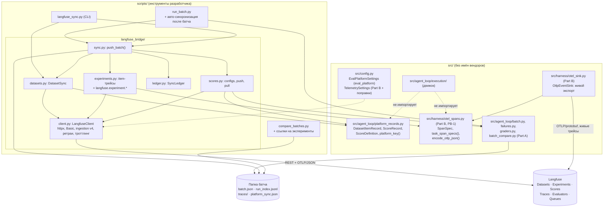
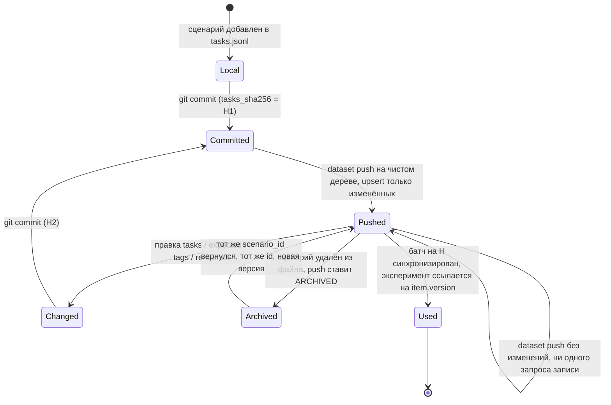
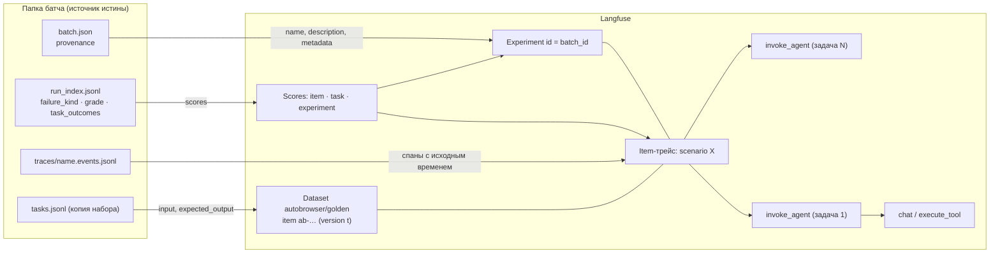
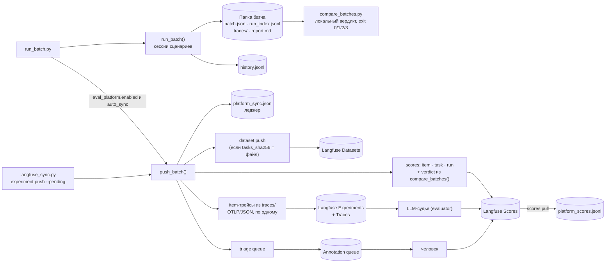
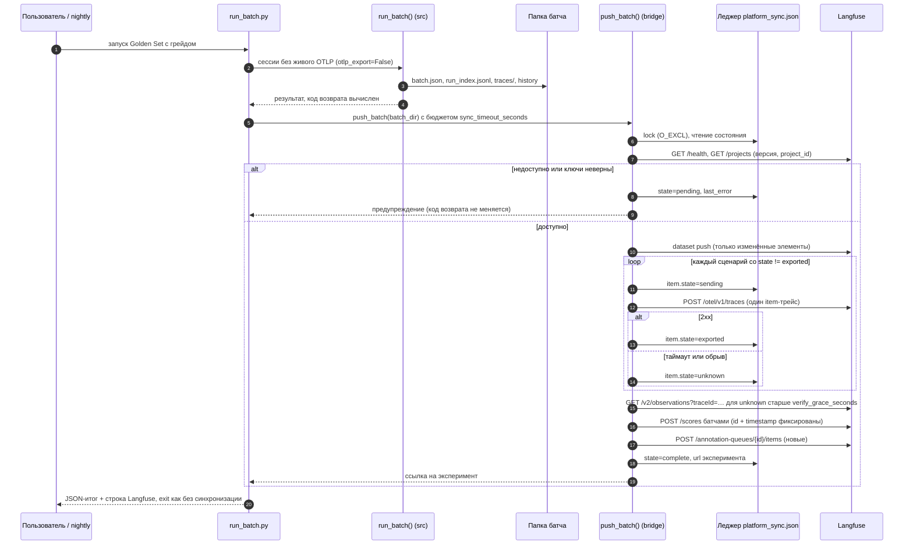
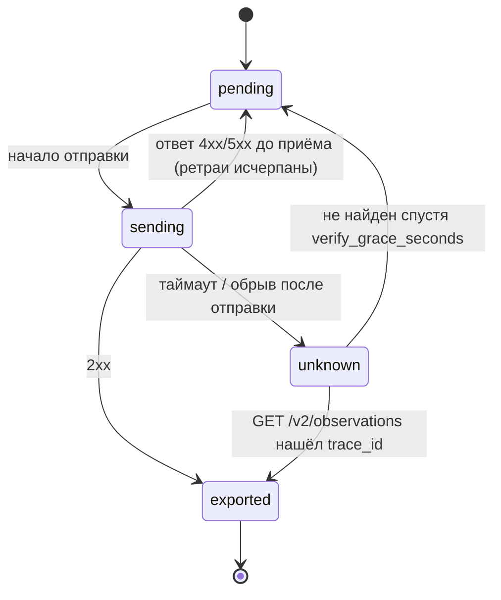

# Интеграция с Langfuse: версии датасетов, эксперименты, оценки и разметка поверх локальных результатов

Статус: Proposed (проект)
Дата: 2026-10-31
Рекомендуемая ветка: `feat/langfuse-sync` (рабочее имя `feat/langfuse-evals`, обоснование — §8.1)
Родительские документы:
- [Дизайн автономного пайплайна](2026-10-19-autonomous-test-pipeline-design.md) (§3.4, §4.3–4.5, §4.8, §4.9, Q1–Q10, §7)
- [План batch-аналитики и OTLP-экспорта](2026-10-29-batch-analytics-and-otlp-export-plan.md) (Part A — сделана в `feat/batch-analytics`, Part B — ветка `feat/otlp-export`, не начата)

ADR (Proposed): [2026-10-31 Langfuse как платформа датасетов, экспериментов и оценок](../decisions/2026-10-31-langfuse-platform-integration.md).
Он частично заменяет [ADR 2026-10-19 о Langfuse](../decisions/2026-10-19-langfuse-observability.md).

Пользователь хочет две вещи:
- версионировать датасеты: Golden Set и другие наборы сценариев;
- получить полноценную observability-платформу для анализа трейсов, регрессионных прогонов и
  оценки агента.

Функции платформы (датасеты, эксперименты и сравнение прогонов, scores, LLM-as-judge, ручная
разметка) должны браться из Langfuse, а не писаться заново.

Документ определяет, как это сделать и при этом сохранить:
- герметичный gate;
- локальные файлы как источник истины;
- отсутствие имён вендоров в `src/`.

---

## 0. Ключевые решения (кратко)

1. **Гибрид.** Вердикт регрессии и коды возврата остаются локальными и герметичными:
   `compare_batches.py`, будущий `ci.py`. Langfuse — второй интерфейс: датасеты, эксперименты,
   scores, LLM-судья, ручная разметка, сравнение прогонов в UI. Локальный вердикт уходит в
   Langfuse как scores прогона и не пересчитывается там.
2. **Без Langfuse SDK.** Интеграция работает через два канала:
   - узкий REST-клиент на уже закреплённом `httpx` (датасеты, scores, score configs, очереди
     разметки, чтение экспериментов);
   - OTLP/HTTP с ключами `langfuse.experiment.*` для экспериментов.

   Так в Langfuse v4 устроены эксперименты: Python SDK v5 пишет их тем же путём, а
   `POST /dataset-run-items` в Cloud снимается 2026-11-16.
3. **Эксперимент создаётся постфактум из локальных файлов.** Источник — папка батча
   (`batch.json`, `run_index.jsonl`, `traces/*.events.jsonl`), а не живая отправка во время
   прогона. Синхронизацию можно повторить, а при недоступном Langfuse батч не падает.
4. **Идемпотентность.** Её дают детерминированные идентификаторы и леджер
   `<batch_dir>/platform_sync.json`. Langfuse v4 не дедуплицирует повторно отправленные спаны,
   поэтому каждый item-трейс отправляется ровно один раз. Scores и элементы датасета
   upsert-ятся по `id`.
5. **Версия датасета.** Каноническая версия — `tasks_sha256` (содержимое файла), человеческая
   метка — git-коммит. Нативная версия Langfuse — это timestamp `validFrom` элементов: проекция,
   а не источник истины. Соответствие хранит журнал пушей.
6. **Код интеграции вне `src/`.** Он лежит в `scripts/langfuse_bridge/` и
   `scripts/langfuse_sync.py`. Нейтральные чистые модели (элементы датасета, score-записи,
   дерево спанов) лежат в `src/` без имён вендоров. Секция настроек называется нейтрально:
   `eval_platform`.
7. **LLM-судья для `ungraded`-ключей (Q7)** — управляемый evaluator Langfuse на корневом
   наблюдении item-трейса. Ручная разметка идёт через annotation queue. Результаты по команде
   возвращаются в папку батча как информационный слой и не влияют на gate.
8. **Порядок веток.** `feat/langfuse-sync` идёт сразу после `feat/otlp-export`, до
   `feat/cassettes`. В Part B нужно внести поправки из §5.8 до её старта.

---

## 1. Контекст и проблема

### 1.1 Что есть после Part A (`feat/batch-analytics`, не слита)

| Что | Где | Значение для интеграции |
|---|---|---|
| Прогон Golden Set | `src/agent_loop/batch.py:112` `run_batch`; `scripts/run_batch.py:47` `run_batch_from_args` | свежая сессия на сценарий; папка `<storage.batches_dir>/<batch_id>/` |
| Копия набора в батче | `batch.py:149` (`shutil.copyfile(tasks_file, batch_dir / "tasks.jsonl")`) | эксперимент можно собрать с той версией набора, на которой шёл прогон, даже если файл в репозитории уже изменился |
| Происхождение прогона | `batch.json.provenance`; `scripts/run_batch.py:171` `_provenance`; `batch.py:272` `settings_provenance`; `batch.py:292` `tasks_sha256` | git commit/branch/dirty, model, provider, `tasks_sha256`, `settings_sha256`, `non_default_sections` |
| Строка `run_index.jsonl` v1 | `batch.py:447` `_run_index_row` + `_add_outcomes` (`:372`) | `failure_kind`, `task_outcomes[]` (`task_id`, `status`, `stop_reason`, …), `grade.checks[]`, `metrics`, `trace_path` |
| Трассы в батче | `batch.py:306` `_keep_trace` → `traces/<name>.events.jsonl` | уже редактированная (`EventRecord.to_json_dict`, `events.py:92`) полная трасса — сырьё для item-трейса |
| Классификация | `src/agent_loop/failures.py:19` `FailureKind`, `:32` `INFRA_KINDS` | словарь категориальных scores |
| `stop_reason` | `src/contracts.py:27` `StopReason` | словарь категориального score задачи |
| Грейдеры | `src/agent_loop/graders.py:35` `CheckStatus`, `:113` `grade_answer` | по score на check |
| История и вердикт | `batch_history.py`, `batch_compare.py:131` `compare_batches`, `scripts/compare_batches.py` (`_latest_pair`) | локальный вердикт, его копируем в Langfuse |
| Метки сессии | `SessionConfig.labels` (`src/harness/session.py:146-148`), payload `session.started` (`:667`); `scripts/run_batch.py:59-62`, `:162` | `autobrowser.batch.id`, `autobrowser.scenario.id`, `vcs.ref.head.revision` |
| Синки событий | `src/harness/session.py:397` `_build_session_event_sink` | точка подключения OTLP-синка Part B |
| Забор движка | `tests/test_engine_boundaries.py:72` `PIPELINE_MODULES`; `:141` `VENDOR_MARKERS` | расширяется (§6.2) |
| Настройки | `src/config.py:1688` `PipelineSettings`, `:1805-1837` `Settings` (13 секций) | новая секция `eval_platform` (§5.10) |
| Зависимости | `pyproject.toml`: `httpx==0.28.1`, `opentelemetry-api/sdk==1.39.1`, `opentelemetry-semantic-conventions==0.60b1` | хватает для REST и OTLP/JSON без новых пакетов |

### 1.2 Что даст Part B (план, не начата)

- `OtlpEventSink` в `src/harness/otel_sink.py`.
- Секция `telemetry`.
- Спаны `invoke_agent`, `chat {model}`, `execute_tool {tool}`; на каждом спане `session.id` и
  метки батча.
- `capture_content`: `none` или `redacted`.
- Langfuse и Phoenix как OTLP-бэкенды.

Part B даёт живые трейсы, но в её скоупе прямо нет датасетов, scores и экспериментов (план
§3.3, Q-C).

### 1.3 Чего не хватает

| # | Проблема |
|---|---|
| L1 | Нет версии датасета вне git. `tasks_sha256` фиксирует содержимое, но в Langfuse никакого набора нет |
| L2 | Прогоны нельзя сравнить в UI. `compare_batches.py` даёт вердикт, но не side-by-side ответы, трейсы и оценки по сценариям нескольких прогонов |
| L3 | Ключи `fields` в `expected` остаются `ungraded`, Q7 открыт. Нет LLM-судьи и нет ручной разметки |
| L4 | `failure_kind` и грейд считаются после прогона, поэтому по плану Part B «остаются локальными» (§6 плана). Пользователь бэкенда их не видит |
| L5 | В Langfuse v4 одна задача — один трейс, а эксперимент требует один трейс на item (§2). Модель «трейс на задачу» из Part B напрямую экспериментом не становится |
| L6 | Живая отправка во время батча теряет данные при недоступном Langfuse. Восстановить их нечем: в v4 повторная отправка спанов создаёт дубли |

### 1.4 Конфликт с ADR 2026-10-19 и почему контекст изменился

[ADR 2026-10-19](../decisions/2026-10-19-langfuse-observability.md) решил: Langfuse не вводится,
SDK отвергнут, OTLP отложен до триггера. Его триггеры пересмотра:
- больше одного человека разбирает прогоны;
- нужна ручная разметка трасс или массовый LLM-judge;
- объём живых прогонов не помещается в `summary.md`/`replay`.

Сейчас выполнен второй триггер: пользователь явно хочет судью и разметку платформой. Сработал и
третий: 18 сценариев × N прогонов × модели. Кроме того, изменились факты (§2):
- эксперименты в Langfuse v4 пишутся обычным OTLP с атрибутами — это та же инфраструктура, что
  Part B;
- у датасетов появилось нативное версионирование.

Что из старого ADR **сохраняется**:
- SDK не вводится;
- gate герметичен;
- `experiment-action` не используется как механизм регрессии;
- по умолчанию содержимое страниц не уходит.

Что **заменяется**:
- пункт 1 «Langfuse не вводится ни как зависимость, ни как сервис, ни как часть пайплайна»;
- запрет на datasets/scores API из плана Part B (§3.3, Q-C).

Новый ADR оформлен как Proposed; старый не переписывается.

---

## 2. Langfuse на 2026-10-31: проверенные факты

Проверено по официальной документации, OpenAPI-спецификации Cloud
(`https://cloud.langfuse.com/generated/api/openapi.yml`, скачана 2026-10-31) и PyPI.

| Тема | Факт | Источник |
|---|---|---|
| Python SDK | Последняя версия 5.1.0 (2026-10-30). Первая v5 на PyPI — 5.0.1 (2026-10-14); 4.0.0 вышла 2026-03-10, 3.0.0 — 2025-06-05: три мажора за 16 месяцев. `Requires-Python >=3.11,<4`. Зависимости: `opentelemetry-api/sdk/exporter-otlp-proto-http >=1.45.0`, `httpx`, `pydantic 2`, `backoff`, `wrapt`, `packaging` | PyPI |
| SDK v5 и сервер | Требует Cloud или self-hosted **v4.59.0+**. Эксперименты пишутся через OpenTelemetry. `api.scores.create()` принимает список. Методы dataset-run удалены | compatibility, upgrade v4→v5 |
| Снятие legacy в Cloud | **2026-11-16**: `GET /traces`, `/observations`, `/sessions`, `/scores`, `/v2/scores`, `/metrics`, `GET/POST /dataset-run-items`, `/datasets/{name}/runs`, трейсы через `POST /ingestion`. Self-hosted v3 получает патчи до 2027-01-31 | deprecated-api-migration, compatibility |
| Замены | Observations API v2, Metrics API v2, Scores API v3 (только чтение), `GET /experiments` и `GET /experiment-items`. Запись экспериментов — runner SDK или `POST /otel/v1/traces` | там же |
| OTLP | `POST /api/public/otel/v1/traces`, HTTP/protobuf **и HTTP/JSON**, gzip, без gRPC. Авторизация Basic (`public:secret`). Прямым экспортёрам нужен заголовок **`x-langfuse-ingestion-version: 4`**, без него данные приходят с задержкой (≈10 минут по OpenAPI и OTel-гайду, «до 15 минут» по странице совместимости) | OpenAPI, OTel integration, compatibility |
| Правила v4 для OTLP | Спан отправляется **один раз**: повторная отправка того же `spanId` не обновляет наблюдение, а может создать дубль. Атрибуты уровня трейса (`session.id`, `user.id`, `langfuse.trace.*`, `langfuse.environment`) нужны на **каждом** спане. Вход и выход запроса — на корневом наблюдении (`langfuse.observation.input/output`); `langfuse.trace.input/output` устарели | migration-to-v4 |
| Маппинг атрибутов | `session.id`, `user.id`, `gen_ai.request.model`/`gen_ai.response.model`, `gen_ai.usage.*`, `gen_ai.usage.cost`, `gen_ai.prompt`/`gen_ai.completion`, `input.value`/`output.value` (OpenInference), `gen_ai.tool.call.arguments`/`.result`, `deployment.environment(.name)` понимаются без `langfuse.*`. Тип наблюдения выводится из конвенций, иначе из модельных атрибутов, иначе `span`. **Только через `langfuse.*`**: теги трейса (`langfuse.trace.tags`), фильтруемые метаданные (`langfuse.trace.metadata.*`, `langfuse.observation.metadata.*`), `release`, `version`, `public`, эксперименты | OTel integration |
| Эксперименты через OTLP | Ровно **один трейс на item**. На всех спанах item: `langfuse.experiment.id`, `.name`, `.dataset.id`, `.item.id`, `.item.root_observation_id` (= `spanId` корня). На корне: `langfuse.observation.input/output`, опционально `langfuse.experiment.item.expected_output` (JSON), `.item.metadata.*`, `.item.version`, `langfuse.experiment.description`, `langfuse.experiment.metadata.*`. Scores item — на корневое наблюдение (`traceId` + `observationId` корня) | OTel experiments, FAQ experiment-runs-not-visible-v4 |
| Датасеты | Версионирование элементов с 2025-12-15. Каждое add/update/delete/archive даёт новую версию, это timestamp. Эксперименты на версии — с 2026-02-11. `GET /dataset-items?datasetName=&version=` возвращает состояние на момент времени. Поле `version` (= `validFrom`) в ответах — PR #18336 (влит 2026-10-09), уже есть в текущей OpenAPI. Схема датасета (`inputSchema`, `expectedOutputSchema`) версий не создаёт | datasets, changelog 2025-12-15 и 2026-02-11, PR #18336, OpenAPI |
| Элемент датасета | Upsert по `id`. `id` уникален в проекте, **не переиспользуется между датасетами**, длина до 255. Поля `input`, `expectedOutput`, `metadata`, `sourceTraceId`, `status` (`ACTIVE`/`ARCHIVED`). Имена датасетов со `/` дают папки | OpenAPI `CreateDatasetItemRequest`, datasets |
| Scores | `POST /api/public/scores` принимает **список**, асинхронно: 202, либо 207 с частичным отказом. «Do not automatically retry a 207 batch». Типы: `NUMERIC`, `CATEGORICAL`, `BOOLEAN`, `TEXT` (+ `CORRECTION`). Цели: trace, observation (`traceId` + `observationId`), session, `datasetRunId` (эксперимент). `id` — ключ идемпотентности; обновление — «тот же `id` и тот же `timestamp`» (поле `timestamp` есть в текущей OpenAPI). `source`: `API` или `ANNOTATION`; `EVAL` зарезервирован. Чтение — только `GET /v3/scores` с фильтрами `id`, `name`, `traceId`, `experimentId`, `source` | OpenAPI, scores-via-sdk, changelog Scores API v3 |
| Score configs | `POST/GET /score-configs`, `PATCH /score-configs/{id}`. Неизменяемы, но архивируются. Имя до 80 символов (буквы, цифры, `_`, пробел, `.`, `()`, `-`) | OpenAPI, scores data model |
| LLM-as-judge | Управляемые evaluators на **наблюдениях**: trace-level устарели и в Cloud перестают давать результаты после 2026-11-16. Переменные: input, output, metadata; для экспериментов ещё expected output и метаданные item. Дочерние наблюдения автоматически не подгружаются. Нужно LLM-подключение к OpenAI-совместимому endpoint со structured outputs. Есть API v2: `/v2/evaluators`, `/v2/evaluation-rules` (фильтр `datasetId` для экспериментов) | llm-as-a-judge, OpenAPI |
| Разметка | `POST /annotation-queues` (`name`, `scoreConfigIds`), `POST /annotation-queues/{id}/items` (`objectId`, `objectType` = `TRACE`/`OBSERVATION`/`SESSION`) | OpenAPI, annotation queues |
| Cloud Hobby | 50k units/мес, 30 дней доступа к данным, 2 пользователя, 1 очередь разметки. Лимиты: ingestion 1000 req/min, general API **30 req/min**, datasets API 100 req/min. Core — $29/мес, 90 дней | pricing |
| Self-host | v4; Docker Compose: web, worker, PostgreSQL, ClickHouse, Redis, MinIO. ВМ от **4 ядер / 16 GiB / 100 GiB**; compose не рекомендован для production | self-hosting docker-compose |
| `langfuse/experiment-action` | v1.0.12. Запускает скрипт `experiment()` (Python/TS) и падает на `RegressionError`. SDK по умолчанию: Python 4.6.0, JS 5.3.0 | GitHub |

### 2.1 Расхождения с родительскими документами

| Где | Было | На 2026-10-31 |
|---|---|---|
| Дизайн §4.9.2, ADR 2026-10-19 | Self-host «4–8 ГБ RAM» | Документация: от 4 ядер / 16 GiB / 100 GiB, compose — не для production |
| План Part B, B5 | Langfuse «self-hosted ≥ 3.22», заголовок только `Authorization` | OTLP принимается с 3.22, но модель данных v4 (эксперименты через OTel, observation-level judge) требует v4; v5 SDK — v4.59.0+. Прямому экспортёру нужен `x-langfuse-ingestion-version: 4`, иначе задержка |
| ADR 2026-10-19, §4.9.1 | Эксперименты — это `run_experiment` в SDK | В v4 эксперимент — это набор OTLP-трейсов с атрибутами `langfuse.experiment.*`. Его можно собрать из уже выполненного прогона, SDK не нужен |
| ADR 2026-10-19 | Датасеты не обсуждались как версионируемые | Нативное версионирование элементов (timestamps) с 2025-12-15 |
| План Part B, Q-C | Scores — вне скоупа | Scores пишутся только REST (`POST /scores`), это не OTLP. Этот дизайн их вводит |
| Документация Langfuse, внутреннее расхождение | Страница scores-via-sdk: замена только при совпадении `id`, `name` и `timestamp` (с точностью до даты); cookbook миграции: «create endpoint does not accept a timestamp» | В текущей OpenAPI у `CreateScoreRequest` есть `timestamp`: «send it again with the same id and timestamp». Дизайн шлёт фиксированный `timestamp` и дополнительно сверяется с леджером (§5.6) |
| Документация Langfuse, внутреннее расхождение | FAQ: score-create через `POST /ingestion` поддерживается и после 2026-11-16 | В текущей OpenAPI `/ingestion` нет. Дизайн его не использует |
| Документация Langfuse, внутреннее расхождение | Задержка без заголовка ingestion-version: «до 15 минут» (совместимость) или «до 10 минут» (OTel-гайд) | Не важно: заголовок отправляется всегда |
| `experiment-action` | — | По умолчанию закреплён Python SDK 4.6.0, то есть v4, а не v5: action отстаёт от SDK |

---

## 3. Требования

### 3.1 Функциональные

- **F1. Датасеты.** Наборы сценариев (сейчас Golden Set, после ветки 6 — фикстурный live-набор)
  синхронизируются в Langfuse Datasets. Каждое изменение сценария даёт новую версию в Langfuse,
  и её можно сопоставить с git-коммитом и `tasks_sha256`.
- **F2. Эксперименты.** Каждый прогон `run_batch` (батч) может стать экспериментом Langfuse на
  датасете. Цепочка связей: сценарий → item → трейс сценария с полной иерархией задач, вызовов
  модели и инструментов.
- **F3. Оценки.** Грейд, каждый check, `failure_kind`, `stop_reason` задач, флаг infra и
  счётчики, которых Langfuse не выводит сам, становятся scores с score configs. Локальный
  вердикт против предыдущего сопоставимого прогона становится scores эксперимента.
- **F4. Судья и разметка.** Для `ungraded`-ключей (`fields`) есть LLM-судья средствами Langfuse.
  Провалившиеся сценарии можно отправить в очередь ручной разметки. Оценки судьи и людей можно
  выгрузить обратно в папку батча.
- **F5. Трейсы.** Живые трейсы Part B в Langfuse читаются полноценно: сессии, generations с
  токенами и стоимостью, инструменты, окружение, фильтры по батчу и сценарию.
- **F6. CLI.** Синхронизация запускается автоматически после батча, когда платформа включена,
  или вручную: догнать незавершённые, синхронизировать конкретный батч, проверить
  подключение.

### 3.2 Нефункциональные

- **N1. Герметичность.** Gate, тесты и `compare_batches.py` не требуют сети и Langfuse. Вердикт и
  код возврата не зависят от состояния синхронизации.
- **N2. Источник истины — локальные файлы.** Langfuse — проекция. Её можно пересобрать в новом
  проекте из папок батчей.
- **N3. Идемпотентность и восстановление.** Повторный запуск не создаёт дублей трейсов, scores
  и элементов. Прерванная синхронизация продолжается с места остановки.
- **N4. Отказоустойчивость.** Недоступность, неверные ключи, 429 и 5xx не роняют батч и не
  меняют его код возврата. Ретраи, бэкофф и троттлинг задаются в конфиге.
- **N5. Приватность.** По умолчанию (`capture_content="none"`) с машины уходят только данные
  репозитория (тексты задач, `expected`), идентификаторы, статусы, метрики и scores. Ответы
  агента и вход/выход инструментов уходят только при явном opt-in. Всё отправляемое проходит
  `redact_json_safe`.
- **N6. Границы.** В `src/` нет имён вендоров и URL. Движок и `src/agent_loop/` не импортируют
  интеграцию. Логика не завязана на имена инструментов или сайтов.
- **N7. Тюнинги.** Все тюнинги — поля `src/config.py`, плюс `.env.example`,
  `config.example.yaml` и `tests/test_config.py`. Секреты — `SecretStr`, не логируются и не
  попадают в события и леджер.
- **N8. Windows first.** UTF-8, без POSIX-утилит, атомарная запись через `os.replace`,
  блокировки через `O_EXCL`.
- **N9. Стоимость.** Golden-прогон должен укладываться в лимиты Cloud Hobby: ≈1100 units на
  прогон (§7.1), general API — 30 req/min.

### 3.3 Вне скоупа

- Langfuse как источник вердикта gate или nightly.
- Использование `langfuse/experiment-action`.
- Управление промптами Langfuse: промпты остаются за пользователем и в репозитории.
- Синхронизация scripted evals (`tests/evals/`) как экспериментов: обоснование в §5.2.5.
- Self-host Langfuse как часть репозитория (docker-compose файлы): только документация.
- Локальный LLM-судья (`pipeline.judge="model"` из §4.3.4 родительского дизайна): заменяется
  управляемым судьёй.
- Автоматическое создание LLM-подключений и evaluators через API: отложено, открытый вопрос
  QL5.

---

## 4. Варианты

### 4.1 Транспорт: SDK или REST + OTLP

| Вариант | Плюсы | Минусы и риски |
|---|---|---|
| **A. Langfuse Python SDK v5** | Готовые `create_score`, `get_dataset`, `run_experiment`, ретраи | Требует `opentelemetry-* >= 1.45.0`, а проект закрепляет 1.39.1. Подъём затрагивает стек `pydocket`/`fastmcp` и `opentelemetry-instrumentation==0.60b1`. Три мажора за 16 месяцев. `run_experiment` **сам исполняет задачу**: прикрепить уже выполненный прогон с исходными временами нельзя. Вендорный SDK в окружении разработчика |
| **B. Узкий REST-клиент на `httpx` + OTLP/JSON (рекомендуется)** | Новых зависимостей нет: `httpx` уже есть, OTLP/JSON — это `json` + `httpx`. Полный контроль над `traceId`/`spanId` и временем спанов, нужный для идемпотентности и постфактум-экспериментов. Около 12 эндпоинтов, все из текущей OpenAPI. Контрактные тесты на фейковом сервере | Пишем и поддерживаем клиент (≈300 строк), следим за изменениями API |
| C. REST + OTLP/protobuf через `opentelemetry-exporter-otlp-proto-http` (группа `otel` из Part B) | Тот же экспортёр, что у живого синка | `ReadableSpan` с заданными id и временем — обход SDK. Результат экспорта бинарный, тестировать сложнее. Нужна группа `otel` и для синхронизации |

**Рекомендация: B.** Langfuse явно принимает HTTP/JSON. Синхронизации нужен синхронный,
проверяемый ответ на один item-трейс, а не фоновый `BatchSpanProcessor`. Живой синк Part B
остаётся на SDK и protobuf-экспортёре (вариант Part B не меняется).

### 4.2 Где живёт код

| Вариант | Плюсы | Минусы |
|---|---|---|
| A. `src/integrations/langfuse/` | Рядом с остальным кодом | Нарушает «нет имён вендоров в `src/`». Попадает в wheel `autobrowser`, хотя пользователю пакета не нужен |
| B. Новый пакет верхнего уровня `integrations/` | Явная граница | Новая конвенция в репозитории; ещё одна корневая папка, которую надо отразить в `pythonpath` и `AGENTS.md` |
| **C. `scripts/langfuse_bridge/` + `scripts/langfuse_sync.py` (рекомендуется)** | Повторяет решение родительского дизайна (§4.2: оркестрация в `scripts/pipeline/`, не в wheel). Тесты уже импортируют `scripts.*` (`tests/test_run_batch_script.py:11`). Имя вендора допустимо вне `src/` | Код инструментов разработчика живёт в `scripts/` — это осознанный выбор |

**Рекомендация: C, с разделением.** Всё нейтральное и чистое лежит в `src/`:
- элементы датасета;
- score-записи и их словарь;
- дерево спанов и OTLP/JSON-кодировщик (§5.8).

Всё, что знает Langfuse (эндпоинты, `langfuse.*`-ключи, Basic-auth, маппинг scores), лежит в
`scripts/langfuse_bridge/`. Пакет **не** называется `scripts/langfuse/`: при запуске
`python scripts/langfuse_sync.py` каталог `scripts/` встаёт в `sys.path[0]`, и
`import langfuse` (если пакет когда-либо появится) разрешился бы в него.

### 4.3 Как прогон становится экспериментом

| Вариант | Плюсы | Минусы |
|---|---|---|
| A. `run_experiment` SDK запускает агента | «Канонично» | Агент исполняется внутри SDK: нужны SDK, сеть во время прогона и отдельный раннер вместо `run_batch`. При падении Langfuse прогон теряется |
| B. `experiment-action` в CI | PR-комментарий из коробки | Как A, плюс GitHub-hosted раннер без Chrome и профиля. Вердикт всё равно наш (`RegressionError`). Закреплён SDK v4 |
| C. Живой OTLP-синк Part B пишет `langfuse.experiment.*` во время батча | Одна отправка | Модель Part B — один трейс на задачу, а эксперименту нужен один трейс на сценарий. Grade и `failure_kind` во время прогона ещё неизвестны. Отправку, потерянную при сбое, нельзя повторить: правило «export once» |
| **D. Постфактум из папки батча (рекомендуется)** | Источник — локальные файлы. Можно повторить: детерминированные id, леджер. Работает для старых батчей и после сбоя. Grade, `failure_kind` и вердикт уже известны. Временные метки спанов — исходные из событий | Вторая копия исполнения, если живой синк тоже был включён. Решение: для батча с синхронизацией живой экспорт отключается (§5.8, PB-6) |

**Рекомендация: D.**

### 4.4 Cloud или self-host

| Вариант | Плюсы | Минусы |
|---|---|---|
| **Cloud Hobby (EU), рекомендуется для старта** | Ноль инфраструктуры; все нужные функции, 1 очередь разметки | 30 дней хранения (локальные файлы остаются навсегда); 50k units/мес; 30 req/min; данные уходят в облако (смягчается `capture_content=none` и публичными сайтами Golden Set) |
| Self-host v4 (Docker Desktop) | Данные на машине, нет лимитов units | 6 контейнеров, 16 GiB / 4 ядра рекомендовано, обновления v4.x раз в несколько недель, «compose не для production» |
| Cloud Core ($29) | 90 дней, без лимита пользователей | Платно |

**Рекомендация.** Начать с Cloud Hobby EU. Код от выбора не зависит: меняется только
`eval_platform.host`. Минимальная версия self-host — **v4.59.0** (та же планка, что у SDK v5);
`langfuse_sync.py doctor` проверяет её по `GET /api/public/health`.

### 4.5 Только Langfuse или гибрид

| Вариант | Итог |
|---|---|
| Langfuse-only: вердикт по экспериментам Langfuse | Отвергнут: нужна сеть в gate и nightly-вердикте; судья недетерминирован; хранение 30 дней; вендорный lock-in на решение «есть ли регрессия» |
| **Гибрид: локальный вердикт + Langfuse как второй интерфейс** | **Принят.** Вердикт пишется в Langfuse как scores эксперимента и item (`regression`, `verdict`), а не пересчитывается |

### 4.6 LLM-судья для `ungraded` (Q7 родительского дизайна)

| Вариант | Плюсы | Минусы |
|---|---|---|
| A. Локальный судья `pipeline.judge="model"` | Работает без сети к Langfuse | Пишем то, что даёт платформа; противоречит запросу пользователя |
| **B. Управляемый evaluator Langfuse на корне item-трейса (рекомендуется)** | Готовый промпт, переменные `input`/`output`/`expected_output`, сэмплирование, повтор, история версий evaluator | Нужен `capture_content ≥ answers` (иначе судье нечего читать); нужно OpenAI-совместимое LLM-подключение со structured outputs; стоит денег/units; недетерминирован, поэтому только информационно |
| C. Переписать `expected`, убрав `fields` | Детерминированно | Проверку «у каждого товара есть название и цена» текстом не выразить надёжно |

**Рекомендация: B**, и только информационно: в gate и `compare_batches` не участвует. Ключи
`fields` остаются в `expected` и уходят в `expected_output` item.

---

## 5. Дизайн

### 5.1 Компоненты и границы



| Компонент | Слой | Ответственность |
|---|---|---|
| `EvalPlatformSettings` | `src/config.py` | Тюнинги и секреты моста; читают только `scripts/` и `doctor` |
| `platform_records.py` | `src/agent_loop/` (чистая аналитика, как `batch_compare.py`) | Нейтральные записи: элемент датасета из сценария; score-записи из `batch.json`/`run_index`/`BatchComparison`; словарь определений scores из `Literal` кода; детерминированные ключи. Ни I/O, ни HTTP |
| `otel_spans.py` | `src/harness/` (поправка PB-1 к Part B) | Чистое построение дерева спанов задачи из `EventRecord` и OTLP/JSON-кодирование. Им пользуются живой синк и мост |
| `langfuse_bridge/client.py` | `scripts/` | Единственное место с эндпоинтами Langfuse, авторизацией, заголовком `x-langfuse-ingestion-version: 4`, ретраями и лимитами |
| `datasets.py`, `experiments.py`, `scores.py` | `scripts/` | Маппинг нейтральных записей в объекты Langfuse |
| `ledger.py`, `sync.py` | `scripts/` | Состояние синхронизации батча, блокировка, порядок шагов, восстановление |
| `langfuse_sync.py` | `scripts/` | CLI (§5.9) |

### 5.2 Версионирование датасетов

#### 5.2.1 Что такое версия

| Уровень | Что это | Где живёт | Роль |
|---|---|---|---|
| Каноническая версия | `tasks_sha256` — sha256 файла набора с CRLF→LF | вычисляется (`batch.py:292`), пишется в `batch.json.provenance` | Идентичность содержимого; решает сопоставимость прогонов (`compare_batches`) |
| Человеческая метка | git-коммит, в котором файл приобрёл это содержимое | git | История и ревью изменений сценариев |
| Версия элемента | `content_sha256` — sha256 канонического JSON одного сценария (`scenario_id`, `tasks`, `expected`, `tags`, `reference`) | вычисляется (`platform_records`) | Дифф «что изменилось» без сравнения JSON с сервера |
| Нативная версия Langfuse | timestamp (`validFrom` элемента, параметр `version` в `GET /dataset-items`) | Langfuse | Проекция: позволяет UI и судье видеть набор «как был» |

**Семантическая версия (`v1.2.0`) не вводится.** Её надо поднимать руками, она расходится с
содержимым и ничего не даёт сверх пары `tasks_sha256` + коммит.

**Источник истины — репозиторий.** Langfuse-датасет никогда не редактируется в UI. Правка там
будет перезаписана при следующем `dataset push`, и команда `dataset status` её покажет.

#### 5.2.2 Отображение сценария в элемент датасета

| Поле Langfuse | Значение | Комментарий |
|---|---|---|
| датасет | `<eval_platform.dataset_prefix><suite>`, например `autobrowser/golden` | `/` даёт папку в UI |
| `id` | `"ab-" + sha256(dataset_name + "\n" + scenario_id)[:32]` | Стабилен при изменении содержимого, поэтому Langfuse версионирует элемент, а не создаёт новый. Включает имя датасета: id нельзя переиспользовать между датасетами |
| `input` | `{"tasks": [...], "scenario_id": "..."}` | Данные репозитория, уходят и при `capture_content=none` |
| `expectedOutput` | `{"checks": <expected как есть>, "reference": <str \| null>}` | Миграция `expected` → `expected_output` **без переписывания**: словарь грейдеров переносится целиком, включая `ungraded`-ключи (`fields`). Их видит судья. `reference` — новое необязательное поле сценария: эталонный ответ или рубрика для судьи (§5.4.3) |
| `metadata` | `{"scenario_id", "tags", "suite", "content_sha256", "source_path"}` | `source_path` — путь относительно корня репозитория |
| `status` | `ACTIVE`; `ARCHIVED` для удалённых сценариев | — |

Метаданные датасета (`POST /v2/datasets`, при создании и обновлении):
`{"source_path", "tasks_sha256", "git_commit"}` последнего пуша. Это только подсказка в UI:
метаданные датасета не версионируются.

#### 5.2.3 Жизненный цикл версии



Правила:
- **Добавление.** Новый `scenario_id` → новый элемент (новая версия датасета).
- **Изменение.** Тот же `scenario_id`, другой `content_sha256` → upsert того же `id` (новая
  версия). Старые эксперименты остаются привязаны к своей версии. Item-трейс эксперимента
  дополнительно несёт `langfuse.experiment.item.expected_output` из **копии набора в батче**,
  поэтому UI показывает ожидание, по которому шёл прогон.
- **Удаление.** Элемент архивируется (`ARCHIVED`), а не удаляется: прошлые эксперименты
  сохраняют ссылки.
- **Переименование `scenario_id`** = удаление + добавление. История сценария в Langfuse
  разрывается; гайд предупреждает, что `scenario_id` должен быть стабильным.
- **Без изменений.** `dataset push` сначала читает текущие элементы
  (`GET /dataset-items?datasetName=`) и сравнивает `metadata.content_sha256`. Неизменённые
  элементы не отправляются: каждый upsert создал бы пустую версию.
- **Грязное дерево.** `dataset push` отказывается работать, если файл набора изменён
  относительно `HEAD` (`git status --porcelain -- <path>`). Флаг `--allow-dirty` разрешает; тогда
  в журнале пушей `git_commit` помечается `dirty`. Так каждая версия Langfuse соответствует
  коммиту.

#### 5.2.4 Как прогон ссылается на версию

1. После успешного пуша мост дописывает строку в журнал
   `<storage.batches_dir>/platform_datasets.jsonl` (рядом с `history.jsonl`, append-only):
   ```json
   {"schema_version": 1, "pushed_at": "...", "host": "...", "project_id": "...",
    "dataset": "autobrowser/golden", "dataset_id": "...", "tasks_sha256": "H2",
    "git_commit": "abc123", "git_dirty": false, "version": "2026-10-31T10:12:03.123Z",
    "added": 1, "updated": 2, "archived": 0, "unchanged": 15}
   ```
   `version` — максимум `version` (`validFrom`) из ответов upsert. Если сервер поле не вернул,
   берётся `max(updatedAt)` элементов после пуша.
2. При синхронизации батча с `provenance.tasks_sha256 = H`:
   - **H совпадает с текущим файлом репозитория.** Мост сначала выполняет `dataset push`
     (идемпотентный).
   - **В журнале есть пуш с H.** Item-трейсы получают `langfuse.experiment.item.version` = его
     `version`, эксперимент — `langfuse.experiment.metadata.dataset_version`.
   - **Пуша с H нет** (набор с тех пор изменили и запушили). Эксперимент всё равно создаётся по
     тем же `id` элементов, но без `item.version`, с
     `langfuse.experiment.metadata.dataset_version_matched=false`. Ожидания берутся из копии
     набора в батче (см. выше). Сценарий, которого в датасете нет вообще (удалён до первого
     пуша), предварительно создаётся из копии набора как `ARCHIVED`-элемент: эксперимент не
     ссылается на несуществующий item.
3. В локальный `batch.json` ничего не дописывается: контракт Part A не меняется. Ссылки
   Langfuse живут только в леджере `platform_sync.json`.

#### 5.2.5 Наборы

| Набор | Источник | Датасет | Эксперименты | Почему |
|---|---|---|---|---|
| `golden` | `tests/golden/tasks.jsonl` | `autobrowser/golden` | да | живые прогоны, недетерминированные, нужна разметка и судья |
| `live-local` (ветка 6) | `tests/pipeline/live/*.yaml` | `autobrowser/live-local` | да | тот же поток, фикстурный сайт |
| `evals` | `tests/evals/scenarios/*.yaml` | нет (по умолчанию) | нет | Детерминированы, вердикт — точное равенство с baseline v2. Трейсы синтетические (фейковая модель и браузер): в Langfuse это шум и расход units. Версию полностью даёт git. Открытый вопрос QL6 |

Адаптер набора — нейтральный `DatasetSource`-протокол в `platform_records.py`:
`load(path) -> list[DatasetItemRecord]`. Сейчас реализован `golden_items` поверх
`load_batch_scenarios`; `live` добавит ветка 6.

### 5.3 Регрессионные прогоны как эксперименты

#### 5.3.1 Связь сценарий ↔ item ↔ трейс

| Локально | Langfuse | Как связано |
|---|---|---|
| батч `batch_id` | эксперимент (`langfuse.experiment.id = batch_id`) | 1:1; повтор после смены проекта даёт `batch_id + ".2"` (§5.6) |
| сценарий `scenario_id` (строка `run_index`) | item датасета (`langfuse.experiment.item.id = ab-…`) | детерминированный id (§5.2.2) |
| сессия сценария (`session_id`) | **один** item-трейс: корневой спан `scenario {scenario_id}` | `trace_id = sha256(experiment_id + "\n" + scenario_id)[:32]`; `session.id = session_id` на каждом спане, поэтому item-трейс виден и в сессии |
| задача (`task_outcomes[].task_id`) | дочерний спан `invoke_agent autobrowser` | из `otel_spans.task_span_specs` |
| вызов модели и инструмента | `chat {model}` (generation), `execute_tool {tool}` (tool) | там же; имена — данные, не ветвления |



#### 5.3.2 Структура item-трейса

Все спаны item-трейса несут:
- атрибуты эксперимента: `langfuse.experiment.id`, `.name`, `.dataset.id`, `.item.id`,
  `.item.root_observation_id`;
- `session.id`, `langfuse.environment = eval_platform.environment`;
- метки батча: `autobrowser.batch.id`, `autobrowser.scenario.id`, `vcs.ref.head.revision`.

Это требование v4 «атрибуты уровня трейса на каждом спане».

| Спан | Имя | Время | Атрибуты |
|---|---|---|---|
| корень | `scenario {scenario_id}` | от первого до последнего события трассы; без трассы — `started_at`/`finished_at` строки | `langfuse.observation.type=agent`; `langfuse.observation.input` = item input; `langfuse.observation.output` — по §5.3.4; `langfuse.experiment.item.expected_output` = `expectedOutput` из копии набора; `.item.version` (если сопоставлена); `.item.metadata.scenario_id`, `.tags`, `.content_sha256`; статус ERROR, если `failure_kind` ≠ `passed`/`ungraded`, сообщение — `failure_kind` |
| задача | `invoke_agent autobrowser` | `goal.started` → терминальное событие | как в Part B: `gen_ai.operation.name`, `gen_ai.conversation.id`, `autobrowser.task.id`, `autobrowser.goal.status`, `autobrowser.stop_reason` |
| модель, инструмент | как в Part B | пары событий | как в Part B, плюс content-атрибуты по §5.3.4 |

Ограничения:
- **Сценарий без трассы** (упал до записи `events.jsonl`). Остаётся только корень с выходом
  `{"error": {"type": ...}}`. Item всё равно есть, и pass rate честный.
- **Размер.** Один item-трейс — один запрос OTLP/JSON. Ozon-сценарий: ≈60 спанов, без контента
  ≈50 КБ. С `redacted` строки уже усечены `events.max_string_chars`. Если запрос превышает
  `eval_platform.max_request_bytes`, мост разбивает трейс на несколько запросов **в одном
  проходе**: ни один спан не отправляется дважды.

#### 5.3.3 Имя, описание, метаданные эксперимента

- **Имя** (фиксированный формат, словарь в мосте):
  `golden · 2026-10-31 14:05 · a1b2c3d* · gemma4:31b-cloud · batch-1a2b3c`.
  Части: набор, `started_at` в UTC, короткий коммит (`*` для dirty), модель, первые 6 символов
  `batch_id`.
- **Описание:** строка провенанса и счётчики «Agent failures · Infra failures · Passed», как в
  `report.md`.
- **`langfuse.experiment.metadata.*`:** `batch_id`, `git_commit`, `git_branch`, `git_dirty`,
  `model`, `provider`, `tasks_sha256`, `settings_sha256`, `non_default_sections` (через запятую),
  `python`, `platform`, `dataset_version`, `dataset_version_matched`, `baseline_batch_id`,
  `graded`, `cli_options` (JSON `batch.json.config`).

#### 5.3.4 Режимы содержимого (`eval_platform.capture_content`)

| Режим | Корень item: output | Задача | Модель, инструмент |
|---|---|---|---|
| `none` (дефолт) | `{"failure_kind", "grade", "task_statuses"}`, без ответа | без `input.value`/`output.value` | без аргументов, результатов и сообщений |
| `answers` | финальный ответ последней задачи (строка) | `input.value` = текст задачи, `output.value` = её ответ | как `none` |
| `redacted` | как `answers` | как `answers` | `gen_ai.tool.call.arguments`/`.result` из редактированных payload (PB-2) |

Тексты задач и `expected` — данные репозитория, они уходят во всех режимах. Ответы агента могут
цитировать страницы, поэтому включаются явно. Судья и сравнение ответов в UI требуют
`answers`.

#### 5.3.5 Как не дублировать локальный вердикт

- Вердикт считает только `src/agent_loop/batch_compare.py::compare_batches`. Мост вызывает эту же
  чистую функцию против предыдущего сопоставимого батча (логика `_latest_pair` из
  `scripts/compare_batches.py`, вынесенная в общую функцию) и записывает результат в Langfuse:
  - item-score `regression` — вид находки сценария;
  - scores эксперимента `verdict`, `regressions`.
- Сравнение экспериментов в UI Langfuse — это **просмотр**: side-by-side ответы, scores, трейсы,
  стоимость и латентность. Своего порога и кода возврата у него нет.
- `compare_batches.py` печатает ссылки на оба эксперимента, если у батчей есть леджеры (§5.9).

#### 5.3.6 Что видно в UI

- **Datasets → `autobrowser/golden` → Experiments.** Прогоны по времени, у каждого pass rate,
  `verdict`, средние scores, латентность и стоимость (из usage + цены модели).
- **Compare.** Выбор 2+ прогонов. По каждому сценарию: ответы (при `answers`), `failure_kind`,
  checks, `regression`, оценка судьи и людей. Клик открывает item-трейс со спанами задач.
- **Sessions.** Сессия сценария: item-трейс и живые трейсы задач (если живой синк был включён
  вне батча).
- **Фильтры.** Окружение `batch`, метаданные эксперимента, score `failure_kind`.

### 5.4 Оценка агента

#### 5.4.1 Scores

Все score-записи строит `platform_records.batch_score_records(metadata, rows, comparison)`.
Словарь категорий берётся из `Literal` кода (`FailureKind`, `StopReason`, `CheckStatus`,
`BatchFindingKind`) через `typing.get_args`: единственный источник.

| Имя | Тип | Цель | Значение | Когда |
|---|---|---|---|---|
| `passed` | BOOLEAN | корень item | `failure_kind == "passed"` | всегда |
| `failure_kind` | CATEGORICAL | корень item | 9 значений `FailureKind` | всегда |
| `infra_failure` | BOOLEAN | корень item | `failure_kind ∈ INFRA_KINDS` | всегда |
| `grade` | CATEGORICAL | корень item | `passed`/`failed`/`ungraded` | батч с `--grade` |
| `check.<key>` | CATEGORICAL | корень item | статус check; `comment` = сообщение грейдера | ключи со своим грейдером, плюс `run` и `expected`; ключи без грейдера score не получают — их оценивает судья |
| `regression` | CATEGORICAL | корень item | `regression`/`fixed`/`inconclusive`/`changed`/`added`/`unchanged` | есть сопоставимый предыдущий батч |
| `model_calls`, `tool_calls`, `tool_errors`, `policy_blocks`, `time_to_first_tool_ms` | NUMERIC | корень item | из `row.metrics` | значение не `null` |
| `stop_reason` | CATEGORICAL | наблюдение задачи | `StopReason` | непустой |
| `task_failure_kind` | CATEGORICAL | наблюдение задачи | `FailureKind` задачи | всегда |
| `pass_rate` | NUMERIC 0..1 | эксперимент (`datasetRunId`) | доля `passed` | всегда |
| `agent_failures`, `infra_failures` | NUMERIC | эксперимент | счётчики | всегда |
| `verdict` | CATEGORICAL | эксперимент | `no_regression`/`regression`/`incomparable`/`no_baseline` | всегда |
| `regressions` | NUMERIC | эксперимент | число находок `regression` | есть сопоставимый батч |

Чего **нет** среди scores:
- длительности, токенов и стоимости: Langfuse выводит их из спанов и usage;
- `duration_ms`: включает старт сессии, а латентность корня в UI честнее.

**Score configs.** `langfuse_sync.py setup` создаёт их идемпотентно: читает `GET /score-configs`
и создаёт недостающие по имени. Конфиги неизменяемы. Если словарь кода расширился (например,
новый `FailureKind`), `setup` архивирует старый конфиг (`PATCH isArchived=true`) и создаёт
новый с тем же именем. Сами scores отправляются с `configId`, поэтому неверная категория
отклоняется сервером (207) и видна в отчёте синхронизации.

**Идентификаторы и время.** `id = sha256(experiment_id + "\n" + target + "\n" + name)[:32]`,
где `target` — `item:<scenario_id>`, `task:<task_id>` или `run`. `timestamp` =
`batch.json.finished_at`. Повторная отправка — upsert, а не дубль (§2).

#### 5.4.2 Отправка

- Батчи по `eval_platform.score_batch_size` в `POST /api/public/scores`.
- Ответ 202 — принято.
- Ответ 207 — отклонённые фиксируются в леджере с сообщением **без автоповтора**: так требует
  Langfuse. Повтор только командой `langfuse_sync.py experiment push --batch X --retry-rejected`
  после `setup`.
- Оценка объёма для Golden Set: 18 × ~13 + 61 × 2 + 5 ≈ 360 scores, то есть ≈4 запроса.

#### 5.4.3 LLM-судья (Q7)

- **Где.** Управляемый evaluator Langfuse типа LLM-as-judge на корневом наблюдении item-трейса.
  Правило (evaluation rule) фильтруется по `datasetId` датасета `autobrowser/golden`.
- **Переменные:**
  - `{{input}}` — задачи;
  - `{{output}}` — финальный ответ, нужен `capture_content ≥ answers`;
  - `{{expected_output}}` — `checks` (включая `fields`) и `reference`.
- **Результат** — score `judge.fields` (BOOLEAN) или `judge.quality` (NUMERIC 0..1), source
  `EVAL`.
- **Рубрика.** Её задаёт пользователь в UI; рекомендуемый текст — в гайде. Новое необязательное
  поле сценария `reference` (строка) даёт судье эталон. В `BatchScenario` добавляется
  `reference: str | None = None` — аддитивно, грейдеры его не читают.
- **LLM-подключение.** OpenAI-совместимое, со structured outputs. Подходит ли `gemma4:31b-cloud`
  через OpenAI-совместимый endpoint Ollama — проверить при живой проверке (QL4).
- **Влияние.** Судья не участвует в `failure_kind`, `compare_batches` и gate. Его оценки
  выгружаются командой `scores pull` (§5.4.5).
- **Evaluators-as-code** через `/v2/evaluators` и `/v2/evaluation-rules` (закоммиченный YAML в
  `tests/golden/judges/`) возможны, но отложены (QL5): API v2 evaluators новый, а один
  evaluator проще завести в UI.

#### 5.4.4 Ручная разметка

- **Очередь** `eval_platform.triage_queue`, по умолчанию выключена. `setup` создаёт её со score
  configs:
  - `human.verdict` CATEGORICAL: `agent_error`, `site_changed`, `anti_bot`, `grader_wrong`,
    `expected_outdated`, `ok`;
  - `human.comment` TEXT.
- **Наполнение.** После отправки scores мост ставит в очередь item-трейсы (`objectType=TRACE`)
  сценариев, у которых `failure_kind ∈ eval_platform.triage_kinds`; не больше
  `triage_max_items` за прогон. Дубли не ставятся: список уже поставленных хранится в леджере.
- **На Hobby одна очередь,** поэтому очередь одна, общая для всех прогонов.

#### 5.4.5 Возврат оценок судьи и людей

- **Команда:** `langfuse_sync.py scores pull --batch X`.
- **Запрос:** `GET /v3/scores?experimentId=<id>&source=EVAL,ANNOTATION&fields=details,subject,annotation`.
  Сопоставление `subject.traceId` → `scenario_id` идёт по леджеру.
- **Результат** — `<batch_dir>/platform_scores.jsonl`, перезаписывается целиком:
  `{scenario_id, task_id?, name, data_type, value, source, comment, author_user_id?, timestamp}`.
- **Зачем:** сохранить разметку после 30-дневного окна Hobby или выхода из Langfuse, и
  использовать её в анализе грейдеров (`grader_wrong` → правка `expected`).
- **Влияние на вердикт:** файл только информационный. `compare_batches.py` его не читает
  (открытый вопрос QL7 — показывать ли колонку).

### 5.5 Поток данных и последовательность одного прогона





### 5.6 Идемпотентность и отказоустойчивость

#### 5.6.1 Леджер `<batch_dir>/platform_sync.json`

```json
{
  "schema_version": 1,
  "platform": "langfuse",
  "host": "https://cloud.langfuse.com",
  "project_id": "cl…",
  "experiment": {"id": "batch-…", "name": "golden · …", "attempt": 1, "url": "https://…"},
  "dataset": {"name": "autobrowser/golden", "id": "…", "version": "2026-…Z", "version_matched": true},
  "baseline_batch_id": "batch-…",
  "items": {
    "books-price-lookup": {"trace_id": "…32hex", "root_span_id": "…16hex",
                           "state": "exported", "exported_at": "…", "requests": 1}
  },
  "scores": {"state": "posted", "timestamp": "<batch finished_at>", "accepted": 360,
             "rejected": [{"name": "failure_kind", "target": "item:…", "message": "…"}]},
  "triage": {"queue_id": "…", "enqueued": ["ozon-gaming-laptops"]},
  "state": "complete",
  "last_error": null,
  "updated_at": "…"
}
```

- **Запись атомарная:** временный файл + `os.replace`. Если `os.replace` не прошёл (Windows,
  антивирус), делается один повтор через `retry_backoff_seconds`.
- **Блокировка.** `platform_sync.lock` создаётся через `os.open(O_CREAT | O_EXCL)`, внутри PID и
  время. Lock старше `2 × sync_timeout_seconds` считается брошенным.
- **Секретов в леджере нет:** только host, ids и состояния. Ошибки пишутся через
  `redact_json_safe`; исключения `httpx` — только тип, статус и путь, без заголовков.

#### 5.6.2 Состояния item-трейса



- `exported` больше никогда не отправляется (правило v4 «export once»).
- `unknown` → `pending` допускается только после `verify_grace_seconds`. Остаточный риск —
  дубль, если приём Langfuse отстал сильнее. Заголовок ingestion-version 4 делает приём
  реальным временем, а `langfuse_sync.py status --verify` находит трейсы с удвоенными
  наблюдениями.
- **Смена проекта** (`project_id` в леджере ≠ текущий). Отправка отказывается работать.
  `--new-attempt` начинает эксперимент `batch_id + ".{attempt}"` с новыми id трейсов и scores
  (соль — номер попытки). Так один и тот же батч можно восстановить в новом проекте или после
  ручного удаления, не смешивая с прежними данными.

#### 5.6.3 Сбои и лимиты

| Ситуация | Поведение |
|---|---|
| Langfuse недоступен, DNS, TLS | `state=pending`, `last_error`; `run_batch` печатает предупреждение, код возврата не меняется; `langfuse_sync.py experiment push --pending` догоняет |
| 401/403 (ключи) | ретраев нет; `state=pending`, сообщение «проверьте eval_platform.public_key/secret_key»; `doctor` показывает то же |
| 429 | ждать `Retry-After` (или экспоненциальный бэкофф от `retry_backoff_seconds`), до `max_retries`; клиент заранее держит не больше `requests_per_minute` запросов к REST (Hobby: 30/min) |
| 5xx, сетевые ошибки до отправки тела | ретраи с бэкоффом; при исчерпании — шаг остаётся `pending` |
| 207 на scores | частичный приём фиксируется, без автоповтора |
| Сервер старше v4.59.0 | `doctor` и `push` отказываются (код 2) с понятным сообщением |
| Бюджет `sync_timeout_seconds` исчерпан в `run_batch` | синхронизация прерывается между шагами (не посреди отправки item), состояние сохраняется |
| Батч без `--grade` | scores грейда не отправляются; остальное как обычно |
| Старые батчи (до Part A, без `schema_version`) | `experiment push` отказывается (код 2): нет `failure_kind`, трасс в батче, провенанса |

Ретраи в `run_batch` и в CLI одни и те же: это один клиент.

### 5.7 Качество трейсов в Langfuse (поверх Part B)

| Что хотим видеть | Как достигается | Нужны `langfuse.*`? |
|---|---|---|
| Сессии (многозадачный сценарий, REPL) | `session.id` на каждом спане (Part B) | нет |
| Generations с моделью, токенами | `gen_ai.request.model`, `gen_ai.usage.input_tokens`/`output_tokens` (Part B) | нет |
| Стоимость | цены модели в Langfuse (Settings → Models; для `gemma4:31b-cloud` завести вручную или `POST /api/public/models` из `setup --models`, если заданы `llm.*_price_per_mtok`, §4.8 родителя) | нет |
| Инструменты как tool-наблюдения | `gen_ai.operation.name=execute_tool`, `gen_ai.tool.name` (Part B); тип выводится по конвенциям — проверить живьём | нет |
| Ошибки | статус спана ERROR + сообщение → level ERROR | нет |
| Окружение (`batch`, `interactive`) | `deployment.environment.name` (PB-4) | нет |
| Вход/выход задачи и инструментов (opt-in) | `input.value`/`output.value`, `gen_ai.tool.call.arguments`/`.result` (PB-2) | нет |
| Имя трейса | имя корня `invoke_agent autobrowser` (PB-3) | нет |
| Фильтр трейсов по батчу и сценарию | метаданные трейса фильтруются только как `langfuse.trace.metadata.*` | **да** — через конфиг-алиасы (PB-5), не в коде |
| Release = коммит | `langfuse.release` | **да** — алиас `vcs.ref.head.revision → langfuse.release` (PB-5) |
| Теги трейса | `langfuse.trace.tags` (массив строк) | **да**, и алиасом не выразить: метки — строки. Не делаем, вместо тегов — фильтры по метаданным |
| Эксперименты, item, expected output | `langfuse.experiment.*` | **да** — только мост в `scripts/` |
| Тип наблюдения задан явно (agent, tool) | `langfuse.observation.type` | **да** — только в item-трейсах моста; в живых полагаемся на вывод |
| Scores, очереди, судья | REST | вне OTLP |

### 5.8 Поправки к другим веткам (оформить до старта Part B)

**К Part B (`feat/otlp-export`)**. Вносятся в план 2026-10-29 до начала ветки 3. Каждая
поправка аддитивна и нейтральна.

| # | Поправка | Зачем |
|---|---|---|
| PB-1 | Чистый построитель `src/harness/otel_spans.py`: `SpanSpec` и `task_span_specs(events, *, capture_content) -> list[SpanSpec]` (ключи спанов стабильны: из `event_id` событий `goal.started`, `model.requested`, `tool.started`), а также `encode_otlp_json(specs, resource, id_of) -> dict`. `OtlpEventSink` материализует `SpanSpec` через SDK | одно дерево для живого экспорта и item-трейсов; детерминированные id в мосте; тесты без SDK |
| PB-2 | Ключи содержимого при `capture_content="redacted"`: корень задачи — `input.value` = текст задачи, `output.value` = финальный ответ; инструмент — `gen_ai.tool.call.arguments` и `gen_ai.tool.call.result` (редактированные и усечённые) | Langfuse и Phoenix понимают эти ключи без вендорных атрибутов; GenAI semconv v1.37 (сообщения в span events) Langfuse читает не полностью |
| PB-3 | Корень задачи: имя `invoke_agent autobrowser`, `gen_ai.agent.name="autobrowser"` | осмысленное имя трейса без `langfuse.trace.name` |
| PB-4 | `telemetry.environment: str \| None = None` → `deployment.environment.name` на каждом спане. `run_batch.py` ставит метку окружения `batch` | окружения Langfuse без вендорных ключей |
| PB-5 | `telemetry.attribute_aliases: dict[str, str] = {}` — «скопировать атрибут A ещё и под ключом B» на каждом спане, где A задан. Вендорные ключи — только в `config.example.yaml`, например `{"autobrowser.batch.id": "langfuse.trace.metadata.batch_id", "autobrowser.scenario.id": "langfuse.trace.metadata.scenario_id", "vcs.ref.head.revision": "langfuse.release"}` | фильтры и release в Langfuse без имён вендоров в `src/` |
| PB-6 | `SessionConfig.otlp_export: bool = True`. `run_batch.py` ставит `False`, когда платформа включена и будет синхронизация | нет второй копии исполнения в Langfuse: батч приходит item-трейсами |
| PB-7 | Документация B5: Langfuse — endpoint `…/api/public/otel/v1/traces`, заголовки `Authorization: Basic …` **и** `x-langfuse-ingestion-version: 4` (в `telemetry.otlp_headers`); минимальный self-host v4.59.0 для полной модели данных v4 | без заголовка — задержка до ~10–15 минут |
| PB-8 | Экспорт один раз на спан. Уже так (`BatchSpanProcessor`, спан закрывается один раз), но закрепить тестом: ни один `span_id` не экспортируется дважды, включая незакрытые спаны, завершаемые по терминальному событию | правило v4 |

**К Part A (в ветке `feat/langfuse-sync`, шаг L1):**
- `settings_provenance` (`batch.py:272`) исключает из `settings_sha256` и `non_default_sections`
  «секции наблюдателей», которые не меняют поведение агента: `pipeline`, `telemetry`,
  `eval_platform`. Иначе включение синхронизации меняет отпечаток, и `compare_batches` выдаёт
  ложное «settings differ». Следствие: отпечаток всех прошлых батчей один раз перестанет
  совпадать с новыми, и первое сравнение через границу выдаст одно предупреждение. Это
  допустимо и описывается в гайде.
- `BatchScenario.reference: str | None = None` (§5.4.3).
- Выбор «предыдущего сопоставимого батча» переносится из `scripts/compare_batches.py`
  (`_latest_pair`) в чистую функцию `src/agent_loop/batch_compare.py::previous_comparable(...)`,
  чтобы мост не дублировал логику.

### 5.9 CLI и UX

```text
uv run scripts/langfuse_sync.py doctor                         # health, версия ≥ 4.59.0, ключи, project, score configs, очередь
uv run scripts/langfuse_sync.py setup [--models]               # score configs (+ архивирование устаревших), triage queue, цены модели
uv run scripts/langfuse_sync.py dataset push   --suite golden [--tasks PATH] [--allow-dirty] [--dry-run]
uv run scripts/langfuse_sync.py dataset status --suite golden  # added / changed / archived / unchanged, правки в UI
uv run scripts/langfuse_sync.py experiment push --batch ID|DIR [--new-attempt] [--retry-rejected] [--dry-run]
uv run scripts/langfuse_sync.py experiment push --pending      # все батчи с незавершённым леджером
uv run scripts/langfuse_sync.py scores pull --batch ID|DIR     # судья и люди → platform_scores.jsonl
uv run scripts/langfuse_sync.py status [--batch ID] [--verify] # состояния леджеров, проверка дублей

uv run scripts/run_batch.py --tasks tests\golden\tasks.jsonl --continue-on-error --grade
    # при eval_platform.enabled и auto_sync — синхронизация после батча; --no-platform-sync отключает
uv run scripts/compare_batches.py   # как раньше + строки «Langfuse: <url>» для обоих батчей, если есть леджеры
```

- **Коды возврата `langfuse_sync.py`:**
  - `0` — всё синхронизировано или делать нечего;
  - `1` — частично: остались `pending`/`unknown` или отклонённые scores;
  - `2` — ошибка использования или конфигурации: платформа выключена, нет ключей, сервер
    несовместим, батч без `schema_version`, смена проекта без `--new-attempt`.
- **`--dry-run`** печатает план (сколько элементов, трейсов, scores), ничего не отправляет и
  сеть не трогает: только чтение файлов.
- **Строка `doctor`** в `src/cli/subcommands.py::_doctor` (`:98`) без сети и без имени вендора:
  `eval platform: disabled` либо `eval platform: enabled · host <host> · keys set|missing ·
  content none|answers|redacted`. Сетевая проверка — `langfuse_sync.py doctor`.

### 5.10 Настройки

**Новая секция `eval_platform`** (`EvalPlatformSettings(_Section)`, `Settings.eval_platform`).
Её читают только `scripts/` и строка `doctor`; рантайм агента не читает. Это тот же прецедент,
что у `pipeline`.

| Поле | Тип | Дефолт | Границы | Env | Описание |
|---|---|---|---|---|---|
| `enabled` | `bool` | `False` | — | `AUTOBROWSER_EVAL_PLATFORM__ENABLED` | включить синхронизацию с платформой оценки |
| `host` | `str \| None` | `None` | `http(s)://`, без `/` в конце | `AUTOBROWSER_EVAL_PLATFORM__HOST` | базовый URL; в `src/` дефолтного URL нет, пример — в `config.example.yaml` |
| `public_key` | `SecretStr \| None` | `None` | — | `AUTOBROWSER_EVAL_PLATFORM__PUBLIC_KEY` | ключ проекта (Basic-auth username) |
| `secret_key` | `SecretStr \| None` | `None` | — | `AUTOBROWSER_EVAL_PLATFORM__SECRET_KEY` | секрет проекта; не логируется |
| `capture_content` | `Literal["none","answers","redacted"]` | `"none"` | — | `AUTOBROWSER_EVAL_PLATFORM__CAPTURE_CONTENT` | что из прогона уходит кроме данных репозитория (§5.3.4) |
| `dataset_prefix` | `str` | `"autobrowser/"` | 1–100, `[a-z0-9/_.-]` | `AUTOBROWSER_EVAL_PLATFORM__DATASET_PREFIX` | префикс (папка) имён датасетов |
| `environment` | `str` | `"batch"` | `^[a-z0-9_-]{1,40}$` | `AUTOBROWSER_EVAL_PLATFORM__ENVIRONMENT` | окружение item-трейсов и scores (запрет вендорского префикса проверяет мост) |
| `auto_sync` | `bool` | `True` | — | `AUTOBROWSER_EVAL_PLATFORM__AUTO_SYNC` | `run_batch.py` синхронизирует батч сразу (при `enabled`) |
| `sync_timeout_seconds` | `float` | `300.0` | 10–3600 | `AUTOBROWSER_EVAL_PLATFORM__SYNC_TIMEOUT_SECONDS` | бюджет синхронизации после батча |
| `timeout_seconds` | `float` | `30.0` | 1–300 | `AUTOBROWSER_EVAL_PLATFORM__TIMEOUT_SECONDS` | таймаут одного HTTP-запроса |
| `max_retries` | `int` | `3` | 0–10 | `AUTOBROWSER_EVAL_PLATFORM__MAX_RETRIES` | повторы на 429/5xx/сеть |
| `retry_backoff_seconds` | `float` | `2.0` | 0.1–60 | `AUTOBROWSER_EVAL_PLATFORM__RETRY_BACKOFF_SECONDS` | база экспоненциального бэкоффа (если нет `Retry-After`) |
| `requests_per_minute` | `int` | `25` | 1–10000 | `AUTOBROWSER_EVAL_PLATFORM__REQUESTS_PER_MINUTE` | клиентский троттлинг REST (Hobby — 30/min) |
| `score_batch_size` | `int` | `100` | 1–1000 | `AUTOBROWSER_EVAL_PLATFORM__SCORE_BATCH_SIZE` | scores в одном `POST /scores` |
| `max_request_bytes` | `int` | `4_000_000` | 10_000–50_000_000 | `AUTOBROWSER_EVAL_PLATFORM__MAX_REQUEST_BYTES` | предел тела одного OTLP-запроса; больше — делим трейс (§5.3.2) |
| `verify_grace_seconds` | `float` | `60.0` | 0–3600 | `AUTOBROWSER_EVAL_PLATFORM__VERIFY_GRACE_SECONDS` | сколько ждать перед повторной отправкой `unknown`-трейса |
| `triage_queue` | `str \| None` | `None` | 1–80 | `AUTOBROWSER_EVAL_PLATFORM__TRIAGE_QUEUE` | имя очереди разметки; `None` — не ставить |
| `triage_kinds` | `tuple[str, ...]` | `("permission_denied","guard_limit","agent_stopped","grade_failed","error","ungraded")` | непусто; значения проверяет мост по `FailureKind` | `AUTOBROWSER_EVAL_PLATFORM__TRIAGE_KINDS` (JSON) | какие сценарии ставить в очередь |
| `triage_max_items` | `int` | `50` | 0–1000 | `AUTOBROWSER_EVAL_PLATFORM__TRIAGE_MAX_ITEMS` | предел постановок за прогон |

Поля `telemetry` из поправок к Part B: `environment` (`str | None = None`, `^[a-z0-9_-]{1,40}$`,
`AUTOBROWSER_TELEMETRY__ENVIRONMENT`) и `attribute_aliases` (`dict[str, str] = {}`,
`AUTOBROWSER_TELEMETRY__ATTRIBUTE_ALIASES`, JSON).

Всё уходит в `.env.example` и `config.example.yaml`; там же закомментированный профиль Langfuse
Cloud EU (`host: https://cloud.langfuse.com`) и пример `attribute_aliases`.
`tests/test_config.py` проверяет границы и дрейф. После Part B и этой ветки секций 15:
предложение в `CLAUDE.md` о числе секций обновляется.

**Фиксированная лексика** (константы допустимы, это не тюнинги):
- пути эндпоинтов;
- заголовок `x-langfuse-ingestion-version: 4`;
- ключи `langfuse.experiment.*`;
- минимальная версия сервера `4.59.0` (контракт совместимости, как `SCHEMA_VERSION`);
- имена scores и формат имени эксперимента.

### 5.11 Контракты (эскизы)

```python
# src/agent_loop/platform_records.py  (чистый, без I/O и имён вендоров)
ScoreDataType = Literal["numeric", "categorical", "boolean", "text"]
ScoreTarget = Literal["item", "task", "run"]

@dataclass(frozen=True)
class DatasetItemRecord:
    item_key: str                 # стабильный ключ: f"{dataset}\n{scenario_id}"
    scenario_id: str
    input: dict[str, Any]         # {"tasks": [...], "scenario_id": ...}
    expected: dict[str, Any] | None   # {"checks": ..., "reference": ...}
    metadata: dict[str, Any]      # scenario_id, tags, suite, content_sha256, source_path
    content_sha256: str

@dataclass(frozen=True)
class ScoreDefinition:
    name: str
    data_type: ScoreDataType
    categories: tuple[str, ...] = ()
    min_value: float | None = None
    max_value: float | None = None
    description: str = ""

@dataclass(frozen=True)
class ScoreRecord:
    name: str
    data_type: ScoreDataType
    value: float | str | bool
    target: ScoreTarget
    scenario_id: str | None = None
    task_id: str | None = None
    comment: str = ""

class DatasetSource(Protocol):
    suite: str
    def load(self, path: Path) -> list[DatasetItemRecord]: ...

def platform_key(*parts: str, length: int = 32) -> str: ...      # sha256 по "\n".join(parts)
def golden_items(path: Path, *, dataset: str, source_path: str) -> list[DatasetItemRecord]: ...
def score_definitions() -> list[ScoreDefinition]: ...            # из get_args(FailureKind/StopReason/...)
def batch_score_records(
    metadata: Mapping[str, Any],
    rows: Sequence[Mapping[str, Any]],
    comparison: BatchComparison | None,
) -> list[ScoreRecord]: ...
```

```python
# src/harness/otel_spans.py  (поправка PB-1 к Part B; чистый)
@dataclass(frozen=True)
class SpanSpec:
    key: str                      # стабильный: из event_id открывающего события
    parent_key: str | None
    name: str
    start_ns: int
    end_ns: int
    attributes: Mapping[str, str | int | float | bool | Sequence[str]]
    error: str | None = None      # статус ERROR + сообщение
    incomplete: bool = False

def task_span_specs(events: Sequence[EventRecord], *, capture_content: str) -> list[SpanSpec]: ...
def encode_otlp_json(
    specs: Sequence[SpanSpec],
    *,
    resource: Mapping[str, str],
    trace_id: str,
    span_id_of: Callable[[str], str],
) -> dict[str, Any]: ...          # {"resourceSpans": [...]} по OTLP/JSON
```

```python
# scripts/langfuse_bridge/client.py
class LangfuseError(Exception): ...           # status, path, retriable; без заголовков и тела запроса
class LangfuseClient:
    def __init__(self, settings: EvalPlatformSettings, *, transport: httpx.BaseTransport | None = None,
                 clock: Callable[[], float] = time.monotonic, sleep: Callable[[float], None] = time.sleep): ...
    def health(self) -> HealthInfo: ...                           # GET /api/public/health
    def project(self) -> ProjectInfo: ...                         # GET /api/public/projects
    def ensure_dataset(self, name: str, metadata: Mapping[str, Any]) -> str: ...   # GET/POST /v2/datasets
    def dataset_items(self, dataset: str) -> list[dict[str, Any]]: ...            # GET /dataset-items (страницы)
    def upsert_dataset_item(self, body: Mapping[str, Any]) -> dict[str, Any]: ... # POST /dataset-items
    def export_otlp(self, payload: Mapping[str, Any]) -> None: ...                # POST /otel/v1/traces (JSON)
    def trace_exists(self, trace_id: str) -> bool: ...                            # GET /v2/observations?traceId=&limit=1
    def post_scores(self, scores: Sequence[Mapping[str, Any]]) -> ScoreBatchResult: ...  # 202/207
    def scores(self, **filters: str) -> Iterator[dict[str, Any]]: ...             # GET /v3/scores (cursor)
    def score_configs(self) -> list[dict[str, Any]]: ...; def create_score_config(...) -> str: ...
    def archive_score_config(self, config_id: str) -> None: ...
    def ensure_queue(self, name: str, config_ids: Sequence[str]) -> str: ...
    def enqueue(self, queue_id: str, trace_id: str) -> None: ...

# scripts/langfuse_bridge/sync.py
@dataclass(frozen=True)
class SyncReport:
    state: Literal["complete", "partial", "pending", "skipped"]
    experiment_url: str | None
    exported: int; unknown: int; pending: int
    scores_accepted: int; scores_rejected: int
    enqueued: int
    error: str | None
    def exit_code(self) -> int: ...

def push_batch(batch_dir: Path, settings: Settings, *, client: LangfuseClient | None = None,
               deadline: float | None = None, new_attempt: bool = False,
               retry_rejected: bool = False, dry_run: bool = False) -> SyncReport: ...
```

`run_batch.py` вызывает `push_batch` **после** вычисления своего кода возврата, в
`try/except Exception` с логом и предупреждением. `src/agent_loop/batch.py` о мосте не знает.

### 5.12 События и телеметрия

- Новых `EventType` нет; мост не пишет в `events.jsonl` сессий.
- Его артефакты:
  - леджер `platform_sync.json` и журнал `platform_datasets.jsonl`;
  - строки в stdout (`langfuse: experiment … · 18 items · 360 scores · <url>`);
  - `logging` на уровне WARNING для сбоев (без секретов).
- `history.jsonl` и `run_index.jsonl` не меняются.

---

## 6. Влияние

### 6.1 Модули

| Файл | Изменение |
|---|---|
| `src/config.py` | `EvalPlatformSettings`, `Settings.eval_platform` (+ поля `telemetry` из PB-4/PB-5 в ветке Part B) |
| `src/agent_loop/platform_records.py` | новый (чистый) |
| `src/agent_loop/batch.py` | `settings_provenance` исключает секции наблюдателей; `BatchScenario.reference` |
| `src/agent_loop/batch_compare.py` | `previous_comparable()` (перенос из скрипта) |
| `src/harness/otel_spans.py` | новый в ветке Part B (PB-1) |
| `src/harness/session.py` | `SessionConfig.otlp_export` (PB-6, ветка Part B) |
| `src/cli/subcommands.py` | строка `eval platform` в `_doctor` |
| `scripts/langfuse_bridge/*.py`, `scripts/langfuse_sync.py` | новые |
| `scripts/run_batch.py` | авто-синхронизация, `--no-platform-sync`, `otlp_export=False` и метка окружения для сессий |
| `scripts/compare_batches.py` | ссылки на эксперименты из леджеров; использует `previous_comparable` |
| `pyproject.toml`, `uv.lock` | без изменений: `httpx` уже есть |
| `.env.example`, `config.example.yaml` | секция `eval_platform`, профиль Langfuse в комментариях, `attribute_aliases` |

### 6.2 Тесты

Все герметичны: без сети и без настоящего Langfuse. HTTP — через `httpx.MockTransport` поверх
фейкового сервера в памяти; один тест — через loopback `http.server` на свободном порту
(`127.0.0.1`) для проверки сериализации, путей и заголовков. Настройки строятся явно
(`EvalPlatformSettings(...)`), не из `get_settings()`.

Новые:
- `tests/platform_fixtures/fake_langfuse.py`. Состояние в памяти: датасеты, элементы с
  версиями, OTLP-трейсы, scores с семантикой `id + timestamp`, configs, очереди. Он же
  `MockTransport` и маленький loopback-сервер. Умеет инъекцию 401/429/5xx/таймаутов/207.
- `tests/test_platform_records.py`:
  - детерминированные ключи;
  - `golden_items` на реальном `tests/golden/tasks.jsonl`;
  - `content_sha256` стабилен при перестановке ключей;
  - `score_definitions` совпадают с `get_args` Literal;
  - `batch_score_records` на строках Part A: graded и ungraded, infra, без трассы, с
    `comparison` и без.
- `tests/test_otel_spans.py` (в ветке Part B):
  - дерево, время, `capture_content`;
  - `encode_otlp_json` по схеме OTLP/JSON (hex id, наносекунды строками);
  - ни один `span_id` не повторяется.
- `tests/test_langfuse_client.py`:
  - Basic-auth и заголовок ingestion-version;
  - ретраи на 429 с `Retry-After` и на 5xx, без ретраев на 4xx;
  - троттлинг (фейковые часы);
  - 207 без повтора;
  - пагинация `cursor`;
  - секрет не появляется в `str(LangfuseError)` и в логах (`caplog`).
- `tests/test_langfuse_datasets.py`:
  - add/update/archive/unchanged;
  - пустой повторный пуш не шлёт записей;
  - отказ на грязном файле;
  - журнал пушей;
  - id не пересекаются между датасетами.
- `tests/test_langfuse_experiments.py`:
  - один трейс на сценарий;
  - атрибуты эксперимента на каждом спане;
  - `root_observation_id == spanId` корня;
  - `expected_output` из копии набора батча;
  - режимы `none`/`answers`/`redacted` (в `none` ни одно значение атрибута не содержит текста
    ответа);
  - сценарий без трассы;
  - деление по `max_request_bytes` без повтора спанов.
- `tests/test_langfuse_scores.py`:
  - configs (создание, архивирование при смене словаря);
  - id и `timestamp` фиксированы;
  - цели item/task/run;
  - `pull` в `platform_scores.jsonl`.
- `tests/test_langfuse_sync.py`:
  - повторный `push_batch` не отправляет ничего;
  - падение посреди списка → продолжение;
  - `unknown` → проверка → `exported`/`pending`;
  - lock;
  - смена проекта и `--new-attempt`;
  - недоступность → `pending`;
  - старый батч → код 2;
  - вердикт совпадает с `compare_batches`.
- `tests/test_langfuse_sync_script.py` — `main(argv)` и коды возврата, `--dry-run` без сети.

Обновляемые:
- `tests/test_engine_boundaries.py`:
  - `src.agent_loop.platform_records` в `PIPELINE_MODULES`;
  - новый тест `test_no_source_module_names_the_eval_platform` (регэксп `langfuse` по всем
    `src/**/*.py`);
  - новый тест `test_src_imports_nothing_from_scripts`.
- `tests/test_config.py` — секция `eval_platform`, границы, `SecretStr`, JSON `triage_kinds`,
  дрейф шаблонов.
- `tests/test_agent_loop_batch.py` — `settings_provenance` игнорирует `pipeline`, `telemetry`,
  `eval_platform`; `reference` в `BatchScenario`.
- `tests/test_run_batch_script.py`:
  - синхронизация после батча с фейковым мостом;
  - код возврата не меняется при сбое синхронизации;
  - `--no-platform-sync`;
  - `otlp_export=False` в аргументах сессии.
- `tests/test_compare_batches_script.py` — строки ссылок при наличии леджеров.
- `tests/test_cli_entry.py` — строка `eval platform` в `doctor`.

### 6.3 Документы и диаграммы (при реализации; в этом изменении не трогаются)

- Новый гайд `docs/development/eval-platform.md`:
  - подключение Cloud и self-host;
  - ключи, `capture_content` и приватность;
  - датасеты и версии;
  - эксперименты, scores, судья (рекомендуемая рубрика), очередь;
  - восстановление и устранение неполадок.

  Ссылки на гайд — из `docs/README.md` и `testing-pipeline.md`.
- `docs/diagrams/eval-platform-sync.md` (диаграммы §5.1, §5.5, §5.6.2) и запись в
  `docs/diagrams/index.md`.
- `docs/glossary.md`: Eval platform, Dataset version, Experiment (item trace), Sync ledger.
- `AGENTS.md`, `CLAUDE.md`: команды `langfuse_sync.py`, число секций настроек, правило «вендор —
  только в `scripts/langfuse_bridge/`».
- План 2026-10-29: поправки PB-1…PB-8 в Part B.
- ADR 2026-10-31 → Accepted после живой проверки. В ADR 2026-10-19 по правилам проекта не
  переписывается ничего, кроме ссылки «superseded in part by …», если пользователь разрешит
  (QL9).

### 6.4 Проверка инвариантов

| Инвариант | Статус |
|---|---|
| Цепочка `SessionRuntime → GoalRunner → Agent → AgentLoopEngine → TurnController` | **Соблюдено.** Мост работает после прогона, над файлами. В сессию добавляется одно поле `SessionConfig.otlp_export` (PB-6), явное и типизированное |
| `execution/` — только reasoning/routing/execution/observation | **Соблюдено.** Движок не меняется; `platform_records` под забором `PIPELINE_MODULES`; новый забор «`src` не импортирует `scripts`» |
| Нет логики по именам инструментов и сайтов | **Соблюдено.** Имена инструментов и модели — данные в именах спанов; score-записи строятся из `failure_kind`, грейда и метрик; судья — правило над наблюдением, без ключевых слов |
| Нет имён вендоров и URL в `src/` | **Соблюдено.** Секция `eval_platform`, атрибуты `langfuse.*` только в `scripts/` и `config.example.yaml`; `host` без дефолта; закрепляется тестом |
| Тюнинги — в `src/config.py` + шаблоны | **Соблюдено.** §5.10. Константы — только фиксированная лексика протокола |
| Секреты | **Соблюдено.** `SecretStr`; Basic-заголовок собирается в клиенте и не логируется; леджер и журналы без ключей; всё отправляемое проходит `redact_json_safe` |
| Приватность по умолчанию | **Соблюдено.** `capture_content="none"`; ответы и I/O инструментов — opt-in |
| Аддитивность, `goal_id == task_id` | **Соблюдено.** Контракты Part A не меняются, кроме отпечатка настроек (одно предупреждение `compare_batches`, §5.8); `BatchScenario.reference` необязательно |
| Герметичность gate | **Соблюдено.** Gate синхронизацию не вызывает; тесты на фейковом сервере |
| Session/task граница | **Не затронута** |
| Хуки и permissions | **Не затронуты** |

---

## 7. Риски и открытые вопросы

### 7.1 Риски

| Риск | Мера |
|---|---|
| Langfuse меняет API (v4 → v5 сервера, снятие эндпоинтов) | Около 12 эндпоинтов в одном модуле клиента; контрактные тесты по фейку, сверенному с OpenAPI; `doctor` проверяет версию сервера; локальные данные не зависят от платформы, а проект можно пересобрать (`--new-attempt`) |
| Дубли при повторной OTLP-отправке (v4 не дедуплицирует) | Детерминированные `trace_id`, леджер `exported`/`unknown`, проверка через Observations v2 перед повтором, `status --verify` |
| Лимиты Hobby: 50k units ≈ 45 golden-прогонов в месяц (≈760 наблюдений + ≈360 scores на прогон); general API 30 req/min | Троттлинг; батчи scores; метрики-scores можно отключить (QL8); живой синк батчей выключен (PB-6) |
| 30 дней хранения на Hobby | Источник истины локальный; `scores pull` сохраняет разметку судьи и людей |
| Утечка содержимого страниц | `capture_content="none"` по умолчанию; `answers` не включает вывод инструментов; предупреждение гайда перед `redacted` с облачным host |
| Судья недетерминирован и платный | Только информационно; сэмплирование в правиле evaluator; не участвует в вердикте |
| `gemma4` не годится для судьи (structured outputs) | Отдельная модель для судьи в LLM-подключении Langfuse (QL4) |
| Score config неизменяем, словарь `FailureKind` растёт | `setup` архивирует и создаёт заново; 207 видны в отчёте |
| Отпечаток настроек меняется для всех батчей после L1 | Одно предупреждение `settings differ` при первом сравнении через границу; в гайде |
| Версия элемента (`version`) не вернулась от self-host с `LANGFUSE_DATASET_SERVICE_WRITE_TO_VERSIONED_IMPLEMENTATION=false` | Фолбэк на `updatedAt`; `version_matched=false` и предупреждение |
| `scripts/` растёт как неупакованный код | Осознанно: инструменты разработчика вне wheel, как `scripts/pipeline/` родителя |
| Вендорный lock-in | Выход: удалить `scripts/langfuse_bridge/` и секцию; локальные файлы целы; трейсы — стандартный OTLP; нейтральные записи (`platform_records`, `otel_spans`) годятся для второго моста (у Phoenix тоже есть datasets и experiments) |

### 7.2 Открытые вопросы (в скобках — дефолт, если ответа нет)

- **QL1.** Cloud или self-host? (Cloud Hobby, регион EU; self-host — только по запросу,
  минимум v4.59.0.)
- **QL2.** Дефолт `capture_content`: оставить `none` или для golden-профиля сразу `answers`?
  (`none` в коде; в личном `config.yaml` пользователь ставит `answers`, иначе судье и
  сравнению ответов нечего показывать.)
- **QL3.** Синхронизировать сразу после батча (`auto_sync=true`) или только вручную/в nightly?
  (Сразу, если `enabled`; бюджет 300 с; код возврата не меняется.)
- **QL4.** Модель судьи: подключить OpenAI-совместимый endpoint Ollama Cloud с `gemma4` или
  отдельную модель со structured outputs? (Отдельная дешёвая модель со structured outputs;
  проверить `gemma4` при живой проверке.)
- **QL5.** Evaluators-as-code через API v2 (`tests/golden/judges/*.yaml` + `setup --judges`)?
  (Нет в этой ветке; судья заводится в UI по рецепту гайда.)
- **QL6.** Синхронизировать scripted evals как датасет (без экспериментов)? (Нет.)
- **QL7.** Показывать оценки судьи и людей (`platform_scores.jsonl`) колонкой в
  `compare_batches`/`report.md`? (Нет, только файл и DuckDB; вернуться после месяца
  использования.)
- **QL8.** Отправлять метрики-scores (`model_calls`, `tool_calls`, …)? (Да; если units не
  хватит — отключить полем `send_metric_scores`, которое добавится только по необходимости.)
- **QL9.** Можно ли при принятии нового ADR добавить в ADR 2026-10-19 одну строку «superseded
  in part by ADR-2026-10-31» (как план Part B делал для своей правки)? (Да, одной строкой, без
  переписывания.)
- **QL10.** Поле `reference` в сценариях Golden Set: заполнять для сценариев с `fields`?
  (Да, для `ozon-*`, `github-*`, `compare-rtx5070` — короткая рубрика, а не эталон.)
- **QL11.** Очередь разметки: какие виды отказа ставить? (Все агентские виды и `ungraded`;
  инфраструктурные — нет.)

Вопросы родительского дизайна, которые затрагиваются:
- **Q7** закрывается рекомендацией §4.6, если пользователь согласен;
- **Q10** (триггеры пересмотра Langfuse) — выполнены, см. §1.4;
- **Q6** (цены `gemma4`) — стоимость в Langfuse тоже требует цены модели: `setup --models`
  берёт `llm.*_price_per_mtok`, если они появятся.

---

## 8. План внедрения

### 8.1 Имя и порядок веток

**Имя: `feat/langfuse-sync`.** Ветка не «оценивает» (это делают грейдеры, судья и люди), а
синхронизирует локальные результаты с платформой: датасеты, эксперименты, scores, очередь. Имя
`feat/langfuse-evals` пересекается по смыслу со scripted evals (`tests/evals/`), которые ветка
как раз не трогает. Делить на две ветки (`…-datasets`, `…-experiments`) не стоит: датасет без
экспериментов мало что даёт, а общий клиент и леджер нужны обеим.

| # | Ветка | Содержимое | После |
|---|---|---|---|
| 2 | `feat/batch-analytics` | Part A (сделана) | слить как есть |
| 3 | `feat/otlp-export` | Part B **с поправками PB-1…PB-8** | 2 |
| **4** | **`feat/langfuse-sync`** | этот дизайн, шаги L0–L10 | 3 |
| 5 | `feat/cassettes` | шаги 8–9 родителя | 4 |
| 6 | `feat/ci-orchestrator` | шаг 10 + стадия `platform_sync` (не гейтящая; `skipped` при выключенной платформе; только в `nightly_stages`) | 5 |
| 7 | `feat/live-stages` | шаг 11 + набор `live-local` как `DatasetSource` и датасет `autobrowser/live-local` | 6 |
| 8 | `ci/nightly` | шаг 13 + секреты `AUTOBROWSER_EVAL_PLATFORM__*` в nightly; `experiment push --pending` первым шагом nightly | 7 |

Почему Langfuse раньше кассет:
- пользователь сейчас просит именно платформу;
- ветка опирается только на Part A/B;
- кассеты (герметичный gate) от неё не зависят и не теряют от сдвига;
- в оркестраторе (6) и nightly (8) стадия синхронизации уже готова к подключению.

Если кассеты окажутся срочнее, ветки 4 и 5 можно поменять местами: прямой зависимости нет.

### 8.2 Шаги ветки `feat/langfuse-sync`

Каждый шаг — отдельный коммит с тестами. Полный прогон, evals и один проход `code-reviewer` —
в конце ветки, как принято в проекте.

0. **L0. ADR и скелет гайда.** Статус ADR 2026-10-31 меняется на Accepted по решению
   пользователя (с ответами на QL1–QL11), запись в `docs/decisions/index.md` обновляется;
   пустой `docs/development/eval-platform.md` со структурой разделов.
1. **L1. Настройки и провенанс.**
   - `EvalPlatformSettings`, шаблоны, `tests/test_config.py`;
   - `settings_provenance` исключает секции наблюдателей (`tests/test_agent_loop_batch.py`);
   - строка `doctor` (`tests/test_cli_entry.py`).
2. **L2. Нейтральные записи.**
   - `src/agent_loop/platform_records.py`, `BatchScenario.reference`;
   - `batch_compare.previous_comparable` и переход `scripts/compare_batches.py` на неё (без
     изменения поведения);
   - тесты: `tests/test_platform_records.py`, `tests/test_batch_compare.py`,
     `tests/test_compare_batches_script.py`;
   - заборы в `tests/test_engine_boundaries.py`.
3. **L3. Клиент.**
   - `scripts/langfuse_bridge/client.py`, фейк `tests/platform_fixtures/fake_langfuse.py`;
   - тест: `tests/test_langfuse_client.py`.
4. **L4. Датасеты.**
   - `datasets.py`, команды `dataset push|status`, журнал `platform_datasets.jsonl`;
   - тесты: `tests/test_langfuse_datasets.py`, `tests/test_langfuse_sync_script.py` (часть
     dataset).
5. **L5. Item-трейсы.**
   - `experiments.py` поверх `src/harness/otel_spans.py` (из Part B);
   - тест: `tests/test_langfuse_experiments.py` плюс один loopback-тест сериализации.
6. **L6. Леджер и `experiment push`.**
   - `ledger.py`, `sync.py` (без scores), `--pending`, `--new-attempt`, `status --verify`;
   - тест: `tests/test_langfuse_sync.py` (идемпотентность, восстановление, lock).
7. **L7. Scores.**
   - `scores.py`: `setup`, отправка item/task/run и вердикт через `compare_batches`;
   - тесты: `tests/test_langfuse_scores.py`, дополнение `tests/test_langfuse_sync.py`.
8. **L8. Очередь и возврат оценок.**
   - triage, `scores pull` → `platform_scores.jsonl`;
   - тесты в `tests/test_langfuse_scores.py`.
9. **L9. Встраивание в скрипты.**
   - `run_batch.py`: авто-синхронизация, `--no-platform-sync`, `otlp_export=False`, метка
     окружения;
   - `compare_batches.py`: ссылки;
   - тесты: `tests/test_run_batch_script.py`, `tests/test_compare_batches_script.py`.
10. **L10. Документация и живая проверка.**
    - Документация: гайд, диаграммы и индекс, глоссарий, `AGENTS.md`/`CLAUDE.md`. Затем
      полный `uv run pytest`, `run_evals.py --memory-seed`, один `code-reviewer`, PR.
    - Живая проверка вручную, Cloud Hobby EU, отдельный проект:
      1. `doctor`, `setup`, `dataset push --suite golden`;
      2. два прогона sandbox-сценариев (`books-*`, `quotes-*`) с `capture_content=answers` →
         два эксперимента;
      3. повторный `experiment push --batch` → ноль запросов записи;
      4. отключить сеть посреди синхронизации → `pending` → догнать `--pending` без дублей
         (проверить `status --verify` и счётчик наблюдений);
      5. испортить `expected` одного сценария → `regression` в локальном вердикте и в score
         `regression`;
      6. завести evaluator на `fields` и проверить score `judge.*`, затем `scores pull`;
      7. проверить, что при `none` в Langfuse нет текста ответов.

### 8.3 Что вносится в другие ветки

- **Ветка 3 (Part B):** PB-1…PB-8; тесты `tests/test_otel_sink.py` и `tests/test_otel_spans.py`
  расширяются (повторов `span_id` нет, алиасы атрибутов, окружение, `otlp_export=False`).
- **Ветка 6 (оркестратор):** стадия `platform_sync`. Вызывает `push_batch` для батчей
  live-стадий; провал синхронизации — предупреждение в `summary.md`, не код возврата.
  `--require platform_sync` даёт код 4 по общим правилам родителя.
- **Ветка 7 (live):** `DatasetSource` для `tests/pipeline/live/*.yaml`; повторы `live_repeats` —
  это отдельные батчи, то есть отдельные эксперименты (один трейс на item).
- **Ветка 8 (nightly):** `experiment push --pending` перед прогоном; секреты платформы; ссылка на
  эксперимент в issue `nightly-regression`.

---

## Источники

Проверено 2026-10-31.

- Langfuse, Versions & Compatibility: https://langfuse.com/docs/compatibility
- Langfuse, How do I migrate off the deprecated APIs: https://langfuse.com/faq/all/deprecated-api-migration
- Langfuse, OpenTelemetry integration (endpoint, заголовки, маппинг): https://langfuse.com/integrations/native/opentelemetry
- Langfuse, Migrate custom ingestion to v4: https://langfuse.com/integrations/native/opentelemetry/migration-to-v4
- Langfuse, Experiments via OpenTelemetry: https://langfuse.com/integrations/native/opentelemetry/experiments
- Langfuse, Experiment runs not visible in v4: https://langfuse.com/faq/all/experiment-runs-not-visible-v4
- Langfuse, Datasets: https://langfuse.com/docs/evaluation/experiments/datasets
- Langfuse changelog, Dataset Item Versioning (2025-12-15): https://langfuse.com/changelog/2025-12-15-dataset-versioning
- Langfuse changelog, Experiments on Versioned Datasets (2026-02-11): https://langfuse.com/changelog/2026-02-11-versioned-dataset-experiments
- langfuse/langfuse PR #18336 (`version` в ответах dataset items): https://github.com/langfuse/langfuse/pull/18336
- Langfuse, Experiments via SDK: https://langfuse.com/docs/evaluation/experiments/experiments-via-sdk
- Langfuse, Python SDK v4 → v5: https://langfuse.com/docs/observability/sdk/upgrade-path/python-v4-to-v5
- Langfuse, Scores via API/SDK: https://langfuse.com/docs/evaluation/evaluation-methods/scores-via-sdk
- Langfuse, Scores data model: https://langfuse.com/docs/evaluation/scores/data-model
- Langfuse changelog, Scores API v3: https://langfuse.com/changelog/2026-06-10-scores-v3-api
- Langfuse, LLM-as-a-Judge: https://langfuse.com/docs/evaluation/evaluation-methods/llm-as-a-judge
- Langfuse, Annotation Queues: https://langfuse.com/docs/evaluation/evaluation-methods/annotation-queues
- Langfuse, Pricing: https://langfuse.com/pricing
- Langfuse, Self-hosting with Docker Compose: https://langfuse.com/self-hosting/deployment/docker-compose
- Langfuse public API, OpenAPI (Cloud): https://cloud.langfuse.com/generated/api/openapi.yml
- Langfuse cookbook, Migrating data between projects: https://langfuse.com/guides/cookbook/example_data_migration
- langfuse/experiment-action: https://github.com/langfuse/experiment-action
- PyPI, langfuse: https://pypi.org/project/langfuse/
- Langfuse v4 GA discussion: https://github.com/orgs/langfuse/discussions/14157
