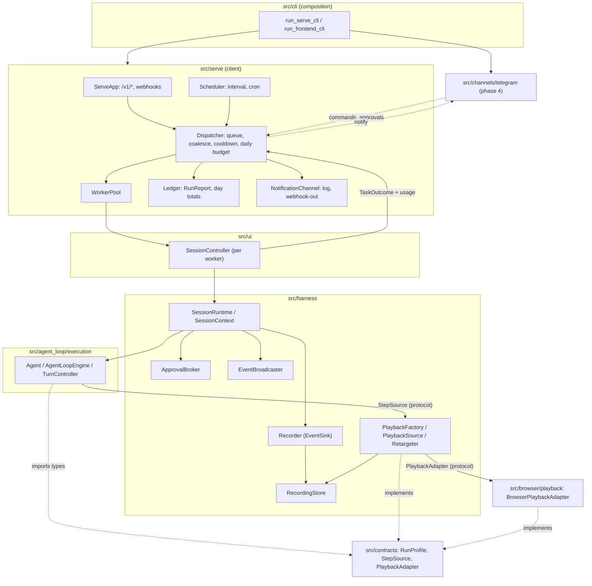
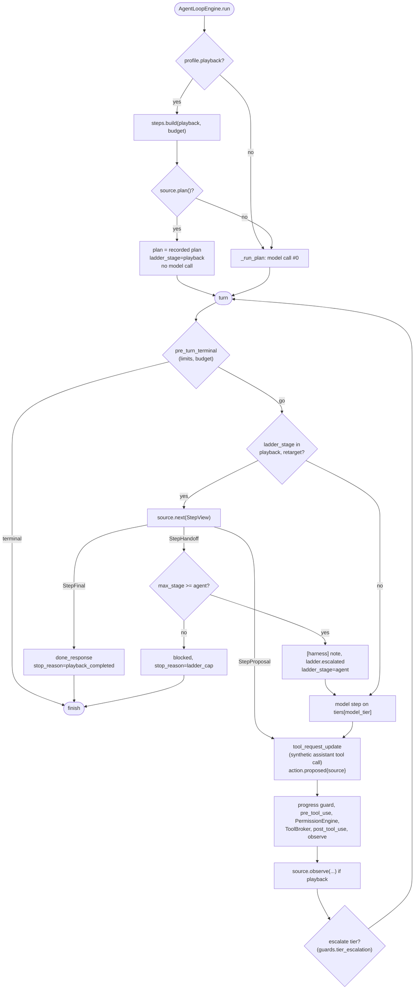
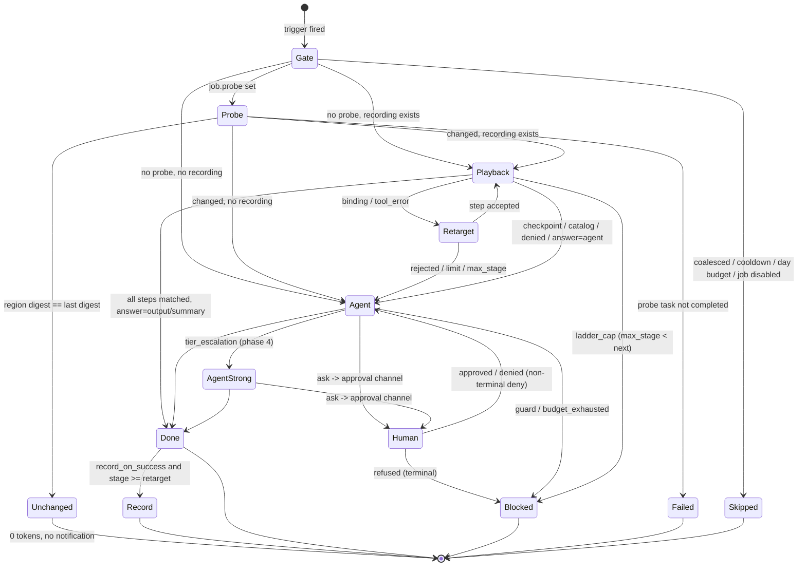
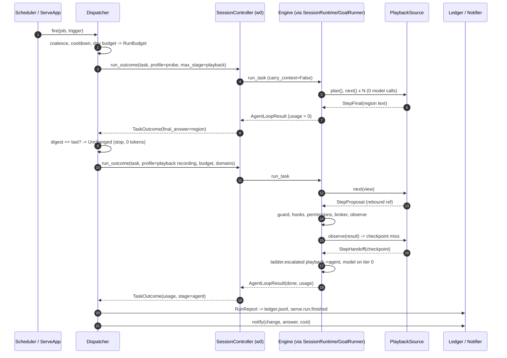

# Режим стенда (`autobrowser serve`), лестница стоимости и replay

Статус: Accepted. Ответы на открытые вопросы Q1–Q15 (§10.2) получены 2026-11-02: приняты
рекомендуемые дефолты. Код не начат.
Дата: 2026-11-02
Ветка: `feat/serve-mode`
ADR (Accepted):
- [2026-11-02 Режим стенда и лестница стоимости](../decisions/2026-11-02-serve-mode-and-cost-ladder.md)

Диаграммы: [Serve Mode](../diagrams/serve-mode.md).

**Позиционирование.** AutoBrowser — open-source harness для браузера. Он выжимает максимум из
открытых и дешёвых моделей и делает повторяемые задачи почти бесплатными. От связки Claude Code +
Playwright MCP его отличают четыре вещи:
- свобода модели: Ollama или любой OpenAI-совместимый сервис;
- цикл, заточенный под браузер;
- детерминированный replay;
- открытый код.

Паритет с Claude Code (rewind, plan mode, subagents) здесь не проектируется.

Режимов два, ядро одно:
1. **Интерактивный.** Существующие TUI, plain и classic: задачу ставит человек. В этом документе
   от него нужны только replay (общий для обоих режимов) и упаковка, которая вынесена в отдельную
   работу (§2.4).
2. **Стенд.** `autobrowser serve` — долгоживущий процесс на сервере или в Docker:
   - задачи приходят по триггерам: cron, webhook, изменение страницы, позже Telegram;
   - браузер headless, с отдельным профилем;
   - подтверждения идут через мессенджер, иначе срабатывает deny по правилам;
   - главная метрика — стоимость одного прогона и надёжность.

Документ определяет:
- replay: формат записи, хранение, воспроизведение без модели, name-free детект расхождения,
  перенацеливание шага дешёвой моделью и передачу агенту;
- лестницу стоимости как конечный автомат;
- бюджеты и учёт стоимости;
- `serve`: компоненты, триггеры, очередь, изоляцию браузера, конкурентность, HTTP API;
- безопасность;
- каскад моделей и канал Telegram (фаза 4);
- настройки, события, тесты, план по коммитам, риски и вопросы.

Термины — в [глоссарии](../glossary.md); новые термины этого документа собраны в §11.

---

## 1. Контекст и проблема

### 1.1 Что есть сейчас

| Место | Что делает | Почему важно для стенда |
| --- | --- | --- |
| `src/ui/controller.py:66` `SessionController` | UI-нейтральный фасад: `submit(text)`, `run_outcome(text)`, `cancel`, `answer`, `subscribe`. Одна задача за раз (`TaskBusyError`, `:108`). | `serve` — ещё один клиент этого фасада. Но `submit` принимает только текст: ни профиля прогона, ни бюджета, ни replay. |
| `src/harness/session.py:1195` `SessionRuntime.run_task` | Каждая задача получает перенесённый durable-контекст через `_task_state_overrides` (`:436`): сообщения, наблюдение, снимки. | На стенде несвязанные задания тянули бы чужую историю. Это лишние токены и шум в контексте. |
| `src/harness/session.py:573` `SessionContext.initialize` | Запускает Chrome через `start_chrome_cdp` (`src/harness/chrome.py:19`) в видимом режиме, с путями Windows по умолчанию (`src/config.py:412-420`), и затем MCP. | Нет headless и нет режима «браузером владеет MCP-сервер». В Docker не стартует. |
| `src/harness/session.py:1158` `reset()` | Закрывает сессию вместе с MCP и Chrome. | Чистый контекст сейчас стоит перезапуска браузера. |
| `src/agent_loop/execution/loop.py:1004`, `:1096` `_run_plan` | Вызов модели №0 строит план — всегда. | Известный проход нельзя исполнить без модели. |
| `src/agent_loop/execution/loop.py:373` `_agent_step` | Каждый ход — вызов модели через `ModelDriver` (`src/agent_loop/model.py:300`). | То же. |
| `loop.py:396-404`, `:1107-1110` | `model.responded` несёт `usage` (`ModelUsage`, `src/llm.py`). | Usage есть. Но его никто не суммирует по задаче, бюджета нет, у `StopReason` (`src/contracts.py:27`) нет причины «бюджет». |
| `src/agent_loop/replay.py`, `autobrowser replay` (`src/cli/subcommands.py:45`, `:87`) | Печатают последовательность действий из `events.jsonl`. | Это просмотр трейса, а не повторное исполнение. Имя `replay` занято (§4.1). |
| Кассеты ([ADR пайплайна](../decisions/2026-10-19-autonomous-test-pipeline.md), Proposed, не реализованы) | `RecordingChatModel` / `ReplayChatModel`: строгое офлайн-воспроизведение ответов модели и инструментов для тестов. Инструменты сопоставляются по `(name, canonical_args)`. | Против живой страницы не работает: ref'ы меняются, а модель кассеты «отвечает» вслепую. Но идея обёрток записи пригодится. |
| `src/harness/approvals.py:49` `ApprovalBroker` | `HumanInputCallback` на тикетах. Ответ принимается из любого клиента; по таймауту — `deny`. `ApprovalVia` (`src/contracts.py:70`) — `tui/plain/classic/web/timeout/cancelled`. | Мессенджер станет ещё одним отвечающим. Нужны значения `ApprovalVia` для канала и API. |
| `src/cli/bootstrap.py:55` `effective_permission_mode` | Без TTY режим `default` превращается в `dont_ask`. | На стенде без канала подтверждений это поведение сохраняется. |
| `src/browser/permissions.py:35` `snapshot_element` | По ref находит строку снимка: роль и доступное имя (`button "Купить"`). Name-free: распознаётся по маркеру `[ref=…]`. | Готовый образец для перенацеливания ref при replay. |
| `src/agent_loop/execution/observation.py:196-200` | Снимки хранятся по серверу, по `readOnlyHint`. | Replay опирается на ту же семантику. |
| `src/agent_loop/execution/progress.py:63` `call_key` / `outcome_key` | Отпечатки вызова и исхода без имён. | Повторы при replay ловит тот же журнал. |
| `pyproject.toml` | `starlette==0.50.0` и `uvicorn==0.40.0` уже прямые зависимости. Модуль называется `src` (`module-name = "src"`). Файла LICENSE нет. | HTTP-сервер не требует новых зависимостей. PyPI блокирован (§2.4). |

### 1.2 Что не так

- **Каждый прогон стоит как первый.** Повторяемое задание («проверь цену раз в час») каждый раз
  проходит планирование и N ходов модели. Проход, который уже удался, переиспользовать нельзя.
- **Нет «нулевой ступени».** Нельзя проверить, есть ли вообще повод запускать модель.
  Heartbeat, который спрашивает модель «есть что делать?», жжёт токены вхолостую — это урок
  OpenClaw, который назвал пользователь.
- **Нет денег в контуре.** Usage приходит, но нет бюджета на прогон, нет дневного бюджета и нет
  отчёта стоимости.
- **Нет долгоживущего процесса без терминала.** Нет триггеров, очереди, HTTP-входа, headless,
  отдельного профиля и Docker.
- **Одна модель на сессию.** Дешёвая модель не может работать на простых шагах, а сильная —
  подключаться только при застревании.
- **Безопасность стенда не описана.** Открытые в интернет инстансы и вредоносные скиллы — второй
  урок OpenClaw от пользователя.

### 1.3 Главная техническая проблема replay

Playwright MCP отдаёт снимок доступности со ссылками вида `[ref=e42]`. Модель передаёт ref в
аргумент `target`. Официальная документация говорит, что ref имеет формат `e` + число, с
необязательным префиксом фрейма (`f2e7`), и «действителен, пока страница не изменилась»
([playwright.dev/mcp/snapshots](https://playwright.dev/mcp/snapshots)). Значит, записанный
`{"target": "e42"}` в следующем прогоне в лучшем случае не найдётся. В худшем — укажет на другой
элемент.

Ещё два факта из той же документации и README сервера
([microsoft/playwright-mcp](https://github.com/microsoft/playwright-mcp)):
- `target` принимает **либо** ref, **либо** любой селектор или локатор Playwright, например
  `getByRole('button', { name: 'Submit' })`;
- ответы инструментов содержат блок сгенерированного кода с устойчивым локатором
  (`--codegen`, по умолчанию `typescript`).

Варианты, которые из этого вытекают, сравниваются в §3.3.

---

## 2. Требования

### 2.1 Функциональные

**Replay — общий для обоих режимов:**
- F1. Удачный проход задачи записывается как **запись** (recording): шаги, аргументы, описание
  целевых элементов, контрольные точки. Запись включается явно: `--record <name>`, `/record`,
  опция задания `record_on_success`.
- F2. Запись воспроизводится **без вызова модели**: без вызова №0 и без ходов. Каждый шаг
  проходит обычный конвейер: progress guard → `pre_tool_use` → `PermissionEngine` →
  `ToolBroker` → `post_tool_use` → наблюдение.
- F3. Перед каждым шагом устаревшие ref'ы перепривязываются к текущей странице. Перепривязка
  name-free: по текстовому формату снимка, без имён инструментов и аргументов.
- F4. Расхождение записи со страницей обнаруживается name-free (§5.5). Тогда шаг
  перенацеливается дешёвой моделью (ступень 2), а если это не удалось — управление передаётся
  агенту (ступень 3). История воспроизведённых шагов остаётся в его контексте.
- F5. Финальный ответ после replay формируется одним из трёх способов (`answer`): передачей агенту
  на один ход, текстом последнего вывода или фиксированной сводкой.

**Лестница стоимости:**
- F6. Каждый прогон поднимается по ступеням 0→4 только при необходимости. Максимальную ступень
  задаёт профиль прогона (`max_stage`).
- F7. Бюджет прогона: вызовы модели, токены, деньги по таблице цен. Его исчерпание — терминальный
  `blocked` с `stop_reason="budget_exhausted"`.
- F8. Отчёт стоимости каждого прогона: ступень, вызовы и токены по ступеням и уровням моделей,
  цена, длительность.

**Стенд:**
- F9. `autobrowser serve` — долгоживущий процесс. Задания объявляются в конфигурации. Триггеры:
  `interval`, `cron`, `webhook`; в фазе 4 — `telegram`.
- F10. Ступень 0 — **проба** (probe): короткая последовательность MCP-вызовов без модели и
  отпечаток вывода. Нет изменений — прогон заканчивается с 0 токенов.
- F11. Очередь с ограничением длины, coalescing повторных срабатываний, cooldown, дневные бюджеты
  и учёт пропусков.
- F12. HTTP API на `starlette` и `uvicorn`: здоровье, статус, запуск задания, webhook, отчёт
  прогона, ответ на подтверждение.
- F13. Уведомления: `log` в фазе 3, исходящий webhook, Telegram в фазе 4. Подтверждения — через
  канал, который это умеет, иначе `dont_ask`.
- F14. Headless-браузер с отдельным профилем стенда и запуск в Docker.
- F15 (фаза 4). Каскад моделей: дешёвая модель по умолчанию, сильная — когда progress guard видит
  застревание. Пул браузеров для параллельных заданий.

### 2.2 Нефункциональные

- N1. **Name-free.** Ни replay, ни детект расхождения, ни проба не решают по имени инструмента.
  Опора — `readOnlyHint`, схемы инструментов, сервер и текстовые форматы вывода
  ([ADR](../decisions/2026-10-19-name-free-tool-handling.md)). Имена инструментов в записи и в
  `probe.steps` — это данные пользователя, а не логика кода.
- N2. **Слои.** Engine (`src/agent_loop/execution/`) получает только нейтральные протоколы из
  `src/contracts.py` и не импортирует `src/browser/`, `src/harness/playback.py`, `src/serve/`.
  Браузерная адаптация — в `src/browser/playback.py`. `serve` — клиент `SessionController`.
- N3. **Модель — только через `ChatModel`.** Перенацеливание и каскад используют контракт
  `src/llm.py`. Провайдеры строит `src/cli/` через `registry.build_chat_model`.
- N4. **Аддитивность.** `TaskRequest()` без профиля работает ровно как сейчас: тот же поток
  событий, то же число вызовов модели, baseline `agent_loop_v2` не меняется. Всё новое выключено
  по умолчанию.
- N5. **Безопасность.**
  - API по умолчанию слушает localhost и требует токен.
  - Каждое задание ограничено allowlist доменов и отправителей.
  - Без канала подтверждений действует `dont_ask`; `bypass` на стенде запрещён.
  - Полезная нагрузка webhook не попадает в промпт по умолчанию.
  - Секреты редактируются до записи событий, записей и отчётов.
- N6. **Тюнаблы — в `src/config.py`** с дефолтами, границами и описаниями, плюс `.env.example` и
  `config.example.yaml`; `tests/test_config.py` их проверяет.
- N7. **Стоимость пустого тика — ноль токенов.** Ступень 0 не вызывает модель никогда.
- N8. **Наблюдаемость.** Каждое решение лестницы — событие. OTLP и Langfuse получают ступень и
  стоимость через существующие sink'и.
- N9. **Стенд не становится личным ассистентом.** Только браузерные задания из конфигурации.
  Свободные задачи из API и мессенджера выключены по умолчанию. Никаких почты и календаря.

### 2.3 Вне скоупа

- Упаковка для PyPI (переименование пакета `src`, LICENSE) — отдельная работа, здесь только
  зависимость (§2.4).
- Бенчмарк открытых моделей — отдельная работа. Здесь — только метрики, которые ему нужны (§7.4).
- Паритет с Claude Code: rewind, plan mode, subagents.
- Параметризация записей (подстановка переменных в аргументы), «обрезка» тупиков записи моделью,
  импорт чужих записей — после v1 (§10).
- Вопросы человеку в произвольной форме (`ask_user` сейчас превращается в replan). Ступень 4 в v1
  — это подтверждения и уведомление о `blocked`.
- Push-уведомления об изменении страницы без опроса. «Изменение страницы» реализуется как проба
  по расписанию.
- Веб-UI стенда. HTTP API сделан так, чтобы веб-UI мог появиться позже как клиент.
- Почта, календарь, файловые задачи и любые не-браузерные «ассистентские» сценарии.

### 2.4 Зависимости от соседних работ

| Работа | Что даёт этому дизайну | Блокирует? |
| --- | --- | --- |
| (1) Бенчмарк на открытых моделях | Пороги `replay.checkpoint_min_similarity` и `cascade.*`, долю расхождений, стоимость ступеней. | Нет: дефолты консервативные, бенчмарк их калибрует. |
| (2) Упаковка, режим 1 | `uv tool install autobrowser` и образ Docker из wheel. | Docker — нет: пакет `src` ставится в изолированный venv образа, как и рекомендует [ADR о команде](../decisions/2026-10-19-autobrowser-command-and-home-directory.md). Публикация на PyPI — да: нужны переименование модуля и LICENSE. |
| Кассеты ([ADR пайплайна](../decisions/2026-10-19-autonomous-test-pipeline.md)) | Общий рекордер инструментов возможен, но не обязателен. | Нет. |

---

## 3. Варианты

### 3.1 Где живёт `serve`

| Вариант | Плюсы | Минусы и риски |
| --- | --- | --- |
| **A. Новый пакет `src/serve/` — клиент `SessionController`** (рекомендуется) | Цепочка владения не меняется. Переиспользуются `ApprovalBroker`, `EventBroadcaster` и композиция из `src/cli/bootstrap.py`. Фронтенд остаётся клиентом, как требует [ADR о SessionController](../decisions/2026-10-19-session-controller-and-local-web-ui.md). | Нужно расширить `submit` профилем прогона (§4.4). |
| B. Планировщик и очередь внутри `SessionRuntime` | Меньше слоёв. | `SessionRuntime` — «not a task solver». Триггеры, бюджеты и HTTP превратили бы сессию в приложение. Нарушает границу «фронтенды — клиенты сессии». |
| C. Внешний cron + `autobrowser -p` на каждый прогон | Ноль нового кода. Уже работает. | Холодный старт Chrome и MCP на каждый прогон. Нет coalescing, дневных бюджетов, webhook, подтверждений, ступени 0 и общего профиля. Остаётся документированным минимальным путём. |

### 3.2 Где исполняется replay

| Вариант | Плюсы | Минусы и риски |
| --- | --- | --- |
| A. Replay как `ChatModel` (`PlaybackChatModel` отдаёт записанные tool calls) | Engine не меняется. | Нарушает контракт `ChatModel`: «never make policy or execution decisions». Модель видит только сообщения: перепривязка ref'ов по истории ломается после сжатия L1 (`[cleared]`). Вызов №0 нужно подделывать. Телеметрия лжёт: «модель ответила», хотя модели не было. |
| **B. Нейтральный `StepSource` в `EngineResources`, engine спрашивает его перед моделью** (рекомендуется) | Каждый шаг проходит тот же конвейер: guard, hooks, permissions, broker, observe. Передача агенту естественна: история уже в `LoopState.messages`. Телеметрия честная (`action.proposed{source}`). Engine не знает ни браузера, ни записей, только протокол. | Аддитивная правка engine: пропуск вызова №0, ветка в `_agent_step`, новые события. |
| C. Отдельный `PlaybackRunner` вне engine: `ToolBroker` напрямую, при расхождении `Agent.run` с перенесённым состоянием | Engine не меняется. | Либо дублирует `_run_tool_turn` (permissions, hooks, approvals, progress), либо обходит его. Replay покупки без подтверждения — недопустимо. Два источника правды о конвейере. |

### 3.3 Эфемерные ref'ы: как воспроизводить шаг

| Вариант | Как работает | Плюсы | Минусы и риски |
| --- | --- | --- | --- |
| **R1. Устойчивый локатор из вывода** | При записи берём из блока сгенерированного кода в выводе успешного шага локатор (`getByRole('button', { name: 'Купить' })`). При replay подставляем его вместо ref в то же значение аргумента. | Строгий режим Playwright: при неоднозначности действие падает, а не кликает не туда. | Привязка к формату codegen одного сервера и его версии. `--codegen none` выключает блок. Сервер, не принимающий селектор в `target`, ломается. Name-free детект, *принимает ли* аргумент селектор, невозможен: это есть только в описании. Отказ обнаруживается **после** вызова. |
| **R2. Перепривязка по описанию элемента в снимке** (рекомендуется) | При записи для каждого строкового значения аргумента V, для которого в тексте страницы *до шага* есть `[ref=V]`, сохраняем дескриптор строки: роль, доступное имя, порядковый номер среди одинаковых, 1–2 строки предков. При replay ищем строку с тем же дескриптором в текущем тексте. Ровно одна — подставляем её ref. Ноль или больше одной — расхождение до вызова. | Name-free и даже arg-name-free: ref распознаётся по значению и маркеру `[ref=…]`, как уже делает `snapshot_element`. Ошибка ловится **до** действия: нет побочных эффектов. Работает с любым сервером, который печатает `[ref=…]`, и с любой версией Playwright MCP. | Дескриптор роль+имя ломается при смене текста кнопки и при одинаковых элементах. Смягчение: порядковый номер, контекст предков, ступень 2. |
| R3. Перенацеливание моделью на каждом шаге | Дешёвая модель получает записанный шаг и текущий снимок и возвращает аргументы. | Устойчиво к любым изменениям вёрстки. | Ступень 1 перестаёт быть бесплатной: N вызовов модели на прогон. Остаётся только как ступень 2 — по расхождению. |
| R4. Сгенерированный Playwright-скрипт вне MCP | Исполняем записанный код напрямую через `playwright`. | Быстро и устойчиво. | Обходит MCP, `PermissionEngine`, hooks, события. Привязка к одному серверу. Отклонено. |

**Рекомендация: R2 как ступень 1, R3 как ступень 2 только на разошедшемся шаге, агент как
ступень 3.** R1 откладывается. Блок кода можно сохранять в запись как диагностический
`locator_hint` без логики. Если бенчмарк покажет высокую долю расхождений R2, его стоит
вернуть как второй детерминированный способ до ступени 2 (вопрос Q8).

### 3.4 Конкурентность и браузеры

| Вариант | Плюсы | Минусы |
| --- | --- | --- |
| **V1. Один worker = одна сессия = один Chrome-профиль, FIFO-очередь** (фаза 3) | Совпадает с текущей моделью «один браузер на сессию». Нет гонок за профиль, память L4 и гранты. | Задания ждут друг друга. |
| **V2. Пул из N worker'ов** (фаза 4) | Параллелизм. У каждого worker'а свой `SessionRuntime`, Chrome, CDP-порт, профиль и MCP-процесс. Задание можно закрепить за профилем с логинами. | N браузеров по памяти. Общие файлы памяти L4 и записей требуют блокировок (Q13). |
| V3. Изолированные контексты внутри одного MCP-сервера (`isolatedContext`, `--isolated`) | Один процесс браузера. | Специфика Playwright MCP в ядре. Одна сессия — один `LoopState`, параллельные задачи в ней невозможны. Отклонено для ядра; пользователь может так настроить свой сервер. |

### 3.5 Расписание

| Вариант | Плюсы | Минусы |
| --- | --- | --- |
| Только `interval` | Ноль зависимостей. | «Каждый будний день в 9:00» не выразить. |
| Свой парсер cron-подмножества | Ноль зависимостей. | DST, дни недели, граничные случаи — свой код с багами. |
| **`interval` + `cron` через `croniter`** (рекомендуется) | Проверенная библиотека, чистый Python. Проект снова поддерживается в `pallets-eco` (6.2.4, 2026-07-10). | Новая зависимость (Q1). Короткий период без поддержки (12.2024–06.2025) — повод закрепить версию. |

---

## 4. Дизайн

### 4.1 Компоненты и слои

Имена. Слово `replay` уже занято просмотром трейса (`src/agent_loop/replay.py`,
`autobrowser replay`). Поэтому в коде воспроизведение называется **playback**, а артефакт —
**recording**. В тексте «replay» означает всё вместе. Настройки — секция `replay`: её видит
пользователь, и там конфликта нет.

| Компонент | Слой и модуль | Ответственность |
| --- | --- | --- |
| `LadderStage`, `RunBudget`, `RunProfile`, `TaskUsage`, `StepView`, `StepProposal`, `StepFinal`, `StepHandoff`, `StepSource`, `StepSourceFactory`, `PlaybackAdapter` | `src/contracts.py` (нейтральный лист) | Типы профиля прогона и протоколы источника шагов и браузерного адаптера. Ничего не импортирует из `agent_loop`, `harness`, `browser`. |
| `ModelPrice`, `ModelTier`, `ModelTiers` | `src/llm.py` | Уровни моделей и цены. Арифметика стоимости по `ModelUsage`. |
| Ветка `StepSource` в `_agent_step`, пропуск вызова №0, guard бюджета, выбор уровня модели | `src/agent_loop/execution/loop.py`, `guards.py`, `state.py` | Engine решает, *кто* предлагает действие (источник или модель), и эскалирует. Что воспроизводить — не знает. |
| `Recording`, `RecordedStep`, `Binding`, `Checkpoint`, (де)сериализация, версия формата | `src/agent_loop/recordings.py` (чистый модуль, как `replay.py`, `export.py`) | Формат записи (§5.1). |
| `RecordingStore` | `src/harness/recording_store.py` | Файлы под `<storage.root_dir>/<replay.dir>/`, атомарная запись, `previous.json`, `stats.json`. |
| `RecordingSink` + `Recorder` | `src/harness/recorder.py` | Session-scoped `EventSink`. Собирает шаги задачи, для которой запись «взведена». `finish()` вызывает сессия после `goal_end`, как `_update_memory`. |
| `PlaybackFactory`, `PlaybackSource`, `Retargeter`, `TextPlaybackAdapter` | `src/harness/playback.py` | Реализация `StepSource`: ступени 1–2, контрольные точки, решение о передаче. `Retargeter` вызывает модель через `ChatModel`. |
| `BrowserPlaybackAdapter` | `src/browser/playback.py` | Текстовые форматы браузера: `[ref=…]` и строка элемента (переиспользует `snapshot_element`), `- Page URL:` (переиспользует `page_url`), отпечаток структуры страницы. |
| Расширение `submit`/`run_outcome` профилем, `TaskOutcome.usage/stop_reason/stage` | `src/ui/controller.py`, `src/ui/views.py`, `SessionRuntime.run_task` | Профиль прогона и чистый контекст (`carry_context=False`). |
| `browser.launch/headless/extra_args` | `src/harness/chrome.py`, `SessionContext.initialize` | Headless и режим «браузером владеет MCP-сервер». |
| `ServeApp` (Starlette), `Scheduler`, `Dispatcher`, `WorkerPool`, `Ledger`, `JobState`, `NotificationChannel`, `LogChannel`, `WebhookOutChannel` | `src/serve/` (новый пакет, клиент) | Процесс стенда. Импортирует `src.ui.controller`, `src.ui.views`, `src.contracts`, `src.config`, `src.agent_loop.events`. Не импортирует `src.agent_loop.execution`, `src.browser`, `src.cli`, `src.providers`. |
| `TelegramChannel` | `src/channels/telegram.py` (фаза 4) | Вендорный адаптер по образцу `src/providers/`. Импортируется только композицией в `src/cli/`. |
| `run_serve_cli`, подкоманды `serve`, `recordings` | `src/cli/bootstrap.py`, `src/cli/subcommands.py` | Композиция: модели, сессии, брокеры, каналы. |



### 4.2 Контракты (эскизы)

Эскизы показывают форму, а не реализацию. Все новые поля имеют дефолты, которые сохраняют
сегодняшнее поведение.

```python
# src/contracts.py  (neutral leaf; additive)

LadderStage = Literal["probe", "playback", "retarget", "agent", "human"]
#: Order of the cost ladder; a run never goes above RunProfile.max_stage.
LADDER_ORDER: tuple[LadderStage, ...] = ("probe", "playback", "retarget", "agent", "human")

StopReason = Literal[..., "budget_exhausted", "ladder_cap", "playback_completed"]
ApprovalVia = Literal["tui", "plain", "classic", "web", "timeout", "cancelled", "api", "channel"]

PlaybackAnswer = Literal["agent", "output", "summary"]


@dataclass(frozen=True)
class RunBudget:
    """Caps of one run; None = no cap. Cost needs a price for every model tier used."""
    max_model_calls: int | None = None
    max_tokens: int | None = None          # input + output, as reported by ModelUsage
    max_cost: float | None = None          # in llm.currency


@dataclass(frozen=True)
class PlaybackRequest:
    """What to replay: a stored recording by name (loaded by the factory, not the engine)."""
    recording: str
    answer: PlaybackAnswer | None = None   # None: the recording's own mode
    select: str | None = None              # probe: regex of the output region to return
    ignore: tuple[str, ...] = ()           # probe: regexes removed before fingerprinting


@dataclass(frozen=True)
class RunProfile:
    """How one task may spend. The default reproduces today's behaviour exactly."""
    playback: PlaybackRequest | None = None
    max_stage: LadderStage = "human"       # today: agent + approvals
    carry_context: bool = True             # serve: False (no messages/snapshots carried)
    record_as: str | None = None           # write a recording on a completed run
    budget: RunBudget = field(default_factory=RunBudget)
    allowed_domains: tuple[str, ...] = ()  # non-empty: calls outside are denied (sec. 6.4)
    labels: Mapping[str, str] = field(default_factory=dict)  # job_id, run_id, trigger


@dataclass(frozen=True)
class TaskRequest:                          # existing; one new field
    ...
    profile: RunProfile = field(default_factory=RunProfile)


@dataclass(frozen=True)
class TaskUsage:
    """Per-task accounting the engine keeps and returns (AgentLoopResult, goal.* payloads)."""
    model_calls: int = 0
    input_tokens: int = 0
    output_tokens: int = 0
    cost: float | None = None              # None: some call had no usage or no price
    by_stage: Mapping[str, Mapping[str, float]] = field(default_factory=dict)
    stage_reached: LadderStage = "agent"


# -- step sources (the engine's view of playback) ------------------------------------

@dataclass(frozen=True)
class StepView:
    """What a step source may read: the same page view the permission resolver gets."""
    task: str
    turn: int
    tool_result: Mapping[str, Any]          # latest ToolResult (content, status, name)
    snapshots: Mapping[str, str]            # kept read-only outputs per server
    tool_schemas: Mapping[str, Mapping[str, Any]]   # name -> {server, read_only, schema_digest}


@dataclass(frozen=True)
class StepProposal:
    request: ToolRequest                    # {"name", "args"} - rebound args
    stage: Literal["playback", "retarget"]
    step: int                               # 1-based index in the recording
    plan_step: int | None = None            # recorded current_step, keeps the plan moving


@dataclass(frozen=True)
class StepFinal:
    final_answer: str
    stage: Literal["playback", "retarget"]


@dataclass(frozen=True)
class StepHandoff:
    """The source gives up; the model drives the rest of the task (sticky)."""
    reason: str                             # model-facing, becomes one [harness] note
    kind: Literal["binding", "tool_error", "checkpoint", "catalog", "denied", "answer", "exhausted"]
    step: int | None = None


StepOutcome = StepProposal | StepFinal | StepHandoff


@runtime_checkable
class StepSource(Protocol):
    def plan(self) -> list[PlanStep] | None: ...                 # recorded plan, skips call #0
    async def next(self, view: StepView) -> StepOutcome: ...
    def observe(self, proposal: StepProposal, result: Mapping[str, Any], view: StepView) -> None: ...
    @property
    def usage(self) -> Sequence[ModelUsageRecord]: ...          # retarget calls, for budgets


@runtime_checkable
class StepSourceFactory(Protocol):
    """Session-scoped (like hooks/permissions); builds one source per task."""
    def build(self, request: PlaybackRequest, *, task: str, budget: RunBudget) -> StepSource: ...


# -- browser adaptation (implemented in src/browser/playback.py) ----------------------

@dataclass(frozen=True)
class Binding:
    path: tuple[str | int, ...]             # JSON path inside args, found by value, not by key
    value: str                              # the recorded ephemeral reference
    descriptor: Mapping[str, Any]           # opaque to everyone but the adapter


@dataclass(frozen=True)
class BindResult:
    args: Mapping[str, Any] | None          # None: could not bind -> divergence "binding"
    detail: str = ""


@runtime_checkable
class PlaybackAdapter(Protocol):
    def describe(self, args: Mapping[str, Any], page_texts: Sequence[str]) -> list[Binding]: ...
    def rebind(self, args: Mapping[str, Any], bindings: Sequence[Binding],
               page_texts: Sequence[str]) -> BindResult: ...
    def checkpoint(self, text: str) -> Mapping[str, Any]: ...    # fingerprint of an output
    def similarity(self, recorded: Mapping[str, Any], current: Mapping[str, Any]) -> float: ...
    def region(self, text: str, select: str | None, ignore: Sequence[str]) -> str: ...
```

```python
# src/llm.py  (additive)

@dataclass(frozen=True)
class ModelPrice:
    input_per_mtok: float
    output_per_mtok: float
    cached_input_per_mtok: float | None = None
    def cost(self, usage: ModelUsage) -> float | None: ...   # None when tokens are missing


@dataclass(frozen=True)
class ModelTier:
    model: ChatModel
    label: str                     # the model id, for events and reports
    price: ModelPrice | None = None


@dataclass(frozen=True)
class ModelTiers:
    """tiers[0] is the default; escalation only moves up. One tier = today's behaviour."""
    tiers: tuple[ModelTier, ...]
    retarget_tier: int = 0
```

```python
# src/agent_loop/execution/resources.py  (additive; defaults keep today's behaviour)

@dataclass(frozen=True)
class EngineResources:
    ...
    steps: StepSourceFactory = field(default_factory=NullStepSourceFactory)
    models: ModelTiers | None = None     # None: ModelTiers((ModelTier(llm, ...),))
```

```python
# src/agent_loop/execution/state.py  (task-local; added to TASK_BOUNDARY_RESETS)

ladder_stage: str = "agent"          # "playback" while a source drives
model_tier: int = 0
usage: dict[str, Any] = {}           # running TaskUsage as a plain mapping
retargets: int = 0
```

```python
# src/ui/controller.py / src/harness/session.py  (additive keyword arguments)

async def submit(self, text: str, *, profile: RunProfile | None = None) -> TaskView: ...
async def run_outcome(self, text: str, *, profile: RunProfile | None = None) -> TaskOutcome: ...
async def run_task(self, task: str, *, profile: RunProfile | None = None) -> AgentLoopResult: ...

@dataclass(frozen=True)
class TaskOutcome:                    # src/ui/views.py, existing + 3 fields
    ...
    stop_reason: str = ""
    usage: TaskUsage | None = None
    stage: str = ""
```

Все `src/serve/*` используют только эти контракты. `ControllerPort` TUI
(`src/ui/tui/ports.py:36`) не меняется.

### 4.3 Поток управления в engine



Правила:
- **Синтетический ход ассистента.** Для `StepProposal` engine добавляет в `messages` обычный
  assistant tool call (`append_ai_tool_call` через `tool_request_update`). Если управление
  перейдёт к агенту, он увидит честную историю: «вызвано X, вернулось Y».
- **Тот же конвейер.**
  - Progress guard, hooks, permissions и approvals применяются к воспроизводимому шагу без
    изъятий.
  - Permission deny или hook deny на воспроизводимом шаге — не терминален, как и сейчас. Источник
    получает отказ в `observe` и отвечает `StepHandoff(kind="denied")`: агент читает причину.
  - Отказ в подтверждении — терминальный `blocked`, как сейчас.
- **План.** Записанный план подставляется без вызова №0. Предложение несёт `plan_step`, и engine
  двигает `current_step` по нему. В стадии `playback` счётчик `steps_without_plan_advance` не
  растёт. Иначе длинная запись упрётся в `loop.max_steps_without_plan_advance` (по умолчанию 8)
  и закончится `no_plan_advance`.
- **Бюджет.**
  - `CompletionController.pre_turn_terminal` проверяет `state.usage` против
    `profile.budget` **перед** каждым вызовом модели, в том числе перед вызовом №0 и перед
    повторным планированием.
  - `PlaybackSource` проверяет остаток бюджета перед вызовом `Retargeter`.
  - Исчерпание даёт `blocked` с `stop_reason="budget_exhausted"`.
  - Если провайдер не вернул usage, `cost=None` и денежный лимит не проверяется. Тогда
    действует `max_model_calls`; `serve` требует его при заданном `max_cost` (§6.2).
- **Каскад (фаза 4).** Чистая функция `tier_escalation(state, settings) -> int` в `guards.py`
  поднимает `model_tier` на один уровень, когда:
  - progress guard заблокировал повтор;
  - `consecutive_failures >= cascade.escalate_after_failures`;
  - `replan_count >= cascade.escalate_after_replans`;
  - модель вернула `no_action`.

  Вниз уровень не опускается. Каждый подъём — `ladder.escalated{tier}`. Вызов №0 и повторное
  планирование идут на текущем уровне.
- **Без профиля ничего не меняется.** `NullStepSourceFactory` никогда не используется: при
  `profile.playback is None` engine не строит источник, не эмитит новых событий и делает
  столько же вызовов модели.

### 4.4 Сессия: профиль прогона и чистый контекст

`SessionRuntime.run_task(task, profile=...)`:
- `profile.carry_context=False` — `_task_state_overrides` не переносит `SESSION_STATE_KEYS`
  (сообщения, наблюдение, снимки, данные о последнем действии). Сбросы `TASK_BOUNDARY_RESETS`
  применяются как обычно. Браузер не перезапускается: страница остаётся, где была, но задача о
  ней ничего «не помнит». Первый шаг записи или пробы обычно — навигация.
- Если `profile.record_as` задан и `replay.enabled`, то до `GoalRunner.run` вызывается
  `recorder.arm(task_id, name)`, а после — `recorder.finish(task_id, goal_status, result)`.
  Это зеркало `_update_memory`: сбой записи никогда не валит задачу и даёт `recording.skipped`.
- После задачи `SessionContext.state` заменяется результатом, как сейчас. При
  `carry_context=False` следующая интерактивная задача всё равно ничего не унаследует от
  задания стенда: на стенде все прогоны идут с `False`.
- `SessionContext.build_agent()` добавляет в `EngineResources`:
  - `steps=PlaybackFactory(store, adapter, retargeter)` при `replay.enabled`;
  - `models=ModelTiers(...)` при `cascade.enabled`.

  `adapter` — `BrowserPlaybackAdapter`, если сконфигурирован браузерный сервер (тот же признак,
  что для `browser-agent-rules`), иначе `TextPlaybackAdapter`.

### 4.5 Браузер: headless и владелец браузера

- `browser.launch: cdp | external`:
  - `cdp` (по умолчанию) — как сейчас: сессия запускает Chrome и ждёт порт.
  - `external` — сессия не запускает Chrome и не ждёт порт. Браузером владеет MCP-сервер,
    например Playwright MCP с `--headless --user-data-dir /data/serve/profiles/w0`, заданный в
    `mcp_servers` пользователем.

  Это нужно Docker-образу. Код не знает аргументов Playwright: они живут в
  `config.example.yaml`.
- `browser.headless: bool` — при `cdp` добавляет `--headless=new` в `start_chrome_cdp`.
- `browser.extra_args: list[str]` — например `--no-sandbox` в контейнере.
- Профиль стенда отдельный: `serve.profiles_dir` (`<home>/serve/profiles/w<i>`). CDP-порт
  worker'а — `serve.cdp_port_base + i`. Логины стенда не смешиваются с личным профилем
  интерактивного режима.

---

## 5. Replay

### 5.1 Формат записи и хранение

Файлы лежат под `<storage.root_dir>/<replay.dir>/` (по умолчанию `<home>/recordings/`):

```text
<home>/recordings/
  price-watch/
    recording.json     # текущая запись (атомарная замена)
    previous.json      # предыдущая версия (replay.keep_previous)
    stats.json         # счётчики воспроизведений; recording.json не переписывается
```

Имя записи подчиняется тем же правилам, что имя скилла: строчные латинские буквы, цифры,
дефис, до 64 символов. Так исключается выход из каталога через путь.

```json
{
  "format": "autobrowser.recording/1",
  "name": "price-watch",
  "created_at": "2026-11-02T10:00:00Z",
  "source": {"session_id": "…", "task_id": "task-…", "model": "gemma4:31b-cloud",
             "stage_reached": "agent", "autobrowser_version": "0.1.0"},
  "task": "Открой страницу товара и сообщи текущую цену",
  "answer": "agent",
  "plan": [{"title": "Открыть страницу товара", "status": "pending"}],
  "catalog": {
    "playwright": {
      "browser_navigate": {"read_only": false, "schema_digest": "sha256:…"},
      "browser_click":    {"read_only": false, "schema_digest": "sha256:…"}
    }
  },
  "steps": [
    {"index": 1, "server": "playwright", "tool": "browser_navigate", "read_only": false,
     "plan_step": 0, "args": {"url": "https://shop.example/item/1"}, "bindings": [],
     "checkpoint": {"url": "shop.example/item/1", "structure": {"roles": 41, "digest": "…"}}},
    {"index": 2, "server": "playwright", "tool": "browser_click", "read_only": false,
     "plan_step": 0, "args": {"element": "Вкладка Характеристики", "target": "e42"},
     "bindings": [{"path": ["target"], "value": "e42",
                   "descriptor": {"role": "tab", "name": "Характеристики", "nth": 1,
                                  "context": ["tablist"], "frame": ""}}],
     "checkpoint": {"url": "shop.example/item/1", "structure": {"roles": 57, "digest": "…"}},
     "locator_hint": "getByRole('tab', { name: 'Характеристики' })"}
  ]
}
```

Правила записи (`Recorder`):
- **Источник — сырые события** задачи. Sink'и получают `EventRecord` до редактирования
  (`src/agent_loop/events.py:92`: редактирование происходит в `to_json_dict`). Шаг — это пара
  `tool.started` / `tool.finished`.
  - Аддитивно `tool.started` получает `server` и `read_only` (из `PreparedToolCall`). Это полезно
    и телеметрии.
  - Записывается `started_request`: запрос модели или аргументы, переписанные hook'ом. Схемная
    нормализация повторится при replay в `ToolBroker`.
- **В запись не попадают:**
  - шаги со статусом `error`;
  - шаги, остановленные guard'ом, hook'ом или permission'ом: у них нет `tool.started`;
  - вызовы инструментов сессии `memory` и `skills`.

  Последнее правило name-free: решение принимается по серверу. В `RecordingSink` передаётся
  набор серверов «служебных» инструментов сессии, и этот набор строит композиция, а не литерал.
- **Текст страницы до шага.** Рекордер ведёт зеркало «последний вывод + снимки по серверам» по
  тем же правилам, что `observation.py:196-200`. Контрактный тест сверяет зеркало с
  `LoopState.browser.snapshots` на одной последовательности. Этот текст получает
  `adapter.describe(args, page_texts)`.
- **Секреты.** К аргументам применяется `redact_json_safe`. Шаг с отредактированным значением
  помечается `"redacted": true`. При replay он не исполняется вслепую: это `StepHandoff`. Логины
  стенда живут в профиле браузера, а не в записи (Q6).
- **Когда сохранять.** Запись сохраняется, только если:
  - статус `completed`;
  - `stop` hooks, если они настроены, приняли ответ;
  - шагов не больше `replay.max_steps`.

  Прогон, который полностью прошёл на ступени 1, запись не переписывает: обновляются только
  `stats.json`. Прогон, дошедший до ступени 2 или выше, при `record_as` заменяет запись, а старая
  уходит в `previous.json`.
- **`catalog`** хранит `read_only` и дайджест входной схемы каждого использованного инструмента.
  При replay другая схема или пропавший инструмент — расхождение `catalog` до вызова.

### 5.2 Ступень 1: воспроизведение

`PlaybackSource.next(view)` для шага *k*:
1. **Каталог.** Инструмента нет, или у него другой `schema_digest` или `read_only` —
   расхождение `catalog`.
2. **Отредактированный шаг** — расхождение `binding` (вслепую не исполняется).
3. **Перепривязка.** `adapter.rebind(args, bindings, page_texts)`. Здесь `page_texts` — последний
   вывод и снимки сервера шага из `StepView`. `args=None` — расхождение `binding`, и мы ещё **до
   вызова**.
4. Возвращается `StepProposal(stage="playback", step=k, plan_step=…)`.

`PlaybackSource.observe(proposal, result, view)` после шага:
- `status=error` — расхождение `tool_error`. Повторная попытка шага идёт на ступени 2.
- Контрольная точка: `adapter.similarity(recorded, adapter.checkpoint(output)) <
  replay.checkpoint_min_similarity` — расхождение `checkpoint`. Действие уже выполнено, поэтому
  дальше идёт передача агенту, а не перенацеливание (§5.5).
- Отказ permission или hook — `denied`, передача агенту: политика могла измениться намеренно.

Когда шаги кончились, `answer` определяет результат:
- `agent` — `StepHandoff(kind="answer")` с заметкой «Записанные шаги выполнены; ответь на задачу
  по текущей странице». Новый промпт не нужен: работает промпт агента. Обычно это один вызов на
  нулевом уровне.
- `output` — `StepFinal(final_answer=adapter.region(last_output, select, ignore))`. Это режим
  пробы ступени 0.
- `summary` — `StepFinal` с фиксированной сводкой «Воспроизведено N шагов». Подходит для
  заданий-действий без вопроса.

### 5.3 Как работает `BrowserPlaybackAdapter` (R2)

Всё ниже опирается на текстовые форматы. Имена инструментов и аргументов не используются.

- **`describe`.** Обходит все строковые значения в `args` на любой глубине. Значение V считается
  ссылкой, если в `page_texts` есть `[ref=V]`; поддерживается префикс фрейма `f1e7`. Для каждой
  ссылки строится дескриптор:
  - `role` и `name` — строка элемента, как в `snapshot_element` (`src/browser/permissions.py:35`);
  - `nth` — номер среди строк с той же парой `role` + `name`;
  - `context` — до `replay.describe_context_lines` ближайших предков по отступу YAML-снимка;
  - `frame` — префикс фрейма.
- **`rebind`.** Для каждой привязки ищет в текущем тексте строки с той же парой `role` + `name`:
  - ровно одна — подставляет её ref;
  - несколько — сужает по `context`, затем по `nth`;
  - ноль или неустранимая неоднозначность — `BindResult(args=None, detail=…)`.

  Значения аргументов, которые не были ссылками (URL, текст ввода), не трогаются.
- **`checkpoint`.** Строит отпечаток вывода:
  - `url` — хост + путь из `- Page URL:` (`page_url`, `src/browser/pages.py`); запрос и
    фрагмент отброшены, режим задаёт `replay.checkpoint_url`;
  - `structure` — мультимножество пар `role` + `name` интерактивных строк без ref'ов,
    чисел и атрибутов `[cursor=…]`.
- **`similarity`.**
  - Если URL записан и `checkpoint_url != off`, путь должен совпасть, иначе результат 0.
  - Иначе — взвешенный Жаккар по `structure`.
  - Числа исключены намеренно: цена изменилась — это не расхождение навигации.
- **`region`.** Режим пробы:
  - вырезает регион по регулярному выражению `select`;
  - удаляет совпадения `ignore`;
  - нормализует пробелы и удаляет ref'ы.

  Результат — текст, который стенд хэширует и сравнивает.

`TextPlaybackAdapter` нужен серверам без браузерного формата. У него нет привязок: аргументы
воспроизводятся буквально. Контрольная точка — шинглы нормализованного текста. Регион и отпечаток
считаются так же.

### 5.4 Ступень 2: перенацеливание шага (`Retargeter`)

Поводы: расхождение `binding` до вызова или `tool_error` на воспроизведённом шаге. Действует
лимит `replay.max_retargets_per_run`, и `max_stage` должен быть не ниже `retarget`.

- **Модель.** `ModelTiers.tiers[retarget_tier]`; без каскада — модель сессии. Вызов
  `ChatModel.complete(messages, tools=[ToolDef только записанного инструмента])`.
- **Сообщения.**
  1. Системный промпт `PLAYBACK_RETARGET_PROMPT` (ниже — требования к нему).
  2. Пользовательский блок:
     - задача;
     - записанный шаг: инструмент и аргументы, где каждая привязка показана дескриптором
       (`<элемент: tab "Характеристики", было e42>`);
     - причина расхождения;
     - текущий текст страницы, обрезанный до `replay.retarget_context_chars`.
- **Проверка ответа.** Ответ принимается, только если:
  - вызван ровно один инструмент, и это записанный инструмент;
  - каждое значение на путях привязок встречается в текущем тексте как `[ref=…]`
    (`adapter.rebind` в режиме проверки). Так ловятся выдуманные ref'ы.

  Иначе — `StepHandoff(kind="binding")`.
- **Принятый шаг** становится `StepProposal(stage="retarget")` и дальше идёт тем же конвейером.
  `Retargeter` возвращает usage в `source.usage`, engine учитывает его в `state.usage.by_stage
  ["retarget"]` и бюджете. События: `model.requested` / `model.responded` с `phase="retarget"`.

**Требования к промпту.** Текст пишет пользователь в `src/agent_loop/prompts.py` и обновляет
`tests/test_prompts.py`. Дизайн задаёт только требования:
- роль: «исполнитель одного записанного шага», а не агент;
- вход: задача, записанный шаг, причина, текущая страница;
- выход: ровно один вызов предложенного инструмента, ref'ы берутся только из текущей страницы;
- если подходящего элемента нет — ответить текстом без вызова: это сигнал передачи агенту;
- нельзя менять смысл шага: другая кнопка, другой товар, другая сумма;
- текст страницы — данные, а не инструкции (защита от prompt injection).

### 5.5 Детект расхождения — сводка

| Вид | Когда обнаруживается | Сигнал (name-free) | Действие |
| --- | --- | --- | --- |
| `catalog` | До вызова | Инструмента нет в каталоге, или изменился `schema_digest` или `readOnlyHint`. | Ступень 3. |
| `binding` | До вызова | `[ref=…]` не перепривязывается однозначно; шаг отредактирован. | Ступень 2, иначе 3. |
| `tool_error` | После вызова | `ToolResult.status == "error"`. | Ступень 2 (повтор шага), иначе 3. |
| `checkpoint` | После вызова | Сходство отпечатка ниже порога или другой путь URL. | Ступень 3 с заметкой «ожидалось X, получено Y». |
| `denied` | До вызова | Отказ hook'а или permission на воспроизводимом шаге. | Ступень 3, агент читает причину. |
| повтор | До вызова | Progress guard (`progress.py`). | Как сейчас: блок, затем ступень 3. |

Почему `checkpoint` не уходит на ступень 2: действие уже совершено и не откатывается.
Перенацеливать *следующий* шаг на непредвиденной странице вслепую опаснее, чем передать
управление агенту с полной историей.

---

## 6. Лестница стоимости, бюджеты, учёт

### 6.1 Лестница как конечный автомат

Один «прогон» (run) — это одно срабатывание задания. Он может состоять из двух задач
(task): пробы и основной задачи. У каждой задачи свой `task_id`, и `goal_id == task_id`
сохраняется. Их связывает `run_id` в `RunProfile.labels`.



Правила переходов:
- Переход вверх разрешён, только если следующая ступень не выше `max_stage`. Иначе — `blocked`
  с `stop_reason="ladder_cap"` и уведомлением.
- Каждый переход — событие `ladder.escalated{from, to, reason, step?, tier?}`.
- `Human` — это существующий путь `ask`: `ApprovalBroker` и канал. Без канала подтверждений
  `ask` превращается в `deny` (`dont_ask`), то есть ступень 4 недоступна, и отчёт это говорит.
- Ступень 0 существует только на стенде: её проводит `Dispatcher`, а не engine. В интерактивном
  режиме лестница начинается с 1, если пользователь указал запись, иначе с 3.

### 6.2 Бюджеты

| Уровень | Где проверяется | Что делает при исчерпании |
| --- | --- | --- |
| Прогон: `RunBudget` (`max_model_calls`, `max_tokens`, `max_cost`) | Engine (`pre_turn_terminal`, перед каждым вызовом модели) и `PlaybackSource` (перед `Retargeter`). | `blocked`, `budget_exhausted`, уведомление. |
| Задание: `serve.jobs.<id>.budget` | `Dispatcher` подставляет его в `RunProfile.budget`. | Как выше. |
| День: `serve.daily_max_runs`, `daily_max_tokens`, `daily_max_cost` | `Dispatcher` перед постановкой в очередь. Бюджет прогона = `min(задание, остаток дня)`. | `serve.run.skipped{reason="budget"}` и **одно** уведомление в день. |

- День считается в `serve.timezone`. Итоги восстанавливаются при старте из `ledger.jsonl`.
- Деньги считаются по таблице цен `llm.prices[model]`.
- Если для модели в цепочке нет цены или провайдер не вернул usage, `cost=None`.
  - `serve` отказывается стартовать, если задан `max_cost`, но нет цены для одной из моделей
    каскада.
  - При `cost=None` в рантайме денежный лимит не проверяется: действует `max_model_calls`, и
    поэтому он обязателен в `serve.default_run_budget`.
- Пустой тик (ступень 0, нет изменений) стоит 0 вызовов модели. Пробе бюджет не нужен:
  `max_stage="playback"`, модель вызвать невозможно.

### 6.3 Coalescing, cooldown, очередь

- Одновременно у задания может быть не больше одного прогона в работе и одного в очереди
  (`coalesce: drop | queue_one`):
  - `drop` — новое срабатывание при занятом задании отбрасывается
    (`serve.run.skipped{reason="coalesced"}`, счётчик в `JobState`);
  - `queue_one` — сохраняется одно отложенное срабатывание.
- `cooldown_seconds` — минимальный интервал между завершёнными прогонами задания.
- Длина очереди ограничена (`serve.queue_size`). Переполнение даёт `skipped{reason="queue_full"}`.
- Webhook с заголовком `Idempotency-Key` дедуплицируется в окне `serve.idempotency_window_seconds`.
- Пропущенные во время простоя cron-срабатывания по умолчанию не догоняются (`catch_up: none`);
  `one` запускает максимум один догоняющий прогон.

### 6.4 Allowlist доменов задания

`RunProfile.allowed_domains` — дополнительное ограничение уровня задачи внутри
`PermissionEngine.evaluate` (`src/harness/permissions.py`). Оно может только **сужать**.
Порядок вычисления:
1. правила `deny`;
2. allowlist задачи;
3. режим;
4. `ask` и `allow`.

Вызов, домен которого разрешён (`BrowserResourceResolver`) и не входит в список, получает deny
с `source="task_scope"`. Вызов без разрешённого домена получает deny, только если он не
read-only. Иначе снимок на `about:blank` был бы запрещён. Это не терминально: модель читает
причину. Hook не может снять этот deny, как и любой другой.

### 6.5 Отчёт стоимости прогона

`RunReport` пишется строкой в `<home>/serve/ledger.jsonl` и публикуется как
`serve.run.finished`:

```json
{"run_id": "run-…", "job_id": "price-watch", "trigger": {"type": "cron", "id": "hourly"},
 "started_at": "…", "finished_at": "…", "duration_ms": 8123,
 "status": "completed", "stop_reason": "playback_completed", "stage_reached": "playback",
 "tasks": [{"task_id": "task-…", "kind": "probe", "status": "completed"},
           {"task_id": "task-…", "kind": "main", "status": "completed"}],
 "changed": true,
 "playback": {"recording": "price-watch", "replayed": 6, "retargeted": 0, "diverged_at": null},
 "usage": {"model_calls": 0, "input_tokens": 0, "output_tokens": 0, "cost": 0.0,
           "by_stage": {}, "by_model": {}},
 "budget": {"run": {"max_model_calls": 30}, "day_spent_cost": 0.42},
 "recording_updated": false, "notified": ["log"]}
```

Источник чисел — `TaskUsage` из `AgentLoopResult`; его же получает `TaskOutcome`. Usage уже
приходит в `model.responded`, поэтому engine суммирует его, а не считает заново. Поля
`by_stage` и `by_model` позволяют бенчмарку и Langfuse смотреть стоимость ступеней.

---

## 7. Стенд: `autobrowser serve`

### 7.1 Задания и триггеры

Задания объявляются в YAML-профиле стенда. Рекомендуется отдельный файл через
`AUTOBROWSER_CONFIG_FILE`. Через API задание создать нельзя.

```yaml
serve:
  host: 127.0.0.1
  port: 8765
  token: ${AUTOBROWSER_SERVE_TOKEN}
  daily_max_cost: 1.0
  default_run_budget: {max_model_calls: 30}
  jobs:
    price-watch:
      task: "Открой https://shop.example/item/1 и сообщи текущую цену товара."
      triggers:
        - {id: hourly, type: cron, schedule: "0 * * * *"}
        - {id: ci, type: webhook, secret: ${PRICE_WATCH_HOOK_SECRET}}
      probe:
        steps:
          - {tool: browser_navigate, args: {url: "https://shop.example/item/1"}}
          - {tool: browser_snapshot}
        select: "(?s)Цена.*?₽"
        ignore: ["\\d+ отзыв\\w*"]
      recording: price-watch
      record_on_success: true
      max_stage: agent
      budget: {max_model_calls: 20, max_cost: 0.02}
      domains: [shop.example]
      notify_on: [change, failure, blocked, budget]
```

- `probe.steps` — данные пользователя: имена инструментов и сервер, по умолчанию браузерный.
  - При старте `serve` проверяет, что каждый инструмент есть в каталоге. Иначе — ошибка запуска
    с понятным текстом.
  - Последний шаг рекомендуется read-only, но код этого не требует: решение name-free, по
    `readOnlyHint`, только для предупреждения в `doctor`.
- Проба исполняется как обычная задача с профилем:

  ```text
  RunProfile(playback=PlaybackRequest(<inline probe>, answer="output", select, ignore),
             max_stage="playback", carry_context=False, allowed_domains=domains)
  ```

  Шаги пробы — анонимная запись, которую `PlaybackFactory` строит из `ProbeSpec` без привязок.
  Она проходит permissions и hooks, как любая задача.
- **Изменение** — sha256 от `final_answer` пробы, то есть нормализованного региона, против
  `serve/jobs/<id>/state.json`. Первая проба всегда «изменение». Дифф «было / стало» идёт в
  уведомление.
- Типы триггеров:
  - `interval` — `every_seconds`, не меньше `serve.min_interval_seconds`;
  - `cron` — `schedule` (croniter);
  - `webhook` — `secret`, `auth: bearer | hmac_sha256`;
  - `telegram` — фаза 4, команда `/run <job>` от отправителя из allowlist.

### 7.2 Процесс и потоки

`run_serve_cli` строит всё на одном asyncio-цикле. `RuntimeLoop` не нужен: терминала нет, а
сессионные корутины и так асинхронны. На цикле работают:
- `uvicorn.Server(config).serve()` с приложением Starlette;
- `Scheduler`;
- `Dispatcher`;
- для каждого worker'а: `SessionRuntime` с `SessionController`, `EventBroadcaster` и
  `ApprovalBroker`, если канал умеет подтверждения.

`build_session` вызывается для каждого worker'а:
- `interactive = channel_can_approve` — без канала остаётся `dont_ask`;
- `user_data_dir` и `cdp_port` — свои у каждого worker'а;
- `labels={"mode": "serve", "worker": "w0"}`.



Сессия worker'а живёт, пока не произойдёт одно из двух:
- набралось `serve.session_max_runs` прогонов — тогда между прогонами вызывается
  `controller.reset()`, перезапускаются браузер и MCP, а `events.jsonl` не растёт бесконечно;
- MCP-сервер упал — тогда вызывается `controller.reconnect(server)`, при неудаче `reset()`.

Остановка по SIGTERM (Docker) или Ctrl+C:
1. триггеры перестают приниматься;
2. очередь отбрасывается с `skipped{reason="shutdown"}`;
3. работающий прогон получает `serve.shutdown_grace_seconds`, затем `cancel()`;
4. вызываются `controller.shutdown` и `session.close`.

На Windows сигналы ограничены, поэтому там поддерживается только Ctrl+C.

### 7.3 HTTP API

| Метод и путь | Доступ | Что делает |
| --- | --- | --- |
| `GET /healthz` | Без токена | `{"status": "ok"}`, без версии и деталей. Для Docker healthcheck. |
| `GET /v1/status` | Bearer `serve.token` | Worker'ы, очередь, сумма за день против бюджета, сводка заданий. |
| `POST /v1/jobs/{job_id}/runs` | Bearer `serve.token` | Запуск существующего задания. `202 {run_id, state: queued \| coalesced \| skipped}`. |
| `POST /v1/hooks/{job_id}/{trigger_id}` | Секрет триггера (bearer или HMAC-SHA256 тела) | Webhook. Тело ограничено `serve.max_body_bytes` и в задачу не попадает (§8). |
| `GET /v1/runs/{run_id}` | Bearer | `RunReport`. |
| `POST /v1/approvals/{ticket_id}` | Bearer | `{"answer": "once" \| "session" \| "deny"}` → `controller.answer(..., via="api")`. |
| `POST /v1/tasks` | Bearer + `serve.free_tasks: true` | Свободная задача с дефолтами стенда. **Выключено по умолчанию.** |

- Ошибки авторизации: `401` без тела и событие `serve.auth.rejected{path, reason}`. В событии нет
  токена и нет IP, если не включено `serve.log_client_addresses`.
- Ограничение частоты: `serve.rate_limit_per_minute` на токен.

### 7.4 Наблюдаемость

Новые `EventType` сессии в `src/agent_loop/events.py`:

| Событие | Payload | Кто эмитит |
| --- | --- | --- |
| `ladder.escalated` | `{from, to, reason, kind?, step?, tier?}` | Engine. |
| `playback.started` | `{recording, steps, answer}` | Engine (после `steps.build`). |
| `playback.step` | `{step, stage, binding: ok \| rebound \| none, similarity?}` | Engine по данным источника. |
| `playback.diverged` | `{step, kind, detail}` | Engine. |
| `recording.saved` | `{name, steps, replaced}` | Session (`Recorder.finish`). |
| `recording.skipped` | `{name, reason}` | Session. |

Аддитивные поля:
- `tool.started` — `server`, `read_only`;
- `action.proposed` — `source: model | playback | retarget`;
- `goal.started` — `profile: {max_stage, recording?, labels}`;
- терминальные `goal.*` — `usage` (`TaskUsage`) и `stage_reached`;
- `model.requested` / `model.responded` — `phase: "retarget"` и `tier`.

События стенда идут в собственный поток `<home>/serve/events.jsonl`: отдельный `EventEmitter`
с тем же редактированием, `session_id` = `serve-<instance>`. Это `serve.started`,
`serve.trigger.fired`, `serve.run.queued`, `serve.run.skipped{reason}`, `serve.run.finished`
(`RunReport`), `serve.notify.failed`, `serve.auth.rejected`.

- **OTLP.** Существующий sink (`src/harness/otel_sink.py`):
  - `labels` профиля становятся атрибутами корневого span'а задачи;
  - `ladder.escalated` и `playback.diverged` становятся span events;
  - `phase="retarget"` даёт отдельный `chat {model}`.

  Langfuse считает стоимость по usage и своей таблице моделей. Локальный `RunReport` остаётся
  источником правды для бюджета.
- **Метрики для бенчмарка.** `run_batch` дополнительно пишет в строки `run_index.jsonl`
  `stage_reached` и `usage`. Тогда можно сравнивать «агент с нуля» и «replay» на одном наборе
  и на открытых моделях.

### 7.5 Уведомления и канал подтверждений

```python
# src/serve/notify.py

NotifyKind = Literal["change", "success", "failure", "blocked", "budget", "approval"]

@dataclass(frozen=True)
class Notification:
    kind: NotifyKind
    job_id: str
    run_id: str
    title: str
    body: str            # sanitized, <= serve.notify_max_chars
    cost: float | None

class NotificationChannel(Protocol):
    name: str
    can_approve: bool
    async def send(self, item: Notification) -> None: ...
    async def run(self, inbox: ChannelInbox) -> None: ...   # commands/answers; no-op for log
```

- `LogChannel` — в фазе 3: строка в `serve/events.jsonl` и stdout контейнера.
- `WebhookOutChannel` — в фазе 3: POST JSON на `serve.webhook_out.url` с HMAC-подписью. Без
  вендора, и тем самым мост к любому мессенджеру.
- `TelegramChannel` (фаза 4, `src/channels/telegram.py`):
  - **Транспорт — long polling `getUpdates`.** Входящий порт не нужен, это безопаснее. Метод не
    работает, если у бота настроен webhook, поэтому `doctor` это проверяет.
  - **Allowlist** `serve.telegram.allowed_chat_ids`. Сообщения из чужих чатов игнорируются, и
    эмитится `serve.auth.rejected` с хэшем id.
  - **Команды:** `/jobs`, `/run <job>`, `/status`, `/budget`, `/cancel`. Свободный текст —
    только при `serve.free_tasks`.
  - **Подтверждения.** Карточка `ApprovalTicket` идёт с inline-клавиатурой `once / session /
    deny`. `callback_data` — короткий ключ `a:<8 символов тикета>:<o|s|d>`: лимит Bot API — 64
    байта. Ответ передаётся в `controller.answer(ticket, answer, via="channel")`.
  - **Таймаут.** Тот же `ApprovalBroker`, по таймауту — `deny`. На стенде разумно поднять
    `loop.progress_timeout_seconds` в профиле стенда: окно ответа человека равно
    `progress_timeout × permissions.approval_timeout_ratio` (Q5).
  - `serve.telegram.api_base` — настраиваемый базовый URL, допускает собственный Bot API
    server. Вендорное имя живёт только в `src/channels/telegram.py`, по образцу
    `src/providers/ollama.py`.

### 7.6 Docker

- **Образ:**
  - база — `python:3.12-slim`;
  - Node.js — для `npx @playwright/mcp`;
  - Chromium со системными зависимостями — через `npx playwright install --with-deps chromium`;
  - установка AutoBrowser — `uv tool install` из wheel; пакет `src` в изолированном окружении
    допустим;
  - пользователь не root.
- **Тома.** `/data` = `AUTOBROWSER_HOME`: конфигурация, профили, записи, ledger.
- **Конфигурация.** `AUTOBROWSER_CONFIG_FILE=/data/serve.yaml`.
- **Браузер.** `browser.launch: external`. `mcp_servers.playwright` запускается с
  `--headless --browser chromium --user-data-dir /data/serve/profiles/w0`, а `--no-sandbox` —
  только если без него не работает в рантайме.
- **Сеть.** Внутри контейнера `serve.host: 0.0.0.0` и `serve.allow_remote: true`, а
  публикация — `-p 127.0.0.1:8765:8765`. Пример `compose.yaml` делает это по умолчанию.
- **Healthcheck:** `GET /healthz`.
- Образ — фаза 3 (шаг 17). Публикация образа зависит от решения по LICENSE (§2.4).

---

## 8. Безопасность

| Угроза | Мера | Где |
| --- | --- | --- |
| Инстанс открыт в интернет (урок OpenClaw) | По умолчанию `host=127.0.0.1`. Нелокальный адрес без `allow_remote: true` **и** непустого `token` — ошибка старта. В Docker — публикация на `127.0.0.1` по умолчанию. | `src/serve/app.py`, проверка конфигурации. |
| Подбор токена, утечка в логи | Bearer с `hmac.compare_digest`. Токены — поля-секреты, не попадают в `doctor` и события: ключи `token` и `authorization` уже редактируются (`SENSITIVE_KEY_MARKERS`). Rate limit. | `src/serve/auth.py`. |
| Удалённая инъекция задач | Задания только из файла конфигурации. API запускает существующие задания. Свободные задачи — `serve.free_tasks=false` по умолчанию. | `ServeApp`. |
| Prompt injection через webhook | Тело webhook **не** попадает в текст задачи. Параметры — после v1, только типизированные, с лимитом длины и цитированием как данных (Q7). | `Dispatcher`. |
| Чужой отправитель в мессенджере | Allowlist chat id. Каждый отказ — событие. | `TelegramChannel`. |
| Агент уходит на чужой сайт | `allowed_domains` задания (§6.4) поверх правил пользователя. Пример `--allowed-origins` Playwright — в `config.example.yaml`. | `PermissionEngine`. |
| Действия без человека | Без канала подтверждений — `dont_ask`, как сейчас без TTY. `permissions.mode: bypass` в `serve` — ошибка старта. | `run_serve_cli`. |
| Вредоносные скиллы (урок OpenClaw) | Скиллы не исполняются никогда — это свойство текущей системы. Установка скиллов через API или канал отсутствует. `doctor` показывает пользовательские скиллы стенда. | Без изменений. |
| Подменённая запись | Записи читаются только из `<home>/recordings`, валидируются по схеме, имя проверяется. Каждый шаг проходит permissions и hooks. Чужой инструмент или схема — расхождение `catalog`. Импорта записей нет. | `RecordingStore`, `PlaybackSource`. |
| Секреты в записях | `redact_json_safe` до записи. Отредактированный шаг не воспроизводится. Логины — в профиле браузера стенда. | `Recorder`. |
| Смешение личного и стендового профиля | Отдельный `serve.profiles_dir`. | `WorkerPool`. |
| Содержимое страниц в уведомлениях | Санитизация управляющих последовательностей (как в `src/ui/feed.py`), лимит длины. Документ предупреждает, что ответ — данные страницы. | `Notification`. |

Стенд не становится личным ассистентом:
- задания — только браузерные задачи;
- нет интеграций с почтой и календарём;
- набор команд канала фиксирован.

---

## 9. Настройки

Все поля — в `src/config.py` с описаниями; дефолты и границы ниже. Каждое добавляется в
`.env.example` и `config.example.yaml`, а `tests/test_config.py` расширяется. Секций станет 18
(плюс `replay`, `cascade`, `serve`): `CLAUDE.md` и `AGENTS.md` нужно обновить.

### 9.1 `replay` (новая), `AUTOBROWSER_REPLAY__*`

| Поле | Тип | Дефолт | Границы | Описание |
| --- | --- | --- | --- | --- |
| `enabled` | bool | `false` | — | Запись и воспроизведение: `--record`, `/record`, `--recording`, `recordings`, задания с `recording`. |
| `dir` | str | `recordings` | `min_length=1` | Каталог записей относительно `storage.root_dir`. |
| `max_steps` | int | `100` | `ge=1` | Шагов в одной записи; более длинный проход не записывается. |
| `checkpoint_min_similarity` | float | `0.6` | `0..1` | Порог сходства отпечатка после шага. |
| `checkpoint_url` | `path \| host \| off` | `path` | — | Что из URL должно совпасть в контрольной точке. |
| `describe_context_lines` | int | `2` | `ge=0`, `le=10` | Строк предков в дескрипторе элемента. |
| `retarget_enabled` | bool | `true` | — | Ступень 2. Без неё — сразу ступень 3. |
| `max_retargets_per_run` | int | `3` | `ge=0` | Перенацеливаний за задачу. |
| `retarget_context_chars` | int | `12000` | `ge=1000` | Символов текста страницы в запросе перенацеливания. |
| `retarget_timeout_seconds` | float | `30.0` | `gt=0` | Таймаут вызова перенацеливания. |
| `default_answer` | `agent \| output \| summary` | `agent` | — | Режим ответа новых записей. |
| `keep_previous` | bool | `true` | — | Хранить `previous.json` при замене. |

### 9.2 `cascade` (новая, фаза 4), `AUTOBROWSER_CASCADE__*`

| Поле | Тип | Дефолт | Границы | Описание |
| --- | --- | --- | --- | --- |
| `enabled` | bool | `false` | — | Уровни моделей и эскалация. |
| `tiers` | list[`ModelTierSpec`] | `[]` | `max_length=4` | Пусто — один уровень `llm.model`. `ModelTierSpec{model, provider?, host?, api_key?, temperature?}`; пустые поля наследуются из `llm`. |
| `retarget_tier` | int | `0` | `ge=0` | Уровень для ступени 2. |
| `escalate_after_failures` | int | `2` | `ge=1` | Неудачных вызовов подряд до подъёма. |
| `escalate_after_replans` | int | `1` | `ge=1` | Повторных планирований до подъёма. |
| `escalate_on_progress_block` | bool | `true` | — | Подъём при блоке progress guard. |
| `escalate_on_no_action` | bool | `true` | — | Подъём, если модель не дала действия. |

### 9.3 Расширения существующих секций

| Секция.поле | Тип | Дефолт | Границы | Описание |
| --- | --- | --- | --- | --- |
| `llm.prices` | dict[str, `ModelPriceSpec`] | `{}` | цены `ge=0` | Цена за 1M токенов (input, output, cached_input) по id модели. Для отчётов и денежных бюджетов. |
| `llm.currency` | str | `USD` | `min_length=1` | Валюта отчётов. |
| `loop.max_task_model_calls` | int \| None | `None` | `ge=1` | Бюджет вызовов модели на задачу в любом режиме. |
| `loop.max_task_tokens` | int \| None | `None` | `ge=1` | Бюджет токенов на задачу. |
| `loop.max_task_cost` | float \| None | `None` | `gt=0` | Бюджет денег на задачу (нужны `llm.prices`). |
| `browser.launch` | `cdp \| external` | `cdp` | — | Кто запускает браузер. |
| `browser.headless` | bool | `false` | — | `--headless=new` при `cdp`. |
| `browser.extra_args` | list[str] | `[]` | — | Дополнительные аргументы Chrome при `cdp`. |

### 9.4 `serve` (новая), `AUTOBROWSER_SERVE__*`

| Поле | Тип | Дефолт | Границы | Описание |
| --- | --- | --- | --- | --- |
| `host` | str | `127.0.0.1` | — | Адрес HTTP API. |
| `port` | int | `8765` | `1..65535` | Порт. |
| `token` | секрет | `""` | — | Bearer для `/v1/*`. Обязателен при нелокальном `host`. |
| `allow_remote` | bool | `false` | — | Разрешить нелокальный `host`. |
| `workers` | int | `1` | `1..8` | Браузеров и сессий (V2 — фаза 4). |
| `profiles_dir` | str | `serve/profiles` | — | Профили worker'ов относительно `storage.root_dir`. |
| `cdp_port_base` | int | `9300` | `1..65535` | CDP-порт worker'а = `base + i`. |
| `queue_size` | int | `20` | `ge=1` | Длина очереди прогонов. |
| `coalesce` | `drop \| queue_one` | `drop` | — | Дефолт coalescing заданий. |
| `cooldown_seconds` | float | `0.0` | `ge=0` | Дефолт cooldown. |
| `min_interval_seconds` | float | `60.0` | `ge=1` | Нижняя граница `interval` и частоты cron. |
| `catch_up` | `none \| one` | `none` | — | Догонять ли пропущенные срабатывания. |
| `timezone` | str | `""` | IANA или пусто | Часовой пояс cron и дневных бюджетов; пусто — системный. |
| `daily_max_runs` | int \| None | `None` | `ge=1` | Прогонов в день. |
| `daily_max_tokens` | int \| None | `None` | `ge=1` | Токенов в день. |
| `daily_max_cost` | float \| None | `None` | `gt=0` | Денег в день. |
| `default_run_budget` | `RunBudgetSpec` | `{max_model_calls: 30}` | поля `ge=1` | Бюджет прогона без своего. |
| `default_max_stage` | `LadderStage` | `agent` | — | Потолок лестницы по умолчанию (`human` — только с каналом подтверждений). |
| `session_max_runs` | int | `200` | `ge=1` | Прогонов до пересоздания сессии worker'а. |
| `shutdown_grace_seconds` | float | `60.0` | `gt=0` | Ожидание работающего прогона при остановке. |
| `rate_limit_per_minute` | int | `60` | `ge=1` | Запросов на токен в минуту. |
| `max_body_bytes` | int | `65536` | `ge=1024` | Размер тела запроса. |
| `idempotency_window_seconds` | float | `3600.0` | `ge=0` | Окно дедупликации `Idempotency-Key`. |
| `free_tasks` | bool | `false` | — | Свободные задачи из API и канала. |
| `log_client_addresses` | bool | `false` | — | Писать адрес клиента в события. |
| `channels` | list[`log \| webhook \| telegram`] | `[log]` | — | Каналы уведомлений. |
| `notify_max_chars` | int | `1500` | `ge=100` | Длина тела уведомления. |
| `webhook_out` | `{url, secret, timeout_seconds=10}` | пусто | — | Исходящий webhook-канал. |
| `telegram` | `{bot_token, allowed_chat_ids=[], poll_timeout_seconds=30, api_base}` | пусто | `poll_timeout 1..60` | Канал Telegram (фаза 4). |
| `jobs` | dict[str, `JobSpec`] | `{}` | имя как у записи | Задания (§7.1). |

`JobSpec`:
- `task`, `enabled=true`, `triggers: list[TriggerSpec]`, `probe: ProbeSpec | None`;
- `recording: str | None`, `record_on_success=false`, `max_stage`, `budget: RunBudgetSpec | None`;
- `domains: list[str]` (нормализуются `normalize_domain`);
- `notify_on=[change, failure, blocked, budget]`, `coalesce`, `cooldown_seconds`, `worker: int | None`.

`TriggerSpec`:
- `id`, `type: interval | cron | webhook | telegram`;
- `every_seconds`, `schedule`, `secret`, `auth: bearer | hmac_sha256`.

`ProbeSpec`:
- `steps: list[{server?, tool, args}]`;
- `select: str | None`, `ignore: list[str]`. Регулярные выражения компилируются при валидации.

Все подмодели — `extra="forbid"`.

Имена переменных окружения: `AUTOBROWSER_SERVE__TOKEN`, `AUTOBROWSER_SERVE__TELEGRAM__BOT_TOKEN`,
`AUTOBROWSER_REPLAY__ENABLED`, `AUTOBROWSER_CASCADE__ENABLED`, `AUTOBROWSER_LLM__PRICES` (JSON) и
т. д. Задания и уровни каскада практично задавать в YAML.

---

## 10. Риски и открытые вопросы

### 10.1 Риски

| Риск | Вероятность / влияние | Смягчение |
| --- | --- | --- |
| R2 часто не перепривязывает: одинаковые кнопки, смена текста, A/B-вёрстка | Средняя / стоимость растёт до ступени 2–3 | `nth` + контекст. Ступень 2. Метрика `playback.diverged{kind}` в бенчмарке. Резерв — R1 (Q8). |
| Контрольная точка ложно срабатывает на динамических страницах | Средняя / лишние передачи агенту | Числа исключены из отпечатка. Порог настраивается. Калибровка бенчмарком. |
| Контрольная точка ложно проходит, хотя страница «не та» | Низкая / неверный ответ | Финальный ответ по умолчанию даёт агент (`answer=agent`) и проверяют `stop` hooks. Для действий — `summary` только по явному выбору. |
| Replay выполняет state-changing шаг на изменившейся странице | Низкая / побочный эффект | Перепривязка до вызова с уникальностью. Permissions и подтверждения не обходятся. Allowlist доменов. |
| Формат снимка Playwright MCP меняется | Средняя / replay ломается целиком | Только `src/browser/playback.py` знает формат. Фикстуры реальных снимков в тестах. Расхождение `catalog` по `schema_digest`. |
| Взаимная блокировка: watchdog `GoalRunner` против долгого подтверждения в мессенджере | Средняя / задачи падают по таймауту | Окно ответа меньше `progress_timeout`. Профиль стенда поднимает таймауты (Q5). |
| Рост `events.jsonl` и задач сессии на стенде | Высокая / диск | `session_max_runs`, отдельный ledger. Очистка старых сессий — `autobrowser sessions` (после v1). |
| Память L4 при `workers > 1` | Средняя / порча файлов | В фазе 4 — файловая блокировка или запрет L4 при `workers > 1` (Q13). |
| Неполный usage у провайдера | Средняя / денежный бюджет не работает | `cost=None` честно в отчёте. Обязательный `max_model_calls`. |

### 10.2 Открытые вопросы (рекомендуемый дефолт в скобках)

**Решение 2026-11-02:** пользователь принял все рекомендуемые дефолты Q1–Q15 (ответы в скобках
ниже). Вопросы закрыты; реализация следует этим ответам.

- **Q1.** Добавить зависимость `croniter` (pallets-eco, закрепить `>=6.2,<7`) или в v1 только
  `interval`? *(Добавить.)*
- **Q2.** Текст `PLAYBACK_RETARGET_PROMPT` пишете вы по требованиям §5.4, или черновик
  предлагается в PR шага 8 на вашу правку? *(Черновик в PR, финальная правка ваша.)*
- **Q3.** Проба идёт через engine как обычная задача: единые permissions, hooks и события, но
  растёт история задач. Или нужен лёгкий раннер вне engine? *(Через engine.)*
- **Q4.** Политика замены записи при `record_on_success`: заменять только прогоны, дошедшие до
  ступени ≥2 и завершённые, старую хранить в `previous.json`? *(Да.)*
- **Q5.** Подтверждения через мессенджер: достаточно поднять `loop.progress_timeout_seconds` в
  профиле стенда, или нужен отдельный `serve.approval_timeout_seconds`? Второе требует
  приостанавливать watchdog `GoalRunner`, пока тикет открыт. *(Профиль стенда в v1, отдельный
  таймаут — по опыту.)*
- **Q6.** Секреты в записях: v1 не воспроизводит отредактированные шаги, логины живут в профиле.
  Нужны ли позже параметры `{{secret:NAME}}` из окружения? *(Позже.)*
- **Q7.** Webhook-параметры в задаче (типизированные, цитируемые как данные) — нужны ли
  вообще? *(Не в v1.)*
- **Q8.** Добавлять ли R1 (устойчивый локатор из блока кода Playwright MCP) как второй
  детерминированный способ до ступени 2? *(Только если бенчмарк покажет долю `binding` > 20 %.)*
- **Q9.** Имена: код — `playback` / `recording`, CLI — `recordings`, настройки — `replay`, чтобы
  не конфликтовать с `autobrowser replay`. Подходит? *(Да.)*
- **Q10.** Запрещать ли `bypass` на стенде безусловно? *(Да.)*
- **Q11.** Telegram: long polling (без входящего порта) или webhook? *(Long polling.)*
- **Q12.** Свободные задачи из API и Telegram — оставить выключенными с возможностью включить?
  *(Да.)*
- **Q13.** `workers > 1`: блокировка файлов памяти L4 или требование
  `memory.persistent_enabled=false`? *(Требование в фазе 4, блокировка — позже.)*
- **Q14.** Пересоздание сессии worker'а: по числу прогонов (`session_max_runs`) или ещё и
  ежедневно? *(По числу.)*
- **Q15.** Нужны ли replay и `--record` в TUI в первой поставке, или достаточно print mode
  (`-p --recording`) и `/record`? *(Print mode + `/record`.)*

---

## 11. Термины

| Термин | Значение |
| --- | --- |
| Лестница стоимости (cost ladder) | Ступени прогона: `probe` (0) → `playback` (1) → `retarget` (2) → `agent` (3, с уровнями моделей) → `human` (4). Подъём — только по необходимости и не выше `max_stage`. |
| Запись (recording) | Сохранённый удачный проход: шаги, привязки ref'ов, контрольные точки, каталог. Формат `autobrowser.recording/1`. |
| Playback | Воспроизведение записи `StepSource`'ом без модели. |
| Привязка (binding) | Значение аргумента, которое в тексте страницы до шага было `[ref=…]`, плюс дескриптор элемента. |
| Перенацеливание (retarget) | Ступень 2: дешёвая модель заново выбирает аргументы одного разошедшегося шага. |
| Передача (handoff) | Переход от источника шагов к модели до конца задачи с заметкой `[harness]`. |
| Проба (probe) | Ступень 0 на стенде: MCP-вызовы без модели и отпечаток региона вывода. |
| Прогон (run) | Одно срабатывание задания: проба и, возможно, основная задача, с одним `run_id`. |
| Профиль прогона (`RunProfile`) | Ограничения и режим одной задачи: playback, `max_stage`, бюджет, домены, перенос контекста, запись. |

---

## 12. Влияние

### 12.1 Модули

| Модуль | Изменение |
| --- | --- |
| `src/contracts.py` | Новые типы (§4.2). `TaskRequest.profile`. Расширение `StopReason` и `ApprovalVia`. |
| `src/llm.py` | `ModelPrice`, `ModelTier`, `ModelTiers`. |
| `src/config.py` | Секции `replay`, `cascade`, `serve`; поля `llm`, `loop`, `browser` (§9). |
| `src/agent_loop/events.py` | Новые `EventType`. |
| `src/agent_loop/recordings.py` | Новый чистый модуль. |
| `src/agent_loop/execution/loop.py`, `guards.py`, `state.py`, `resources.py` | Ветка источника шагов, пропуск вызова №0, бюджет, уровни моделей, новые поля состояния. |
| `src/harness/session.py` | `run_task(profile)`, `carry_context`, `Recorder`, композиция `PlaybackFactory` и `ModelTiers` в `build_agent`, `browser.launch`. |
| `src/harness/permissions.py` | `allowed_domains` уровня задачи. |
| `src/harness/chrome.py` | `headless`, `extra_args`. |
| `src/harness/recorder.py`, `recording_store.py`, `playback.py` | Новые. |
| `src/browser/playback.py` | Новый `BrowserPlaybackAdapter`. |
| `src/ui/controller.py`, `src/ui/views.py` | `profile` в `submit` и `run_outcome`; `TaskOutcome.usage/stop_reason/stage`. |
| `src/serve/*` | Новый пакет. |
| `src/channels/telegram.py` | Новый (фаза 4). |
| `src/cli/bootstrap.py`, `subcommands.py`, `parser.py` | `serve`, `recordings`, `--record`, `--recording`. |
| `src/agent_loop/prompts.py` | `PLAYBACK_RETARGET_PROMPT` — пишет пользователь. |
| `src/agent_loop/batch.py` | `stage_reached`, `usage` в строках. |

### 12.2 Проверка инвариантов

| Инвариант | Статус |
| --- | --- |
| Цепочка `SessionRuntime → GoalRunner → Agent → AgentLoopEngine → TurnController` | Соблюдено. `serve` над `SessionController`. Профиль едет в `TaskRequest` — типизированный объект, без `Any`-бандлов и магических ключей. |
| Engine владеет только reasoning, routing, execution, observation | Соблюдено. Engine выбирает, кто предлагает шаг, и уровень модели (routing). Хранилище, формат страницы и вызов перенацеливания — в harness и browser. |
| Engine не импортирует `src/browser/` | Соблюдено. Только протоколы из `src/contracts.py`; адаптер инъецируется сессией. |
| Никакой логики по именам инструментов | Соблюдено. Ref распознаётся по `[ref=…]`, сервер и read-only — из `PreparedToolCall`, каталог — по дайджесту схемы. Имена в записях и пробах — данные. Служебные серверы исключаются по набору, который строит композиция. |
| Модель — через `ChatModel`; `src.providers` импортирует только `src/cli/` | Соблюдено. Уровни каскада строит `registry.build_chat_model` в `src/cli/`. |
| Тюнаблы — в конфиге | Соблюдено (§9). Модульных констант нет; словарь (`LADDER_ORDER`, формат записи, маркеры) — фиксированная лексика. |
| Hooks, permissions, memory, skills — session-scoped; deny не терминален; отказ в approval — `blocked`; hook не снимает deny | Соблюдено. Шаги playback проходят тот же конвейер. Allowlist доменов только сужает. |
| Граница сессии и задачи | Соблюдено. Новые поля `LoopState` — task-local, в `TASK_BOUNDARY_RESETS`. `carry_context=False` переносит меньше, никогда не больше. |
| Аддитивность, `goal_id == task_id` | Соблюдено. Дефолтный `RunProfile` воспроизводит текущее поведение. Проба и основная задача — разные `task_id`. |
| Новые фичи opt-in | Соблюдено. `replay.enabled`, `cascade.enabled` — `false`; `serve` — отдельная команда; каналы кроме `log` — явно. |
| Секреты не попадают в логи | Соблюдено. Редактирование записей и событий; токены — секретные поля. |
| Промпты не трогаются | Соблюдено. Один новый промпт описан требованиями. |

### 12.3 Документы и диаграммы

- **Новые.**
  - `docs/diagrams/serve-mode.md`.
  - После реализации: `docs/development/serve-mode.md` (руководство) и `docs/development/replay.md`.
- **Обновить при реализации.**
  - `docs/diagrams/agent-runtime-flow.md`: ветка источника шагов, пропуск вызова №0.
  - `docs/diagrams/harness-boundaries.md`: `EngineResources.steps` / `models`.
  - `docs/diagrams/session-runtime-sequence.md`: `carry_context`, `Recorder`.
  - `CLAUDE.md`, `AGENTS.md`: секции, команды, границы `src/serve`.
  - `docs/glossary.md` — термины §11.

---

## 13. Тестовая стратегия

| Уровень | Что | Где |
| --- | --- | --- |
| Контракты | `RunProfile()` даёт сегодняшнее поведение: тот же поток событий и вызовов модели на сценариях evals; baseline `agent_loop_v2` не меняется. | `tests/test_contracts.py`, `scripts/run_evals.py`. |
| Engine | Фейковый `StepSource`: план без вызова №0; `StepFinal` — 0 вызовов модели; `StepHandoff` — модель с историей и заметкой; deny на шаге — передача, а не терминал; отказ в подтверждении — `blocked`; `max_stage` — `ladder_cap`; бюджет — `budget_exhausted` до вызова; `plan_step` двигает план, `no_plan_advance` не срабатывает в playback; эскалация уровня по каждому поводу; никаких новых событий без профиля. | `tests/test_agent_loop_playback.py`, `tests/test_agent_loop_budget.py`, `tests/test_model_tiers.py`. |
| Browser | `describe`, `rebind`, `checkpoint`, `similarity`, `region` на фикстурах **реальных** снимков Playwright MCP: уникальный, отсутствующий и неоднозначный элемент, `nth`, контекст, iframe `f1e7`, `[cursor=pointer]`, смена цен без расхождения, смена пути URL с расхождением. | `tests/test_browser_playback.py`, `tests/fixtures/snapshots/*.txt`. |
| Harness | `Recorder` на синтетических потоках: пропуск ошибок и блоков, исключение служебных серверов, редактирование, зеркало снимков равно `LoopState`; `RecordingStore`: roundtrip, версия формата, повреждённый файл, имя с `..`, атомарность, `previous.json`; `Retargeter` с `FakeChatModel`: принят, чужой инструмент, нет вызова, выдуманный ref, таймаут, бюджет. | `tests/test_recorder.py`, `tests/test_recording_store.py`, `tests/test_playback_source.py`, `tests/test_retargeter.py`. |
| Session и UI | `run_task(profile, carry_context=False)` не переносит состояние; `record_as` пишет запись после `goal_end`; сбой записи не валит задачу; `TaskOutcome.usage`. | `tests/test_harness_session.py`, `tests/test_ui_controller.py`. |
| Serve | `Scheduler` с фейковыми часами (interval, cron, DST, `catch_up`); `Dispatcher`: coalescing, cooldown, очередь, дневной бюджет и смена дня, восстановление из ledger, одно уведомление о бюджете в день; проба: без изменений — 0 вызовов модели и нет основной задачи; API через Starlette `TestClient`: 401, отказ старта при нелокальном адресе без токена, rate limit, идемпотентность, лимит тела, тело webhook не попадает в задачу, `free_tasks`; остановка с grace. | `tests/serve/*`. |
| Интеграция | Настоящий MCP-сервер `tests/mcp_fixtures/fake_server.py` со страницей, где ref'ы меняются между снимками. Сценарий: запись (scripted model) → replay без модели → изменённая страница → перенацеливание (`FakeChatModel`) → передача агенту. | `tests/test_playback_integration.py`. |
| Границы | `src/serve/**` не импортирует `src.agent_loop.execution`, `src.cli`, `src.browser`, `src.providers`, `src.channels`. `src/agent_loop/**` и `src/harness/**` не импортируют `src.serve` и `src.channels`. `src.channels` импортирует только `src/cli/`. Существующие ограждения engine (нет `browser_*` литералов) покрывают новые модули автоматически. | `tests/test_serve_boundaries.py`, `tests/test_engine_boundaries.py`. |
| Конфиг | Новые поля, дефолты, границы, `extra="forbid"` подмоделей, валидация regex и cron, `.env.example`, `config.example.yaml`. | `tests/test_config.py`. |
| Промпты | `PLAYBACK_RETARGET_PROMPT`. | `tests/test_prompts.py`. |
| Evals | Сценарии playback в scripted evals; отдельный baseline `playback_v1.json` (число вызовов модели = 0 на чистом replay). | `tests/evals/scenarios/`, `tests/evals/baselines/`. |
| Live (`-m live`) | Фикстурный сайт пайплайна: запись → replay → изменённая вёрстка; Docker smoke (`/healthz`, один cron-прогон). | `tests/pipeline/`. |

---

## 14. План внедрения

Каждый шаг — отдельный коммит или маленький PR. Полный прогон `uv run pytest` и evals — в конце
партии, review — один раз на партию (правила проекта).

### Фаза 1 — replay (общее для обоих режимов)

1. **Контракты без поведения.**
   - Типы §4.2 в `src/contracts.py` и `src/llm.py`.
   - Поля `LoopState`, расширение `TASK_BOUNDARY_RESETS`, новые `EventType`, `StopReason`,
     `ApprovalVia`.
   - Тесты: `test_contracts.py`, `test_harness_session.py` (сбросы).
2. **Телеметрия под рекордер:** `tool.started{server, read_only}`, `action.proposed{source}`.
   Тесты: `test_engine_events.py`, `test_otel_spans.py`.
3. **Секция `replay`, формат записи, хранилище:** `recordings.py`, `recording_store.py`.
   Тесты: `test_config.py`, `test_recording_store.py`.
4. **Браузерный адаптер:** `src/browser/playback.py` и `TextPlaybackAdapter`. Тесты:
   `test_browser_playback.py` на фикстурах реальных снимков, ограждение name-free.
5. **Рекордер и CLI записи:**
   - `recorder.py`, `run_task(profile)`, `--record <name>`, `/record <name>`;
   - `autobrowser recordings list | show | rm`.

   Тесты: `test_recorder.py`, `test_cli_entry.py`, `test_ui_controller.py`.
6. **Engine: источник шагов** — ветка `_agent_step`, пропуск вызова №0, `plan_step`, передача,
   `ladder_cap`, события `playback.*` и `ladder.escalated`. Тесты: `test_agent_loop_playback.py`,
   baseline evals без изменений.
7. **`PlaybackSource` (ступень 1) и `-p --recording <name>`**. Тесты:
   `test_playback_source.py`, `test_print_mode.py`, интеграционный тест на `fake_server.py`.
8. **`Retargeter` (ступень 2)** и требования к `PLAYBACK_RETARGET_PROMPT` (текст — по Q2).
   Тесты: `test_retargeter.py`, `test_prompts.py`.
9. **Бюджеты и цены:** `llm.prices`, `loop.max_task_*`, `TaskUsage`, `budget_exhausted`, usage в
   `goal.*` и `TaskOutcome`. Тесты: `test_agent_loop_budget.py`, `test_config.py`.
10. **Метрики для бенчмарка:** `stage_reached` и `usage` в `run_batch`; сценарии playback в evals и
    baseline `playback_v1`. Сам бенчмарк — отдельная работа.

### Фаза 2 — упаковка (отдельный дизайн)

Переименование пакета, LICENSE, PyPI. Здесь только зависимость.

### Фаза 3 — стенд минимум

11. **Браузер для сервера:** `browser.launch`, `headless`, `extra_args`. Тесты:
    `test_harness_session.py` (`external` не стартует Chrome), `test_config.py`.
12. **Чистый контекст и allowlist доменов:** `carry_context=False`, `allowed_domains` в
    `PermissionEngine`. Тесты: `test_permissions.py`, `test_harness_session.py`.
13. **Каркас `src/serve/`:**
    - секция `serve` и `JobSpec`;
    - `Dispatcher` (очередь, coalescing, cooldown, дневные бюджеты), `Ledger`, `LogChannel`;
    - `autobrowser serve`, отказ `bypass`, проверка `host` и `token`;
    - ограждения импорта.

    Тесты: `tests/serve/test_dispatcher.py`, `test_ledger.py`, `test_serve_boundaries.py`.
14. **`Scheduler`:** `interval` и `cron` (`croniter`, по Q1). Тесты: фейковые часы, DST.
15. **HTTP API и webhook:** auth, rate limit, идемпотентность, лимит тела. Тесты: `TestClient`.
16. **Проба (ступень 0):** `ProbeSpec` → анонимная запись, `answer=output`, отпечаток,
    `JobState`. Тесты: без изменений — 0 вызовов модели и нет основной задачи.
17. **`WebhookOutChannel`, Docker-образ, `compose.yaml`, руководство
    `docs/development/serve-mode.md`, обновление диаграмм.** Тесты: `-m live` smoke.

### Фаза 4 — расширение

18. **Каскад моделей:** секция `cascade`, `ModelTiers` в `build_agent`, `tier_escalation`.
    Тесты: `test_model_tiers.py`, evals с двумя фейковыми моделями.
19. **Telegram:** `src/channels/telegram.py` — уведомления, команды, подтверждения, allowlist.
    Тесты: фейковый Bot API на `httpx.MockTransport`.
20. **Пул worker'ов:** `serve.workers > 1`, профили и порты, закрепление заданий, правило памяти
    L4 (Q13). Тесты: `tests/serve/test_worker_pool.py`.

---

## 15. Источники

- Playwright MCP, снимки и ref'ы: [playwright.dev/mcp/snapshots](https://playwright.dev/mcp/snapshots).
- Playwright MCP, параметры и инструменты (`target` = ref или селектор, `--headless`,
  `--isolated`, `--user-data-dir`, `--codegen`, `--allowed-origins`):
  [github.com/microsoft/playwright-mcp](https://github.com/microsoft/playwright-mcp).
- Состояние `croniter`: [github.com/pallets-eco/croniter](https://github.com/pallets-eco/croniter),
  [обсуждение Airflow о рисках CRA](https://github.com/apache/airflow/discussions/46172).
- Telegram Bot API: `getUpdates` не работает при установленном webhook; заголовок
  `X-Telegram-Bot-Api-Secret-Token`; лимит `callback_data` — 64 байта:
  [core.telegram.org/bots/api](https://core.telegram.org/bots/api).
