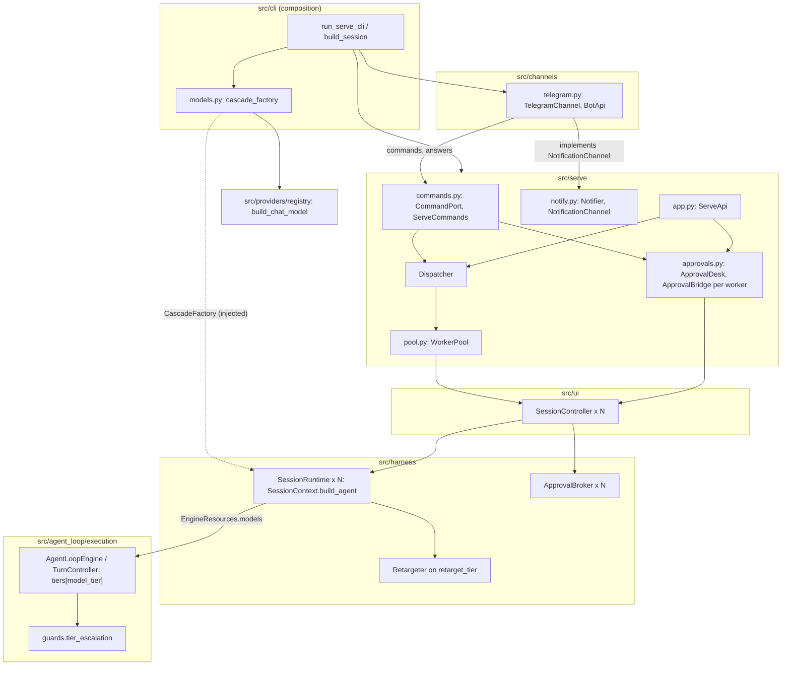
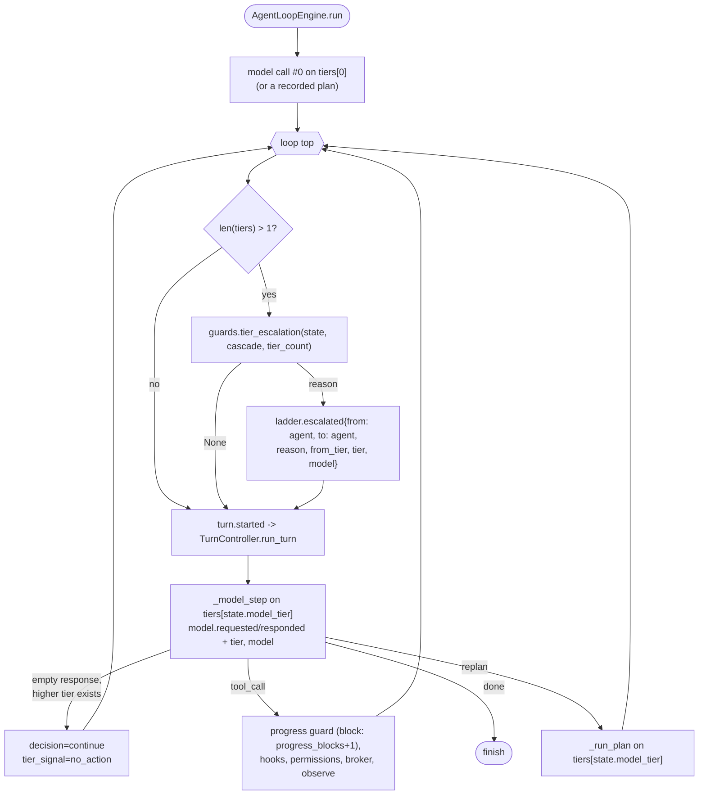
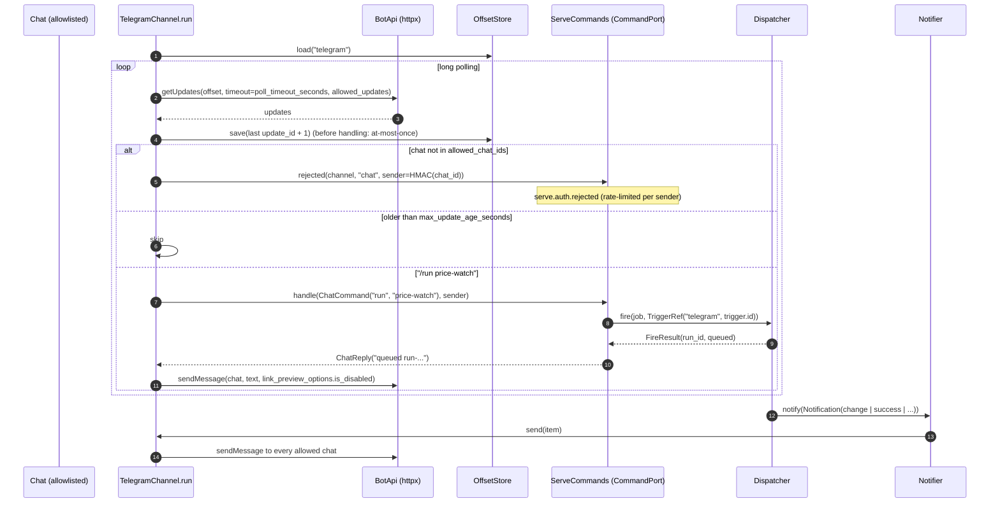
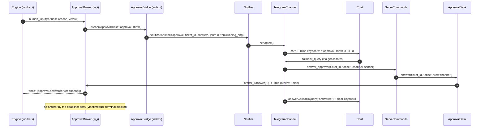
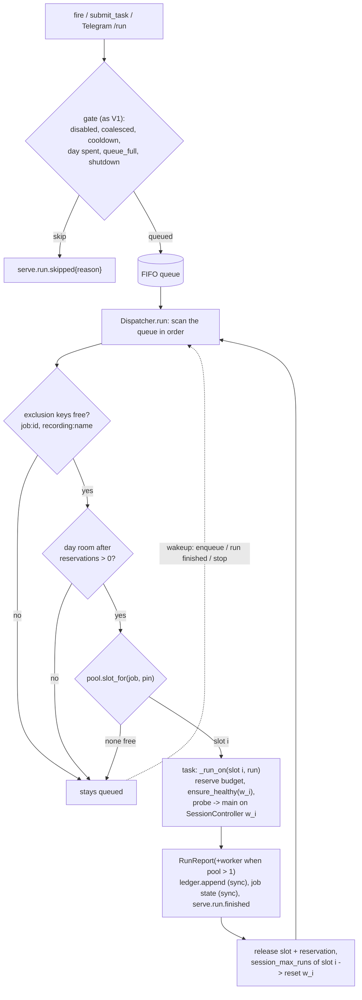

# Фаза 4 режима стенда: каскад моделей, Telegram, пул worker'ов

Статус: Implemented (2026-11-09) — [план](2026-11-08-serve-mode-phase4-plan.md) (U64 добавлен при
реализации), руководство — [serve-mode.md](serve-mode.md). Approved (2026-11-09): ответы P4–P11 (§11)
приняты по дефолтам в скобках.
Дата: 2026-11-08
Ветка: `feat/serve-phase4` (от `feat/serve-mode`)
Дизайн: [serve mode design](2026-11-02-serve-mode-design.md) — §2.1 F15, §3.4 V2, §4.2–§4.4,
§7.1, §7.2, §7.5, §8, §9.2, §9.4, §10.1, §10.2 (Q5, Q11, Q12, Q13), §13, §14 шаги 18–20.
ADR: [2026-11-02 serve mode and cost ladder](../decisions/2026-11-02-serve-mode-and-cost-ladder.md)
(Accepted), решения 8, 10, 11.
Планы: [Фаза 1](2026-11-02-serve-mode-phase1-plan.md) (U1–U10),
[Фаза 3](2026-11-02-serve-mode-phase3-plan.md) (U11–U27). Руководства: [serve-mode.md](serve-mode.md),
[replay.md](replay.md). Диаграммы: [Serve Mode](../diagrams/serve-mode.md).

Фаза 4 добавляет к стенду три независимые вещи. Каждая выключена по умолчанию:

1. **Каскад моделей** (шаг 18). Дешёвая модель работает по умолчанию, сильная подключается, когда
   агент застрял. Работает в обоих режимах, не только на стенде.
2. **Канал Telegram** (шаг 19). Уведомления, команды, подтверждения кнопками. Транспорт — long
   polling.
3. **Пул worker'ов** (шаг 20). До 8 сессий с браузерами параллельно, задания можно закреплять за
   worker'ом.

Ответы Q1–Q15 действуют без изменений и здесь не переоткрываются. Для Фазы 4 важны:
- Q5: окно ответа на подтверждение — через `loop.progress_timeout_seconds` профиля стенда;
- Q11: long polling;
- Q12: свободные задачи выключены, но их можно включить;
- Q13: при `workers > 1` требуется `memory.persistent_enabled=false`.

Расхождения дизайна с кодом собраны в §10 (U28–U63). Ниже на них ссылки вида «(U31)».

---

## 1. Что не меняется

- Цепочка `SessionRuntime → GoalRunner → Agent → AgentLoopEngine → TurnController`.
- Engine не вызывает `registry` и провайдеров. Уровни моделей приходят готовыми через
  `EngineResources.models` (`src/agent_loop/execution/resources.py:70`).
- `src.providers` импортирует только `src/cli/`. Новый пакет `src/channels/` по тому же правилу
  импортирует только `src/cli/`.
- `src/serve/**` не импортирует `src.agent_loop.execution`, `src.browser`, `src.harness`,
  `src.cli`, `src.providers`, а теперь и `src.channels`.
- Никакой логики по именам инструментов. Команды Telegram — фиксированная лексика стенда.
- Без новых настроек поведение байт-в-байт прежнее. Это касается событий, их payload'ов, числа
  вызовов модели, строк ledger и ответов API. Каждое новое поле payload появляется только при
  включённой фиче (§6).
- Новых зависимостей нет: `httpx==0.28.1` уже прямая зависимость (`pyproject.toml:45`).

---

## 2. Компоненты и слои

| Компонент | Модуль | Что нового |
| --- | --- | --- |
| `ModelTiers`, `ModelTier` | `src/llm.py` | Поведение то же. Меняется только docstring: несколько уровней — норма, а не «later phase». |
| `CascadeSettings`, `ModelTierSpec` | `src/config.py` | 18-я секция `cascade` (§5.1). |
| `TierMarks`, поля `progress_blocks`, `tier_marks`, `tier_signal` | `src/agent_loop/execution/state.py` | Счётчики эскалации, все task-local (U31). |
| `tier_escalation`, `escalation_possible` | `src/agent_loop/execution/guards.py` | Чистые функции решения о подъёме уровня (U32). |
| Драйвер на каждый уровень, уровень в `_model_step`/`_run_plan`, проверка эскалации в начале итерации | `src/agent_loop/execution/loop.py` | Routing по уровню (U29, U30, U32). |
| `CascadeFactory`, `SessionContext.model_tiers()`, `Retargeter` на `retarget_tier` | `src/harness/session.py` | Композиция уровней из внедрённой фабрики (U34, U35). |
| `cascade_factory`, `build_tier` | `src/cli/models.py` (новый) | Уровни строит `registry.build_chat_model` (U34). |
| `ChatCommand`, `ChatReply`, `CommandPort`, `OffsetStore`, `ServeCommands`, `parse_command` | `src/serve/commands.py` (новый) | Нейтральный порт команд и ответов канала (U38, U39). |
| `ApprovalDesk` | `src/serve/approvals.py` | Подтверждения всех worker'ов за одним `ApprovalsPort` (U46). |
| `Notification.answers` | `src/serve/notify.py` | Допустимые ответы на тикет (U45). |
| `ChannelStateStore` | `src/serve/state.py` | Offset канала в своём файле (U56). |
| `WorkerPool`, `WorkerSlot` | `src/serve/pool.py` (новый) | Слоты, закрепление, резервирование (U48, U51). |
| `Dispatcher` над пулом | `src/serve/dispatcher.py` | Прогоны по слотам, ключи исключения, резервы бюджета дня, `cancel` (U48–U50). |
| `BotApi`, `TelegramChannel`, `TelegramError*` | `src/channels/telegram.py` (новый) | Вендорный адаптер: long polling, кнопки, редактирование токена (U40, U41, U43). |
| Композиция пула и Telegram | `src/cli/serve.py` | Сессия, брокер, мост и контроллер на каждый worker. Канал и его сервис (U58, U59). |
| `{profile_dir}` | `src/harness/mcp_setup.py`, `src/harness/session.py` | Плейсхолдер профиля для `launch: external` (U52). |
| `doctor`: каскад, Telegram, `config_error_lines` | `src/cli/subcommands.py` | Новые строки проверок, ошибки без значений (U42, U59). |
| Модель span'а из payload | `src/harness/otel_spans.py` | `payload["model"]` выигрывает (U36). |



Направление зависимостей:
- `src/channels/telegram.py` импортирует только `src.config` (`TelegramSettings`, `LOCAL_HOSTS`),
  `src.contracts` (`ApprovalAnswer`), `src.serve.commands`, `src.serve.notify`, `src.serve.clock`,
  `httpx` и stdlib;
- `src.serve` про `src.channels` не знает;
- импортирует `src.channels` только `src/cli/` (U62).

---

## 3. Контракты (эскизы)

Эскизы показывают форму, а не реализацию. У всех новых полей дефолты сохраняют сегодняшнее
поведение.

### 3.1 Каскад: настройки

```python
# src/config.py  (18th section)

class ModelTierSpec(_Section):
    """One cascade tier above the session model (tier 0). Fields the profile names override
    ``llm``; the rest is inherited. An explicit ``temperature: null`` sends no temperature."""

    model: Annotated[str, Field(min_length=1, description="Model id handed to the provider.")]
    label: Annotated[str, Field(description="Label in events and reports; empty: the model id.")] = ""
    provider: LLMProvider | None = None
    host: str | None = None
    api_key: SecretStr | None = None
    temperature: Annotated[float | None, Field(ge=0.0, le=2.0)] = None
    reasoning_effort: Literal["minimal", "low", "medium", "high"] | None = None
    timeout_seconds: Annotated[float | None, Field(gt=0.0)] = None

    def llm_overrides(self) -> dict[str, Any]:
        """The ``llm`` fields this tier sets: those named in the profile (``model_fields_set``),
        ``label`` excluded."""


class CascadeSettings(_Section):
    enabled: bool = False
    tiers: Annotated[list[ModelTierSpec], Field(max_length=3)] = []   # above tier 0 (U33)
    retarget_tier: Annotated[int, Field(ge=0, le=3)] = 0              # <= len(tiers)
    escalate_after_failures: Annotated[int, Field(ge=1)] = 2
    escalate_after_replans: Annotated[int, Field(ge=1)] = 1
    escalate_on_progress_block: bool = True
    escalate_on_no_action: bool = True

    @model_validator(mode="after")
    def _consistent(self) -> CascadeSettings:
        # retarget_tier <= len(tiers); labels (label or model) unique among tiers.
        ...
```

### 3.2 Каскад: как `src/cli` строит уровни

```python
# src/harness/session.py
#: ``cascade_factory()`` -> the tiers above the session model, labelled and priced. The CLI
#: builds them with the provider registry; ``None`` or empty: one tier (today).
CascadeFactory = Callable[[], Sequence[ModelTier]]

class SessionRuntime:
    def __init__(self, config, *, llm_factory, ..., cascade_factory: CascadeFactory | None = None): ...

class SessionContext:
    cascade_tiers: tuple[ModelTier, ...] = ()

    async def initialize(self, *, llm_factory, ..., cascade_factory: CascadeFactory | None = None):
        ...
        self.llm, self.approval = self._build_model(self.config, llm_factory)
        # Built per session, like the session model: provider clients bind to the session loop.
        self.cascade_tiers = tuple(cascade_factory()) if cascade_factory is not None else ()

    def model_tiers(self) -> ModelTiers:
        """Tier 0 is the session model (``config.model``, ``/model``); the cascade tiers follow.
        A cascade label equal to tier 0's is a ValueError (by_model would merge them)."""

    def build_agent(self, *, human_input=None) -> Agent:
        tiers = self.model_tiers()
        resources = EngineResources.from_harness(..., steps=self._step_sources(tiers), models=tiers)
        ...

def model_price(model: str) -> ModelPrice | None:      # today's SessionContext._model_price
    ...
```

```python
# src/cli/models.py  (new; the only place that turns ModelTierSpec into a ChatModel)

def tier_llm_settings(spec: ModelTierSpec, llm: LLMSettings, *, provider: LLMProvider | None) -> LLMSettings:
    """``llm`` with the tier's overrides, revalidated (an openai_compat tier without a host
    fails here). A tier without ``provider`` takes the effective one (``--provider`` or
    ``llm.provider``)."""
    return LLMSettings.model_validate({**llm.model_dump(), **({"provider": provider} if provider else {}),
                                       **spec.llm_overrides()})

def build_tier(spec: ModelTierSpec, llm: LLMSettings, *, provider: LLMProvider | None) -> ModelTier:
    settings = tier_llm_settings(spec, llm, provider=provider)
    model = build_chat_model(settings.model, settings.temperature, settings=settings)
    return ModelTier(model, label=spec.label or spec.model, price=model_price(spec.model))

def cascade_factory(settings: Settings, *, provider: LLMProvider | None = None) -> CascadeFactory | None:
    """``None`` unless ``cascade.enabled`` with at least one tier."""
```

`build_session(args, *, llm_factory=None, cascade_factory=None, ...)`. Если `llm_factory is None`
(боевой путь) и `cascade_factory` не передан, берётся `models.cascade_factory(get_settings(),
provider=args.provider)`. Тесты с фейковым `llm_factory` получают каскад только явно.

### 3.3 Каскад: состояние и чистая функция

```python
# src/agent_loop/execution/state.py

@dataclass(frozen=True)
class TierMarks:
    """Counters at the last tier change: escalation counts what happened since."""
    failures: int = 0          # consecutive_failures at the change (0 after a reset)
    replans: int = 0           # replan_count at the change
    progress_blocks: int = 0   # progress_blocks at the change

@dataclass(frozen=True)
class LoopState:
    ...
    model_tier: int = 0                          # exists
    progress_blocks: int = 0                     # progress-guard blocks this task (new)
    tier_marks: TierMarks = field(default_factory=TierMarks)   # new
    tier_signal: str = ""                        # "no_action" from the last model step (new)
```

Все три новых поля — task-local: они добавляются в `TASK_BOUNDARY_RESETS`
(`src/harness/session.py:121`) и не попадают в `to_session_state`.

```python
# src/agent_loop/execution/guards.py

TierReason = Literal["progress_block", "failures", "replans", "no_action"]

def escalation_possible(state: LoopState, *, tier_count: int) -> bool:
    """A higher tier exists and the agent (not a step source) drives."""
    return tier_count > 1 and state.model_tier < tier_count - 1 and state.ladder_stage == "agent"

def tier_escalation(
    state: LoopState, settings: CascadeSettings, *, tier_count: int
) -> tuple[dict[str, Any], TierReason | None]:
    """Pure: the LoopState update of one check and why the tier went up (None: it stayed).

    Up only, one tier per check. Order: no_action, progress_block, failures, replans.
    - failures: consecutive_failures - marks.failures >= escalate_after_failures; when
      consecutive_failures fell below the mark (a success reset it), the mark becomes 0 in
      the returned update even without an escalation;
    - replans: replan_count - marks.replans >= escalate_after_replans;
    - progress_block: progress_blocks > marks.progress_blocks (escalate_on_progress_block);
    - no_action: tier_signal == "no_action" (escalate_on_no_action); the signal is cleared.
    An escalation returns {"model_tier": n + 1, "tier_marks": <current counters>, "tier_signal": ""}.
    Does not read ``settings.enabled``: the session builds several tiers only when it is on.
    """
```

Payload `ladder.escalated` при подъёме уровня:
`{"from": "agent", "to": "agent", "reason": <TierReason>, "from_tier": n, "tier": n + 1,
"model": <label>}`. Ключи `from`/`to` совпадают с переходами лестницы. Ключ `tier` уже был в
§7.4 дизайна.

### 3.4 Каскад: engine

```python
# src/agent_loop/execution/loop.py

class TurnController:
    def __init__(...):
        self._tiers = resources.tiers()
        self._drivers: dict[int, ModelDriver] = {}      # one per tier, built lazily

    def _driver(self, index: int) -> ModelDriver: ...
    def _tier_fields(self, index: int) -> dict[str, Any]:
        """{"tier", "model"} for model.* payloads; {} with one tier (byte-identical events)."""

    async def _model_step(self, state):          # uses state.model_tier for driver, payload, _account
        ...
        if _empty_response(model_turn.response) and get_settings().cascade.escalate_on_no_action \
                and escalation_possible(state, tier_count=len(self._tiers.tiers)):
            # A higher tier answers instead of the empty-response terminal (U30).
            return {"decision": "continue", "tier_signal": "no_action", "usage": accounted}
        ...

    def _account(self, usage, stage, response, tokens, *, tier: int) -> TaskUsage: ...

class AgentLoopEngine:
    async def run(...):
        ...
        while True:
            state = self._escalate_tier(state)     # one call point, before every turn (U32)
            turn += 1
            ...

    def _escalate_tier(self, state: LoopState) -> LoopState:
        """tier_escalation + ladder.escalated; a no-op with one tier."""

    async def _run_plan(self, state):            # tiers.tier(state.model_tier), tier fields
        ...
```

`_run_tool_turn` при блоке progress guard (`loop.py:852-856`) дополнительно ставит
`progress_blocks = state.progress_blocks + 1`.

### 3.5 Telegram: нейтральный порт стенда

```python
# src/serve/commands.py  (no vendor: any chat channel uses it)

ChatCommandName = Literal["help", "jobs", "run", "status", "budget", "cancel", "task"]
#: The stand's chat lexicon: "/<name> [argument]".
COMMAND_PREFIX = "/"
#: Telegram clients send /start on first contact; it means help.
COMMAND_ALIASES: Mapping[str, ChatCommandName] = {"start": "help"}

@dataclass(frozen=True)
class ChatCommand:
    name: ChatCommandName
    argument: str = ""      # job id, run id; for "task" the task text

@dataclass(frozen=True)
class ChatReply:
    text: str               # sanitized (src.ui.feed.sanitize_text), cut to serve.notify_max_chars

def parse_command(text: str) -> ChatCommand | None:
    """'/run price-watch' -> ChatCommand("run", "price-watch"); not a command -> None.
    The channel strips its own syntax (Telegram's '/run@Bot') before."""

class CommandPort(Protocol):
    async def handle(self, command: ChatCommand, *, channel: str, sender: str) -> ChatReply: ...
    def answer_approval(self, ticket_id: str, answer: ApprovalAnswer, *, channel: str, sender: str) -> bool: ...
    def rejected(self, *, channel: str, reason: str, sender: str) -> None: ...   # serve.auth.rejected
    def channel_error(self, *, channel: str, error: str, retry_in: float) -> None: ...  # serve.channel.error

class OffsetStore(Protocol):
    def load(self, channel: str) -> int: ...
    def save(self, channel: str, offset: int) -> None: ...

class ServeCommands:
    """CommandPort over the dispatcher and the approval desk. Rate-limited per sender
    (serve.rate_limit_per_minute, the existing RateLimiter); every command is a serve.command
    event; replies never carry secrets or page text except a run's own notifications."""
    def __init__(self, settings: ServeSettings, dispatcher: Dispatcher, *, approvals: ApprovalsPort | None,
                 events: EventEmitter, clock: Clock) -> None: ...
```

`sender` — непрозрачный ключ отправителя, который вычисляет канал. Для Telegram это
`HMAC-SHA256(key=bot_token, msg=str(chat_id))` в hex. Ключ стабилен для одного бота, а сырой id
из него не восстановить. Сырой id в событиях не встречается никогда.

Семантика команд (`ServeCommands.handle`):

| Команда | Что делает |
| --- | --- |
| `/help`, `/start` | Список команд. `/task` упоминается, только если `serve.free_tasks`. |
| `/jobs` | Имена заданий, `enabled`, можно ли запустить из чата (есть триггер `telegram`), состояние последнего прогона. Текст задачи не показывается. |
| `/run <job>` | Неизвестное задание — «unknown job». Задание без триггера `type: telegram` — «not runnable from the chat» (U55). Иначе `dispatcher.fire(job, TriggerRef("telegram", <trigger.id>))`. В ответе `run_id` и `queued`, `coalesced` или `skipped` с причиной. |
| `/status` | Работающие прогоны (по worker'ам при пуле), длина очереди, итоги дня. |
| `/budget` | Итоги дня против `daily_max_*`. |
| `/cancel [run_id\|job]` | `dispatcher.cancel(target)`. Без аргумента — единственный работающий прогон, иначе список работающих. |
| `/task <текст>` | Только при `serve.free_tasks`: `dispatcher.submit_task(text, TriggerRef("telegram", "task"))` с `free_task_profile` и `free_task_domains`. Без флага — отказ (P7). |

```python
# src/serve/approvals.py

class ApprovalsPort(Protocol):                      # moved here from app.py, + via (U44)
    def pending(self) -> list[dict[str, Any]]: ...
    def answer(self, ticket_id: str, answer: str, *, via: ApprovalVia = "api") -> bool: ...

class ApprovalBridge:
    def __init__(self, worker: WorkerPort, notifier: Notifier, dispatcher: Dispatcher, *, index: int = 0): ...
    # _send: job/run from dispatcher.running_on(index); Notification.answers from ticket.allow_session

class ApprovalDesk:
    """ApprovalsPort over every worker's bridge: pending() concatenated; answer() asks each
    worker's broker in turn (ticket ids are uuid4, unique across workers)."""
    def __init__(self, bridges: Sequence[ApprovalBridge]) -> None: ...

# src/serve/notify.py
@dataclass(frozen=True)
class Notification:
    ...
    ticket_id: str = ""
    #: Answers a channel may offer for ``ticket_id`` (no "session" when the ticket forbids it).
    answers: tuple[ApprovalAnswer, ...] = ()       # new; the webhook body does not carry it
```

```python
# src/serve/state.py
class ChannelStateStore:
    """<serve.dir>/channels/<name>.json: {"offset": n}, atomic like JobStateStore (U56)."""
    def load(self, channel: str) -> int: ...
    def save(self, channel: str, offset: int) -> None: ...
```

### 3.6 Telegram: канал и клиент Bot API

```python
# src/channels/telegram.py  (the only module that knows the vendor; imported by src/cli only)

#: Bot API host; serve.telegram.api_base (a local Bot API server) replaces it (U40).
TELEGRAM_API_BASE = "https://api.telegram.org"
#: Bot API limits (protocol facts, not tunables; U57).
CALLBACK_DATA_MAX_BYTES = 64
MESSAGE_MAX_CHARS = 4096
#: callback_data = "a:<ticket_id>:<o|s|d>".
CALLBACK_PREFIX = "a"
ANSWER_CODES: Mapping[str, ApprovalAnswer] = {"o": "once", "s": "session", "d": "deny"}
ALLOWED_UPDATES = ("message", "callback_query")

class TelegramError(RuntimeError):
    """A failed Bot API call. The message is the method and a status code only, never the URL
    (it holds the token) nor an httpx text. Raised ``from None``."""
    method: str
    status_code: int | None
    retry_after: float | None
class TelegramUnauthorized(TelegramError): ...   # 401/404: bad token -> the stand stops
class TelegramConflict(TelegramError): ...       # 409: a webhook or another poller
class TelegramRateLimited(TelegramError): ...    # 429 with parameters.retry_after
class TelegramUnavailable(TelegramError): ...    # connect/timeout/5xx
class TelegramBadRequest(TelegramError): ...     # other 4xx (chat not found, ...)

@dataclass(frozen=True)
class WebhookInfo:
    set: bool                  # the URL itself is never returned (it may hold a secret path)
    pending_updates: int

class BotApi:
    def __init__(self, settings: TelegramSettings, *, client: httpx.AsyncClient | None = None) -> None: ...
    async def get_updates(self, offset: int) -> list[Mapping[str, Any]]: ...   # timeout=poll_timeout_seconds
    async def send_message(self, chat_id: int, text: str, *, keyboard: Sequence[Sequence[Mapping[str, str]]] = ()) -> int: ...
    async def answer_callback(self, callback_id: str, text: str) -> None: ...
    async def clear_keyboard(self, chat_id: int, message_id: int) -> None: ...   # editMessageReplyMarkup
    async def get_webhook_info(self) -> WebhookInfo: ...
    async def aclose(self) -> None: ...

class TelegramChannel:
    """NotificationChannel ``telegram`` and its long-polling service."""
    name = "telegram"
    def __init__(self, settings: TelegramSettings, *, api: BotApi, offsets: OffsetStore, clock: Clock) -> None: ...
    async def check(self) -> None:          # start: a webhook set -> TelegramConflict
    async def send(self, item: Notification) -> None:   # every allowed chat; approval -> keyboard
    async def run(self, commands: CommandPort) -> None: # the poll loop; a ServeRuntime service (U39)
    async def aclose(self) -> None: ...
```

Формат `callback_data`: `a:<ticket_id>:<o|s|d>`. Тикет — `approval-<32 hex>`
(`src/harness/approvals.py:94`), так что строка занимает 45 байт при лимите 64. Таблица коротких
ключей не нужна (U43). Канал проверяет длину при сборке карточки. Если строка длиннее
`CALLBACK_DATA_MAX_BYTES`, карточка уходит без кнопок с текстом «answer via the API».

Обработка обновления:
- **`message`**:
  - чат не в `allowed_chat_ids` → `commands.rejected(channel, "chat", sender)`, ответа нет;
  - дата сообщения старше `max_update_age_seconds` → пропуск;
  - `parse_command(text)` после снятия суффикса `@<bot>` → `commands.handle(...)` →
    `send_message`. Не команда → подсказка `/help`.
- **`callback_query`**:
  - чат `callback_query.message.chat.id` не в allowlist → `rejected(..., "callback")`;
  - нет `message` (inline-режим) → отказ;
  - разобрать `a:<id>:<code>` → `commands.answer_approval(id, ANSWER_CODES[code])` →
    `answer_callback("answered" | "expired")` → `clear_keyboard` в этом чате.
- Остальные типы не приходят: `allowed_updates=ALLOWED_UPDATES`.

### 3.7 Пул worker'ов

```python
# src/serve/pool.py

@dataclass
class WorkerSlot:
    index: int
    worker: WorkerPort
    #: Pinned jobs (JobSpec.worker == index); non-empty: only they run here (U51, P5).
    pinned: frozenset[str] = frozenset()
    busy: bool = False
    runs_in_session: int = 0

class WorkerPool:
    def __init__(self, workers: Sequence[WorkerPort], *, pinned: Mapping[int, frozenset[str]] = {}) -> None: ...
    @classmethod
    def of(cls, worker: WorkerPort) -> WorkerPool: ...            # one worker (tests, V1)
    @property
    def size(self) -> int: ...
    def slots(self) -> tuple[WorkerSlot, ...]: ...
    def slot_for(self, job_id: str, pin: int | None) -> WorkerSlot | None:
        """The lowest-index free slot the job may use: its pinned one, else an unreserved one."""
    async def start(self) -> None: ...          # one after another: failures name the worker
    async def shutdown(self, timeout_seconds: float) -> None: ...  # all, concurrently
    async def tool_names(self) -> tuple[str, ...]: ...             # w0: every worker has one config
```

```python
# src/serve/dispatcher.py  (V1 -> pool)

class Dispatcher:
    def __init__(self, settings: ServeSettings, pool: WorkerPool, *, ledger, states, notifier,
                 events, tally, clock) -> None:
        self._running: dict[int, _Run] = {}          # slot index -> run
        self._current: dict[int, asyncio.Task[None]] = {}
        self._reserved: dict[str, _Reservation] = {} # run_id -> the run budget's tokens/cost

    def running(self) -> tuple[str, str] | None: ...        # the lowest-index running run (compat)
    def running_on(self, index: int) -> tuple[str, str] | None: ...
    async def cancel(self, target: str) -> CancelResult: ...  # run_id or job id: queued -> skipped{cancelled}; running -> worker.cancel()

    async def run(self) -> None:
        """Until stop(): start every eligible queued run on a slot, then wait for a wakeup
        (enqueue, a run finished, stop)."""

    def _eligible(self, run: _Run) -> WorkerSlot | None:
        """FIFO scan: no running run shares its exclusion keys (job:<id>, recording:<name>);
        the day has room after the reservations; a slot the job may use is free."""

    async def _run_on(self, slot: WorkerSlot, run: _Run) -> None:
        """In the slot's task: _start_refusal (day cap, cooldown wait as in V1), _execute,
        per-slot session_max_runs, release the slot and the reservation, wake the loop."""

    def day_left(self, *, exclude: str = "") -> DayLeft:
        """Ledger totals plus the reservations of running runs (all but ``exclude``)."""
```

`RunReport` (`src/serve/reports.py`): добавляются `worker: int | None = None` и
`tier_reached: int | None = None`. `to_json` пишет каждый ключ, только если значение не `None`.
`worker` заполняется при `pool.size > 1`, `tier_reached` — если в задачах прогона был подъём
уровня (`RunTally` считает `ladder.escalated` с ключом `tier`).

---

## 4. Потоки данных

### 4.1 Эскалация уровня в цикле engine

`tier_escalation` вызывается в одном месте: в начале каждой итерации `while` в
`AgentLoopEngine.run` (сейчас `loop.py:1319`), до `turn.started`. Почему именно там:
- после хода с `replan` engine выполняет `_run_plan` и делает `continue`. Значит, проверка видит
  уже увеличенный `replan_count`, и следующий ход идёт на новом уровне;
- вызов №0 строит план до цикла и всегда идёт на уровне 0. Повторное планирование идёт на уровне,
  текущем в момент replan, как требует §4.3 дизайна;
- в стадиях `playback`/`retarget` проверка — no-op (`escalation_possible`). Перенацеливание
  всегда идёт на `retarget_tier`, его выбирает сессия (U35).



Сколько стоит. Модель вызывается столько же раз, сколько без каскада, плюс ничего: эскалация
сама модель не вызывает. Подъём меняет только то, какая модель ответит на следующий вызов.
Пустой ответ при доступном уровне выше не завершает задачу. Это лишний ход, но не лишний вызов
сверх `turn_cap` и бюджета: оба по-прежнему проверяются.

### 4.2 Telegram: polling → команда → диспетчер → ответ и уведомление



Сбои polling:
- `TelegramUnavailable` и `TelegramRateLimited` → `commands.channel_error(...)` и пауза. Пауза
  растёт от `poll_backoff_seconds` удвоением до `poll_backoff_max_seconds`, у `429` она равна
  `retry_after`. Успешный вызов сбрасывает её.
- `TelegramConflict` (409: webhook или второй poller) ведёт себя так же, плюс `channel_error`.
- `TelegramUnauthorized` (401/404) роняет сервис. `ServeRuntime` останавливает стенд с кодом 1
  (`runtime.py:121-127`). Без канала подтверждения тихо истекали бы в `deny`, а пользователь не
  узнал бы почему.

### 4.3 Подтверждение кнопкой → `ApprovalBroker` нужного worker'а



### 4.4 Пул: срабатывание → очередь → worker



Почему нет гонок за файлы (U50):
- весь стенд, все сессии worker'ов и канал работают на **одном** asyncio-цикле. `RuntimeLoop` в
  `serve` не используется, и в `src/serve` нет `to_thread` (`grep`: только `src/ui/controller.py`
  в `resume`/`replay`, их стенд не вызывает);
- каждая запись `Ledger.append`, `JobStateStore.save`, `ChannelStateStore.save`,
  `RecordingStore.save`/`record_playback` и строка `JsonlEventSink` синхронна: между чтением и
  записью нет `await`. Так что две корутины не могут переплести строку или потерять обновление
  внутри одного файла;
- логические гонки (два прогона одного задания пишут один `state.json`, два задания пишут одну
  запись) закрывают ключи исключения: прогон не стартует, пока работает другой с тем же
  `job:<id>` или `recording:<name>`;
- ограждение теста: в `src/serve/**` и `src/channels/**` нет `to_thread`, `run_in_executor`,
  `threading`. Если это когда-нибудь понадобится, выше по слою потребуется явная блокировка.

---

## 5. Настройки

Каждое поле уходит в `src/config.py` с описанием, а также в `.env.example` и `config.example.yaml`
(закомментированные примеры). `tests/test_config.py` их проверяет. Секций становится 18:
`CLAUDE.md` и `AGENTS.md` нужно обновить («seventeen» → «eighteen»).

### 5.1 `cascade` (новая, 18-я), `AUTOBROWSER_CASCADE__*`

| Поле | Тип | Дефолт | Границы | Описание |
| --- | --- | --- | --- | --- |
| `enabled` | bool | `false` | — | Уровни моделей выше модели сессии и эскалация. Выключено — один уровень, как сейчас. |
| `tiers` | list[`ModelTierSpec`] | `[]` | `max_length=3`; метки уникальны | Уровни **над** уровнем 0 (модель сессии, U33). Пусто при `enabled` — без эффекта, `doctor` предупреждает. JSON в env: `AUTOBROWSER_CASCADE__TIERS`. |
| `retarget_tier` | int | `0` | `0..len(tiers)` | Уровень перенацеливания (ступень 2). |
| `escalate_after_failures` | int | `2` | `ge=1` | Неудач подряд на текущем уровне до подъёма. Если не меньше `loop.max_consecutive_failures` (3), подъём по неудачам невозможен: предупреждают `doctor` и `serve --check`. |
| `escalate_after_replans` | int | `1` | `ge=1` | Повторных планирований на текущем уровне до подъёма. |
| `escalate_on_progress_block` | bool | `true` | — | Подъём при блоке progress guard. |
| `escalate_on_no_action` | bool | `true` | — | Пустой ответ модели (ни текста, ни вызова) поднимает уровень вместо терминала. |

`ModelTierSpec` (`extra="forbid"`):

| Поле | Тип | Дефолт | Границы | Описание |
| --- | --- | --- | --- | --- |
| `model` | str | — | `min_length=1` | Id модели. Цена ищется в `llm.prices[model]`. |
| `label` | str | `""` | — | Метка в событиях, `by_model` и отчётах. Пусто — `model`. |
| `provider` | `LLMProvider \| None` | `None` | — | Не задан — эффективный провайдер сессии (`--provider` или `llm.provider`). |
| `host` | str \| None | `None` | — | Не задан — `llm.host`. |
| `api_key` | `SecretStr \| None` | `None` | — | Не задан — `llm.api_key`. Никогда не выводится. |
| `temperature` | float \| None | `None` | `0..2` | Не задан — `llm.temperature`. Явный `null` — без температуры (через `model_fields_set`). |
| `reasoning_effort` | literal \| None | `None` | — | Не задан — `llm.reasoning_effort`. |
| `timeout_seconds` | float \| None | `None` | `gt=0` | Не задан — `llm.timeout_seconds`. |

Валидация и ошибки старта:
- `retarget_tier > len(tiers)` или повтор метки — ошибка загрузки настроек;
- метка уровня совпала с моделью сессии (`config.model`, его знает только сессия) —
  `ValueError` в `SessionContext.model_tiers()` с подсказкой «give it a label»;
- уровень `openai_compat` без `host` (свой или унаследованный) — ошибка
  `LLMSettings.model_validate` в `src/cli/models.py` при первом построении сессии. В `serve`
  уровни проверяются в `--check` без сети: валидацией `tier_llm_settings`;
- денежные лимиты (`serve.daily_max_cost`, `default_run_budget.max_cost`, `jobs.*.budget.max_cost`,
  `loop.max_task_cost`) при цене не для каждого уровня (уровень 0 и все `tiers`): в `serve` —
  ошибка старта, в интерактивном режиме — предупреждение при `SessionRuntime.start` (U37).

### 5.2 `serve` — новые поля, `AUTOBROWSER_SERVE__*`

| Поле | Тип | Дефолт | Границы | Описание |
| --- | --- | --- | --- | --- |
| `workers` | int | `1` | `1..8` | Worker'ов: сессий, браузеров, MCP-процессов. Worker `i` берёт профиль `<root>/<profiles_dir>/w<i>` и CDP-порт `cdp_port_base + i`. |
| `channels` | list[`log \| webhook \| telegram`] | `[log]` | — | Добавлено значение `telegram`. |
| `telegram` | `TelegramSettings \| None` | `None` | — | Канал Telegram (§5.3). JSON в env: `AUTOBROWSER_SERVE__TELEGRAM`. Токен — `AUTOBROWSER_SERVE__TELEGRAM__BOT_TOKEN`. |

`JobSpec` — новое поле:

| Поле | Тип | Дефолт | Границы | Описание |
| --- | --- | --- | --- | --- |
| `worker` | int \| None | `None` | `ge=0`, `< serve.workers` | Закрепить задание за worker'ом (профиль с логинами). Worker с закреплёнными заданиями берёт только их (P5). |

`TriggerSpec.type` получает значение `telegram`. Такому триггеру нужны только `id`; поля
`every_seconds`, `schedule`, `secret`, `secret_env` запрещены. Триггер разрешает `/run <job>` из
чата allowlist (U55).

Валидаторы `ServeSettings._safe_and_consistent` (`src/config.py:2622`), все ошибки — без
значений:
- `cdp_port_base + workers - 1 > 65535` — ошибка; `serve.port` в диапазоне CDP-портов worker'ов —
  ошибка;
- `jobs.<id>.worker >= workers` — ошибка;
- при `telegram` в `channels` должен быть задан `serve.telegram`, непустой `bot_token` и непустой
  `allowed_chat_ids`; иначе ошибка с именем поля;
- триггер `telegram` без канала `telegram` — ошибка;
- закреплённые worker'ы резервируются. Если есть незакреплённое задание или `free_tasks`, а
  свободных worker'ов не осталось, — ошибка: «every worker is reserved by pinned jobs».

Межсекционные проверки — в `src/serve/checks.py::startup_problems`, ошибка старта:
- **Q13:** `workers > 1` и `memory.persistent_enabled` → «serve.workers > 1 needs
  memory.persistent_enabled=false (workers would share the memory files; locking comes later)»;
- цены уровней каскада при денежных лимитах (§5.1).

Предупреждения (`serve --check` и строка при старте, не ошибки):
- `workers > 1`, `browser.launch: external`, и в конфигурации браузерного сервера нет
  `{profile_dir}`. Тогда worker'ы делят один профиль, если сервер не изолирует их сам (P8, U52);
- `cascade.escalate_after_failures >= loop.max_consecutive_failures`.

### 5.3 `serve.telegram` (`TelegramSettings`, `extra="forbid"`)

| Поле | Тип | Дефолт | Границы | Описание |
| --- | --- | --- | --- | --- |
| `bot_token` | `SecretStr \| None` | `None` | — | Токен бота. Только через env или секрет; не попадает в логи, события, `doctor` и `--check`. |
| `allowed_chat_ids` | list[int] | `[]` | уникальные | Чаты, которым бот отвечает и которым шлёт уведомления. В группе команды может давать любой участник (P10). |
| `api_base` | str | `""` | пусто, `https://…` или `http://` только на `LOCAL_HOSTS` | База Bot API. Пусто — `TELEGRAM_API_BASE` в `src/channels/telegram.py` (U40). Для собственного Bot API server. |
| `approvals` | bool | `true` | — | Подтверждения кнопками. Вместе с `api_approvals` решает, получает ли worker `ApprovalBroker` (U58, P6). |
| `poll_timeout_seconds` | int | `30` | `1..60` | Таймаут long polling в `getUpdates` (целые секунды, как в Bot API). |
| `request_timeout_seconds` | float | `10.0` | `gt=0` | Таймаут остальных вызовов и запас поверх `poll_timeout_seconds` для HTTP-таймаута `getUpdates`. |
| `poll_backoff_seconds` | float | `1.0` | `gt=0` | Первая пауза после сбоя polling. |
| `poll_backoff_max_seconds` | float | `60.0` | `gt=0`, `>= poll_backoff_seconds` | Потолок паузы (удвоение). |
| `send_retry_max_seconds` | float | `30.0` | `ge=0` | Самый долгий `retry_after` (429), который `send` выждет для одного повтора. Больше или `0` — без повтора, `serve.notify.failed`. |
| `max_update_age_seconds` | float | `300.0` | `gt=0` | Сообщения старше игнорируются: команда, пришедшая, пока стенд лежал, не исполняется. Bot API хранит обновления до 24 часов. |

Частота команд от одного отправителя и событий об отказах ограничена тем же
`serve.rate_limit_per_minute`. Новые поля для этого не нужны.

### 5.4 Плейсхолдер `{profile_dir}`

`mcp_servers.<name>.{command,args,env,cwd,url,headers}` могут содержать `{profile_dir}`. Сессия
подставляет в него `SessionConfig.user_data_dir`, то есть профиль worker'а на стенде и
`browser.user_data_dir` (или `--user-data-dir`) в интерактивном режиме. Это runtime-плейсхолдер,
как `{cdp_port}`/`{cdp_endpoint}` (`src/harness/mcp_setup.py:8-11`), но к CDP он не относится:
проверка `launch: external` (`cdp_placeholder_servers`) его не считает. Пример в
`docker/serve.example.yaml` меняется на `--user-data-dir {profile_dir}`.

---

## 6. События

| Событие | Payload | Кто эмитит | Когда появляется |
| --- | --- | --- | --- |
| `ladder.escalated` (существующее) | `{from: "agent", to: "agent", reason, from_tier, tier, model}` | Engine, `_escalate_tier` | Только при подъёме уровня, то есть при > 1 уровне. |
| `model.requested` / `model.responded`, фазы `agent` и `plan` | + `tier`, `model` | `TurnController._model_step`, `AgentLoopEngine._run_plan` | Только при > 1 уровне. С одним уровнем payload байт-в-байт прежний. |
| `model.*{phase: "retarget"}` | уже несёт `tier` (`playback.py:370-388`); + `model` при > 1 уровне | `Retargeter` | Ключ `tier` не трогается: он уже в коде (U35). |
| `serve.command` (новое) | `{channel, command, argument, sender, outcome}`. `argument` — id задания или прогона; для `task` — только `chars`, без текста. `outcome`: `ok`, `refused`, `rate_limited`, `unknown` | `ServeCommands` | Только при канале с командами (Telegram). |
| `serve.channel.error` (новое) | `{channel, error, retry_in}`; `error` — имя класса `TelegramError*` | `ServeCommands.channel_error` | Сбой polling. |
| `serve.auth.rejected` (существующее) | `{channel: "telegram", reason: "chat" \| "callback", sender}` | `ServeCommands.rejected` | Чужой чат; не чаще `rate_limit_per_minute` на отправителя. |
| `serve.notify.failed` (существующее) | `{channel: "telegram", kind, job_id, run_id, error}`; `error` — имя класса | `Notifier` (`notify.py:78-90`) | Как сейчас, без изменений кода `Notifier`. |
| `serve.run.skipped` (существующее) | новое значение `reason: "cancelled"` | `Dispatcher.cancel` | `/cancel` для прогона в очереди. |
| `serve.run.finished` (`RunReport`) | + `worker`, + `tier_reached` | `Dispatcher` | `worker` — при `workers > 1`, `tier_reached` — после подъёма уровня. |
| `serve.started` | + `workers` | `ServeRuntime` | При `workers > 1`. |
| `approval.answered` (существующее) | `via: "channel"` | `ApprovalBroker` | Ответ кнопкой. `ApprovalVia` уже содержит `channel` (`src/contracts.py:76`). |

`EventType` (`src/agent_loop/events.py:14`) получает `serve.command` и `serve.channel.error`.
Другие типы не добавляются.

С выключенными `cascade`, Telegram и `workers=1` не меняется ничего:
- те же события, ключи, порядок и `sequence`;
- то же число вызовов модели;
- те же строки `ledger.jsonl` и ответы `/v1/status`;
- `serve.started` — без `workers`.

Метрики evals — счётчики и сигнатуры, а не payload'ы (`src/agent_loop/evals.py:420-448`), и evals
строят `EngineResources` без `models` (`evals.py:602-613`). Поэтому baseline `agent_loop_v2` и
`playback_v1` не меняются даже теоретически. Правило «ключи только при > 1 уровне» нужно для
байтовой совместимости трейсов и экспорта.

---

## 7. Безопасность

| Угроза | Мера | Где |
| --- | --- | --- |
| Токен бота в URL `/bot<token>/<method>` попадает в исключение httpx, traceback или `httpx` INFO-лог | Все ошибки httpx `BotApi` превращает в `TelegramError*` (метод и код) `from None`, `str(exc)` нигде не используется. На время жизни канала на логгеры `httpx`/`httpcore` ставится фильтр, заменяющий значение токена на `[REDACTED]`. `_LOG` канала пишет только имя класса, без `exc_info`. Тест: токен не найден в событиях, `caplog` (DEBUG), выводе `--check` и `doctor`, сообщениях исключений (U41). | `src/channels/telegram.py` |
| Токен в ошибке конфигурации | `serve --check` уже использует `config_error_lines` (`include_input=False`, `src/cli/serve.py:76-85`). `doctor` печатает сырой `{exc}` (`src/cli/subcommands.py:164-168`) и переходит на ту же функцию (U42). Ошибки валидаторов не цитируют значения. | `src/cli/` |
| Токен в событиях по ключу | Ключ `bot_token` содержит `token`: он уже редактируется (`SENSITIVE_KEY_MARKERS`, `events.py:66`). Канал его в payload не кладёт. | — |
| Токен по сети в открытом виде | `api_base` — только `https://`, `http://` — только на `LOCAL_HOSTS`. | `TelegramSettings` |
| Чужой отправитель | Allowlist по `chat.id` для сообщений и `callback_query.message.chat.id` для кнопок. Отказ — без ответа, событие с HMAC id и ограничением частоты. | `TelegramChannel`, `ServeCommands` |
| Перебор и флуд от своих чатов | `RateLimiter` на отправителя (`serve.rate_limit_per_minute`). Сверх лимита — молча. | `ServeCommands` |
| Подделка `callback_data` | Данные приходят только из чатов allowlist. Тикет ищется среди ожидающих (`ApprovalDesk.pending`). `session` для тикета без `allow_session` отклоняет брокер (`approvals.py:161`). | `ApprovalDesk` |
| Повтор старых команд после рестарта | Offset сохраняется до обработки (at-most-once). Сообщения старше `max_update_age_seconds` не исполняются. | `TelegramChannel` |
| Инъекция задач через чат | Тело сообщения не попадает в задачу. Исключение — `/task` при `serve.free_tasks`, тогда с `free_task_domains`, `default_run_budget`, `carry_context=False`, как `POST /v1/tasks`. `/run` — только задания с триггером `telegram`. | `ServeCommands` |
| Разметка и ссылки в исходящих сообщениях | Plain text без `parse_mode`. Нет HTML/Markdown-инъекции из текста страниц. `link_preview_options.is_disabled=true`, чтобы Telegram не ходил по ссылкам со страниц. Тело уже санитизирует и режет `Notifier`; канал режет до `MESSAGE_MAX_CHARS`. | `TelegramChannel.send` |
| Данные страницы и аргументы у третьей стороны | Уведомления и карточки подтверждений (с `args_preview`, отредактированным по ключам) уходят на серверы Telegram. Об этом — предупреждение в руководстве. `serve.notify_on` задания ограничивает, что уходит. | Документ |
| Входящий порт | Его нет: long polling (Q11). `doctor` и старт проверяют, что webhook не настроен. | — |
| Смешение профилей | Закреплённый worker с логинами не исполняет чужие задания и свободные задачи (P5). У worker'ов разные `user_data_dir`. При `external` — `{profile_dir}`. | `WorkerPool`, `mcp_setup` |
| Память L4 при пуле | `workers > 1` требует `memory.persistent_enabled=false` (Q13). | `startup_problems` |
| Ключи уровней каскада | `ModelTierSpec.api_key` — `SecretStr`. `doctor` показывает только «key set» и публичный хост (`_public_url`). | `src/cli/` |

---

## 8. Тестовая стратегия

Полный `uv run pytest` и оба прогона evals — один раз в конце партии. На шаге гоняются только
тесты шага (правила проекта).

### Шаг 18 — каскад

- `tests/test_config.py`:
  - секция `cascade`, дефолты, границы;
  - `extra="forbid"` у `ModelTierSpec`;
  - `retarget_tier` вне диапазона, повтор метки;
  - явный `temperature: null` против отсутствующего поля;
  - примеры в `.env.example` и `config.example.yaml`.
- `tests/test_tier_escalation.py` (чистая функция, без engine):
  - каждый повод по отдельности и их порядок;
  - «с момента последнего подъёма»: сброс `consecutive_failures` успехом обнуляет метку;
  - верхний уровень — `None`;
  - стадия `playback` — `None`;
  - один уровень за проверку;
  - сигнал `no_action` очищается.
- `tests/test_model_tiers.py` (engine на двух `FakeChatModel`):
  - вызов №0 на уровне 0;
  - после блока progress guard следующий ход на уровне 1, `ladder.escalated{tier: 1, reason:
    progress_block}`;
  - повторное планирование и последующий ход на текущем уровне;
  - пустой ответ на уровне 0 даёт ход на уровне 1, а не `blocked`; на верхнем уровне — `blocked`,
    как сейчас;
  - `usage.by_model` разделён по меткам, цена считается по цене уровня;
  - `budget_exhausted` проверяется до вызова любого уровня;
  - **с одним уровнем payload'ы `model.*` и поток событий идентичны текущим**: сравнение списка
    `(type, payload)` со снимком.
- `tests/test_harness_session.py`:
  - `cascade_factory` вызывается в `initialize`;
  - `model_tiers()` ставит модель сессии уровнем 0;
  - `/model` (`use_model`) меняет только уровень 0;
  - коллизия меток — `ValueError`;
  - `Retargeter` получает `retarget_tier` (модель, метка, цена, `tier`);
  - предупреждение о цене при `loop.max_task_cost`.
- `tests/test_cli_models.py`:
  - `tier_llm_settings` наследует незаданные поля;
  - `--provider` применяется к уровню без `provider`;
  - `openai_compat` без хоста — ошибка без значения ключа;
  - фабрика вызывает `build_chat_model` с объединёнными настройками (monkeypatch);
  - `api_key` не появляется в `repr` и ошибках.
- `tests/test_otel_spans.py`: `payload["model"]` выигрывает у `phase_models`.
- `tests/test_cli_entry.py` (`serve --check`) и `tests/serve/test_checks.py`: денежный лимит без
  цены уровня — код 2 и текст без ключа.
- Evals: `tests/evals/cascade_scenarios/` (две скриптованные модели в сценарии) и
  `tests/evals/baselines/cascade_v1.json`, запуск через существующий `--scenarios`. Строку в
  `gate.yml` не добавляю без согласия (P11). `agent_loop_v2` и `playback_v1` прогоняются без
  изменений.

### Шаг 19 — Telegram

- `tests/serve/test_commands.py` (фейковый диспетчер и часы):
  - `parse_command`: аргументы, `/start` как `/help`, не-команда;
  - каждая команда; `/run` без триггера `telegram` — отказ;
  - `/task` без `free_tasks` — отказ; с ним — `submit_task` со свободным профилем и
    `free_task_domains`;
  - `/cancel` для прогона в очереди и работающего;
  - ограничение частоты по отправителю;
  - `serve.command` без текста задачи;
  - `rejected` пишет `serve.auth.rejected` не чаще лимита.
- `tests/channels/test_telegram.py` — фейковый Bot API на `httpx.MockTransport`, часы — `FakeClock`
  из `tests/serve/serve_fakes.py`:
  - polling: offset сохраняется до обработки; рестарт продолжает с сохранённого;
  - старые сообщения пропускаются;
  - чужой чат → `rejected`, `sendMessage` не вызывается;
  - `/run@Bot job` распознаётся;
  - карточка `approval`: кнопки по `answers`, `callback_data <= 64` байт, нажатие →
    `answer_approval(via="channel")`, `answerCallbackQuery`, клавиатура снимается; истёкший тикет
    → «expired»; чужой чат в callback → `rejected`;
  - 429 с `retry_after` в пределах `send_retry_max_seconds` → один повтор; сверх него →
    исключение (`serve.notify.failed`);
  - 5xx и обрыв → пауза растёт удвоением до потолка и сбрасывается успехом;
  - 409 → `channel_error`; 401 → сервис падает;
  - `check()` при установленном webhook → `TelegramConflict`, без URL в тексте;
  - **значение токена отсутствует** в ошибках, `caplog` на уровне DEBUG (включая логгер `httpx`),
    событиях;
  - plain text и `link_preview_options` в теле `sendMessage`; `MESSAGE_MAX_CHARS`.
- `tests/test_config.py`:
  - `TelegramSettings`: дефолты, `api_base` (https, http на localhost, ошибка без URL);
  - канал без токена или allowlist — ошибка без значений;
  - триггер `telegram` без канала;
  - `AUTOBROWSER_SERVE__TELEGRAM__BOT_TOKEN` из env при YAML-профиле с `allowed_chat_ids`
    (глубокое слияние).
- `tests/test_serve_boundaries.py` (расширение, U62):
  - `src.serve` не импортирует `src.channels`;
  - `src/channels/**` импортирует только разрешённое (§2);
  - `src.channels` импортируют только модули `src/cli/`;
  - литерал `api.telegram.org` встречается только в `src/channels/telegram.py`;
  - нет `to_thread`/`threading` в `src/serve` и `src/channels`.
- `tests/test_cli_entry.py` и `tests/test_doctor.py`:
  - `doctor` при Telegram: `getWebhookInfo` через monkeypatch `BotApi`, строки «token set, N chats»
    и «webhook: none» или «webhook set»;
  - сломанная секция — `config_error_lines` без значения токена.
- `tests/serve/test_approvals.py`: `ApprovalDesk` — ответ уходит брокеру нужного worker'а, `via`
  проходит насквозь.

### Шаг 20 — пул

`tests/serve/test_worker_pool.py`: `Dispatcher` на 2–3 `FakeWorker` с «воротами»
(`asyncio.Event` внутри `run_outcome`), фейковые часы.
- **Параллелизм:** два задания на двух worker'ах идут одновременно; третье ждёт свободный слот и
  стартует, когда слот освободился.
- **Исключения:**
  - второй прогон того же задания (`queue_one`) не стартует, пока идёт первый;
  - два задания с одной `recording` не идут одновременно.
- **Закрепление:**
  - задание с `worker: 1` ждёт worker 1, даже если worker 0 свободен;
  - на зарезервированный worker не попадают незакреплённые задания и свободные задачи;
  - конфигурация, где все worker'ы зарезервированы, а есть незакреплённое задание, — ошибка.
- **Бюджет дня:**
  - два параллельных прогона вместе не получают больше остатка дня;
  - прогон ждёт, пока резерв другого не освободится;
  - с одним worker'ом бюджеты совпадают с V1.
- **`session_max_runs`:** считается по слоту и сбрасывает только свой worker.
- **`cancel`, `stop`:**
  - `cancel` по `run_id` и по заданию;
  - `stop(grace)` ждёт все прогоны, затем отменяет все worker'ы.
- **Подтверждения:** мост worker'а 1 подписывает уведомление прогоном worker'а 1
  (`running_on`).
- **Совместимость:** при `workers=1` строки ledger, `status()` и `serve.started` побайтно равны
  текущим (снимок до и после). `RunReport` при пуле содержит `worker`.
- **Файлы:** ledger — по строке на прогон без переплетения; `JobState` каждого задания согласован
  после параллельных прогонов.

Дополнительно:
- `tests/test_config.py`:
  - `workers` `1..8`;
  - `JobSpec.worker >= workers`;
  - диапазон CDP-портов и `serve.port`.
- `tests/serve/test_checks.py`: Q13 — `workers=2` с `persistent_enabled` → ошибка старта.
- `tests/test_harness_session.py` и `tests/test_mcp_setup.py`:
  - `{profile_dir}` подставляется в args и env;
  - `external` не считает его CDP-плейсхолдером;
  - фабрика по умолчанию получает профиль через `build_session`;
  - предупреждение пула без `{profile_dir}`.
- `tests/test_cli_entry.py`: `worker_args(i)` — порт, профиль, метки `w<i>`, `interactive` по
  каналу подтверждений.
- `-m live`: Docker smoke с `workers: 2` и `{profile_dir}` — опционально, вне gate.

---

## 9. Риски и смягчения

| Риск | Вероятность / влияние | Смягчение |
| --- | --- | --- |
| Эскалация срабатывает слишком рано и всё уходит на дорогую модель | Средняя / стоимость | Пороги в конфиге, счёт «с последнего подъёма». `by_model` в отчёте показывает долю дорогого уровня. Калибровка — бенчмарком (работа 1, §2.4 дизайна). |
| Эскалация не срабатывает: задача заканчивается терминалом раньше подъёма (`max_consecutive_failures=3` против `escalate_after_failures=2`) | Средняя / толку от каскада нет | Предупреждение `doctor`/`--check`. Основные поводы — progress guard и replan — не терминальны. |
| Сильная модель видит историю дешёвой с её ошибками | Средняя / лишние токены | История — честная, как при handoff. Сжатие L1 уже работает. Заметку `[harness]` о смене модели не добавляю: промпты — зона пользователя. |
| Пустой ответ провайдера — не «нет действия», а сбой сети | Низкая | Сбой провайдера — `ModelProviderError`, как сейчас; поводом эскалации он не становится (§11, P-кандидат на потом). |
| Утечка токена через лог стороннего кода (`httpx`, `httpcore`, пользовательский logging) | Средняя / критично | Фильтр на логгерах, `from None`, тесты на `caplog` DEBUG. Руководство: не включать DEBUG `httpx` на стенде. |
| Webhook на боте выключает polling (409) | Средняя / нет команд и подтверждений | Проверка `getWebhookInfo` при старте (ошибка) и в `doctor`. 409 в рантайме — `serve.channel.error`. |
| Rate limit Telegram при множестве уведомлений | Низкая | Один повтор в пределах `send_retry_max_seconds`, дальше — `serve.notify.failed`. Прогон не падает. |
| Подтверждение не успевают нажать | Средняя / `blocked` | Q5: окно = `progress_timeout × approval_timeout_ratio`; руководство советует поднять `loop.progress_timeout_seconds` в профиле стенда. |
| N браузеров по памяти, N процессов `npx` | Высокая при `workers > 2` / OOM | Дефолт 1, потолок 8. Руководство: память на worker'а; запуск worker'ов последовательно. |
| Worker'ы при `external` делят профиль по умолчанию Playwright MCP | Высокая без `{profile_dir}` / браузер второго worker'а не стартует | Плейсхолдер `{profile_dir}`, предупреждение при старте, пример Docker. |
| Резервирование бюджета дня держит прогоны в очереди при больших бюджетах заданий | Средняя / задержки | Резерв равен бюджету прогона, который уже ограничен остатком дня. С одним worker'ом резервов нет. Метрика ожидания — `queued_at` против `started_at` в отчёте. |
| Один asyncio-цикл: долгая синхронная работа одной сессии тормозит остальные worker'ы и API | Средняя | Как в Фазе 3 (риск плана). Сессии асинхронны. Новых синхронных участков нет; ограждение «нет потоков» делает модель гонок явной. |
| OTLP: N сессий — N экспортёров | Низкая | Каждая сессия как сейчас; метки `worker: w<i>` различают трассы. |

---

## 10. Расхождения дизайна с кодом

Код сверен с §4.2–§4.4, §7.1–§7.5, §9.2, §9.4 дизайна и с правилами этого документа. Нумерация
продолжает U1–U27 Фаз 1 и 3. Все решения аддитивны и не меняют решений ADR.

| # | Наблюдение | Где | Решение |
| --- | --- | --- | --- |
| U28 | `TaskUsage.by_model` уже есть (Фаза 1), и `add_call` раскладывает вызовы по `tier.label`. Терминальные `goal.*` несут `asdict(usage)`: любое новое поле `TaskUsage` изменило бы каждый `goal.*` даже без каскада. | `src/contracts.py:488-503`, `src/agent_loop/execution/usage.py:36-60`, `src/agent_loop/goals.py:185-191` | `TaskUsage` не расширяю. Уровни различаются меткой в `by_model`. Достигнутый уровень считает `RunTally` по `ladder.escalated{tier}`, в `RunReport` это `tier_reached` (ключ только при подъёме). |
| U29 | Уровень зафиксирован при создании `TurnController`: `self._tier = resources.tiers().tier(0)` и один `ModelDriver`. `_run_plan` берёт `tier(0)`. | `loop.py:374-382`, `loop.py:1473-1478` | Драйвер на каждый уровень (лениво), уровень — `state.model_tier` в `_model_step`, `_account`, `_run_plan`. `ModelTiers.tier()` уже ограничивает индекс. |
| U30 | Повод «модель не дала действия» (§4.3) недостижим. `ActionParser.parse` всегда возвращает ≥ 1 действие, пустой ответ становится `stop_action("Empty model response.", status="blocked")`, а он — терминалом `blocked`/`model_stop`. Ветка `stop_reason="no_action"` только защитная. | `src/agent_loop/model.py:61-71`, `loop.py:477-485`, `loop.py:791-819` | «Нет действия» — пустой ответ: нет ни текста, ни вызовов (name-free). При доступном уровне выше и `escalate_on_no_action` `_model_step` возвращает `decision="continue"` и `tier_signal="no_action"` вместо терминала. Без уровня выше всё как сейчас. |
| U31 | У блока progress guard нет своего счётчика: он только увеличивает `consecutive_failures` (`tool_block_updates`). Успех обнуляет `consecutive_failures`. Без меток эскалация сработала бы повторно сразу после подъёма. | `guards.py:206-236`, `loop.py:852-856`, `observation.py:211-215` | Новые task-local поля `progress_blocks`, `tier_marks: TierMarks`, `tier_signal` (в `TASK_BOUNDARY_RESETS`). `tier_escalation` считает события «с последней смены уровня», а сброс серии неудач обнуляет метку. |
| U32 | Дизайн: `tier_escalation(state, settings) -> int`. Но `LoopState` не знает числа уровней, а guards возвращают плоские обновления. Место вызова не указано. | §4.3 дизайна, `guards.py:1-11`, `loop.py:1319-1359` | `tier_escalation(state, settings, *, tier_count) -> (updates, reason)`. Вызов один — в начале каждой итерации `while` в `AgentLoopEngine.run`, до `turn.started`. Вызов №0 всегда на уровне 0; replan — на текущем; в стадиях источника шагов проверка — no-op. `settings.enabled` engine не читает: несколько уровней строит только сессия при `enabled`. |
| U33 | §9.2: `tiers[0]` — уровень по умолчанию, «пусто — один уровень `llm.model`». Но модель сессии участвует в `--model`, в `/model` (`use_model`), в классификаторе подтверждений и в `ModelIdentity` OTLP. | `session.py:748-783`, `session.py:1248-1275` | Уровень 0 — всегда модель сессии. `cascade.tiers` — уровни **над** ним (`max_length=3`, всего ≤ 4, как в §9.2). `/model` меняет только уровень 0. См. P4. |
| U34 | У сессии есть только `llm_factory(model=, temperature=)`. Фабрика провайдера принимает `settings=`, но строить уровни из `ModelTierSpec` в harness значило бы повторить логику CLI. | `session.py:80-82`, `session.py:754`, `src/providers/registry.py:39-60` | `src/cli/models.py` строит `CascadeFactory` (`registry.build_chat_model` над `LLMSettings` с переопределениями уровня). Фабрика внедряется в `SessionRuntime` → `SessionContext.initialize`, как `llm_factory`, и вызывается в каждой сессии: клиенты провайдера привязаны к циклу сессии. Цена — по `spec.model`; `SessionContext._model_price` становится функцией модуля `model_price`. |
| U35 | `Retargeter` получает модель сессии и её метку. Параметр `tier` у него уже есть, и он всегда пишет `tier` в `model.*{phase: retarget}`. | `session.py:1024-1043`, `src/harness/playback.py:325-342`, `playback.py:370-388` | `_step_sources(tiers)` передаёт `tiers.tier(retarget_tier)`: модель, метку, цену, `tier`. Уже выпущенный ключ `tier` в retarget-событиях не трогаю. Фазы `agent`/`plan` получают `tier` и `model` только при > 1 уровне. |
| U36 | OTLP называет span `chat {model}` по `phase_models.get(phase) or context.model`: вызовы верхних уровней получили бы имя модели уровня 0. | `src/harness/otel_spans.py:148-150` | Если в payload есть `model`, побеждает он. Аддитивно, при одном уровне ключа нет. |
| U37 | Проверка цены на стенде смотрит только `settings.llm.model` и не учитывает `loop.max_task_cost`. В интерактивном режиме проверки нет вовсе. | `src/serve/checks.py:41-47` | Цена нужна для каждого уровня (0 и `cascade.tiers`) при любом денежном лимите, включая `loop.max_task_cost`. `serve` — ошибка старта; интерактивный режим — предупреждение в `SessionRuntime.start` рядом с предупреждением о `bypass` (`session.py:1232`). |
| U38 | `NotificationChannel` — только `{name, send}`; `can_approve` и `run(inbox)` из §7.5 в код не попали. Порта для команд и ответов нет. | `src/serve/notify.py:42-45` | Протокол не трогаю. Новый нейтральный `src/serve/commands.py`: `ChatCommand`, `ChatReply`, `CommandPort`, `OffsetStore`, `parse_command`, `ServeCommands`. Лексика команд — стенда, не вендора; Telegram только снимает свой суффикс `@<bot>`. |
| U39 | Цикл композиции: `Notifier(channels)` → `Dispatcher(notifier)` → `ServeCommands(dispatcher)` → каналу нужны команды. | `src/cli/serve.py:156-171` | Канал получает порт в `run(commands)` — это сервис `ServeRuntime`, — а не в конструкторе. `send` порт не использует. |
| U40 | Дефолт `serve.telegram.api_base` в `src/config.py` не может быть URL вендора: имена и URL вендоров живут только в адаптере. | правило §1, `tests/test_engine_boundaries.py:229-264` (образец `VENDOR_MARKERS`) | `api_base: str = ""`: пусто — константа `TELEGRAM_API_BASE` в `src/channels/telegram.py`. Непустое значение — `https://` или `http://` только на `LOCAL_HOSTS` (токен идёт в пути); ошибка без URL. Ограждение: `api.telegram.org` встречается только в этом файле. Само слово `telegram` в `config.py` допустимо: это имя настройки для пользователя, как литерал `ollama` в `LLMProvider`. |
| U41 | Токен — часть пути `/bot<token>/`. Тексты `httpx.HTTPStatusError`/`ConnectError` содержат URL; логгер `httpx` пишет URL на INFO; `_LOG.warning(..., exc_info=True)` в стенде печатает traceback. `Notifier` пишет только тип ошибки — это хорошо. | `src/serve/notify.py:78-90`, `src/serve/approvals.py:80` | `BotApi` превращает каждую ошибку в `TelegramError*` (метод, код, `retry_after`) `from None`. Фильтр токена на логгерах `httpx`/`httpcore` на время жизни канала. Логи канала — только имя класса. Тесты ищут значение токена во всех выходах (§8). |
| U42 | `doctor` печатает сырой `f"{type(exc).__name__}: {exc}"` при сломанных настройках. Ошибка pydantic до приведения типов содержит `input_value` — исходный словарь, в том числе строку `bot_token`. | `src/cli/subcommands.py:164-168`, `src/cli/serve.py:76-85` | `doctor` использует `config_error_lines` (`include_input=False`). Функция переезжает в общий модуль `src/cli/` (например, `src/cli/output.py`). |
| U43 | §7.5: `callback_data` — короткий ключ из 8 символов тикета. Это требует таблицы ключей и даёт коллизии между worker'ами. Полный id тикета (`approval-<32 hex>`) помещается: `a:<id>:<o\|s\|d>` = 45 байт при лимите 64. | `src/harness/approvals.py:94`, Bot API `InlineKeyboardButton.callback_data` 1–64 байта | В `callback_data` идёт полный `ticket_id`. Состояние не нужно, id уникален между worker'ами (uuid4), поиск — через `ApprovalDesk`. Длина проверяется при сборке карточки; > 64 байт — карточка без кнопок. |
| U44 | `ApprovalsPort.answer(ticket_id, answer)` без `via`, мост жёстко пишет `via="api"`. | `src/serve/app.py:41-46`, `src/serve/approvals.py:54-55` | `answer(..., *, via: ApprovalVia = "api")`. `ApprovalsPort` переезжает в `src/serve/approvals.py`, `app.py` его импортирует. Telegram передаёт `"channel"`. |
| U45 | В `Notification` нет `allow_session`: канал предложил бы `session` там, где брокер её отклонит. | `src/serve/notify.py:30-39`, `approvals.py:161-162` | `Notification.answers: tuple[ApprovalAnswer, ...] = ()` заполняет мост. Тело `WebhookOutChannel` не меняется: поля там перечислены явно. |
| U46 | У `ApprovalBroker` один `_task_id` (`bind_task`), контроллер привязывает его на `task.started` своей сессии. Общий брокер на пул приписывал бы тикеты не тем задачам. | `src/harness/approvals.py:68-84`, `src/ui/controller.py:563-578` | На каждый worker — свои `ApprovalBroker`, `SessionController` и `ApprovalBridge(index=i)`. `ApprovalDesk` собирает их за одним `ApprovalsPort` (для API и Telegram). |
| U47 | `ApprovalBridge._send` берёт задание и прогон из `dispatcher.running()` — одного на стенд. | `src/serve/approvals.py:65-77` | Мост знает индекс своего worker'а и берёт `dispatcher.running_on(index)`. `running()` остаётся для совместимости: прогон с наименьшим индексом. |
| U48 | `Dispatcher` устроен под V1: `_running`/`_current` — одиночные, `_run_next` ждёт прогон в основном цикле, `_runs_in_session` общий, ожидание cooldown в `_start_refusal` блокирует весь цикл. | `src/serve/dispatcher.py:119-123`, `:250-321`, `:497-504` | `WorkerPool` и задача на каждый слот. Цикл `run()` сканирует очередь FIFO и запускает всё, что можно (§4.4). Ожидание cooldown идёт внутри задачи слота, как в V1: с одним worker'ом порядок и поведение совпадают. `session_max_runs` считается по слоту. |
| U49 | `day_left()` считает только ledger. Параллельные прогоны получили бы каждый весь остаток дня и вместе превысили бы дневной лимит. | `dispatcher.py:508-514`, `src/serve/profiles.py:33-45` | Резерв: на время прогона его `max_tokens`/`max_cost` (уже `min(задание, остаток)`) вычитается из остатка для остальных. Прогон без места после резервов остаётся в очереди, а не пропускается. Пропуск `budget` — как раньше, только по израсходованному. С одним worker'ом резервов нет. |
| U50 | Coalescing смотрит только на одиночный `_running`. `RecordingStore` (запись и `stats.json`) делается чтением-изменением-записью в общем каталоге. | `dispatcher.py:185-189`, `src/harness/recording_store.py:94-167` | Ключи исключения `job:<id>` и `recording:<name>`. Один asyncio-цикл и синхронные записи исключают рваные строки (§4.4). Ограждение «нет потоков в `src/serve` и `src/channels`». |
| U51 | `JobSpec.worker` в дизайне есть, но правила выбора worker'а нет. Профиль с логинами, закреплённый за заданием, стал бы доступен любому заданию и свободной задаче из чата. | §9.4 дизайна, `src/config.py:2416-2470` | Worker с закреплёнными заданиями зарезервирован только за ними. Остальные идут на свободный незарезервированный worker с наименьшим индексом. Конфигурация без незарезервированных worker'ов при незакреплённых заданиях или `free_tasks` — ошибка. См. P5. |
| U52 | Runtime-плейсхолдеры — только `{cdp_port}`/`{cdp_endpoint}`. Docker-пример жёстко задаёт `/data/serve/profiles/w0`. Playwright MCP: постоянный профиль доступен одному экземпляру браузера, параллельным клиентам нужен свой `--user-data-dir` или `--isolated`. | `src/harness/mcp_setup.py:65-66`, `:101-109`, `docker/serve.example.yaml`; [README Playwright MCP](https://raw.githubusercontent.com/microsoft/playwright-mcp/main/README.md) | Плейсхолдер `{profile_dir}` = `SessionConfig.user_data_dir`. `default_mcp_runtime_factory(cdp_port, errlog, *, profile_dir="")`; `build_session` привязывает профиль через `partial`, так что сигнатура внедряемой фабрики и фейки тестов не меняются (как U15). Проверка `external` его не считает. Пул без `{profile_dir}` в конфигурации браузерного сервера даёт предупреждение (P8). |
| U53 | Для `workers` нет проверок диапазона портов, `JobSpec.worker` и Q13. Память — другая секция, валидатор `ServeSettings` её не видит. | `src/config.py:2622-2645`, `src/serve/checks.py:24-55` | Порты и `worker` — в `_safe_and_consistent`. Q13 — в `startup_problems` (ошибка старта и `--check`). |
| U54 | `RunReport.to_json` пишет фиксированный набор ключей. `status()` и `serve.started` — тоже. | `src/serve/reports.py:66-91`, `dispatcher.py:527-557`, `src/serve/runtime.py:63-69` | `worker`, `workers`, `tier_reached` — только при пуле > 1 или после подъёма уровня. `status()["running"]` — как раньше; список `workers` добавляется только при пуле. |
| U55 | Триггер `telegram` («`/run <job>` из allowlist», §7.1) не определён: можно ли запустить из чата любое задание, как через API? | §7.1 дизайна, `src/serve/app.py:87-94` | `/run` — только для заданий с триггером `type: telegram`. Это явное согласие на запуск из чата, у API права прежние. `TriggerRef("telegram", trigger.id)`. `Scheduler` его не трогает: `SCHEDULED_TYPES` (`src/serve/scheduler.py:31`). |
| U56 | Bot API хранит обновления до 24 часов. Без offset после рестарта старые `/run` исполнились бы снова. Свою копию `ServeState` `Dispatcher` держит в памяти, и второй писатель того же файла терял бы обновления. | `src/serve/state.py:69-99`, `dispatcher.py:123`, `:227-235` | Offset — в отдельном файле `<serve.dir>/channels/telegram.json` (`ChannelStateStore`), сохраняется до обработки пачки (at-most-once). Сообщения старше `max_update_age_seconds` игнорируются. |
| U57 | Правило «никаких модульных констант» против лимитов Bot API (64 байта, 4096 символов). | правило §1, образец `TOKENS_PER_PRICE_UNIT` в `src/llm.py:135-136` | Лимиты протокола — константы лексики в `src/channels/telegram.py`: менять их бессмысленно. Всё настраиваемое (таймауты, паузы, возраст, повторы) — в `TelegramSettings`. |
| U58 | Брокер и `interactive` worker'а включаются только при `serve.api_approvals`. | `src/cli/serve.py:100-109`, `:144-155` | Канал подтверждений = `api_approvals` или (`telegram` в `channels` и `telegram.approvals`). Тогда у worker'а есть брокер, режим не становится `dont_ask`, `POST /v1/approvals` по-прежнему закрыт без `api_approvals` (`app.py:121-122`). См. P6. |
| U59 | `serve --check` работает без сети; `doctor` ходит в сеть только с `--llm`. А webhook бота можно проверить только `getWebhookInfo`. | `src/cli/serve.py:53-73`, `src/cli/subcommands.py:184-185` | `--check` остаётся офлайн. При реальном старте `TelegramChannel.check()` вызывается до запуска браузеров; webhook или 401 → `ServeStartError` (код 2). `doctor` вызывает `getWebhookInfo`, когда `telegram` есть в `serve.channels`, с `ui.doctor_probe_timeout_seconds`. URL webhook'а не печатается. См. P9. |
| U60 | Нет события для команд канала, а аудит «кто запустил или отменил из чата» нужен. Нет события для сбоев polling: `serve.notify.failed` — про `NotifyKind`. Нет причины пропуска «отменён». | `src/agent_loop/events.py:14-64` | Новые `serve.command` и `serve.channel.error`; `serve.auth.rejected` с `{channel, reason, sender}`; `serve.run.skipped{reason: "cancelled"}`. Эмитит `ServeCommands`: канал событий не импортирует. |
| U61 | `doctor` и `summary()` стенда не знают о каскаде, Telegram и пуле. | `src/cli/subcommands.py:133-215`, `src/cli/serve.py:88-97` | `doctor`: строка `cascade` (метки, провайдер, публичный хост, есть ли цена), с `--llm` — проба каждого уровня с другим `(provider, host)`; строка `telegram` (token set, N chats, webhook). `summary()`: `workers N`, `cascade N tiers`, `telegram (N chats)`, без секретов. |
| U62 | `tests/test_serve_boundaries.py` не знает `src.channels`. | `tests/test_serve_boundaries.py:16-24` | `FORBIDDEN_IN_SERVE += "src.channels"`. Новые проверки: импорты `src/channels/**` из списка разрешённых (§2); `src.channels` импортирует только `src/cli/`; вендорный URL — только в `telegram.py`; нет потоков. |
| U63 | `ladder.escalated` сейчас — только переход ступени (`from`/`to` — разные стадии). Его единственные потребители — `RunTally` (его не считает) и общий OTLP span event. | `loop.py:667-670`, `playback.py:271`, `src/serve/tally.py:15` | Подъём уровня — то же событие с `from = to = "agent"` плюс `from_tier`, `tier`, `model`. `RunTally` начинает считать `ladder.escalated` с ключом `tier` ради `tier_reached`. |

---

## 11. Вопросы P4+

Дефолт в скобках. Без ответа реализация идёт по нему.

- **P4.** Уровень 0 — всегда модель сессии (`llm.model`, `--model`, `/model`), а `cascade.tiers` —
  уровни над ним (до 3). Или, как буквально в §9.2, `tiers[0]` заменяет модель сессии? Второе
  ломает смысл `/model` и `--model` при включённом каскаде. *(Уровень 0 — модель сессии, U33.)*
- **P5.** Worker с закреплёнными заданиями резервируется только за ними: свободные задачи и
  незакреплённые задания туда не попадают. Или закрепление — только «предпочтение», а свободный
  закреплённый worker может взять и чужое задание? *(Резервировать: профиль с логинами не должен
  достаться свободной задаче из чата.)*
- **P6.** Включать подтверждения кнопками вместе с каналом Telegram (`serve.telegram.approvals:
  true`) или только явно? Включение не ослабляет защиту: без ответа по-прежнему `deny`. Но тикеты
  тогда ждут человека, а не превращаются в немедленный отказ. *(`true`.)*
- **P7.** Свободная задача из чата — только командой `/task <текст>` или любым текстом без `/`,
  как можно прочитать §7.5? Любой текст — это случайное «ок», которое запускает платный прогон.
  *(Только `/task`; обычный текст получает подсказку `/help`.)*
- **P8.** `workers > 1`, `launch: external`, а в конфигурации браузерного сервера нет
  `{profile_dir}`: предупреждение или ошибка старта? Name-free код не может узнать, изолирует ли
  сервер профили сам (`--isolated` у Playwright MCP). *(Предупреждение.)*
- **P9.** `doctor` вызывает `getWebhookInfo` сам, когда Telegram настроен, или только под
  отдельным флагом, как `--llm`? *(Сам: пользователь явно включил канал, вызов один и ничего не
  меняет.)*
- **P10.** Allowlist по `chat.id` пускает группу целиком: команды может давать любой её участник.
  Нужен ли дополнительный allowlist пользователей (`from.id`) или запрет групп? *(Нет: только
  `allowed_chat_ids`; руководство рекомендует личный чат.)*
- **P11.** Evals каскада — отдельный каталог `tests/evals/cascade_scenarios/` и baseline
  `cascade_v1.json` (как `playback_v1`, U8). Добавлять ли строку в `.github/workflows/gate.yml`?
  *(Каталог и baseline — да, строку в `gate.yml` — нет, без вашего согласия.)*

---

## 12. План внедрения

Один шаг — один коммит (скилл `commit`, scope из `.claude/conventions/commit.md`, новые scope —
`channels`). Тесты идут в том же коммите. Полный `uv run pytest`, оба baseline и новый
`cascade_v1` — в конце партии; `code-reviewer` — один раз над партией.

**Шаг 18 — каскад**

1. **18a** `feat(config): add the cascade settings` — `CascadeSettings`, `ModelTierSpec`, 18-я
   секция, `.env.example`, `config.example.yaml` (закомментированный пример с двумя уровнями).
   Тесты: `test_config.py`.
2. **18b** `feat(engine): escalate the model tier when the agent is stuck`:
   - `TierMarks` и поля `LoopState`, `TASK_BOUNDARY_RESETS`;
   - `tier_escalation` и `escalation_possible`;
   - драйверы по уровням, `_run_plan` на текущем уровне, `no_action`;
   - `progress_blocks`, `ladder.escalated`, поля `tier`/`model` при > 1 уровне.

   Тесты: `test_tier_escalation.py`, `test_model_tiers.py`, снимок событий с одним уровнем.
   Дополнительно — прогон `agent_loop_v2`.
3. **18c** `feat(cli): build the cascade tiers with the provider registry`:
   - `src/cli/models.py`;
   - `CascadeFactory` в `SessionRuntime`/`SessionContext`, `model_tiers()`, `model_price`;
   - `Retargeter` на `retarget_tier`;
   - проверки цены (стенд — ошибка, интерактивный режим — предупреждение);
   - строки `doctor`, модель span'а OTLP.

   Тесты: `test_cli_models.py`, `test_harness_session.py`, `test_otel_spans.py`,
   `serve/test_checks.py`.
4. **18d** `test(evals): add cascade scenarios and their baseline` — `cascade_scenarios`,
   `cascade_v1.json` (P11).

**Шаг 19 — Telegram**

5. **19a** `feat(serve): add the chat command port`:
   - `src/serve/commands.py`, `Dispatcher.cancel`;
   - `ApprovalsPort` с `via`, `ApprovalDesk`, `Notification.answers`;
   - `ChannelStateStore`;
   - события `serve.command` и `serve.channel.error`.

   Тесты: `serve/test_commands.py`, `serve/test_approvals.py`, `serve/test_dispatcher.py` (`cancel`).
6. **19b** `feat(channels): add the Telegram channel`:
   - `TelegramSettings`, `ServeChannel += telegram`, `TriggerType += telegram`, валидаторы;
   - `src/channels/__init__.py`, `src/channels/telegram.py`;
   - ограждения в `test_serve_boundaries.py`.

   Тесты: `channels/test_telegram.py`, `test_config.py`.
7. **19c** `feat(cli): wire Telegram into serve and doctor`:
   - композиция в `src/cli/serve.py` (канал, сервис, `check()` до браузеров, брокер по U58);
   - `doctor` (`getWebhookInfo`, `config_error_lines`), `summary()`.

   Тесты: `test_cli_entry.py`, `test_doctor.py`.

**Шаг 20 — пул worker'ов**

8. **20a** `feat(serve): add workers, job pinning and the profile placeholder`:
   - `serve.workers`, `JobSpec.worker`, валидаторы портов и резервов;
   - Q13 в `startup_problems`;
   - `{profile_dir}` в `mcp_setup` и `build_session`, предупреждение пула.

   Тесты: `test_config.py`, `serve/test_checks.py`, `test_mcp_setup.py`, `test_harness_session.py`.
9. **20b** `feat(serve): run jobs on a pool of workers`:
   - `src/serve/pool.py`, `Dispatcher` над пулом (слоты, ключи исключения, резервы, `running_on`,
     `stop`);
   - `RunReport.worker`/`tier_reached`, `status()["workers"]`, `RunTally` + `ladder.escalated`.

   Тесты: `serve/test_worker_pool.py`, обновлённые `serve/test_dispatcher.py` (Rig на
   `WorkerPool.of`), снимки совместимости при `workers=1`.
10. **20c** `feat(cli): start one session per worker`:
    - `worker_args(serve, paths, index)`;
    - сессия, брокер, мост и контроллер на каждый worker;
    - `ServeRuntime` над пулом;
    - `docker/serve.example.yaml` с `{profile_dir}`.

    Тесты: `test_cli_entry.py`; `-m live` Docker smoke — по возможности.

**Документация** (последним коммитом партии, `docs(serve): ...`):
- руководство `serve-mode.md`: каскад, Telegram (бот, allowlist, команды, подтверждения,
  предупреждение о данных у третьей стороны), пул, `{profile_dir}`, память на worker'а;
- `replay.md` (`retarget_tier`);
- `docs/diagrams/serve-mode.md` (пул, Telegram) и `agent-runtime-flow.md` (точка эскалации);
- `CLAUDE.md` и `AGENTS.md`: 18 секций, граница `src/channels`, команды тестов;
- статус дизайна: «Фаза 4 реализована»;
- если ответ на P4 расходится с §9.2, нужна запись в ADR-реестре. Это уточнение, а не замена
  решения 10 ADR.
