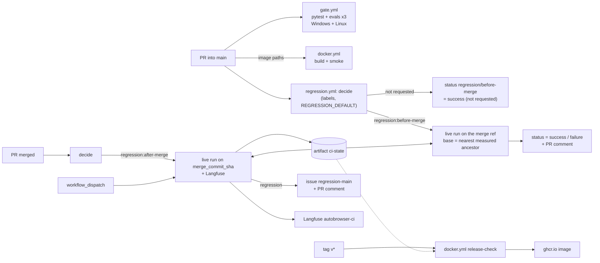
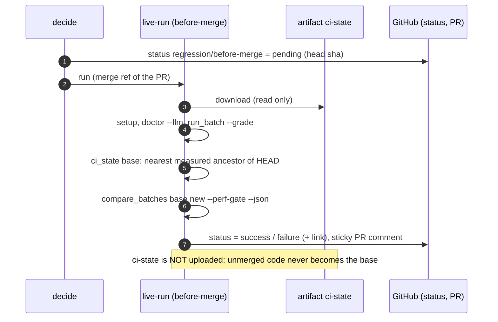

# Регрессионное тестирование в CI/CD и Langfuse в CI/CD: системный дизайн и ТЗ

Status: Accepted (2026-11-10; открытые вопросы §10 приняты по умолчанию)
Решение: [ADR-2026-11-10: Regression and Langfuse in CI/CD](../decisions/2026-11-10-regression-and-langfuse-in-ci-cd.md).
Реализация: WP1, WP3–WP6, WP9, WP10 и документация WP11 — в коде (см. «Отличия реализации» в
конце). Не сделаны: локальный живой прогон на Linux (WP2), прогоны на тестовом PR и настройка
репозитория (WP6, WP7), мост G8 (WP8, ждёт теста пользователя).
Date: 2026-11-10
Расширяет: [Автономный пайплайн тестирования](2026-10-19-autonomous-test-pipeline-design.md).
Его §4.6.6 «CI-workflow» (ночной прогон на self-hosted Windows и история в ветке `ci-history`)
заменён здесь живыми прогонами по запросу, привязанными к мержам в `main` (§3–§5). Остальное
в силе.
Связано: [Testing Pipeline Guide](testing-pipeline.md), [Langfuse Integration Runbook](langfuse.md),
[Eval Platform Guide](eval-platform.md),
[ADR-2026-10-19: Autonomous Test Pipeline](../decisions/2026-10-19-autonomous-test-pipeline.md),
[ADR-2026-10-31: Langfuse Platform Integration](../decisions/2026-10-31-langfuse-platform-integration.md),
[ADR-2026-11-02: Serve Mode](../decisions/2026-11-02-serve-mode-and-cost-ladder.md),
[глоссарий](../glossary.md) (Golden Set, Grader, Eval baseline).

## 0. Кратко

- **Офлайн-гейт PR не меняется по смыслу и остаётся обязательным:**
  - без сети, модели и браузера;
  - проверяет больше: все три eval-сюиты, Windows и Linux, JUnit и сводку.
- **Живой регрессионный прогон есть только вокруг мержей в `main`, и оба режима — по желанию:**
  - **до мержа** — метка `regression:before-merge` на PR. Прогон идёт на коде PR, слитом с
    `main`, и пишет проверку `regression/before-merge`. Если сделать её обязательной,
    регрессия блокирует мерж, только когда прогон запрошен;
  - **после мержа** — метка `regression:after-merge`. Прогон идёт на коммите мержа в `main`,
    сравнивается с предыдущим замером `main`, обновляет базу сравнения, синхронизирует Langfuse
    и при регрессии открывает issue. Мерж он не блокирует;
  - **без меток живых тестов нет**, и мерж ничем не ограничен.
  - Кроме меток — ручной запуск на `main` (`workflow_dispatch`) и необязательный режим по
    умолчанию для репозитория (`REGRESSION_DEFAULT`).
- **Расписания нет.**
- **Состояние между прогонами:**
  - база сравнения, история и ledger'ы Langfuse лежат в цепочке артефактов `ci-state`;
  - пишут её только прогоны на `main`;
  - база выбирается как ближайший замеренный предок проверяемого коммита.
- **Langfuse в CI:**
  - только в прогонах на `main` (после мержа и ручных), из секретов, в отдельном проекте
    `autobrowser-ci`;
  - сбой синхронизации — предупреждение, вердикт от него не зависит;
  - прогоны до мержа в Langfuse не пишут.
- **CD:**
  - Docker-образ собирается и проходит smoke в PR, затрагивающих образ;
  - по тегу `v*` образ публикуется в GHCR, если есть зелёный замер `main` на этом коммите или
    его предке (проверку можно выключить переменной).
- **Что невыполнимо** (подробно §3.4):
  - выбрать режим в момент нажатия Merge: у кнопки нет параметров, выбор делается метками
    заранее;
  - прогон после мержа по определению не может мерж остановить;
  - «обязательная, но необязательная» проверка не встроена в GitHub, её даёт workflow, который
    сам пишет статус;
  - для PR из форков статус писать нельзя.

## 1. Контекст

### 1.1 Что есть (2026-11-10)

| Уровень | Что проверяет | Команда | В CI |
|---|---|---|---|
| Unit и контракты | ~3840 тестов, границы слоёв, промпты | `uv run pytest` (без `live`, `bench`) | да, `gate.yml`, `windows-latest` |
| Eval `agent_loop_v2` | движок на 57 скриптованных сценариях, с `memory_seed` | `scripts/run_evals.py --baseline …agent_loop_v2.json --memory-seed …` | да |
| Eval `playback_v1`, `cascade_v1` | replay (6) и каскад моделей (4) | `run_evals.py --scenarios … --baseline …` | **нет** |
| Docker smoke | образ стенда, `/healthz`, probe без модели | `pytest -m live tests/pipeline/test_docker_smoke.py` | **нет** |
| Живые сюиты `smoke` (2), `benchmark` (31), `golden` (18) | агент на живых сайтах, оценка по ответу | `run_batch.py --tasks … --grade` | **нет**, вручную |
| Сравнение прогонов | регрессии по `failure_kind`, perf по метрикам | `compare_batches.py A B [--perf-gate]`, коды 0/1/2/3 | **нет** |
| Langfuse | датасеты, эксперименты, скоры | `langfuse_sync.py …`, `run_batch` с `auto_sync` | **нет** |

Готовые строительные блоки:
- **Батч на Linux без Chrome от сессии.**
  - `browser.launch: external` и `{profile_dir}` в `mcp_servers` (сделано в фазах стенда).
  - `bootstrap` подставляет в `{profile_dir}` профиль сценария
    `<batch_dir>/profiles/scenario-N`, так что изоляция сценариев сохраняется.
  - Docker-образ доказывает, что связка headless Chromium + Playwright MCP работает на Linux.
- **Вердикт — уже код:**
  - `compare_batches.py` с кодами возврата;
  - `failure_kind` отделяет инфраструктурные сбои (`provider_error`, `timeout` →
    `inconclusive`) от агентских.
- **Герметичность evals:** `tests/evals/runner.isolate_settings`, `tests/pipeline/hermetic.yaml`.

### 1.2 Пробелы

| # | Пробел | Следствие |
|---|---|---|
| G1 | В гейте одна eval-сюита из трёх | регрессия replay или каскада проходит в `main` незамеченной |
| G2 | Только `windows-latest`; `uv sync --locked` на Linux в CI не проверялся | Docker и стенд на Linux ломаются без сигнала |
| G3 | Живой регрессии в CI нет вообще | изменения промптов и контекста (как `feat/neutral-server-context`) проверяются только руками |
| G4 | Раннер одноразовый, а `compare_batches` нужен прошлый батч `main` | живой прогон не с чем сравнить |
| G5 | Ledger синхронизации (`platform_sync.json`) живёт в папке батча | на новом раннере потерян, а «ровно один раз» держится на нём |
| G6 | Docker-образ не собирается в CI и не публикуется | нет CD стенда |
| G7 | Нет JUnit, сводки шага и аннотаций | причину падения ищут в сыром логе |
| G8 | `experiment push --pending` и `--batch` по умолчанию берут `--suite golden` и не сверяют набор батча | догоняющая синхронизация `benchmark`-батча уходит не в тот датасет ([runbook](langfuse.md#7-sync-by-hand)) |

### 1.3 Цели и не-цели

Цели:
- закрыть G1–G8 так, чтобы живая регрессия была **инструментом по выбору** вокруг мержа в
  `main`, а не обязательной ценой каждого PR;
- соблюсти принципы пайплайна: вердикт считается локально и кодом, офлайн-гейт герметичен,
  Langfuse — второе окно, а не источник истины.

Не-цели:
- прогоны по расписанию (ночные, недельные) — по решению пользователя 2026-11-10;
- кассеты;
- A/B-бенчмарк в PR;
- LLM-судья как гейт;
- автоматическое обновление baseline;
- живой OTLP-экспорт из CI;
- merge queue (`merge_group`) — см. §10, Q9.

## 2. Требования (ТЗ)

### 2.1 Функциональные

| ID | Требование | Критерий приёмки |
|---|---|---|
| R1 | Офлайн-гейт запускает `pytest` и все три eval-сюиты против закоммиченных baseline | заведомо сломанный baseline любой сюиты даёт красный гейт; три шага видны отдельно |
| R2 | Гейт идёт на `windows-latest` и `ubuntu-latest` | обе джобы зелёные на `main`; `conpty`-тесты на Linux пропускаются маркером |
| R3 | Гейт публикует JUnit и сводку | `$GITHUB_STEP_SUMMARY` содержит итог pytest и находки evals; JUnit лежит в артефакте |
| R4 | Режим «до мержа» включается меткой `regression:before-merge` (или режимом по умолчанию) | метка запускает живой прогон на merge-ref PR; без неё прогона нет |
| R5 | Режим «до мержа» пишет commit status `regression/before-merge` на head-коммит PR | не запрошен → `success` «не запрошен»; идёт → `pending`; итог → `success` или `failure` со ссылкой на прогон |
| R6 | Мерж без живой регрессии возможен всегда | PR без меток мержится при обязательной `regression/before-merge`; снятие метки с красного PR переводит статус в `success` «снят» |
| R7 | Посторонние события PR (другие метки, правка описания) не меняют и не маскируют результат | добавление чужой метки после красного прогона оставляет статус `failure` |
| R8 | Режим «после мержа» включается меткой `regression:after-merge` (или режимом по умолчанию), установленной до мержа | мерж такого PR запускает прогон на `merge_commit_sha`; мерж без метки — нет |
| R9 | Прогон после мержа сравнивается с ближайшим замеренным предком на `main`, обновляет `ci-state`, комментирует PR, при регрессии открывает или обновляет issue `regression-main` | два последовательных мержа с меткой: второй сравнивается с первым |
| R10 | Ручной запуск на `main` или любом коммите `main` (`workflow_dispatch`: `ref`, `suite`, `model`) | запуск создаёт замер и обновляет `ci-state`, как прогон после мержа |
| R11 | Прогон до мержа сравнивается с ближайшим замеренным предком из `ci-state` и **не** пишет `ci-state` | после красного прогона до мержа база `main` не изменилась |
| R12 | Langfuse: в прогонах на `main` — датасет, эксперимент, скоры, ссылка в сводке | после прогона с секретами в проекте `autobrowser-ci` есть эксперимент с коммитом в имени |
| R13 | Сбой Langfuse не меняет вердикт; без секретов шаги Langfuse пропускаются | неверный ключ → предупреждение, вердикт тот же; без секретов → шаги `skipped` |
| R14 | Docker-образ собирается и проходит smoke в PR, затрагивающих образ | PR с правкой `Dockerfile` или `src/` запускает `docker.yml`; smoke зелёный |
| R15 | Тег `v*` публикует образ, если есть зелёный замер `main` на коммите тега или его предке за `pipeline.ci_release_verdict_max_age_days`; переменная `RELEASE_REQUIRES_REGRESSION=false` выключает проверку | тег без замера и с включённой проверкой не публикует; с выключенной — публикует |
| R16 | Догоняющая синхронизация берёт сюиту батча из самого батча (G8) | зависит от решения пользователя по мосту, Q8 |

### 2.2 Нефункциональные

| ID | Требование |
|---|---|
| N1 | Офлайн-гейт не ходит в сеть, к модели и к Langfuse; секреты в него не передаются |
| N2 | Гейт ≤ 15 минут на ОС; живой прогон ≤ 120 минут (таймаут джобы) |
| N3 | Ни одного правила по именам инструментов или сайтам в `src/`; CI-профиль — YAML в `ci/`, логика выбора режима — тестируемый Python в `scripts/` |
| N4 | Новые пороги и окна — поля `src/config.py` (секция `pipeline`) с описанием в `.env.example` и `config.example.yaml`; значения CI — в профиле `ci/regression.yaml` |
| N5 | Секреты только в GitHub Secrets; не печатаются и не попадают в артефакты |
| N6 | Из CI в Langfuse по умолчанию не уходит содержимое страниц (`capture_content: none`) |
| N7 | Всё воспроизводится локально теми же командами `uv run …`; YAML только вызывает скрипты |
| N8 | Права токена минимальны: `contents: read` по умолчанию; `statuses: write`, `pull-requests: write`, `issues: write`, `actions: read`, `packages: write` — только у джоб, которым они нужны |

## 3. Как сделать оба режима опциональными: что возможно и что нет

### 3.1 Механизмы GitHub, которые можно использовать

| Механизм | Что даёт | Ограничение |
|---|---|---|
| Метки PR + события `pull_request` (`labeled`, `unlabeled`, `synchronize`, `closed`) | выбор режима на каждом PR, видимый в истории PR | событие нельзя отфильтровать по имени метки в `on:`: workflow стартует на любую метку, фильтровать приходится в коде |
| `if:` на джобе | пропуск живого прогона, когда он не запрошен | пропущенная джоба для обязательных проверок считается **успешной** (поведение GitHub). Повторный запуск по постороннему событию с пропуском **замаскирует** прошлый провал |
| Commit status (`POST /repos/{owner}/{repo}/statuses/{sha}`, контекст `regression/before-merge`) | статус пишется явно: `success`, `pending` или `failure`. Посторонний запуск его не трогает | токену нужен `statuses: write`; у PR из форков токен только на чтение |
| Обязательные проверки (branch protection или ruleset на `main`) | красный `regression/before-merge` блокирует мерж | обязательная проверка всегда обязательна; «по желанию» это делает только сам workflow, записав `success` «не запрошен» |
| `pull_request` `closed` + `merged == true` | прогон ровно на мерж, с номером и метками PR | идёт уже после мержа: может сообщить, но не остановить |
| `workflow_dispatch` | ручной замер любого коммита `main` | запускает человек |
| Repository variables (`vars.*`) | режим по умолчанию для всего репозитория без правки YAML | — |
| Обход правил (bypass) для админов | аварийный мерж при любом статусе | зависит от настроек ruleset; виден в истории |

### 3.2 Сравнение вариантов «до мержа»

| Вариант | Корректность | Удобство | Итог |
|---|---|---|---|
| A. Только `workflow_dispatch` на ветке PR | статус к PR не привязан | ручной | отвергнут |
| B. Метка + `if:` на джобе, джоба — обязательная проверка | **ломается:** чужая метка после красного прогона запускает пропущенный повтор, и он засчитывается как успех | просто | отвергнут (R7) |
| C. Команда в комментарии (`/regression`, событие `issue_comment`) | workflow идёт в контексте `main`, checkout кода PR приходится делать вручную; статус всё равно нужно писать самим | гибко | возможная надстройка, не база |
| **D. Метка + решающая джоба + явный commit status** | посторонние события ничего не пишут, результат прогона не маскируется | метки видны в PR | **рекомендован** |

### 3.3 Как смержить без регрессионных тестов

1. **По умолчанию.** Нет метки → решающая джоба пишет `regression/before-merge = success`
   («регрессия не запрошена») → мерж доступен. После мержа прогон не запускается.
2. **Прогон запрошен, но красный, висит или не нужен.** Снять метку `regression:before-merge`
   → статус `success` («прогон снят») → мерж доступен. В таймлайне PR видно, что метку сняли
   после красного прогона.
3. **Нестабильный живой прогон.** «Re-run failed jobs» в Actions перезапускает его на том же
   коммите.
4. **Авария.** Обход правил админом, если ruleset его разрешает.
5. **Проверку можно вообще не делать обязательной.** Тогда `regression/before-merge` только
   информирует и ничего не блокирует. Выбирается в настройках ruleset (Q1).

### 3.4 Что невыполнимо и почему

- **Выбрать режим нажатием на кнопку Merge.** У кнопки Merge нет параметров и хуков
  («смержить с регрессией» или «без»). Выбор фиксируется заранее метками.
  - Метка `regression:after-merge` должна стоять до мержа.
  - Замер после мержа без метки — ручной `workflow_dispatch` с `ref` нужного коммита.
- **Остановить мерж прогоном после мержа.** К моменту запуска коммит уже в `main`. Такой
  прогон может только:
  - открыть issue;
  - прокомментировать PR;
  - не дать опубликовать релиз (R15).
  Откат — отдельный revert-PR человеком.
- **Встроенная «необязательная обязательная проверка».** В GitHub обязательная проверка
  обязательна всегда. Нужную семантику даёт только workflow: он сам пишет `success` «не
  запрошен» на каждый новый коммит PR (§4.3).
  - Если решающая джоба не запустилась (Actions выключены, сбой GitHub), статус не появится и
    мерж будет ждать. Выход — повторный запуск, снятие обязательности или обход правил.
- **PR из форков.** У `pull_request` из форка токен только на чтение, секретов нет.
  - Статус не пишется, живой прогон невозможен.
  - Если `regression/before-merge` обязательна, такой PR ждёт: его мержит владелец обходом
    правил или после переноса ветки в репозиторий.
  - `pull_request_target` для этого не используется: он дал бы секреты коду из форка.
- **Замер каждого мержа при частых мержах.** В группе конкурентности GitHub держит один
  ожидающий запуск, и новый ожидающий вытесняет старый.
  - Если три PR с `regression:after-merge` смержены за время одного прогона, средний
    замер может быть отменён. Следующий замер покроет его изменения кумулятивно.
  - Без группы конкурентности прогоны шли бы параллельно и перезаписывали `ci-state` друг
    другу.
  - Гарантировать замер каждого мержа можно только ручными запусками по одному.
- **Детерминизм живого прогона.** Модель и сайты недетерминированы, поэтому один красный
  прогон до мержа может быть шумом. Это свойство живых тестов, а не GitHub. Средства —
  `inconclusive` для infra, Re-run, снятие метки. N повторов — вне скоупа.

## 4. Варианты остальных решений

### 4.1 Где запускать живой прогон

| Вариант | Итог |
|---|---|
| **A. `ubuntu-latest` + headless Chromium за Playwright MCP (`launch: external`)** | **рекомендован**: без своего железа, та же связка, что в Docker-образе; минус — IP дата-центра (анти-бот на коммерческих сайтах) |
| B. Self-hosted Windows-раннер | основная платформа и «домашний» IP; машина должна быть включена, self-hosted небезопасен для публичного репо; опция для `golden` (Q4) |
| C. Контейнер стенда как раннер | `scripts/` нет в образе; отвергнут |

### 4.2 Какую сюиту гонять

Решает переменная `REGRESSION_SUITE` или вход `suite` у ручного запуска:
- **`benchmark`** (31 сценарий на песочницах и Википедии) — по умолчанию: агентские провалы
  там почти всегда настоящие;
- `smoke` (2) — быстрая проверка связки, примерно за 5 минут;
- `golden` (с Ozon) — только вручную: с IP раннера Ozon даёт анти-бот (`agent_stopped`).

Сюита до мержа и база должны совпадать (`tasks_sha256`). Иначе `compare_batches` вернёт 2 «нет
базы».

### 4.3 Состояние между прогонами

| Вариант | Итог |
|---|---|
| **A. Цепочка артефактов `ci-state`**, которую пишут только прогоны на `main` | **рекомендован**: `contents: read`, 90 дней хранения, обновляется каждым замером `main` |
| B. Ветка `ci-history` | `contents: write`, трассы раздувают репозиторий; опция только для `history.jsonl` (Q5) |
| C. `actions/cache` | вытесняется и иммутабелен по ключу; отвергнут |
| D. Langfuse как хранилище | Hobby — 30 дней; вердикт по ADR не зависит от Langfuse; отвергнут |

### 4.4 Оркестратор

`scripts/ci.py` из старого плана пока не нужен. Вместо него три небольших тестируемых скрипта:
- `ci_regression_mode.py` — решение, какой режим запущен;
- `ci_state.py` — состояние и выбор базы;
- `ci_summary.py` — вердикт, статус, комментарии и issue.

## 5. Дизайн

### 5.1 Уровни и триггеры

| Уровень | Триггер | Где | Блокирует |
|---|---|---|---|
| L0 `pytest` + L1 evals ×3 | каждый PR, push `main` | Windows + Linux (`gate.yml`) | мерж (обязательная проверка) |
| L2 Docker build + smoke | PR с изменением образа; тег `v*` | Linux (`docker.yml`) | мерж таких PR; публикацию |
| L3 живой прогон **до мержа** | метка `regression:before-merge` (или режим по умолчанию) | Linux (`regression.yml`) | мерж, только если запрошен и `regression/before-merge` обязательна |
| L3 живой прогон **после мержа** | мерж PR с `regression:after-merge` (или режимом по умолчанию) | Linux | ничего; публикацию релиза (R15) |
| L3 живой прогон **вручную** | `workflow_dispatch` (`ref` из `main`) | Linux | ничего |



### 5.2 Офлайн-гейт (`gate.yml`, изменение)

- Матрица `os: [windows-latest, ubuntu-latest]`, `fail-fast: false`. Linux первые две недели
  идёт с `continue-on-error: true`, затем становится обязательной (Q6).
- Шаги:
  1. `uv sync --locked`;
  2. `uv run pytest --junitxml=ci-out/junit.xml`;
  3. три `run_evals.py`, каждый отдельным шагом с `if: always()`;
  4. `ci_summary.py gate` → `$GITHUB_STEP_SUMMARY`;
  5. артефакт `gate-<os>`.
- Без секретов, `permissions: contents: read`.

### 5.3 Выбор режима

**Метки** (создаются один раз, приложение D):

| Метка | Смысл |
|---|---|
| `regression:before-merge` | живой прогон на каждом новом коммите PR; итог — статус `regression/before-merge` |
| `regression:after-merge` | живой прогон после мержа на коммите мержа |
| `regression:skip` | отменяет режим по умолчанию для этого PR |

**Режим по умолчанию** — repository variable `REGRESSION_DEFAULT`: `off` (по умолчанию) |
`before` | `after` | `both`. Запрошен ли режим:

```text
before_requested = has("regression:before-merge") or (REGRESSION_DEFAULT in {before, both} and not has("regression:skip"))
after_requested  = has("regression:after-merge")  or (REGRESSION_DEFAULT in {after, both}  and not has("regression:skip"))
```

**Решающая джоба** — `scripts/ci_regression_mode.py`, только stdlib, читает
`$GITHUB_EVENT_PATH`. Для событий меток она сравнивает «запрошено» по меткам до события
(текущие метки плюс или минус изменённая) и после него. Поэтому срабатывает только та метка,
которая что-то меняет:

| Событие PR | До мержа | После мержа |
|---|---|---|
| `opened`, `reopened`, `synchronize` (новый head) | запрошен → `pending` + прогон; нет → `success` «не запрошен» | — |
| `labeled` или `unlabeled`, «запрошено до мержа» стало `true` | `pending` + прогон на текущем head | — |
| `labeled` или `unlabeled`, «запрошено до мержа» стало `false` | `success` «прогон снят» | — |
| `labeled` или `unlabeled`, ничего не изменилось (чужая метка) | **ничего не пишется** (R7) | — |
| `closed`, `merged == true` | — | запрошен → прогон на `merge_commit_sha` |
| `closed` без мержа | — | — |

Выход скрипта:
- `before=run|pass|keep`;
- `after=run|none`;
- `status_sha` — `pull_request.head.sha`;
- `reason` — текст для описания статуса.

Статус `pending` или `success` пишет следующий шаг через `gh api …/statuses/<sha>`.

**Снятие метки во время прогона.** Решающая джоба не входит в группу конкурентности прогона,
поэтому снятие метки не отменяет уже идущий прогон. Чтобы его итог не перезаписал «прогон
снят», `ci_summary.py` перед записью финального статуса перечитывает PR через API. Статус
пишется, только если head-коммит прежний и прогон всё ещё запрошен. Иначе прогон завершается,
не трогая статус. Отменять такие прогоны принудительно (`gh run cancel`) не нужно: для этого
требуется `actions: write`.

### 5.4 Прогон до мержа



- **Код.** Checkout по умолчанию для `pull_request` — merge-ref (PR, слитый с текущим `main`),
  то есть то, что окажется в `main`. `fetch-depth: 0` для проверки предков.
- **База.** Среди батчей `ci-state` выбирается ближайший предок `HEAD`: батч, коммит которого
  — предок `HEAD` и потомок всех остальных таких батчей (`git merge-base --is-ancestor`).
  - Нет такого батча → `compare` 2 → статус `success` с описанием «нет базы: запустите
    замер `main`» (Q2: или `failure`).
- **Конкурентность.** `regression-pr-<номер>`, `cancel-in-progress: true`: новый запрошенный
  прогон того же PR (новый push или повторная метка) отменяет идущий. Снятие метки обрабатывает
  перепроверка в `ci_summary.py` (§5.3).
- **Langfuse.** Не пишется (Q7).
- **Итог статуса** — по таблице §5.7.

### 5.5 Прогон после мержа и ручной замер

```mermaid
sequenceDiagram
  autonumber
  participant R as live-run (after-merge / dispatch)
  participant ST as artifact ci-state
  participant LF as Langfuse autobrowser-ci
  participant GH as GitHub (issue, PR)
  R->>ST: download the latest ci-state
  R->>R: checkout merge_commit_sha (or the dispatch ref), fetch-depth 0
  R->>R: setup, doctor --llm
  opt Langfuse secrets present
    R->>LF: langfuse_sync doctor, setup
  end
  R->>R: run_batch --grade (auto_sync -> Langfuse)
  R->>R: base = nearest measured ancestor; compare_batches
  opt Langfuse secrets present
    R->>LF: experiment push --pending --suite <suite>
  end
  R->>GH: PR comment; issue regression-main open / update / close
  R->>ST: upload new ci-state (always)
```

- **Код.** `github.event.pull_request.merge_commit_sha` — коммит, который реально лёг в
  `main` (для squash и rebase — итоговый). Это не `GITHUB_SHA` события `closed`: тот указывает
  на тестовый merge-ref. При ручном запуске — вход `ref`; коммит должен быть в `main`, иначе
  джоба завершается с ошибкой.
- **Конкурентность.** `regression-main`, `cancel-in-progress: false` (ограничения — §3.4).
- **База** — тот же выбор ближайшего предка. Поэтому порядок прогонов не важен: опоздавший
  или ручной замер старого коммита не станет базой для более нового.

### 5.6 Состояние `ci-state`

Пишут только прогоны после мержа и ручные. Содержимое относительно `$AUTOBROWSER_HOME`:

| Путь | Зачем | Политика |
|---|---|---|
| `batches/<batch_id>/` последних `pipeline.ci_state_keep_batches` замеров `main` | базы сравнения; ledger `platform_sync.json` для догоняющей синхронизации | без `profiles/`, с `traces/` |
| `batches/history.jsonl` | история метрик и вердиктов | целиком (обрезка `pipeline.history_max_rows`) |
| `batches/platform_datasets.jsonl` | журнал версий датасетов | целиком |
| `ci/verdicts.jsonl` | вердикт каждого замера: `run_id`, `commit`, `suite`, `pr`, `compare_exit`, `regressions`, `inconclusive`, `experiment_url` | дописывается; читается релизом |

- **Поиск последнего состояния:** `gh api "repos/$GITHUB_REPOSITORY/actions/artifacts?name=ci-state&per_page=1"` →
  `workflow_run.id` → `gh run download <id> -n ci-state`. Артефакт с этим именем выкладывают
  только прогоны на `main`, так что ветка и событие запуска не важны.
- **Разрыв цепочки** (нет замеров `main` дольше 90 дней) — штатная ситуация: «нет базы», и
  следующий замер становится базой.
- **Новые настройки** (N4), секция `pipeline`:
  - `ci_state_keep_batches` (int, 5, `ge=1`);
  - `ci_max_inconclusive_ratio` (float, 0.3, 0..1);
  - `ci_release_verdict_max_age_days` (int, 14, `ge=1`).

### 5.7 Вердикт

| Ситуация | Признак | До мержа: статус | После мержа и вручную |
|---|---|---|---|
| Нет регрессий | `compare` 0 | `success` | зелёная; закрыть `regression-main`, если открыта |
| Регрессия | `compare` 1 | **`failure`** + список сценариев | **красная**; issue `regression-main`: сценарии, было → стало, `failure_kind`, ссылки на трассы и эксперимент |
| Нет базы или сменилась сюита | `compare` 2 | `success` «нет базы» (Q2) | зелёная, становится базой |
| Только медленнее или дороже | `compare` 3 (`--perf-gate`) | `success`, предупреждение в комментарии | зелёная, предупреждение |
| Инфраструктура: `doctor --llm` ≠ 0, Chromium не стартовал, доля `provider_error`/`timeout` > `ci_max_inconclusive_ratio` | — | `error` «infra: перезапустите» (блокирует так же, как `failure`) | красная `infra`; issue `regression-infra` |
| Сбой Langfuse | `langfuse_sync` 1 или 2 | — | не влияет (R13) |

`run_batch.py --grade` возвращает 1 при любом проваленном сценарии. На живых сайтах это норма,
поэтому решает сравнение с базой (`compare_batches`), а не абсолютный pass rate.

### 5.8 CI-профиль `ci/regression.yaml`

Частичный YAML-профиль через `AUTOBROWSER_CONFIG_FILE`: решает только перечисленные поля.
`AUTOBROWSER_HOME` — `${{ runner.temp }}/abhome`, туда распаковывается `ci-state`.

```yaml
llm:
  provider: ollama              # Q3: модель живого прогона
  model: gemma4:31b-cloud
browser:
  launch: external              # Chromium запускает MCP-сервер, сессия — нет
mcp_servers:
  playwright:
    transport: stdio
    command: playwright-mcp
    args: [--headless, --browser, chromium, --user-data-dir, "{profile_dir}", --no-sandbox]
    stateful: true
permissions:
  mode: dont_ask                # в батче некому отвечать
loop:
  max_task_model_calls: 40      # потолок стоимости одной задачи
telemetry:
  otlp_enabled: false
eval_platform:                  # enabled — из env, только при наличии секретов (§5.9)
  environment: ci-main
  capture_content: none         # N6
  auto_sync: true
  sync_timeout_seconds: 600
```

Ключи в профиле не указываются: профиль важнее env, а ключи приходят только из env.

### 5.9 Langfuse в CI/CD

**Подготовка (один раз, человеком):**
1. Langfuse → новый проект `autobrowser-ci` → Settings → API Keys → пара ключей.
2. GitHub → Settings → Secrets and variables → Actions (команды — приложение D):

   | Тип | Имя | Значение |
   |---|---|---|
   | Secret | `LANGFUSE_PUBLIC_KEY` | `pk-lf-…` |
   | Secret | `LANGFUSE_SECRET_KEY` | `sk-lf-…` |
   | Variable | `LANGFUSE_HOST` | `https://cloud.langfuse.com` (US или self-host ≥ 4.59.0) |
   | Secret | `AUTOBROWSER_LLM_API_KEY` | ключ провайдера модели |

3. Проверить ключи локально по [runbook](langfuse.md), шаг 4: `langfuse_sync.py doctor`.

**Где включается.** Только прогоны после мержа и ручные. В reusable workflow вход
`langfuse: true` (§приложение A). Решение принимает один шаг, а не `env:` джобы, чтобы его
можно было выключить позже в том же прогоне:

```yaml
env:   # уровень джобы: хост и ключи; ENABLED задаёт шаг ниже
  AUTOBROWSER_EVAL_PLATFORM__HOST: ${{ vars.LANGFUSE_HOST }}
  AUTOBROWSER_EVAL_PLATFORM__PUBLIC_KEY: ${{ secrets.LANGFUSE_PUBLIC_KEY }}
  AUTOBROWSER_EVAL_PLATFORM__SECRET_KEY: ${{ secrets.LANGFUSE_SECRET_KEY }}
steps:
  - name: Decide whether Langfuse runs
    env: { HAS_KEYS: "${{ secrets.LANGFUSE_SECRET_KEY != '' }}" }
    run: |
      on=false
      if [ "${{ inputs.langfuse }}" = true ] && [ "$HAS_KEYS" = true ]; then on=true; fi
      echo "AUTOBROWSER_EVAL_PLATFORM__ENABLED=$on" >> "$GITHUB_ENV"
```

**Шаги** (все с `if: env.AUTOBROWSER_EVAL_PLATFORM__ENABLED == 'true'`):

| Шаг | Команда | Код ≠ 0 |
|---|---|---|
| Проверка | `uv run scripts/langfuse_sync.py doctor` | 2 → `AUTOBROWSER_EVAL_PLATFORM__ENABLED=false` в `$GITHUB_ENV`, предупреждение |
| Конфиги скоров | `uv run scripts/langfuse_sync.py setup` | идемпотентен; ошибка — предупреждение |
| Датасет и эксперимент | внутри `run_batch.py` (`auto_sync`) | только stderr-предупреждение |
| Догоняющая синхронизация | `uv run scripts/langfuse_sync.py experiment push --pending --suite <suite>` | 1 → предупреждение, догонит следующий замер; 2 → предупреждение |
| Статус и ссылка | `uv run scripts/langfuse_sync.py status` | — |
| Скоры судей (по желанию) | `uv run scripts/langfuse_sync.py scores pull --batch <id>` | предупреждение |

**Инварианты:**
- **Ровно один раз** держится на ledger `platform_sync.json`. Ledger едет в `ci-state`, и
  следующий замер дошлёт только недошедшее.
- **Чистое дерево.** Датасет пушится из чистого checkout коммита `main`; `--allow-dirty` не
  используется.
- **Прогоны до мержа в Langfuse не пишут** (Q7): эксперименты в проекте — только история
  `main`.
- **Сюита передаётся явно** (`--suite`) до исправления G8 (Q8).
- **Бюджет Hobby.**
  - `golden` (18 сценариев) — около 1100 единиц за прогон
    ([Eval Platform Guide](eval-platform.md)); `benchmark` (31) — около 1900.
  - 50 тысяч в месяц — это примерно 26 замеров `main` на `benchmark`. Режим по запросу
    вписывается в лимит; при `REGRESSION_DEFAULT=after` или `both` и частых мержах — платный
    план или self-host (Q10).
  - REST-запросов — десятки за прогон при `requests_per_minute: 25`.
- **Удержание 30 дней.** Вердикт и история — в `ci-state`. `scores pull` сохраняет скоры
  судей в папку батча.
- **Содержимое:** `capture_content: none`; для LLM-судьи нужен минимум `answers` (Q11).

**Что видно в Langfuse:**
- Datasets → `autobrowser/benchmark` → Experiments → `benchmark · <дата> · <commit> · <model> · <batch>`;
- по одному эксперименту на каждый замеренный мерж;
- Compare между ними;
- скоры `passed`, `failure_kind`, `regression`, `verdict`.

Ссылка на эксперимент — в сводке, комментарии к PR и issue.

### 5.10 CD: образ стенда (`docker.yml`)

| Событие | Джобы |
|---|---|
| PR с изменением `Dockerfile`, `docker/`, `src/`, `pyproject.toml`, `uv.lock` | `build` (кэш `type=gha`) → `smoke` (`AUTOBROWSER_SMOKE_IMAGE=<tag> uv run pytest -m live tests/pipeline/test_docker_smoke.py`) |
| тег `v*` | `build` → `smoke` → `release-check` → `publish` (`:vX.Y.Z`, `:latest`) |

**`release-check`** (R15):
- если `vars.RELEASE_REQUIRES_REGRESSION` не равен `false`:
  - `uv run scripts/ci_state.py verdict --commit $GITHUB_SHA` скачивает `ci-state` и ищет в
    `ci/verdicts.jsonl` зелёный замер (`compare` 0, 2 или 3, без `infra`) на коммите тега или
    его предке не старше `ci_release_verdict_max_age_days`;
  - нет такого замера — джоба красная с подсказкой: «запустите `regression` вручную с
    `ref=<тег>`, или выключите проверку переменной»;
- если `false` — шаг пропускается.

Публикация: `packages: write` только у `publish`; `docker/login-action` с `GITHUB_TOKEN`;
`docker/metadata-action` для тегов.

### 5.11 Отчёты и уведомления

- **Гейт:** итог pytest, три строки evals, JUnit.
- **До мержа:**
  - статус `regression/before-merge` со ссылкой на прогон;
  - sticky-комментарий в PR (`gh pr comment --edit-last`): вердикт, таблица регрессий,
    счётчики passed, agent, infra, база (коммит и PR), ссылка на артефакт батча.
- **После мержа:**
  - комментарий в смерженный PR с тем же содержимым и ссылкой на эксперимент Langfuse;
  - issue `regression-main` (одна открытая) — при регрессии создаётся или дополняется, при
    зелёном замере закрывается.
- **Все живые прогоны:** сводка шага и артефакт `regression-batch-<run_id>` (30 дней).

### 5.12 Секреты и безопасность

| Секрет | Где нужен | Никогда |
|---|---|---|
| `AUTOBROWSER_LLM_API_KEY` | живые прогоны (до мержа, после мержа, вручную) | гейт, Docker smoke, логи, артефакты |
| `LANGFUSE_*` | прогоны после мержа и ручные | гейт, прогоны до мержа, форки |
| `GITHUB_TOKEN` | статусы, комментарии, issue, артефакты, GHCR | шире §2.2 N8 |

- Секреты получают только `pull_request` из веток этого же репозитория. Право push в
  репозиторий и так означает доверие.
- `pull_request_target` не используется.
- В артефакты не попадают `<home>/.env` и личный `config.yaml`: профиль берётся из `ci/`.
- Трассы батча содержат ответы агента и тексты страниц публичных сайтов `benchmark`.
  Артефакты публичного репозитория видны тем, у кого есть доступ к Actions: `golden` с Ozon
  туда выгружать только осознанно (Q4).

## 6. Изменения по модулям

| Файл | Изменение |
|---|---|
| `.github/workflows/gate.yml` | матрица ОС, три eval-шага, JUnit, сводка |
| `.github/workflows/regression.yml` | новый: `decide`, `before-merge`, `after-merge`, `manual` (приложение A) |
| `.github/workflows/live-run.yml` | новый reusable workflow живого прогона (`workflow_call`) |
| `.github/actions/live-setup/action.yml` | composite: uv, Node, Playwright MCP, Chromium |
| `.github/workflows/docker.yml` | новый (§5.10) |
| `ci/regression.yaml` | CI-профиль (§5.8) |
| `scripts/ci_regression_mode.py` | решение по событию PR (§5.3), только stdlib |
| `scripts/ci_state.py` | `restore`, `base` (ближайший предок), `save` (обрезка), `verdict` (релиз) |
| `scripts/ci_summary.py` | сводка гейта и живого прогона, статус, комментарии, issue |
| `src/config.py` → `PipelineSettings` | три поля §5.6 (+ `.env.example`, `config.example.yaml`, `tests/test_config.py`) |
| `tests/test_ci_regression_mode.py`, `tests/test_ci_state.py`, `tests/test_ci_summary.py` | события-фикстуры, выбор базы на временном git-репозитории, таблица вердиктов |
| `scripts/langfuse_bridge/` | по решению пользователя (Q8): сюита из батча (G8) |
| `docs/development/testing-pipeline.md`, `docs/development/langfuse.md` | разделы «В CI», «Как запросить регрессию» |
| `docs/diagrams/` | новая диаграмма «CI/CD pipeline» (§5.1) |
| `docs/decisions/` | ADR «Regression and Langfuse in CI/CD» после согласования |

Движок, сессия и `src/` (кроме трёх настроек) не меняются.

## 7. План работ (ТЗ по пакетам)

| WP | Содержание | Результат и приёмка | Зависит | Объём |
|---|---|---|---|---|
| WP1 | Гейт: матрица Windows и Linux, три eval-сюиты, JUnit | R1–R3 (Linux пока `continue-on-error`) | — | S |
| WP2 | `ci/regression.yaml` + локальный прогон `benchmark` на Linux (WSL или Docker) | батч проходит до конца, `report.md` осмыслен; отличия Linux заведены задачами | — | M |
| WP3 | `ci_state.py` (restore, base, save, verdict) + настройки `pipeline.ci_*` + тесты | выбор ближайшего предка на временном репозитории с ветвлением; обрезка | — | M |
| WP4 | `ci_regression_mode.py` + тесты на событиях-фикстурах | таблица §5.3 целиком, включая «чужая метка → keep» и `REGRESSION_DEFAULT` | — | S |
| WP5 | `ci_summary.py` (gate, before-merge, after-merge) + тесты на фикстурах батча | таблица §5.7; статус, комментарий и issue через подменяемый `gh` | WP3 | M |
| WP6 | `live-run.yml`, `live-setup`, `regression.yml` без Langfuse | R4–R11 на тестовом PR: без метки → `success`; с меткой → прогон; чужая метка после красного → статус не меняется; снятие → `success`; мерж с `after-merge` → замер и `ci-state`; два мержа → второй сравнивается с первым | WP2–WP5 | M |
| WP7 | Обязательность `regression/before-merge` в ruleset `main` (по Q1) + метки и переменные (приложение D) | PR без меток мержится; с красным прогоном — нет; после снятия метки — да | WP6 | S |
| WP8 | Исправление моста G8 (если пользователь решит) | `--pending` без `--suite` синхронизирует `benchmark`-батч в свой датасет | тест пользователя | S |
| WP9 | Langfuse в `live-run.yml` (§5.9) | R12–R13: с секретами → эксперимент; без → `skipped`; неверный ключ → предупреждение | WP6, (WP8) | S |
| WP10 | `docker.yml`: build и smoke в PR, publish по тегу, `release-check` | R14–R15 | WP3 | M |
| WP11 | Документация: гайды, диаграмма, ADR; Linux-джоба гейта становится обязательной | ссылки живые, ADR в `index.md` | WP1–WP10 | S |

**Definition of Done каждого пакета:**
- код и YAML в ветке;
- тесты на новый Python-код без сети;
- полный `uv run pytest` и три eval-сюиты зелёные;
- для workflow — ссылки на прогоны, подтверждающие позитивный и негативный пути;
- документация обновлена;
- одно ревью `code-reviewer` на весь пакет изменений.

Порядок: WP1 → WP2 → WP3, WP4 → WP5 → WP6 → WP7 → (WP8) → WP9 → WP10 → WP11.

## 8. Риски

| Риск | Вероятность | Митигирующее решение |
|---|---|---|
| Шум живых сайтов и модели даёт красный прогон до мержа | средняя | `benchmark` на стабильных сайтах; `inconclusive` для infra; Re-run; снятие метки (§3.3) |
| База устарела: давно не было замеров `main` | средняя | в комментарии указаны коммит и PR базы; ручной замер `main`; `REGRESSION_DEFAULT=after` |
| Регрессия до мержа на самом деле внесена между базой и `main` (незамеренный мерж) | средняя | база — ближайший замеренный предок, комментарий называет диапазон; при сомнении сначала замер `main` |
| Решающая джоба не отработала — обязательный статус не появился | низкая | Re-run, снятие обязательности, обход правил |
| Linux-различия (пути, кодировки, флаги Chromium) | средняя | WP2 до WP6; `--no-sandbox`; Linux-гейт сначала необязательный |
| Бюджет Langfuse Hobby | низкая при режиме по запросу | отдельный проект; предупреждение вместо провала |
| Стоимость модели при `before-merge` на часто обновляемом PR | средняя | `cancel-in-progress`; ставить метку перед мержем; `smoke` вместо `benchmark` через `REGRESSION_SUITE` |
| Секрет в логе | низкая | маскирование GitHub; мост и события не печатают ключи |

## 9. Влияние на существующие решения

- Старый §4.6.6:
  - ночной прогон и self-hosted Windows-раннер заменены прогонами по запросу вокруг мержа на
    `ubuntu-latest`;
  - история хранится в цепочке артефактов вместо ветки `ci-history` (опция Q5).
- Принципы ADR-2026-10-19 (вердикт локален, офлайн-гейт герметичен, живые прогоны не
  обязательны) и ADR-2026-10-31 (Langfuse — второе окно) сохраняются.
- После согласования — новый ADR, расширяющий оба.

## 10. Открытые вопросы (дефолт — рекомендация)

| # | Вопрос | Дефолт |
|---|---|---|
| Q1 | Делать ли `regression/before-merge` обязательной проверкой | да: она блокирует только запрошенный и красный прогон, без метки мерж свободен |
| Q2 | Статус до мержа при «нет базы» | `success` с описанием «нет базы» |
| Q3 | Модель живого прогона | `gemma4:31b-cloud` через Ollama Cloud |
| Q4 | `golden` (с Ozon) в CI | только вручную, на `ubuntu-latest`; self-hosted Windows — позже, если мешает анти-бот |
| Q5 | Долгая история в ветке `ci-history` | нет |
| Q6 | Когда Linux-джоба гейта становится обязательной | после двух недель без нестабильных падений |
| Q7 | Писать ли прогоны до мержа в Langfuse (environment `ci-pr`) | нет |
| Q8 | Исправить мост: сюита из батча (G8) | да, после теста пользователя |
| Q9 | Merge queue (`merge_group`) | не используется; при включении решающей джобе нужен ещё и этот триггер |
| Q10 | `REGRESSION_DEFAULT` | `off`: всё по меткам |
| Q11 | `capture_content` в CI | `none`; `answers` для `benchmark`, если понадобится LLM-судья |

## Приложение A. Эскиз `regression.yml` и `live-run.yml`

```yaml
# .github/workflows/regression.yml
name: regression
on:
  pull_request:
    branches: [main]
    types: [opened, reopened, synchronize, labeled, unlabeled, closed]
  workflow_dispatch:
    inputs:
      ref: { type: string, default: main, description: "a commit or branch of main" }
      suite: { type: choice, options: [benchmark, smoke, golden], default: benchmark }
      model: { type: string, required: false }

permissions: { contents: read }

jobs:
  decide:
    if: github.event_name == 'pull_request'
    runs-on: ubuntu-latest
    permissions: { contents: read, statuses: write }
    outputs:
      before: ${{ steps.mode.outputs.before }}
      after: ${{ steps.mode.outputs.after }}
    env:
      GH_TOKEN: ${{ github.token }}
      REGRESSION_DEFAULT: ${{ vars.REGRESSION_DEFAULT || 'off' }}
    steps:
      - uses: actions/checkout@v4
      - id: mode
        run: python3 scripts/ci_regression_mode.py --event "$GITHUB_EVENT_PATH" >> "$GITHUB_OUTPUT"
      - name: Write the status that needs no run
        if: steps.mode.outputs.before == 'pass' || steps.mode.outputs.before == 'run'
        run: >
          gh api "repos/$GITHUB_REPOSITORY/statuses/${{ steps.mode.outputs.status_sha }}"
          -f context=regression/before-merge
          -f state=${{ steps.mode.outputs.before == 'run' && 'pending' || 'success' }}
          -f description="${{ steps.mode.outputs.reason }}"
          -f target_url="$GITHUB_SERVER_URL/$GITHUB_REPOSITORY/actions/runs/$GITHUB_RUN_ID"

  before-merge:
    needs: decide
    if: needs.decide.outputs.before == 'run'
    concurrency: { group: "regression-pr-${{ github.event.pull_request.number }}", cancel-in-progress: true }
    permissions: { contents: read, actions: read, statuses: write, pull-requests: write }
    uses: ./.github/workflows/live-run.yml
    with:
      mode: before-merge
      ref: ""                                   # the PR merge ref (checkout default)
      status_sha: ${{ github.event.pull_request.head.sha }}
      pr: ${{ github.event.pull_request.number }}
      suite: ${{ vars.REGRESSION_SUITE || 'benchmark' }}
      langfuse: false
    secrets: inherit

  after-merge:
    needs: decide
    if: needs.decide.outputs.after == 'run'
    concurrency: { group: regression-main, cancel-in-progress: false }
    permissions: { contents: read, actions: read, issues: write, pull-requests: write }
    uses: ./.github/workflows/live-run.yml
    with:
      mode: after-merge
      ref: ${{ github.event.pull_request.merge_commit_sha }}
      pr: ${{ github.event.pull_request.number }}
      suite: ${{ vars.REGRESSION_SUITE || 'benchmark' }}
      langfuse: true
    secrets: inherit

  manual:
    if: github.event_name == 'workflow_dispatch'
    concurrency: { group: regression-main, cancel-in-progress: false }
    permissions: { contents: read, actions: read, issues: write, pull-requests: write }
    uses: ./.github/workflows/live-run.yml
    with:
      mode: manual
      ref: ${{ inputs.ref }}
      suite: ${{ inputs.suite }}
      model: ${{ inputs.model }}
      langfuse: true
    secrets: inherit
```

```yaml
# .github/workflows/live-run.yml (reusable)
name: live-run
on:
  workflow_call:
    inputs:
      mode: { type: string, required: true }        # before-merge | after-merge | manual
      ref: { type: string, default: "" }
      status_sha: { type: string, default: "" }
      pr: { type: string, default: "" }
      suite: { type: string, default: benchmark }
      model: { type: string, default: "" }
      langfuse: { type: boolean, default: false }

jobs:
  live:
    runs-on: ubuntu-latest
    timeout-minutes: 120
    env:
      AUTOBROWSER_HOME: ${{ runner.temp }}/abhome
      AUTOBROWSER_CONFIG_FILE: ci/regression.yaml
      AUTOBROWSER_LLM__API_KEY: ${{ secrets.AUTOBROWSER_LLM_API_KEY }}
      AUTOBROWSER_EVAL_PLATFORM__HOST: ${{ vars.LANGFUSE_HOST }}
      AUTOBROWSER_EVAL_PLATFORM__PUBLIC_KEY: ${{ secrets.LANGFUSE_PUBLIC_KEY }}
      AUTOBROWSER_EVAL_PLATFORM__SECRET_KEY: ${{ secrets.LANGFUSE_SECRET_KEY }}
      PYTHONIOENCODING: utf-8
      GH_TOKEN: ${{ github.token }}
      MODE: ${{ inputs.mode }}
      SUITE: ${{ inputs.suite }}
    steps:
      - uses: actions/checkout@v4
        with: { ref: "${{ inputs.ref }}", fetch-depth: 0 }
      - name: Decide whether Langfuse runs
        env: { HAS_KEYS: "${{ secrets.LANGFUSE_SECRET_KEY != '' }}" }
        run: |
          on=false
          if [ "${{ inputs.langfuse }}" = true ] && [ "$HAS_KEYS" = true ]; then on=true; fi
          echo "AUTOBROWSER_EVAL_PLATFORM__ENABLED=$on" >> "$GITHUB_ENV"
      - uses: ./.github/actions/live-setup          # uv sync --locked, Node 20, @playwright/mcp, Chromium
      - run: uv run scripts/ci_state.py restore      # the latest ci-state, if any
      - run: uv run scripts/ci_state.py check-ref --mode "$MODE"   # after-merge/manual: HEAD must be on main
      - run: uv run main.py doctor --llm
      - name: Langfuse doctor and setup
        if: env.AUTOBROWSER_EVAL_PLATFORM__ENABLED == 'true'
        continue-on-error: true
        run: |
          uv run scripts/langfuse_sync.py doctor || echo "AUTOBROWSER_EVAL_PLATFORM__ENABLED=false" >> "$GITHUB_ENV"
          uv run scripts/langfuse_sync.py setup
      - name: Run the suite
        continue-on-error: true
        run: >
          uv run scripts/run_batch.py --tasks "tests/golden/${SUITE}.jsonl" --continue-on-error --grade
          ${{ inputs.model && format('--model {0}', inputs.model) || '' }} > ci-out-batch.json
      - name: Compare with the nearest measured ancestor
        id: compare
        run: |
          set +e   # the step shell is bash -e: keep the exit code
          uv run scripts/ci_state.py compare --batch-json ci-out-batch.json --out ci-out
          echo "code=$?" >> "$GITHUB_OUTPUT"
      - name: Langfuse catch-up
        if: always() && env.AUTOBROWSER_EVAL_PLATFORM__ENABLED == 'true'
        continue-on-error: true
        run: |
          uv run scripts/langfuse_sync.py experiment push --pending --suite "$SUITE"
          uv run scripts/langfuse_sync.py status
      - name: Verdict, status, comments, issue
        if: always()
        run: >
          uv run scripts/ci_summary.py live --mode "$MODE" --out ci-out
          --compare-code "${{ steps.compare.outputs.code }}"
          --status-sha "${{ inputs.status_sha }}" --pr "${{ inputs.pr }}"
      - name: Save ci-state (main measurements only)
        if: always() && inputs.mode != 'before-merge'
        run: uv run scripts/ci_state.py save --out ci-state.tar.gz
      - if: always() && inputs.mode != 'before-merge'
        uses: actions/upload-artifact@v4
        with: { name: ci-state, path: ci-state.tar.gz, retention-days: 90 }
      - if: always()
        uses: actions/upload-artifact@v4
        with:
          name: "regression-batch-${{ github.run_id }}"
          path: "${{ env.AUTOBROWSER_HOME }}/batches/batch-*"
          retention-days: 30
```

- `ci_summary.py live` завершается кодом вердикта по §5.7.
- В режиме `before-merge` он пишет финальный статус, но только если PR всё ещё на том же
  head-коммите и прогон всё ещё запрошен (§5.3). Если джоба оборвалась раньше, шаг отработает
  благодаря `if: always()` и запишет `error`.
- Отменённый прогон (`cancel-in-progress`) статус не трогает: следующий запуск по новому коммиту
  или метке пишет свой.

## Приложение B. Эскиз изменений `gate.yml`

```yaml
jobs:
  gate:
    strategy:
      fail-fast: false
      matrix: { os: [windows-latest, ubuntu-latest] }
    runs-on: ${{ matrix.os }}
    continue-on-error: ${{ matrix.os == 'ubuntu-latest' }}   # Q6: до стабилизации
    timeout-minutes: 30
    env: { PYTHONIOENCODING: utf-8, PYTHONUTF8: "1" }
    steps:
      - uses: actions/checkout@v4
      - uses: astral-sh/setup-uv@v6
        with: { version: "0.12.21", enable-cache: true }
      - run: uv sync --locked
      - run: uv run pytest --junitxml=ci-out/junit.xml
      - if: always()
        run: uv run scripts/run_evals.py --baseline tests/evals/baselines/agent_loop_v2.json --memory-seed tests/evals/memory_seed
      - if: always()
        run: uv run scripts/run_evals.py --scenarios tests/evals/playback_scenarios --baseline tests/evals/baselines/playback_v1.json
      - if: always()
        run: uv run scripts/run_evals.py --scenarios tests/evals/cascade_scenarios --baseline tests/evals/baselines/cascade_v1.json
      - if: always()
        run: uv run scripts/ci_summary.py gate --junit ci-out/junit.xml
      - if: always()
        uses: actions/upload-artifact@v4
        with: { name: "gate-${{ matrix.os }}", path: ci-out }
```

## Приложение C. Локальная проверка до CI

```powershell
# офлайн-гейт, как в CI
uv sync --locked
uv run pytest
uv run scripts/run_evals.py --baseline tests/evals/baselines/agent_loop_v2.json --memory-seed tests/evals/memory_seed
uv run scripts/run_evals.py --scenarios tests/evals/playback_scenarios --baseline tests/evals/baselines/playback_v1.json
uv run scripts/run_evals.py --scenarios tests/evals/cascade_scenarios --baseline tests/evals/baselines/cascade_v1.json

# живой прогон и сравнение, как в live-run (Windows: обычный Chrome; ci/regression.yaml — для Linux/WSL)
uv run scripts/run_batch.py --tasks tests\golden\benchmark.jsonl --continue-on-error --grade
uv run scripts/compare_batches.py --perf-gate
uv run scripts/langfuse_sync.py experiment push --pending --suite benchmark

# Docker smoke, как в docker.yml
docker build -t autobrowser-serve .
$env:AUTOBROWSER_SMOKE_IMAGE = "autobrowser-serve"; uv run pytest -m live tests/pipeline/test_docker_smoke.py
```

## Приложение D. Настройка репозитория (один раз)

```powershell
# метки (regression-main и regression-infra нужны issue-отчётам прогонов на main)
gh label create "regression:before-merge" --color D93F0B --description "Live regression run before merging; sets regression/before-merge"
gh label create "regression:after-merge"  --color 0E8A16 --description "Live regression run on main after merging"
gh label create "regression:skip"         --color BFD4F2 --description "Opt this PR out of REGRESSION_DEFAULT"
gh label create "regression-main"         --color B60205 --description "Live regression found on main"
gh label create "regression-infra"        --color FBCA04 --description "Live regression run on main broke (infra)"

# переменные
gh variable set REGRESSION_DEFAULT --body off            # off | before | after | both
gh variable set REGRESSION_SUITE --body benchmark        # benchmark | smoke | golden
gh variable set LANGFUSE_HOST --body https://cloud.langfuse.com
gh variable set RELEASE_REQUIRES_REGRESSION --body true

# секреты (значение вводится интерактивно и не попадает в историю)
gh secret set AUTOBROWSER_LLM_API_KEY
gh secret set LANGFUSE_PUBLIC_KEY
gh secret set LANGFUSE_SECRET_KEY
```

Обязательные проверки (Q1): Settings → Rules → Rulesets → New branch ruleset →
- Target: default branch;
- Require status checks to pass: `gate (windows-latest)`, затем `gate (ubuntu-latest)` (Q6) и
  `regression/before-merge`. Контекст появляется в поиске после первого PR, на котором
  workflow его записал;
- Bypass list: себя (аварийный мерж), если нужен.

Как пользоваться:
- **Мерж без живых тестов** — ничего не делать.
- **Проверить до мержа** — поставить `regression:before-merge` перед мержем, дождаться
  зелёного `regression/before-merge`.
- **Замерить `main` после мержа** — поставить `regression:after-merge` до нажатия Merge.
- **Замерить `main` без PR** — Actions → regression → Run workflow (`ref`, `suite`).

## Отличия реализации от эскизов

Эскизы приложений A и B остались как были. Реализация отличается от них в следующем:

- `AUTOBROWSER_HOME` задаёт шаг, а не `env:` джобы: контекст `runner` в `jobs.<id>.env`
  недоступен.
- Секреты передаются в `live-run.yml` явно (`llm_api_key`, `langfuse_*`), а не через
  `secrets: inherit`. Прогон до мержа получает только ключ модели (§5.12).
- Файл сюиты берётся из `ci_state.py tasks --suite` (словарь `SUITES` моста), а не из
  `tests/golden/${SUITE}.jsonl`: у `golden` файл называется `tests/golden/tasks.jsonl`.
- `ci_summary.py live` берёт вердикт из `compare.json`, а не из `--compare-code`. Только по
  `compare.json` можно отличить «нет базы» от «нет батча». Коды выхода: 0 — зелёный, 1 —
  регрессия, 2 — infra.
- Sticky-комментарий находится по скрытому маркеру через API, а не через
  `gh pr comment --edit-last`: тот правит последний комментарий бота, а это может быть
  комментарий другого workflow.
- После отчёта `ci_summary.py` пишет маркер `ci-out/summary.done`. Если джоба оборвалась до
  отчёта (setup, uv), запасной шаг ставит статус `error`, иначе статус остался бы `pending`
  навсегда. Отменённый прогон статус не трогает (`!cancelled()` вместо `always()`).
- `ci-state` сохраняется, только если `restore` прошёл успешно: загрузка после сбоя
  `restore` оборвала бы цепочку.
- `verdict` для релиза не скачивает состояние сам: `docker.yml` сначала вызывает
  `ci_state.py restore`, затем `verdict`.
- Недопустимое значение `REGRESSION_DEFAULT` считается `off` и даёт предупреждение. Ошибкой
  оно не считается, иначе обязательный статус не был бы записан.
