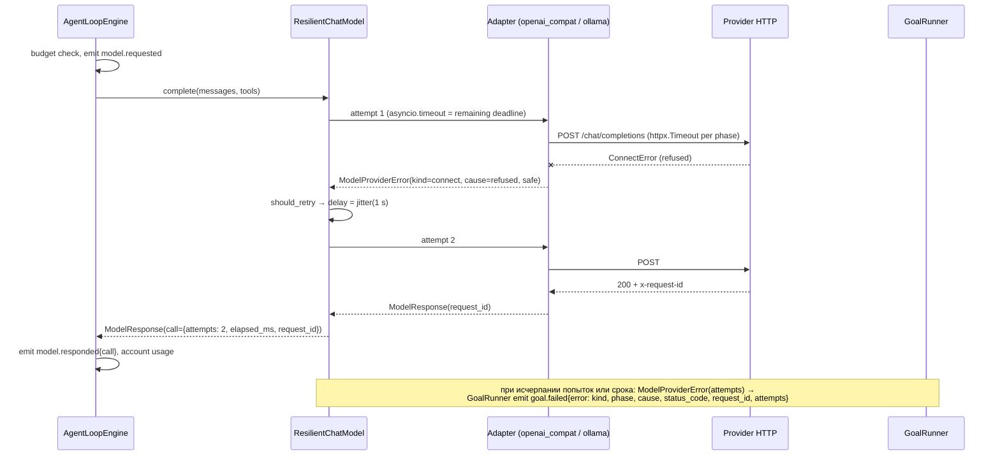
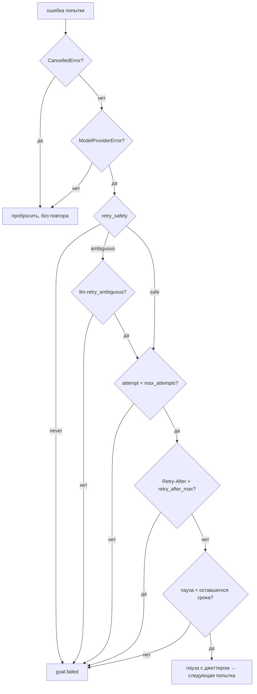

# Обработка ошибок провайдера модели

Статус: Proposed — шаги 1–5 плана (§11) реализованы 2026-11-13 на ветке
`feat/neutral-server-context`, без коммита. Открытые вопросы Q1–Q5 решены по рекомендациям
(§9). Отличия реализации от проекта — в §13. ADR переводится в Accepted после живого прогона.
Дата: 2026-11-13
Ветка: `feat/provider-call-resilience` (предлагаемая)
ADR (Proposed):
- [2026-11-13 Устойчивый вызов провайдера модели](../decisions/2026-11-13-provider-call-resilience.md)

Агент падает целиком, когда один вызов модели не удался: `goal.failed` с
`ModelProviderError: openai_compat: timed out after 60 s` или
`openai_compat: connection failed (APIConnectionError <- ConnectError)`. MCP и браузер при
этом исправны. Документ определяет:

- нейтральную классификацию ошибок провайдера (вид, фаза, безопасность повтора);
- раздельные таймауты фаз HTTP и общий срок одного логического вызова;
- повтор с экспоненциальной задержкой и джиттером — только там, где он не может удвоить
  генерацию;
- диагностику вызова (эндпоинт без секретов, модель, request id, длительность, статус, фаза,
  попытки) в событиях и логе;
- настройки, тесты, рекомендуемую конфигурацию и план внедрения.

Архитектура рантайма не меняется: движок по-прежнему не повторяет вызовы и не видит
провайдеров, MCP не затрагивается.

---

## 1. Разбор инцидента (root cause)

### 1.1 Что показывают логи

| Время | Событие | Ошибка | Что произошло |
|---|---|---|---|
| 20:05:58 | `goal.failed` | `openai_compat: timed out after 60 s` | Запрос отправлен, за 60 с ответа нет |
| 20:09:41 | `goal.failed` | `openai_compat: connection failed (APIConnectionError <- ConnectError)` | Соединение с эндпоинтом не установлено, запрос до модели не дошёл |

Отдельная ошибка `Unknown engine "ref" while parsing selector ref=f3e370` возникла при вызове
инструмента браузера: модель передала ссылку снапшота туда, где ожидался селектор. К провайдеру
она отношения не имеет: это ошибка инструмента, модель читает её и исправляется следующим ходом.
Если она повторяется, это тема скилла `browser-agent-rules`, а не этого документа.

### 1.2 Что в коде к этому приводит

1. **Один таймаут на все фазы.** `build_client` передаёт SDK `timeout=settings.timeout_seconds`
   (`src/providers/openai_compat.py`). `httpx` применяет 60 с к каждой фазе одинаково: connect,
   write, pool и read. Запрос идёт без стриминга (`chat.completions.create` без `stream`), сервер
   молчит до конца генерации, поэтому **read-фаза равна всему времени генерации**. С каждым ходом
   история растёт (снапшоты страниц), растёт и время генерации. Вызов, который на 3-м ходу
   занимал 20 с, на 15-м может занять больше 60 с. Отсюда первая ошибка. Недоступный эндпоинт
   при этом тоже ждётся до 60 с на connect, хотя хватило бы 5–10 с.
2. **Повторов нет.** `llm.max_retries = 0` по ADR-2026-10-22: при 60 с таймауте повтор вывел бы
   худший случай за сторож цели `loop.progress_timeout_seconds = 120`. Поэтому кратковременный
   сбой сети (вторая ошибка) сразу завершает задачу.
3. **Повторы SDK, если их включить, слепые.**
   - SDK повторяет и read timeout, и 500/502/504. Это неоднозначные случаи: сервер мог уже
     сгенерировать ответ, и повтор оплачивается заново.
   - Попытки не видны ни в событиях, ни сторожу цели, который считает тишину потока событий.
     Поэтому `max_retries > 0` легко превращает ошибку провайдера в
     `TimeoutError: made no progress`.
   - Общего срока на все попытки нет.
4. **Диагностика теряется.**
   - `connection_error` намеренно называет только типы исключений
     (`APIConnectionError <- ConnectError`) и не пишет их текст: текст может процитировать
     заголовок или тело. Вместе с текстом пропадает и причина: DNS, отказ в соединении, TLS,
     прокси или сброс.
   - `timeout_error` не различает connect, read, write и pool, хотя `APITimeoutError` хранит
     нужный `httpx.*Timeout` в `__cause__`.
   - Request id ответа, `Retry-After` 429/503, эндпоинт, модель, длительность и номер попытки
     нигде не сохраняются.
   - Сериализатор событий (`redact_json_safe` в `src/agent_loop/events.py`) пишет у исключения
     только `type` и `message`, так что `status_code` и `retryable` до `goal.failed` не доходят.

**Вывод.** Первопричина — транспортный уровень, а не движок:
- таймаут не различает фазы и меньше реального времени генерации на длинной истории;
- кратковременный сбой соединения не повторяется;
- по логам нельзя отличить «медленная модель» от «зависший запрос» и «DNS» от «connection
  refused».

Доказать, какая из сетевых причин сработала 20:09, по нынешним логам нельзя. Ровно это и
закрывает §5.

### 1.3 Чего делать не нужно

- **Поднимать `timeout_seconds` до 180 с.** Это лечит только медленную генерацию: недоступный
  хост тогда ждётся 3 минуты, а сторож цели всё равно сработает раньше.
- **Повторять в движке.** ADR-2026-10-22 прямо говорит: «движок не повторяет». Повтор — это
  инфраструктура, а не reasoning, routing, execution или observation.
- **Повторять всё подряд.** POST после неопределённого сбоя может удвоить генерацию и стоимость.

---

## 2. Общие правила обработки ошибок в harness (откуда берётся дизайн)

Правила собраны из уже работающих подсистем. Дизайн обязан им следовать.

| # | Правило | Где уже действует |
|---|---|---|
| R1 | **Типизированная ошибка со стабильным кодом.** Классифицирует слой, где ошибка родилась. Потребители читают поля, а не разбирают текст | `MCPManagerError.error_code` → `ToolResult.error_code` (`src/mcp/errors.py`); `ModelProviderError.status_code/retryable` |
| R2 | **Безопасное сообщение.** Короткое, обрезанное (`error_preview_chars`), без ключей и заголовков. У неизвестного исключения пишется только тип. Редакция — до записи события | `_wire.status_error` (401/403 ничего не цитирует), `registry.list_chat_models` (`unexpected <Type>`), `redact_json_safe` |
| R3 | **Повтор только транзиентного, ограниченный, с экспоненциальной задержкой и потолком.** `Retry-After` уважается | `ReconnectPolicy.delay_for` (MCP), `eval_platform.max_retries/retry_backoff_seconds` |
| R4 | **Каждый тюнинг — поле `src/config.py`** с границами и описанием, плюс `.env.example` и `config.example.yaml` | `tests/test_config.py` |
| R5 | **Любое ожидание укладывается в бюджет сторожа цели.** Иначе сторож сработает первым и скроет настоящую причину | `ui.approval_timeout_ratio < 1`; предупреждение `doctor` о `timeout × (max_retries+1)` |
| R6 | **Слои.** Движок не повторяет вызовы и не знает провайдеров. Вендорских имён в `src/` нет. Адаптер — только wire, `src/providers/` импортирует только `src/cli/` | ADR-2026-10-22, `tests/test_engine_boundaries.py` |
| R7 | **Инфраструктурный сбой — не регрессия агента** | `failures.INFRA_KINDS = {provider_error, timeout}` |
| R8 | **Ошибки не проглатываются, отмена не перехватывается.** Неизвестное либо пробрасывается, либо оборачивается с `from exc`. `CancelledError` никогда не повторяется | `GoalRunner.run`, адаптеры (`raise error from exc`) |
| R9 | **Каждый вызов модели учтён в бюджете задачи.** Бюджет проверяется до вызова | `RunBudget`, `TaskUsage` (`execution/usage.py`) |

---

## 3. Классификация ошибок

### 3.1 Нейтральная таксономия (`src/llm.py`)

Поля добавляются в `ModelProviderError` keyword-only и со значениями по умолчанию, поэтому все
существующие конструкторы и тесты остаются рабочими (R1). Имена вендоров не появляются (R6).

```python
ProviderErrorKind = Literal[
    "connect",            # DNS, refused, reset до отправки, TLS, прокси
    "timeout",            # фаза — в ``phase``
    "rate_limited",       # 429
    "unavailable",        # 503, 529, 408, 409: сервер отказал, не обработав
    "server_error",       # 500, 502, 504, прочие 5xx
    "interrupted",        # соединение оборвалось после отправки (RemoteProtocolError, ReadError)
    "auth",               # 401, 403
    "payment",            # 402
    "not_found",          # 404: модель или эндпоинт
    "bad_request",        # 400, 413, 422 и прочие 4xx
    "empty_response",     # 200 без пригодного choice
    "malformed_response", # тело не разобралось
    "unexpected",         # всё остальное, обёрнутое адаптером
]
TimeoutPhase = Literal["connect", "write", "pool", "read", "deadline"]
RetrySafety = Literal["safe", "ambiguous", "never"]
ConnectCause = Literal["dns", "refused", "reset", "tls", "proxy", "unreachable", "unknown"]
```

Новые поля `ModelProviderError`:

| Поле | Тип | Смысл |
|---|---|---|
| `kind` | `ProviderErrorKind` | вид (по умолчанию `"unexpected"`) |
| `phase` | `TimeoutPhase \| None` | фаза таймаута |
| `cause` | `ConnectCause \| None` | причина `connect` — по типу и `errno` цепочки исключений, **никогда по тексту** (R2) |
| `retry_after_seconds` | `float \| None` | из заголовка `Retry-After` ответа 429/503 |
| `request_id` | `str \| None` | идентификатор запроса провайдера (`x-request-id` и подобные), если ответ был |
| `endpoint` | `str \| None` | публичный URL без userinfo, query и fragment (хелпер `_public_url` из `doctor` переезжает в нейтральный `src/providers/_wire.py`) |
| `model` | `str \| None` | id модели |
| `attempts` | `tuple[ProviderAttempt, ...]` | попытки, заполняет слой повторов (§4) |
| `elapsed_ms` | `int \| None` | время вызова со всеми попытками |

`retry_safety` — вычисляемое свойство, а не поле: его выводят из `kind`/`phase` по таблице
§3.2. `retryable` остаётся для совместимости и равен `retry_safety != "never"`. Метод
`to_json_dict()` отдаёт безопасные поля события. `__reduce__` расширяется новыми полями: тест
`copy`/`pickle` уже существует и должен остаться зелёным.

`ProviderAttempt` — frozen dataclass в `src/llm.py`:
`attempt: int, kind: str | None, phase: str | None, status_code: int | None,
elapsed_ms: int, delay_ms: int` (задержка перед этой попыткой). У успешной попытки `kind=None`.

### 3.2 Таблица «вид → безопасность повтора»

Главный принцип: **повтор безопасен, только если сервер гарантированно не начал генерацию.**

| Вид / фаза | Дошёл ли запрос до модели | `retry_safety` | Повтор по умолчанию |
|---|---|---|---|
| `connect` (любая `cause`) | нет | `safe` | да |
| `timeout` + `connect` / `pool` | нет | `safe` | да |
| `timeout` + `write` | тело не дописано, сервер не мог его обработать | `safe` | да |
| `rate_limited` (429) | отклонён до обработки | `safe` | да, с `Retry-After` |
| `unavailable` (503/529/408/409) | отклонён до обработки | `safe` | да, с `Retry-After` |
| `timeout` + `read` | да, генерация могла идти | `ambiguous` | только при `llm.retry_ambiguous` |
| `interrupted` | да | `ambiguous` | только при `llm.retry_ambiguous` |
| `server_error` (500/502/504) | возможно | `ambiguous` | только при `llm.retry_ambiguous` |
| `timeout` + `deadline` | срок вызова исчерпан | `never` | нет |
| `auth`, `payment`, `not_found`, `bad_request` | ошибка конфигурации или запроса | `never` | нет |
| `empty_response`, `malformed_response` | генерация оплачена | `never` | нет |
| `unexpected` | неизвестно | `never` | нет |
| `asyncio.CancelledError` | — | не ошибка провайдера | никогда, пробрасывается (R8) |

### 3.3 Кто классифицирует

Классифицируют адаптеры (R1), каждый над своим транспортом. Общие хелперы лежат в
`src/providers/_wire.py`:

- `status_error(...)`: `kind` по коду и `retry_after_seconds` из заголовков ответа. Из заголовков
  читаются только `Retry-After` и request id. Остальные заголовки не читаются и не пишутся
  никуда.
- `connection_error(...)`: `cause` по цепочке `__cause__`/`__context__`:
  - `socket.gaierror` → `dns`;
  - `ConnectionRefusedError` или `errno` ECONNREFUSED/WSAECONNREFUSED → `refused`;
  - `ConnectionResetError` → `reset`;
  - `ssl.SSLError` → `tls`;
  - `httpx.ProxyError` → `proxy`;
  - `OSError` с ENETUNREACH/EHOSTUNREACH → `unreachable`;
  - иначе `unknown`.

  Сообщение: `openai_compat: connection failed (dns; APIConnectionError <- ConnectError)`.
- `timeout_error(...)`: `phase` по типу `httpx.ConnectTimeout/ReadTimeout/WriteTimeout/PoolTimeout`
  в цепочке. Сообщение называет фазу и её лимит: `openai_compat: read timed out after 90 s`.
- Новый `interrupted_error(...)` для `httpx.RemoteProtocolError`/`ReadError` после отправки.
  Сейчас эти исключения попадают в общий `APIConnectionError`. Различить их можно только по типу
  `__cause__`, потому что SDK оборачивает всё в `APIConnectionError`.
- `request_id`: `openai`-ответ хранит его в `reply._request_id`, ошибка статуса — в
  `exc.request_id`. У Ollama его нет, поле остаётся `None`.

Оба адаптера (`openai_compat`, `ollama`) классифицируют по одной таблице. Ollama ходит через тот
же `httpx`, так что `ConnectTimeout`/`ReadTimeout`/`ConnectError` распознаются одинаково.

### 3.4 Стриминг

Оба адаптера вызывают модель без стриминга (`chat.completions.create` без `stream`,
`AsyncClient.chat` без `stream`). Поэтому «прерванный стрим» здесь означает обрыв тела ответа:
это `kind="interrupted"`. Переход на SSE в объём не входит (§8). Если он появится, правило
останется тем же: обрыв после первого байта — `ambiguous`, частичный ответ не склеивается.

---

## 4. Устойчивый вызов: `ResilientChatModel`

### 4.1 Где живёт и кто собирает

`src/providers/resilience.py` — декоратор `ChatModel` поверх любого адаптера:

```python
class ResilientChatModel(ChatModel):
    def __init__(
        self,
        inner: ChatModel,
        policy: ProviderCallPolicy,
        *,
        sleep: Callable[[float], Awaitable[None]] = asyncio.sleep,  # тесты: фейковые часы
        rng: Callable[[], float] = random.random,                   # тесты: детерминированный джиттер
        clock: Callable[[], float] = time.monotonic,
        logger: logging.Logger | None = None,
    ) -> None: ...
```

- Собирает его `registry.build_chat_model`, единственная фабрика моделей CLI. Значит, обёрнуты
  все потребители: модель сессии, тиры каскада (`src/cli/models.py`), классификатор
  подтверждений, retarget, консолидация памяти.
- Тесты и evals, которые строят адаптер или `FakeChatModel` напрямую, обёртку не получают:
  поведение не меняется.
- `src/providers/` по-прежнему импортирует только `src/cli/` (R6). Движок, `harness`, `ui` и
  `serve` о декораторе не знают.
- Почему не `src/harness/`: обёртка нужна каждой модели, а модели строит только фабрика CLI.
  Правило «один composition root для провайдера» уже записано в ADR-2026-10-22. Внутри обёртка
  нейтральна: она читает только поля `ModelProviderError` и имён вендоров не содержит.
- Повторы SDK выключаются: `build_client(..., max_retries=0)`, когда работает слой повторов
  (§6.2). Иначе попытки перемножатся: N в обёртке × M в SDK.

`ProviderCallPolicy` — frozen dataclass, строится из `LLMSettings` и `LoopSettings` функцией
`ProviderCallPolicy.from_settings(llm, loop)`:

```python
@dataclass(frozen=True)
class ProviderCallPolicy:
    max_attempts: int                  # llm.retry_max_attempts
    retry_ambiguous: bool              # llm.retry_ambiguous
    base_delay_s: float                # llm.retry_base_delay_seconds
    max_delay_s: float                 # llm.retry_max_delay_seconds
    retry_after_max_s: float           # llm.retry_after_max_seconds
    deadline_s: float | None           # llm.call_deadline_ratio * loop.progress_timeout_seconds

    def should_retry(self, error: ModelProviderError, attempt: int) -> bool: ...
    def delay_for(self, attempt: int, retry_after: float | None, rng: float) -> float | None: ...
```

### 4.2 Алгоритм одного логического вызова

```text
deadline = now + policy.deadline_s                       (None — без срока)
for attempt in 1..max_attempts:
    remaining = deadline - now
    try:
        async with asyncio.timeout(remaining):           # общий срок поверх фазовых таймаутов
            response = await inner.complete(messages, tools=tools, **params)
    except CancelledError: raise                         # R8: отмена никогда не повторяется
    except TimeoutError (наш срок):
        raise ModelProviderError(kind="timeout", phase="deadline", attempts=...) from exc
    except ModelProviderError as error:
        record attempt
        if not policy.should_retry(error, attempt): raise error.with_attempts(...) from error
        delay = policy.delay_for(attempt, error.retry_after_seconds, rng())
        if delay is None or delay >= deadline - now: raise error.with_attempts(...) from error
        log.warning("provider retry %d/%d after %s in %.1f s", ...)
        await sleep(delay)
        continue
    return replace(response, call=ModelCallInfo(attempts=..., elapsed_ms=..., request_id=...))
```

- **Задержка (R3)** — full jitter, как в MCP, но со случайностью:
  `uniform(0, min(max_delay, base * 2**(attempt-1)))`. Если есть `Retry-After`, ждём
  `max(retry_after, джиттер)`. Если `Retry-After` больше `retry_after_max_s`, повтора нет:
  ошибка сразу выходит с текстом «rate limited, retry after N s». Ждать минуту внутри хода
  хуже, чем честно завершить задачу.
- **Срок (R5).** `deadline_s` — доля `loop.progress_timeout_seconds` меньше единицы, тот же
  приём, что `ui.approval_timeout_ratio`. Пока попытки и паузы не создают событий, сторож цели
  молчит. Срок гарантирует, что вызов завершится ошибкой провайдера раньше, чем сторож скажет
  «no progress», и в `goal.failed` попадёт настоящая причина.
- **Неизменяемость.** `error.with_attempts(...)` возвращает копию ошибки с попытками, `from
  error` сохраняет исходную цепочку (R8). `ModelResponse` дополняется через
  `dataclasses.replace`.
- **Ошибка не `ModelProviderError`.** Например, `ValueError` конфигурации или баг: пробрасывается
  без повтора.

### 4.3 Учёт стоимости и бюджет (R9)

- Безопасные повторы не тратят токены: генерация не начиналась.
- Неоднозначные (`retry_ambiguous`) могут тратить. Цена такой попытки неизвестна, `usage` у
  ошибки нет. Поэтому:
  - `retry_ambiguous` выключен по умолчанию;
  - `ModelCallInfo.attempts` уходит в `model.responded`, и аналитика видит, сколько было
    попыток;
  - `TaskUsage` получает аддитивный счётчик `provider_attempts`: движок прибавляет
    `len(call.attempts)` в `_account`, это одна строка. `max_task_model_calls` считает
    логические вызовы, как сейчас. Отдельный лимит попыток не вводится (YAGNI): попытки
    ограничены `retry_max_attempts` на вызов.

---

## 5. Диагностика

### 5.1 Что и где видно

| Поле | `model.responded` (`call`) | `goal.failed` (`error`) | Лог `src.providers` |
|---|---|---|---|
| provider | есть (уже в `tier`/`model` при каскаде) | `provider` | да |
| endpoint без секретов | — (шумно на каждом ходе) | `endpoint` | да |
| модель | `model` (уже при каскаде) | `model` | да |
| request id | `request_id` | `request_id` | да |
| длительность | `elapsed_ms` | `elapsed_ms` | да |
| HTTP status | — | `status_code` | да |
| вид, фаза, причина | — | `kind`, `phase`, `cause` | да |
| попытки | `attempts` | `attempts` | WARNING на каждый повтор |
| таймауты фаз | — | в тексте сообщения (лимит сработавшей фазы) | DEBUG при сборке клиента |
| «заголовки получены» | — | следует из `kind`: есть `status_code` — получены; `connect`/`timeout` до `read` — нет | да |
| стриминг | не используется (§3.4) | — | — |
| traceback | — | — | DEBUG только для транспортных ошибок (`connect`, `timeout`, `interrupted`) |

- Traceback ошибок статуса не логируется: текст `APIStatusError` содержит тело, а 401 может
  эхом вернуть ключ (R2).
- Заголовки, тело запроса и промпт не пишутся никуда.
- Ключ не попадает в лог по построению: в логи и события идут только поля
  `ModelProviderError`/`ModelCallInfo`, а не объекты SDK.

### 5.2 Изменения в событиях

- `redact_json_safe`: для `ModelProviderError` вместо `{type, message}` пишется
  `{type, message, **error.to_json_dict()}`.
  - Нейтральность сохраняется: `src/agent_loop/events.py` импортирует только `src.llm`, который
    движок уже импортирует.
  - Редакция ключей по именам продолжает работать поверх: `to_json_dict` не содержит полей с
    чувствительными именами.
- `model.responded`: аддитивный ключ `call` (`ModelResponse.call.to_json_dict()`), если он есть.
  Три места вызова: ход агента и план в `loop.py`, retarget в `playback.py`. Новых `EventType`
  нет.
- `failures.TaskOutcome`: аддитивное поле `provider_error_kind` из `error.kind` в `goal.failed`.
  `FailureKind` не меняется: `provider_error` остаётся `INFRA` (R7). Сводка батча может
  группировать по виду: «5 connect/dns, 2 timeout/read».

### 5.3 `doctor`

- `doctor` (офлайн): строка `llm` показывает таймауты фаз, попытки, `retry_ambiguous` и срок
  вызова. Предупреждение о бюджете считает уже не `timeout × (max_retries+1)`, а
  `deadline_s >= progress_timeout_seconds`. По построению `call_deadline_ratio < 1`, так что
  предупреждение остаётся только для `read_timeout > deadline` («один вызов упрётся в срок
  раньше, чем в read timeout»).
- `doctor --llm` при ошибке печатает `kind/phase/cause`, например `connect (dns)` или
  `connect (refused)`. Это самая короткая диагностика именно таких инцидентов.

---

## 6. Настройки (R4)

### 6.1 Новые поля `llm.*`

Раздел остаётся плоским (решение ADR-2026-10-22). Все поля читают оба адаптера, если не сказано
иное.

| Поле | Тип, границы | По умолчанию | Env | Описание |
|---|---|---|---|---|
| `connect_timeout_seconds` | `float \| None`, `> 0` | `10.0` (Q2); `None` → `timeout_seconds` | `AUTOBROWSER_LLM__CONNECT_TIMEOUT_SECONDS` | установление TCP/TLS |
| `write_timeout_seconds` | `float \| None`, `> 0` | `30.0` (Q2); `None` → `timeout_seconds` | `AUTOBROWSER_LLM__WRITE_TIMEOUT_SECONDS` | отправка тела запроса |
| `pool_timeout_seconds` | `float \| None`, `> 0` | `10.0` (Q2); `None` → `timeout_seconds` | `AUTOBROWSER_LLM__POOL_TIMEOUT_SECONDS` | ожидание свободного соединения |
| `timeout_seconds` | без изменений | `60.0` (Q3) | без изменений | **read-таймаут** (ожидание ответа модели) и запасное значение трёх полей выше, когда они `None`; `None` — ждать бесконечно |
| `retry_max_attempts` | `int`, `1..10` | `3` (Q1) | `AUTOBROWSER_LLM__RETRY_MAX_ATTEMPTS` | попытки одного логического вызова; 1 — без повторов |
| `retry_ambiguous` | `bool` | `false` | `AUTOBROWSER_LLM__RETRY_AMBIGUOUS` | повторять ли read timeout, обрыв и 500/502/504 (может удвоить генерацию) |
| `retry_base_delay_seconds` | `float`, `0..60` | `1.0` | `AUTOBROWSER_LLM__RETRY_BASE_DELAY_SECONDS` | основание экспоненты |
| `retry_max_delay_seconds` | `float`, `0..120` | `8.0` | `AUTOBROWSER_LLM__RETRY_MAX_DELAY_SECONDS` | потолок одной паузы; валидатор: `>= base` |
| `retry_after_max_seconds` | `float`, `0..300` | `30.0` | `AUTOBROWSER_LLM__RETRY_AFTER_MAX_SECONDS` | дольше этого `Retry-After` не ждём, ошибка выходит сразу |
| `call_deadline_ratio` | `float`, `0 < x < 1` | `0.9` | `AUTOBROWSER_LLM__CALL_DEADLINE_RATIO` | доля `loop.progress_timeout_seconds` на все попытки одного вызова, чтобы сторож цели не сработал первым |

Фазовые таймауты собираются в `httpx.Timeout(read, connect=..., write=..., pool=...)`:
- `openai_compat`: передаётся в `AsyncOpenAI(timeout=...)`;
- `ollama`: передаётся в `AsyncClient(timeout=...)`, обе библиотеки принимают `httpx.Timeout`.

### 6.2 Совместимость с `llm.max_retries`

Сейчас `max_retries` — повторы SDK (только `openai_compat`). Решение Q5: старые конфиги
пересчитываются, а не отвергаются.

- `max_retries = 0` (умолчание): повторы SDK выключены, как и раньше. Работают новые
  умолчания: безопасные повторы `retry_max_attempts = 3` (Q1). Это осознанное изменение
  поведения: повторяются только ошибки, которые сейчас фатальны и токенов не тратят.
- `max_retries > 0`, а `retry_max_attempts` явно не задан (нет в `model_fields_set`): читается
  как `retry_max_attempts = max_retries + 1` и `retry_ambiguous = true` (так SDK и повторял,
  включая read timeout и 5xx), с `FutureWarning` «используйте `llm.retry_*`». Повторы SDK при
  этом выключаются, работает один слой.
- Заданы оба явно: ошибка валидации конфигурации с понятным текстом.

`.env.example`, `config.example.yaml` и `tests/test_config.py` обновляются в том же коммите.

### 6.3 Рекомендуемая production-конфигурация

Для облачного OpenAI-совместимого провайдера и `gemma4:31b-cloud` при `progress_timeout = 120 с`:

```yaml
llm:
  connect_timeout_seconds: 10    # недоступный хост виден за 10 с, а не за 60
  write_timeout_seconds: 30
  pool_timeout_seconds: 10
  timeout_seconds: 90            # read: генерация на длинной истории
  retry_max_attempts: 3          # повторяются только безопасные: connect, 429, 503
  retry_ambiguous: false         # read timeout и 5xx не повторяем: дубль генерации
  retry_base_delay_seconds: 1.0
  retry_max_delay_seconds: 8.0
  retry_after_max_seconds: 30
  call_deadline_ratio: 0.9       # 108 с на вызов со всеми попытками
loop:
  progress_timeout_seconds: 120
```

Худший случай безопасных повторов: 3 × 10 с connect + паузы ≤ 1 + 2 с ≈ 33 с, далеко до 108 с.
Read 90 с укладывается в срок 108 с один раз. Если задача регулярно упирается в read, это сигнал
сократить историю (`memory.history_budget_chars`, L1), а не поднимать таймауты дальше.

Для локальной Ollama: `connect_timeout_seconds: 5`, `timeout_seconds: null` или большой read,
`retry_max_attempts: 2`. Холодная загрузка модели долгая, но соединение локальное.

---

## 7. Потоки

### 7.1 Последовательность одного вызова



### 7.2 Решение о повторе



После внедрения `docs/diagrams/agent-runtime-flow.md` дополняется узлом `ResilientChatModel`
между `ModelDriver` и адаптером, с записью в `docs/diagrams/index.md`.

---

## 8. Границы и что не меняется

- `src/agent_loop/execution/` не повторяет вызовы и не импортирует `src.providers`. Его изменения
  только аддитивные:
  - ключ `call` в `model.responded`;
  - счётчик `provider_attempts` в `TaskUsage`.
- `GoalRunner`, сторож цели, `PermissionEngine`, хуки, MCP, браузер — без изменений.
- Терминальный путь ошибки остаётся прежним: исчерпанный вызов → исключение → `goal.failed` →
  `FailureKind = provider_error` (INFRA). Стоп-причина `blocked/provider_error` не вводится:
  `failures.py` и батч-аналитика опираются на нынешний путь.
- **Вне объёма** (последующая работа):
  - **Переключение на другой тир каскада при исчерпанном вызове**
    (`cascade.escalate_on_provider_error`, выключено). Для этого движку нужно поймать
    `ModelProviderError` в `_model_step` и вернуть `tier_signal`. Это изменение маршрутизации
    движка, оно требует отдельного решения. Имеет смысл, только если тиры идут к разным
    эндпоинтам.
  - **Circuit breaker на сессию** («хост недоступен 5 вызовов подряд — не пытаться N секунд»).
    В serve-режиме инфраструктурные сбои уже видны через `INFRA_KINDS` и дневные бюджеты.
    Добавлять стоит, когда появится реальная нагрузка.
  - **SSE-стриминг** (чтобы различать «медленно» и «зависло» по первому байту) — отдельный ADR.
  - **Распознавание переполнения контекста** в тексте 400: формулировки вендорские, правило по
    тексту нарушило бы R6.

---

## 9. Решённые вопросы

Пользователь 2026-11-13 принял все рекомендации.

| # | Вопрос | Варианты | Решение |
|---|---|---|---|
| Q1 | Умолчание `retry_max_attempts` | `1` (как сейчас, повторы только по конфигу) / `3` (безопасные повторы из коробки) | **3**: безопасные повторы не тратят токенов и закрывают инцидент 20:09 без настройки. Поведение меняется только для ошибок, которые сейчас фатальны |
| Q2 | Умолчания фазовых таймаутов | `None` (→ `timeout_seconds`, полная совместимость) / `connect 10, write 30, pool 10` | **10/30/10**: недоступный хост виден за 10 с вместо 60; `None` по-прежнему означает «как `timeout_seconds`» |
| Q3 | Умолчание `timeout_seconds` (read) | `60` / `90` | **60** остаётся: менять ли read, решаем по живым замерам `elapsed_ms` после внедрения §5. `90` из §6.3 — пример для длинных задач, а не умолчание |
| Q4 | Где живёт обёртка | `src/providers/resilience.py` (фабрика CLI) / `src/harness/model_retry.py` (`SessionContext`) | **`src/providers/`**: одна точка сборки моделей, обёрнуты все потребители, включая тиры и классификатор |
| Q5 | Старый `max_retries > 0` | маппинг с `FutureWarning` (§6.2) / сразу ошибка конфигурации | **маппинг** |

---

## 10. Тесты

Все тесты сетевые только на `httpx.MockTransport` (уже так в `tests/test_openai_compat_provider.py`)
или на фейковых `inner`/`sleep`/`rng`/`clock`. Живой сети и `get_settings()` нет: `LLMSettings(...)`
передаются явно.

**Классификация адаптеров** (`tests/test_openai_compat_provider.py`, `tests/test_ollama_provider.py`,
параметризованно для обоих):

| Сценарий | Как воспроизвести | Ожидание |
|---|---|---|
| connect timeout | транспорт бросает `httpx.ConnectTimeout` | `kind=timeout, phase=connect, safe` |
| read timeout | `httpx.ReadTimeout` | `phase=read, ambiguous` |
| write / pool timeout | `httpx.WriteTimeout` / `PoolTimeout` | `phase=write/pool, safe` |
| connection refused | `httpx.ConnectError` с `__cause__ = ConnectionRefusedError` | `kind=connect, cause=refused` |
| DNS | `httpx.ConnectError` с `__cause__ = socket.gaierror` | `cause=dns` |
| TLS | `ssl.SSLError` в цепочке | `cause=tls` |
| HTTP 429 + `Retry-After: 3` | ответ 429 | `rate_limited, retry_after_seconds=3, safe` |
| HTTP 500 / 502 / 503 / 504 | ответы | 503 → `unavailable/safe`; 500/502/504 → `server_error/ambiguous` |
| обрыв тела | `httpx.RemoteProtocolError` после заголовков | `interrupted, ambiguous` |
| 401 с ключом в теле | тело эхом содержит ключ | `auth`, ключа нет ни в сообщении, ни в `to_json_dict()` |
| request id | заголовок `x-request-id` в 200 и 500 | попадает в `ModelResponse.call` / в ошибку |
| эндпоинт без секретов | `host` с userinfo и query | `endpoint` без них |
| copy/pickle | `copy.copy`, `pickle` | новые поля сохраняются |

**Политика и обёртка** (`tests/test_provider_resilience.py`, новый):

- успех со второй попытки после `connect`: `call.attempts == 2`, пауза в пределах джиттера;
- исчерпанные попытки: последняя ошибка с `attempts` длиной `max_attempts`, `__cause__` сохранён;
- `ambiguous` не повторяется при `retry_ambiguous=false` и повторяется при `true`;
- `never` (401, 400, `empty_response`) — ровно одна попытка;
- `Retry-After` учитывается; `Retry-After > retry_after_max_seconds` — без повтора;
- срок: попытка, которая не укладывается в оставшийся срок, не начинается, ошибка
  `phase=deadline`; зависший `inner` прерывается по сроку;
- `CancelledError` во время попытки и во время паузы пробрасывается, повтора нет;
- исключение не `ModelProviderError` пробрасывается без повтора;
- джиттер: экспонента с потолком при фиксированном `rng`;
- повторы SDK выключены, когда работает обёртка (`max_retries=0` в собранном клиенте);
- лог: WARNING на повтор без ключа и заголовков (`caplog`).

**Сквозные:**

- `tests/test_harness_session.py` / evals: зелёные без изменений (фейковые модели не обёрнуты);
- `tests/test_goal_runner.py`: `goal.failed` несёт `kind/phase/attempts`;
  `failures.classify_task` → `provider_error`, `provider_error_kind` заполнен;
- `tests/test_engine_boundaries.py`: движок не импортирует `src.providers`;
- `tests/test_config.py`: новые поля, валидатор `max_delay >= base`, маппинг и конфликт
  `max_retries`, дрейф `.env.example`/`config.example.yaml`;
- `doctor`: строка `llm` с фазами и сроком; `--llm` печатает `connect (dns)`.

---

## 11. План внедрения (коммиты)

1. `feat(llm): classify provider errors by kind, phase and retry safety` — поля
   `ModelProviderError`, `ProviderAttempt`, `ModelCallInfo`, хелперы `_wire`, оба адаптера,
   тесты классификации.
2. `feat(llm): split provider timeouts by HTTP phase` — поля таймаутов, `httpx.Timeout` в обоих
   адаптерах, примеры конфигов, `tests/test_config.py`.
3. `feat(providers): retry safe provider failures within a call deadline` —
   `ResilientChatModel`, `ProviderCallPolicy`, сборка в `build_chat_model`, маппинг
   `max_retries`, тесты обёртки.
4. `feat(events): carry provider diagnostics in model and goal events` — `redact_json_safe`,
   `call` в `model.responded`, `provider_attempts`, `provider_error_kind`.
5. `feat(doctor): show phase timeouts and classify probe failures`.
6. `docs: provider error handling guide and diagrams` — раздел в `docs/development/setup.md`
   (или отдельный гайд), `agent-runtime-flow.md`, перевод ADR в Accepted после живого прогона
   с `elapsed_ms`.

После каждого шага — его целевые тесты (TDD). В конце один прогон полного набора и evals, затем
один `code-reviewer` по всей ветке.

---

## 12. Оставшиеся ограничения

- `read timeout` остаётся неоднозначным: без стриминга нельзя отличить медленную генерацию от
  зависшего сервера. Диагностика (`elapsed_ms` успешных вызовов) покажет, какой read нужен
  реально.
- Цена неоднозначной попытки неизвестна (`usage` у ошибки нет), так что `max_task_cost` её не
  видит. Это главная причина держать `retry_ambiguous` выключенным.
- `cause` для `connect` выводится из типов и `errno`. На экзотических транспортах (прокси,
  Windows-специфичные коды) будет `unknown`, это честнее, чем угадывать по тексту.
- Если эндпоинт лежит долго, повторы не помогают. Задача честно завершается `provider_error`
  (INFRA), а перезапуск остаётся за пользователем или serve-режимом.

---

## 13. Реализация и отличия от проекта

Реализованы шаги 1–5 §11 на ветке `feat/neutral-server-context`; полный набор тестов и три
набора evals (`agent_loop_v2`, `playback_v1`, `cascade_v1`) зелёные.

| Где | Что |
|---|---|
| `src/llm.py` | `ProviderErrorKind`, `TimeoutPhase`, `RetrySafety`, `ConnectCause`; поля `ModelProviderError`, `retry_safety`, `with_details()`, `to_json_dict()`; `ProviderAttempt`, `ModelCallInfo`, `ModelResponse.call` |
| `src/providers/_wire.py` | `status_kind`, `connect_cause`, `timeout_phase`, `is_interrupted`, `interrupted_error`, `retry_after_seconds`, `request_id`, `public_url` |
| `src/providers/openai_compat.py`, `ollama.py` | `httpx.Timeout` по фазам, повторы SDK выключены, классификация, `endpoint`/`model` в ошибке, request id в ответе |
| `src/providers/resilience.py` | `ProviderCallPolicy`, `ResilientChatModel` |
| `src/providers/registry.py` | `build_chat_model` оборачивает адаптер; проба `doctor --llm` — один лимит на все фазы |
| `src/config.py` | десять полей `llm.*` (§6.1), `phase_timeout()`, валидаторы порядка пауз и пересчёта `max_retries` |
| `src/agent_loop/events.py`, `model.py`, `execution/loop.py`, `src/harness/playback.py` | поля ошибки в `goal.failed`, ключ `call` в `model.responded` (план, ход, retarget) |
| `src/cli/subcommands.py` | строка `llm` в `doctor`: `connect … / read … · N attempts [+ambiguous] · deadline … s` |

Тесты: `tests/test_provider_resilience.py`, `tests/test_engine_provider_calls.py` (новые), классификация
в `tests/test_openai_compat_provider.py` и `tests/test_ollama_provider.py`, контракт ошибки в
`tests/test_messages.py`, настройки в `tests/test_config.py`, редакция в
`tests/test_agent_loop_events.py`, `doctor` в `tests/test_cli_entry.py`.

Отличия от проекта:

1. **`TaskUsage.provider_attempts` и `TaskOutcome.provider_error_kind` отложены.** Оба поля
   меняют форму `usage` в `goal.*`, строк батча и экспортов (контракт данных батча). Число
   попыток уже есть в `model.responded.call`, вид ошибки — в `goal.failed.error.kind`;
   агрегирование добавляется отдельным шагом вместе с отчётом батча.
2. **Пересчёт `max_retries` обнуляет поле.** После пересчёта `max_retries = 0`, иначе
   повторная валидация `model_dump()` (тиры каскада, `tier_llm_settings`) видела бы оба поля
   заданными и падала. Явное `retry_ambiguous` при этом сохраняется.
3. **`phase` у `ProviderAttempt` несёт и причину `connect`** (`refused`, `dns`): одно поле
   «как именно» на попытку вместо двух.
4. **Сообщения без фазы и причины не изменились** (`timed out after 60 s`,
   `connection failed (APIConnectionError <- ConnectError)`), когда SDK не дал их определить;
   с известной фазой — `read timed out after 60 s`, с причиной — `connection failed (dns; …)`.
5. **Диаграмма и гайд (шаг 6)** — после живого прогона, вместе с переводом ADR в Accepted.
