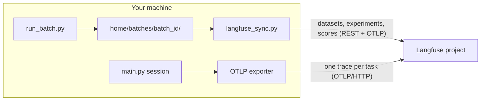

# Langfuse Integration Runbook

A step-by-step guide to connecting AutoBrowser to Langfuse, with every command in the order
you run them. It is the hands-on companion of two reference guides that explain the data in
depth:

- [Eval Platform Guide](eval-platform.md) — batch results as datasets, experiments and scores
  (`scripts/langfuse_sync.py`, the `eval_platform` settings);
- [Trace Export Guide](telemetry.md) — the live OTLP export of interactive sessions (the
  `telemetry` settings).

Decision records: [ADR-2026-10-31](../decisions/2026-10-31-langfuse-platform-integration.md)
(datasets, experiments, scores) and [ADR-2026-10-29](../decisions/2026-10-29-otlp-trace-export.md)
(OTLP export). Diagrams: [Eval Platform Sync](../diagrams/eval-platform-sync.md) and
[Trace Export](../diagrams/trace-export.md). Commands are PowerShell, run from the repository
root.

## 0. Two Channels, One Project

AutoBrowser reaches Langfuse in two independent ways. You can turn on either one or both, in
the same Langfuse project.

| | Batch sync (eval platform) | Live trace export (telemetry) |
|---|---|---|
| What | `scripts/run_batch.py` runs of a suite → a dataset, one experiment per batch, scores | every task of a session (`main.py`, `main.py -p`) → one trace |
| Built | after the batch, from the batch folder | when each task ends, from the session events |
| Transport | REST (`httpx`) + OTLP/JSON, no SDK | OpenTelemetry OTLP/HTTP exporter (`uv sync --group otel`) |
| Settings | `eval_platform.*` | `telemetry.*` |
| Verdict | stays local: `compare_batches.py` | none: traces are for viewing |
| Langfuse environment | `batch` (`eval_platform.environment`) | your `telemetry.environment` |



A batch that is synced turns the live export off for its own sessions, so a batch run is never
sent twice.

## 1. Prerequisites

```powershell
uv sync                       # the project environment
uv sync --group otel          # only for the live trace export (step 7)
uv run main.py doctor         # paths, config source, the eval platform and telemetry lines
```

- A Langfuse account: Cloud EU `https://cloud.langfuse.com`, Cloud US
  `https://us.cloud.langfuse.com`, or a self-hosted Langfuse **4.59.0 or newer**.
- The AutoBrowser home: `AUTOBROWSER_HOME`, else `~/.autobrowser`. Secrets go to
  `<home>/.env`, never to a committed file.
- Know which profile wins. A YAML profile (`<home>/config.yaml` or the repository's
  `config.yaml`) outranks the environment and `.env`. If it sets `eval_platform.enabled: false`,
  your `.env` line does not count. `uv run main.py doctor` prints the config source.

## 2. Create the Project and the Keys

1. In Langfuse, create a separate project for AutoBrowser.
2. Project → **Settings → API Keys → Create new API keys**. Copy the public key (`pk-lf-…`) and
   the secret key (`sk-lf-…`). The secret is shown once.
3. Note the region of the host the keys belong to: EU keys fail against the US host with
   HTTP 401.

## 3. Configure `<home>/.env`

Open the file (it is created if missing):

```powershell
New-Item -ItemType Directory -Force "$HOME\.autobrowser" | Out-Null
notepad "$HOME\.autobrowser\.env"
```

### 3.1 Batch sync

```dotenv
AUTOBROWSER_EVAL_PLATFORM__ENABLED=true
AUTOBROWSER_EVAL_PLATFORM__HOST=https://cloud.langfuse.com
AUTOBROWSER_EVAL_PLATFORM__PUBLIC_KEY=pk-lf-...
AUTOBROWSER_EVAL_PLATFORM__SECRET_KEY=sk-lf-...
```

Optional settings (defaults in brackets; all of them are in `config.example.yaml` and
`.env.example`):

```dotenv
# What a run produced may leave the machine: none [default] | answers | redacted.
# The LLM judge needs at least answers; the trajectory judge needs redacted to see tool results.
AUTOBROWSER_EVAL_PLATFORM__CAPTURE_CONTENT=none
# run_batch.py syncs right after the batch [true]; its time budget [300 s].
AUTOBROWSER_EVAL_PLATFORM__AUTO_SYNC=true
AUTOBROWSER_EVAL_PLATFORM__SYNC_TIMEOUT_SECONDS=300.0
# The annotation queue for failed scenarios [unset: no queue] (step 9).
AUTOBROWSER_EVAL_PLATFORM__TRIAGE_QUEUE=autobrowser-triage
```

Self-hosted: change only `HOST`, for example `http://localhost:3000`. There is no trailing slash
and no default host in the code.

### 3.2 Live trace export (optional)

The OTLP exporter authenticates with a `Basic` header: the Base64 of `public:secret`. To build
it without echoing the secret into the shell history:

```powershell
$public = Read-Host "Langfuse public key"
$secret = Read-Host "Langfuse secret key" -AsSecureString
$plain  = [Net.NetworkCredential]::new("", $secret).Password
[Convert]::ToBase64String([Text.Encoding]::UTF8.GetBytes("${public}:${plain}"))
Remove-Variable plain, secret
```

```dotenv
AUTOBROWSER_TELEMETRY__OTLP_ENABLED=true
AUTOBROWSER_TELEMETRY__OTLP_ENDPOINT=https://cloud.langfuse.com/api/public/otel/v1/traces
AUTOBROWSER_TELEMETRY__OTLP_HEADERS={"Authorization": "Basic <base64>", "x-langfuse-ingestion-version": "4"}
AUTOBROWSER_TELEMETRY__ENVIRONMENT=interactive
AUTOBROWSER_TELEMETRY__ATTRIBUTE_ALIASES={"autobrowser.batch.id": "langfuse.trace.metadata.batch_id", "autobrowser.scenario.id": "langfuse.trace.metadata.scenario_id", "vcs.ref.head.revision": "langfuse.release"}
```

- Without `x-langfuse-ingestion-version: 4`, traces show up only after 10–15 minutes.
- The aliases make batch and scenario ids filterable trace metadata and the git commit the
  release. For a judge on the task span, also set `AUTOBROWSER_TELEMETRY__TRAJECTORY=true` and
  add `"autobrowser.trajectory": "langfuse.observation.metadata"` to the aliases.
- `AUTOBROWSER_TELEMETRY__CAPTURE_CONTENT` is `none` [default] or `redacted`. With `redacted`,
  task texts, answers and tool results, which are page text, leave the machine.

## 4. Check the Connection and Prepare the Project

```powershell
uv run main.py doctor                       # offline: "eval platform  enabled · host … · keys set · content none"
                                            # and the telemetry line: endpoint, headers count, exporter installed
uv run scripts/langfuse_sync.py doctor      # network: server version, project of the keys, score configs
uv run scripts/langfuse_sync.py setup       # creates the score configs (and the annotation queue, if named)
uv run scripts/langfuse_sync.py doctor      # now: "ok  configs  score configs N of N"
```

`setup` is idempotent. Run it again after an upgrade that changes the score vocabulary:
outdated configs are archived and new ones created.

## 5. Push the Datasets

Three suites can be synced (`SUITES` in `scripts/langfuse_bridge/datasets.py`). Any other tasks
file is never synced.

| Suite | File | Dataset |
|---|---|---|
| `golden` | `tests/golden/tasks.jsonl` | `autobrowser/golden` |
| `smoke` | `tests/golden/smoke.jsonl` | `autobrowser/smoke` (2 quick scenarios, to check the setup) |
| `benchmark` | `tests/golden/benchmark.jsonl` | `autobrowser/benchmark` (31 scenarios, tagged easy/medium/hard) |

```powershell
uv run scripts/langfuse_sync.py dataset push --suite smoke --dry-run   # reads only the file
uv run scripts/langfuse_sync.py dataset push --suite smoke
uv run scripts/langfuse_sync.py dataset push --suite golden
uv run scripts/langfuse_sync.py dataset push --suite benchmark
uv run scripts/langfuse_sync.py dataset status --suite golden          # added / changed / archived / edited in the UI
```

- Only changed scenarios are sent. A removed scenario is archived, never deleted.
- `dataset push` refuses a tasks file that differs from git `HEAD`: commit first, or pass
  `--allow-dirty`, which records the push as dirty.
- `--tasks PATH` overrides the suite's file.
- Every push appends a row to `<home>/batches/platform_datasets.jsonl` (the git version ↔ the
  Langfuse version).
- Do not edit datasets in the UI: the next push of a change overwrites the edit.

A batch syncs its dataset itself, so this step is optional. It is useful to see the datasets
before the first run.

## 6. Run a Batch and See It in Langfuse

Start with the smoke suite. The batch needs Chrome and the MCP browser server like any
session.

```powershell
uv run scripts/run_batch.py --tasks tests\golden\smoke.jsonl --continue-on-error --grade
```

With `enabled` and `auto_sync`, the batch is synced right after it ends. The summary goes to
stderr; stdout stays the batch JSON. A sync problem is a warning and never changes the batch's
exit code. Then:

```powershell
uv run scripts/langfuse_sync.py status                     # every synced batch: state, exported/total, experiment URL
uv run scripts/compare_batches.py                          # the local verdict, plus "langfuse: <batch> <url>"
```

In Langfuse: **Datasets → autobrowser/smoke → Experiments** lists the run. **Compare** shows
runs side by side; an item opens its trace (a root `scenario …` over the `invoke_agent
autobrowser` task trees). The experiment name reads
`smoke · <UTC start> · <commit>[*] · <model> · <batch>`.

The full suites:

```powershell
uv run scripts/run_batch.py --tasks tests\golden\tasks.jsonl --continue-on-error --grade
uv run scripts/run_batch.py --tasks tests\golden\benchmark.jsonl --continue-on-error --grade
uv run scripts/run_batch.py --tasks tests\golden\tasks.jsonl --continue-on-error --grade --no-platform-sync   # this run stays local
```

## 7. Sync by Hand

Use this when `auto_sync` is off, a sync was partial, or you want to inspect first. Batch
folders are `<home>/batches/<batch_id>/`. `--batch` takes the id or the directory.

> **Pass the batch's suite.** `experiment push` defaults to `--suite golden` and does not check
> which tasks file the batch ran. A smoke or benchmark batch needs `--suite smoke` or
> `--suite benchmark`. The same holds for `--pending`, which syncs every unfinished batch
> against the one suite you name.

```powershell
uv run scripts/langfuse_sync.py experiment push --batch <batch_id> --dry-run          # the plan, reads only files
uv run scripts/langfuse_sync.py experiment push --batch <batch_id>                    # a golden batch
uv run scripts/langfuse_sync.py experiment push --batch <batch_id> --suite smoke      # a smoke batch
uv run scripts/langfuse_sync.py experiment push --pending                             # every unfinished golden batch
uv run scripts/langfuse_sync.py experiment push --pending --suite benchmark
uv run scripts/langfuse_sync.py status --batch <batch_id>
uv run scripts/langfuse_sync.py status --verify            # traces with more observations than spans (duplicates)
```

Each synced batch keeps a ledger, `<batch_dir>/platform_sync.json` (ids and states, no keys).
Every trace is sent exactly once: rerunning a push only sends what is still `pending`, or
`unknown` after `verify_grace_seconds` and a check against the server.

## 8. Live Traces of Interactive Sessions

With step 3.2 configured:

```powershell
uv run main.py doctor                                         # telemetry line: ok, exporter installed
uv run main.py -p "Open https://example.com and report the page title"
uv run main.py                                                # the terminal UI; every task is a trace
```

In Langfuse: **Tracing → Traces**, filter by environment `interactive` (or yours). **Sessions**
groups the tasks of one AutoBrowser session. With `capture_content=none` you see the tree,
timings, models, tokens, tool names and statuses, but no texts.

## 9. Judges, the Annotation Queue and Pulling Scores

These steps happen in the Langfuse UI. The full prompts and variable mappings are in the
[Eval Platform Guide](eval-platform.md#llm-judge).

1. **Content.** Set `AUTOBROWSER_EVAL_PLATFORM__CAPTURE_CONTENT=answers` for the answer judge,
   or `redacted` for the trajectory judge. Do this only if sending answers or page text is
   acceptable for every site of the suite.
2. **LLM connection.** Settings → LLM Connections → a model with structured outputs.
3. **Answer judge.** Evaluators → new LLM-as-a-judge on observations, dataset
   `autobrowser/golden`, the item root. Variables `{{input}}`, `{{output}}` and
   `{{expected_output}}`; score `judge.fields` (boolean) or `judge.quality` (0–1).
4. **Trajectory judge.** The same, with `{{trajectory}}` mapped to the root's Metadata, JSONPath
   `$.full_trajectory`; score `judge.trajectory`.
5. **Annotation queue.** Set `AUTOBROWSER_EVAL_PLATFORM__TRIAGE_QUEUE`, then run
   `uv run scripts/langfuse_sync.py setup`. Later syncs queue failed scenarios
   (`triage_kinds`, at most `triage_max_items` per batch) with the `human.verdict` and
   `human.comment` scores.
6. **Keep the scores locally.** Langfuse Cloud Hobby keeps data for 30 days:

   ```powershell
   uv run scripts/langfuse_sync.py scores pull --batch <batch_id>   # -> <batch_dir>/platform_scores.jsonl
   ```

Judge and reviewer scores are informational: nothing in `failure_kind`, `compare_batches.py`
or a gate reads them.

## 10. Recovery

| Situation | Command |
|---|---|
| `run_batch.py` warned `langfuse sync … is partial` / `failed` | `uv run scripts/langfuse_sync.py experiment push --pending [--suite …]` |
| Scores `rejected` in `status` (a category the config lacks) | `uv run scripts/langfuse_sync.py setup`, then `experiment push --batch <id> --retry-rejected` |
| New project or keys, or you deleted the experiment (`pass --new-attempt`) | `uv run scripts/langfuse_sync.py experiment push --batch <id> --new-attempt` (experiment `<id>.2`, new ids) |
| Possible duplicates after network trouble | `uv run scripts/langfuse_sync.py status --verify` |
| A sync is stuck on the lock | wait: `platform_sync.lock` is taken over after `2 × sync_timeout_seconds` |
| `dataset push` refuses a dirty file | commit `tests/golden/*.jsonl`, or add `--allow-dirty` |
| HTTP 401 | wrong keys, or EU keys against the US host |
| `the server reports version …` | self-hosted Langfuse older than 4.59.0 |
| Live traces appear 10–15 minutes late | the `x-langfuse-ingestion-version: 4` header is missing |
| A session refuses to start: `uv sync --group otel` | live export on, exporter group not installed |

More symptoms: [eval platform troubleshooting](eval-platform.md#recovery-and-troubleshooting)
and [trace export troubleshooting](telemetry.md#troubleshooting).

## 11. Turning It Off

```dotenv
AUTOBROWSER_EVAL_PLATFORM__ENABLED=false     # no batch sync; the batch folders are unaffected
AUTOBROWSER_TELEMETRY__OTLP_ENABLED=false    # no live export
```

For a single run, use `--no-platform-sync` on `run_batch.py`. Everything in Langfuse can be
rebuilt from the batch folders: `experiment push --batch <id> --new-attempt` against a fresh
project.

## 12. Exit Codes of `langfuse_sync.py`

| Code | Meaning |
|---|---|
| `0` | synced, or nothing to do |
| `1` | partly synced (an outage, traces pending or unknown, rejected scores, a held lock): rerun later |
| `2` | usage or configuration: platform disabled, keys missing or rejected (401/403), server older than 4.59.0, an unfinished or pre-contract batch, another project without `--new-attempt`, a dirty tasks file |

## 13. Testing the Bridge Without a Network

The bridge tests run against `tests/platform_fixtures/fake_langfuse.py` (`FakeLangfuse`) and
a sample batch folder; no keys and no network are needed:

```powershell
uv run pytest tests\test_langfuse_client.py tests\test_langfuse_datasets.py tests\test_langfuse_experiments.py tests\test_langfuse_scores.py tests\test_langfuse_sync.py tests\test_langfuse_sync_script.py tests\test_platform_records.py
uv run pytest tests\test_otel_spans.py tests\test_otel_trajectory.py tests\test_otel_sink.py
```

## Command Reference

```powershell
# setup
uv sync --group otel
uv run main.py doctor
uv run scripts/langfuse_sync.py doctor
uv run scripts/langfuse_sync.py setup

# datasets
uv run scripts/langfuse_sync.py dataset push   [--suite golden|smoke|benchmark] [--tasks PATH] [--allow-dirty] [--dry-run]
uv run scripts/langfuse_sync.py dataset status [--suite golden|smoke|benchmark] [--tasks PATH]

# batches
uv run scripts/run_batch.py --tasks tests\golden\smoke.jsonl     --continue-on-error --grade [--no-platform-sync]
uv run scripts/run_batch.py --tasks tests\golden\tasks.jsonl     --continue-on-error --grade
uv run scripts/run_batch.py --tasks tests\golden\benchmark.jsonl --continue-on-error --grade
uv run scripts/compare_batches.py

# experiments
uv run scripts/langfuse_sync.py experiment push --batch ID|DIR [--suite …] [--new-attempt] [--retry-rejected] [--dry-run]
uv run scripts/langfuse_sync.py experiment push --pending      [--suite …]
uv run scripts/langfuse_sync.py status [--batch ID|DIR] [--verify]

# scores
uv run scripts/langfuse_sync.py scores pull --batch ID|DIR
```
