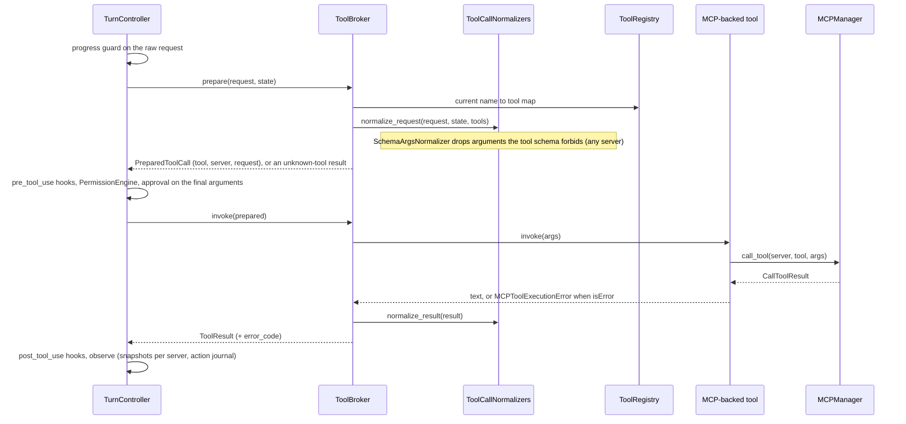

# Tool Call Normalization

This diagram shows how `ToolBroker` (`src/agent_loop/execution/tools.py`) folds every tool call
through stateless `ToolCallNormalizer`s: `prepare` normalizes the request and resolves the tool,
the engine runs `pre_tool_use` hooks and the `PermissionEngine` on the **final** arguments,
and `invoke` runs the tool and normalizes its result. It replaces the former `BrowserProvider`
boundary (see
[ADR-2026-09-28: Universal MCP Manager](../decisions/2026-09-28-universal-mcp-manager.md)).

Normalizers hold no tools and do no ref rewriting or snapshot lookups; no normalizer looks at
tool names. Deterministic tests use `tests/mcp_fixtures/fake_server.py` (a real MCP server)
or the `_FakeBrowserTools` helper of `src/agent_loop/evals.py`, without Chrome or CDP.
