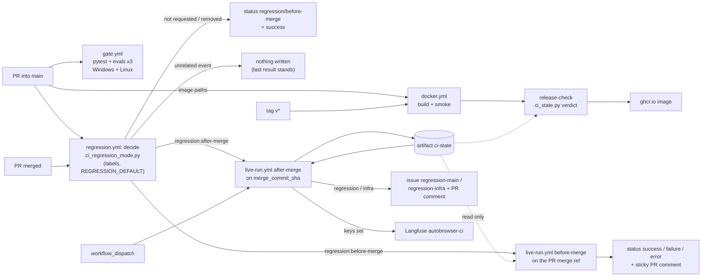
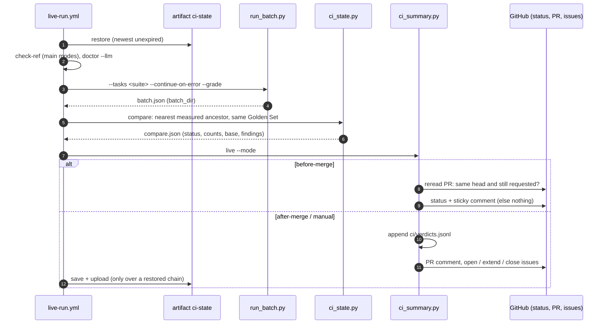

# CI/CD Pipeline

The offline gate on every pull request, the optional live regression runs around merges into
`main`, the `ci-state` artifact chain, Langfuse, and the stand image. Design:
[Regression and Langfuse in CI/CD](../development/2026-11-10-regression-ci-cd-design.md);
decision: [ADR-2026-11-10](../decisions/2026-11-10-regression-and-langfuse-in-ci-cd.md); usage:
[Testing Pipeline Guide](../development/testing-pipeline.md#live-regression-in-ci).

## Levels and Triggers

## One Live Run

