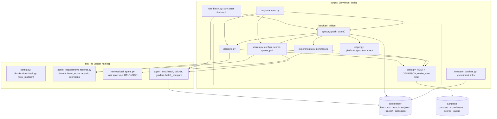
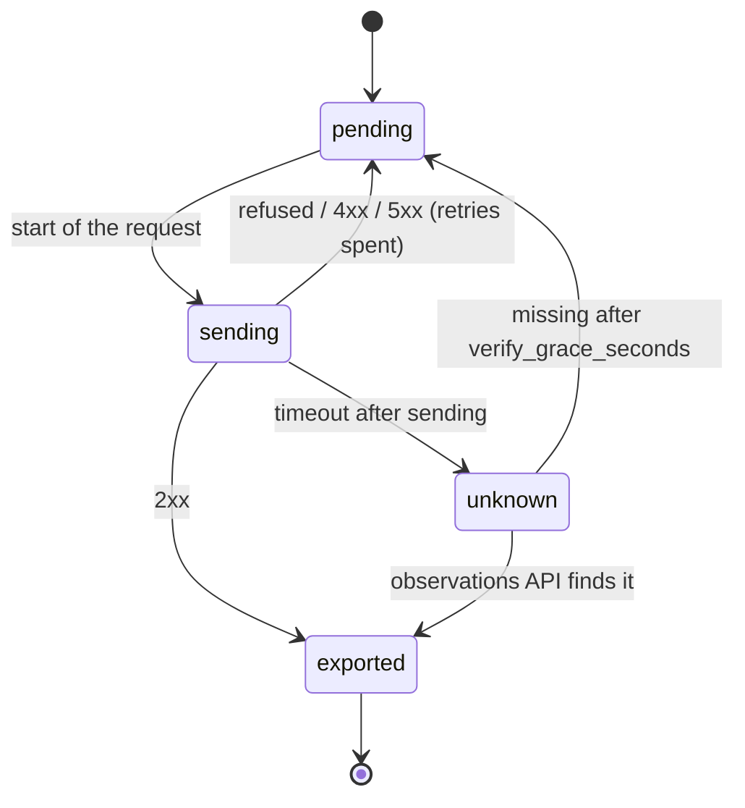

# Eval Platform Sync

How a finished batch folder becomes a Langfuse dataset version, experiment and scores, and the
states of one experiment trace. See the [Eval Platform Guide](../development/eval-platform.md) and
[ADR-2026-10-31](../decisions/2026-10-31-langfuse-platform-integration.md).

## Components and Boundaries



## One Sync

```mermaid
sequenceDiagram
    autonumber
    participant RB as run_batch.py / langfuse_sync.py
    participant S as push_batch()
    participant L as platform_sync.json
    participant LF as Langfuse
    RB->>S: batch folder, budget
    S->>L: lock (O_EXCL), read state
    S->>LF: GET health, projects
    alt unreachable or rejected
        S->>L: pending, last_error
    else reachable
        S->>LF: dataset push (only changed items) when the batch ran on the current set
        loop every scenario not exported
            S->>L: sending
            S->>LF: POST /otel/v1/traces (item trace)
            S->>L: exported, or unknown on a timeout after sending
        end
        S->>LF: POST /scores (fixed ids; 207 recorded, not retried)
        S->>LF: annotation queue items (new failures)
        S->>L: complete, experiment url
    end
    S-->>RB: report (the batch's exit code is unchanged)
```

## Experiment Trace States


