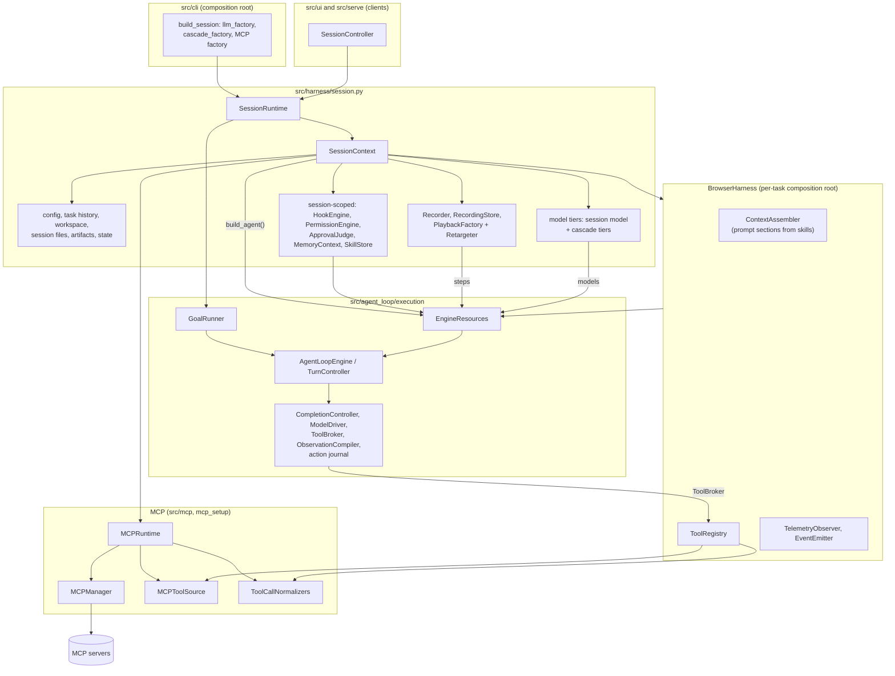

# Harness Boundaries

This diagram shows how `SessionRuntime` coordinates lifecycle through
`SessionContext`, while `BrowserHarness` is the composition root whose
collaborators `EngineResources.from_harness` bundles for the engine-native
`AgentLoopEngine`, together with the session-scoped ones. `SessionRuntime.start()` asks
`SessionContext.build_agent()` for the `Agent` once; front ends and the stand reach the
session only through `SessionController`.

The boundary is intentional: `SessionRuntime` coordinates interaction lifecycle,
`SessionContext` owns session-scoped state and resources, `BrowserHarness` is a
pure composition root (no graph), and `AgentLoopEngine` owns reasoning and state
transitions over a frozen `LoopState`. MCP servers are owned by the session-scoped
`MCPRuntime` (see [MCP Runtime](mcp-runtime.md)); tools reach `ToolRegistry`
through `MCPToolSource`, and name/argument adaptation is done by stateless
`ToolCallNormalizer`s folded by `ToolBroker`, not by the engine. Conversation history is not a harness or `EngineResources` resource:
`src/harness/memory.py` provides functional message-shaping helpers the engine
calls, and the durable `list[Message]` is carried on `LoopState.messages` /
`SessionContext.state`. `SessionRuntime` carries useful state between tasks
through `SessionContext.state` and resets task-local fields before the next run,
while session metadata remains available in `<home>/sessions/<session_id>/`.

Lifecycle hooks are session-scoped, not a harness resource: `SessionContext.initialize`
loads `HookEngine.from_settings(settings.hooks)` before Chrome/MCP start (a broken registry
fails startup) and `SessionContext.build_agent()` passes it through
`EngineResources.from_harness(..., hooks=...)`. Anything that builds `EngineResources`
without `hooks=` — evals, tests — gets a `NullHookEngine`, so a personal `config.yaml` never
changes them. The engine never hands `LoopState` to a hook; hook decisions are emitted as
`hook.decided` through the same `EventEmitter` the `GoalRunner` watchdog polls.

The `PermissionEngine` follows the same pattern: `SessionContext.initialize` builds it from
`settings.permissions` before Chrome/MCP start (a clashing rule id fails startup), it holds the
session's approval grants across tasks, and `build_agent()` passes it through
`EngineResources.from_harness(..., permissions=...)`. Without it, `EngineResources` gets a
`PermissionEngine.from_settings()`: the code-default settings (no rules, `default` mode), never
the personal config.

No tool name decides anything. The `ObservationCompiler` gets the server and the
`readOnlyHint` of every call: a successful read-only call stores its output as that server's
snapshot, a successful state-changing call of the server drops it, other servers are
untouched. The session hands `ContextAssembler` its prompt sections: the always-on skills
(the browser rules iff a browser server is configured) and, with `skills.enabled`, the
`Skills` catalog whose bodies the model loads with the `skill_view` harness tool. Neither the
engine nor the assembler knows the skill modules or the tool name
(`tests/test_skill_boundaries.py`). The engine imports nothing from `src/browser/`
(`tests/test_engine_boundaries.py`).

The model tiers come ready-made: `src/cli/models.py` turns each `cascade.tiers` entry into a
`ChatModel` with the provider registry and hands the session a `CascadeFactory`, called once
per session. `SessionContext.model_tiers()` puts the session model first (tier 0, the one
`/model` switches) and the cascade tiers after it; `build_agent` passes them as
`EngineResources.models` and gives the `Retargeter` the `cascade.retarget_tier`. Neither the
session nor the engine imports `src.providers`. Chat channels (`src/channels/`) are wired by
`src/cli/serve.py` only and reach the stand through its neutral ports.
