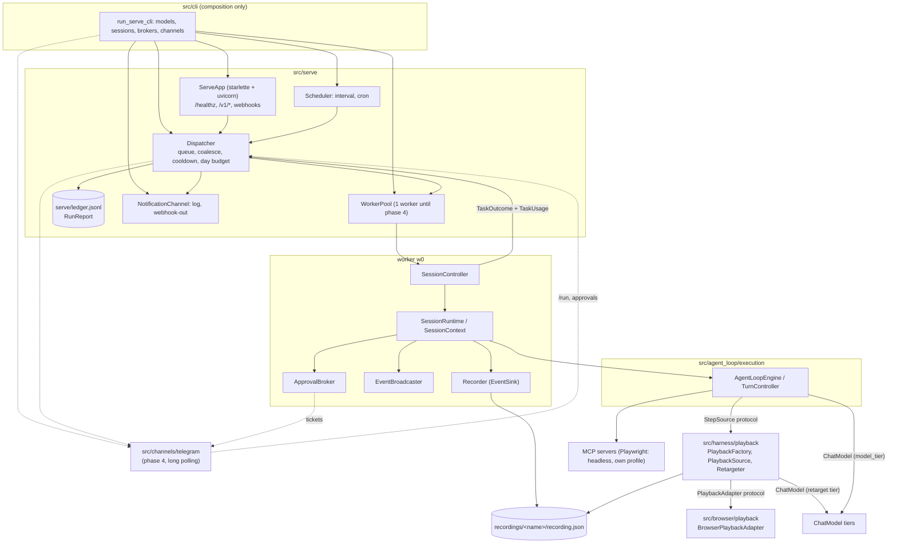
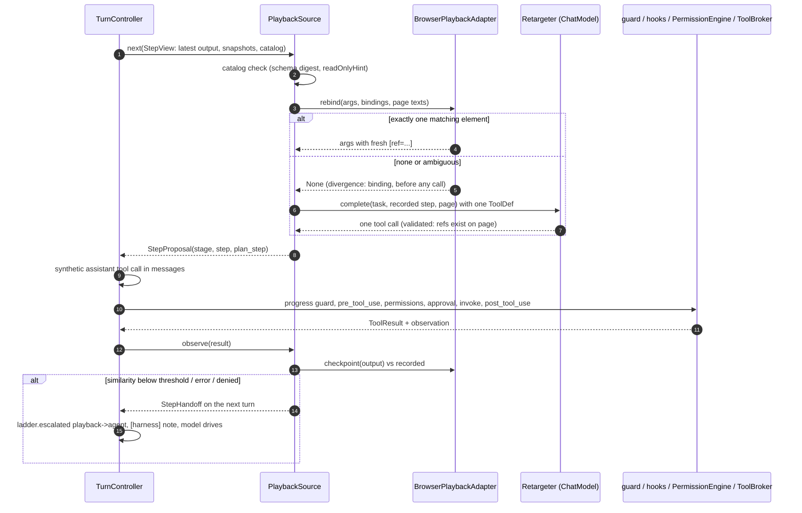

# Serve Mode

Accepted design (2026-11-02). This diagram shows the design, not the code that exists today. It covers the stand
process (`autobrowser serve`), the cost ladder and replay (playback of a recording) inside the
engine.
Design: [serve mode design](../development/2026-11-02-serve-mode-design.md);
ADR: [2026-11-02 serve mode and cost ladder](../decisions/2026-11-02-serve-mode-and-cost-ladder.md).

## Components and Boundaries

`src/serve/` is a client of `SessionController`, as the terminal UI is. The engine sees only
the neutral protocols in `src/contracts.py`. Playback lives in `src/harness/`, page-format
knowledge lives in `src/browser/`, and vendor channels live in `src/channels/`. Only
`src/cli/` wires these pieces together.

Import fences (tests):

- `src/serve` does not import `src.agent_loop.execution`, `src.browser`, `src.cli`,
  `src.providers` or `src.channels`.
- `src/agent_loop` and `src/harness` do not import `src.serve` or `src.channels`.
- The engine imports no `src.browser` and holds no `browser_*` literals.

## Cost Ladder

A run starts at the lowest rung its job allows. It climbs only when the rung below cannot
finish, and never above `RunProfile.max_stage`. Each climb emits `ladder.escalated`.

## One Replayed Step

Every proposal goes through the normal tool pipeline, whether it comes from the recording, the
retarget model or the agent.

