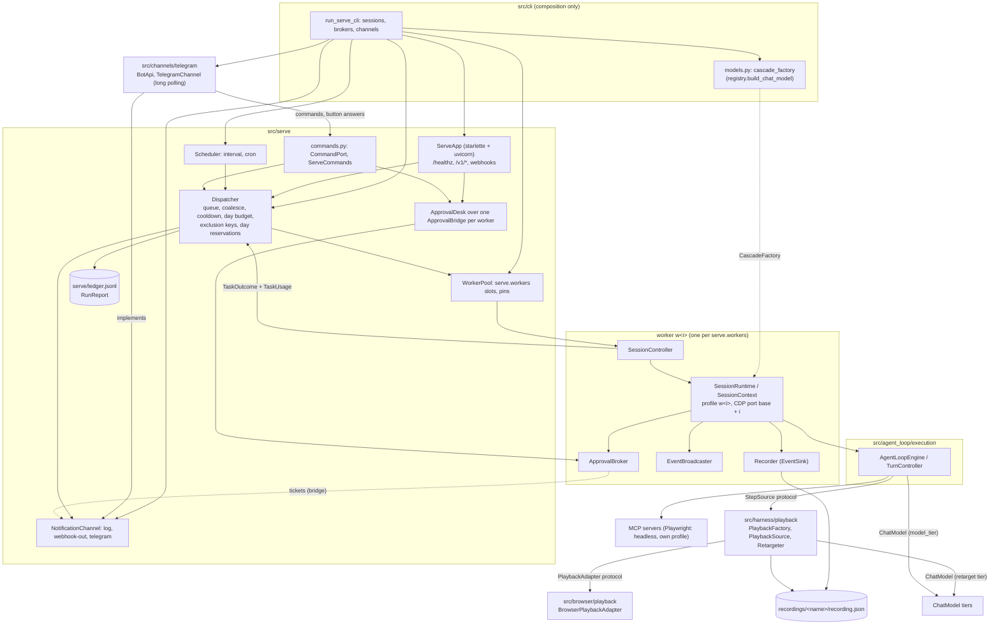
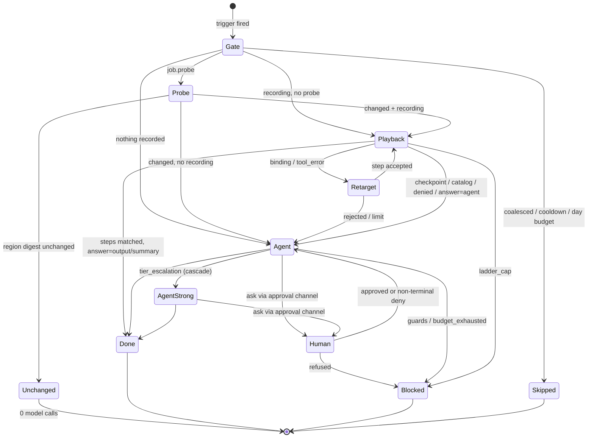
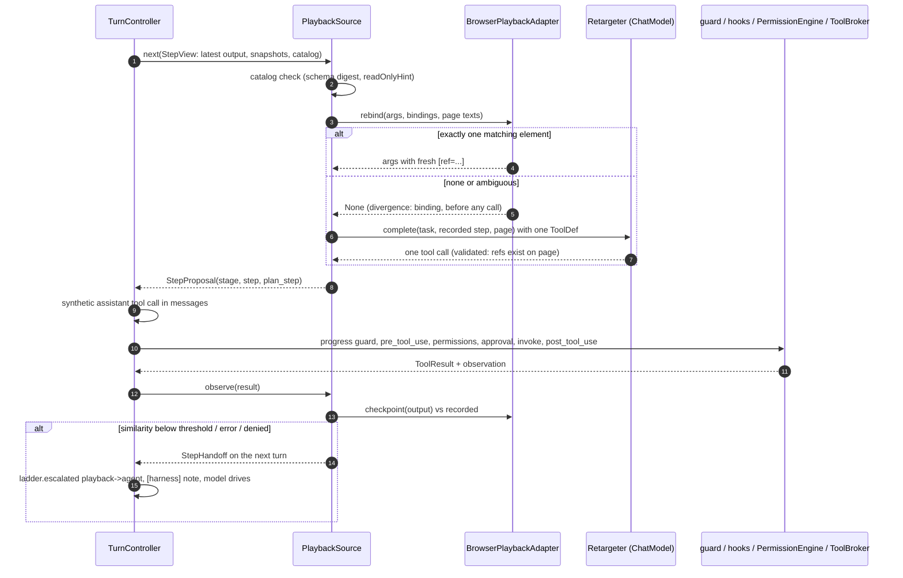
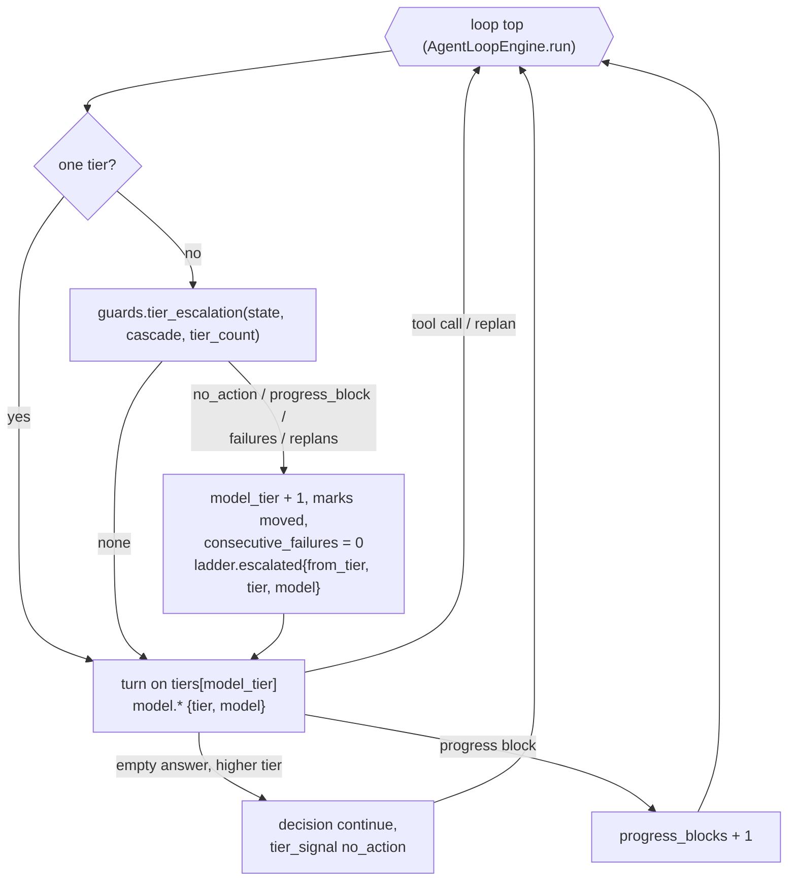
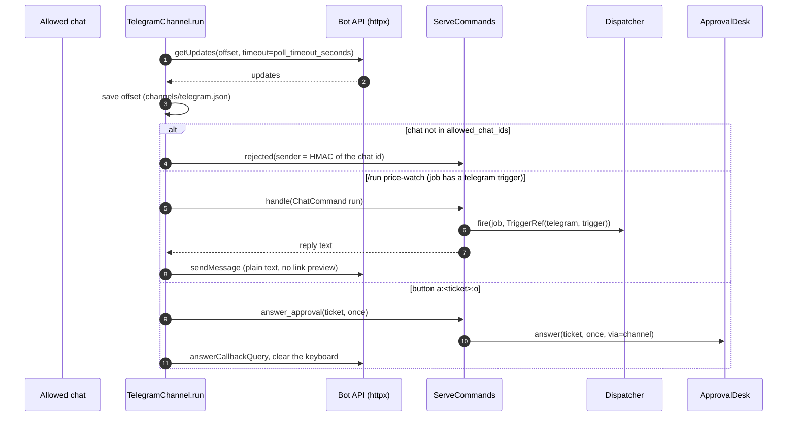
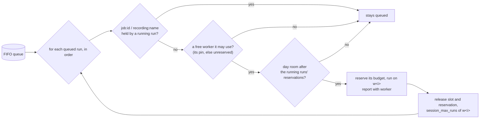

# Serve Mode

Accepted design (2026-11-02), implemented in full: replay and budgets (phase 1, 2026-11-02),
the minimal stand (phase 3, 2026-11-09) and phase 4 (2026-11-09): the worker pool, model tiers
(cascade) and the Telegram channel. It covers the stand process (`autobrowser serve`), the cost
ladder and replay (playback of a recording) inside the engine. Guide:
[serve mode](../development/serve-mode.md).
Design: [serve mode design](../development/2026-11-02-serve-mode-design.md),
[phase 4 design](../development/2026-11-08-serve-mode-phase4-design.md);
ADRs: [2026-11-02 serve mode and cost ladder](../decisions/2026-11-02-serve-mode-and-cost-ladder.md),
[2026-11-09 cascade, chat channels and the worker pool](../decisions/2026-11-09-cascade-channels-and-worker-pool.md).

## Components and Boundaries

`src/serve/` is a client of `SessionController`, as the terminal UI is. The engine sees only
the neutral protocols in `src/contracts.py`. Playback lives in `src/harness/`, page-format
knowledge lives in `src/browser/`, and vendor channels live in `src/channels/`. Only
`src/cli/` wires these pieces together.

Import fences (tests):

- `src/serve` does not import `src.agent_loop.execution`, `src.browser`, `src.cli`,
  `src.providers`, `src.harness` or `src.channels` (`tests/test_serve_boundaries.py`).
- `src/channels` imports only `src.config`, `src.contracts` and the neutral ports
  `src.serve.{commands,notify,clock}`; only `src/cli/` imports it; the vendor host appears in
  `src/channels/telegram.py` only; neither package uses threads.
- `src/agent_loop`, `src/harness`, `src/ui`, `src/browser`, `src/mcp` and `src/providers` do
  not import `src.serve`; only `src/cli/serve.py` composes the stand.
- The engine imports no `src.browser` and holds no `browser_*` literals.

## Cost Ladder

A run starts at the lowest rung its job allows. It climbs only when the rung below cannot
finish, and never above `RunProfile.max_stage`. Each climb emits `ladder.escalated`.

## One Replayed Step

Every proposal goes through the normal tool pipeline, whether it comes from the recording, the
retarget model or the agent.

## Model Tier Escalation

With `cascade.enabled` the agent starts on tier 0 (the session model) and the engine checks,
before every turn, whether it is stuck. The tier only goes up; call #0 is always tier 0, a
replan runs on the current tier, a retarget on `cascade.retarget_tier`.

## Telegram Channel

Long polling, no inbound port. The offset is saved before the updates are handled, so a
restart never repeats a command.

## Worker Pool

