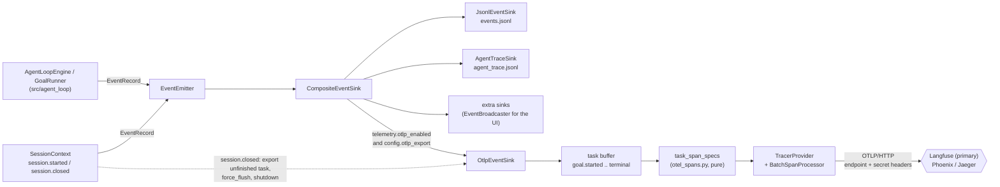
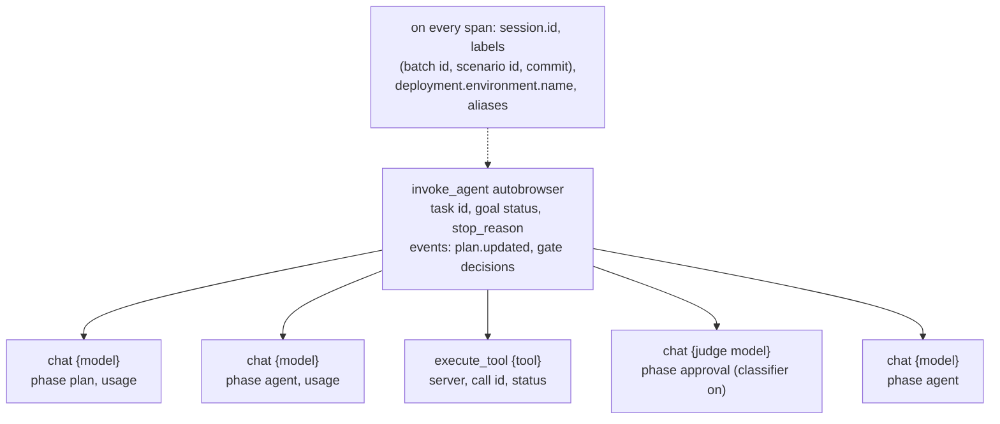

# Trace Export

How a session's events reach a trace backend over OTLP, and the span tree of one task. See the
[Trace Export Guide](../development/telemetry.md) and
[ADR-2026-10-29: Neutral OTLP Trace Export](../decisions/2026-10-29-otlp-trace-export.md).

## Events to Sinks to the Backend

`src/agent_loop/` only emits events: it imports neither the sink nor OpenTelemetry
(`tests/test_engine_boundaries.py`). `capture_content`, the environment and the attribute
aliases are applied in `task_span_specs`; the SDK only materializes the specs, each span once.

## Span Tree of One Task

