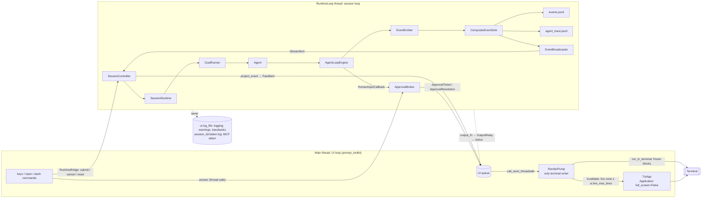
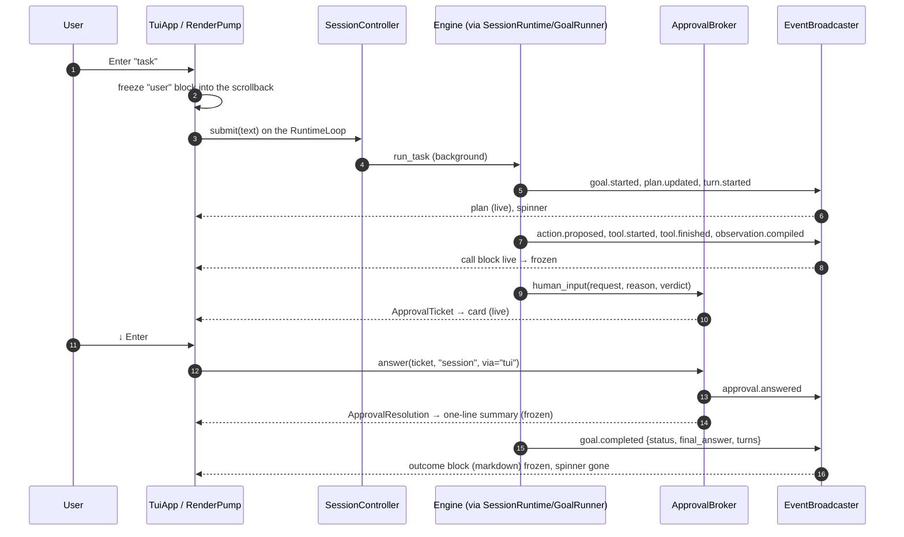

# UI Integration

How the terminal UI talks to the session (`src/ui/`, `src/cli/bootstrap.run_frontend_cli`).
Design: [terminal UI design](../development/2026-10-19-gui-redesign-design.md) §5.3–§5.4;
guide: [terminal UI](../development/terminal-ui.md).

## Threads and the single writer

## A task with an approval

Esc or Ctrl+C during a task call `SessionController.cancel()`; `GoalRunner` emits
`goal.cancelled` and the session closes the `TaskRecord`.
